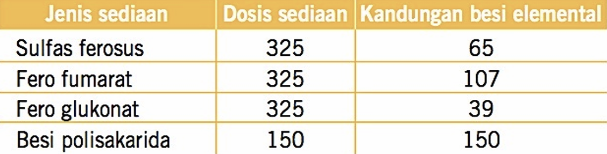

# 1. Definisi dan Pentingnya Anemia dalam Kehamilan

- Anemia adalah keadaan ketika **jumlah eritrosit dan/atau kapasitas darah membawa oksigen tidak mencukupi** kebutuhan fisiologis tubuh. 
- Pada kehamilan, anemia penting dikenali sejak antenatal karena kebutuhan zat besi meningkat, volume plasma bertambah, dan anemia dapat memperburuk toleransi ibu terhadap perdarahan saat persalinan.
- Anemia pada ibu juga berkaitan dengan peningkatan kerentanan terhadap infeksi, gangguan kondisi ibu, serta luaran perinatal yang kurang baik, seperti **pertumbuhan janin terhambat (IUGR), kelahiran prematur, dan berat badan lahir rendah (BBLR)**. BBLR dapat berkontribusi terhadap anemia pada neonatus dan mempertahankan siklus anemia antargenerasi.

# 2. Perubahan Fisiologis dan Patofisiologi

- Selama kehamilan, **volume plasma meningkat lebih besar daripada peningkatan massa eritrosit**. Akibatnya, konsentrasi hemoglobin dapat menurun karena **hemodilusi fisiologis**, terutama pada trimester II.
- Kebutuhan zat besi meningkat untuk mendukung ekspansi massa eritrosit ibu, pertumbuhan janin, dan plasenta. Cadangan zat besi sebelum hamil sering kali tidak cukup untuk memenuhi kebutuhan tambahan ini.
- Jika asupan atau cadangan zat besi tidak memadai, pembentukan hemoglobin terganggu dan dapat terjadi anemia defisiensi besi.
- Anemia berat menurunkan kemampuan pengangkutan oksigen. **Pada Hb <11 g/dL, dapat terjadi penurunan jumlah sel T dan B yang menyebabkan ibu lebih rentan terhadap infeksi**. Pada Hb <8 g/dL, penurunan tersebut akan lebih bermakna.
- Dampak pada ibu yang perlu diwaspadai meliputi toleransi buruk terhadap kehilangan darah, kebutuhan transfusi yang lebih tinggi, infeksi puerperium, dan pada keadaan berat dekompensasi jantung. Dampak pada janin/neonatus meliputi IUGR, prematuritas, dan BBLR.

**Tips mengingat:** kehamilan meningkatkan kebutuhan zat besi sekaligus mengencerkan darah. Hemodilusi dapat menurunkan Hb secara fisiologis, tetapi cadangan besi yang tidak mencukupi dapat menyebabkan anemia patologis.

# 3. Etiologi dan Faktor Predisposisi

## Penyebab utama

- **Asupan zat besi atau nutrisi tidak memadai**, termasuk folat dan vitamin B12.
- **Bioavailabilitas zat besi rendah** atau absorpsi terganggu. Serat dan fitat dalam makanan tertentu dapat menghambat absorpsi; gangguan gastrointestinal juga dapat mengurangi penyerapan.
- **Kehilangan darah kronis**, misalnya perdarahan menstruasi sebelum hamil atau sumber perdarahan lain.
- **Peningkatan kebutuhan selama kehamilan**, terutama pada kehamilan multipel dan polihidramnion.
- **Penyakit kronis** atau kelainan genetik yang memengaruhi pembentukan eritrosit/hemoglobin, misalnya **talasemia**.

## Faktor predisposisi

- Pola makan rendah zat besi, folat, atau vitamin B12.
- Riwayat anemia, perdarahan banyak, atau penyakit kronis.
- Gangguan gastrointestinal yang memengaruhi absorpsi.
- Kehamilan, khususnya bila cadangan zat besi awal rendah atau kehamilan multipel.
- Riwayat keluarga atau dugaan kelainan hemoglobin herediter.
- Pola makan vegetarian dapat meningkatkan risiko bila asupan dan sumber zat besi tidak direncanakan dengan baik.

## Sumber zat besi

Sumber zat besi meliputi daging sapi, ayam, serealia yang difortifikasi, kacang-kacangan, gandum utuh, biji-bijian, dan bayam. Zat besi heme dari daging umumnya lebih mudah diserap daripada zat besi non-heme dari tumbuhan. Vitamin C dapat membantu absorpsi zat besi non-heme.

# 4. Manifestasi Klinis

Gejala anemia dapat tidak spesifik dan meliputi:

- **Lemas, mudah lelah, dan penurunan energi**.
- Kulit atau gusi pucat.
- Pusing hingga hampir pingsan atau sinkop.
- Palpitasi atau denyut jantung terasa tidak teratur.
- Penurunan nafsu makan.
- Glossitis (peradangan lidah).
- **Pica**, yaitu keinginan mengonsumsi benda nonmakanan.
- Mudah mengalami keluhan saat aktivitas.

Gejala saja tidak cukup untuk menentukan jenis atau derajat anemia; diperlukan pemeriksaan laboratorium.

# 5. Penilaian Antenatal dan Anamnesis

Deteksi dini penting agar anemia diketahui sebelum persalinan, ketika kehilangan darah dapat memperberat kondisi ibu.

## Anamnesis

Tanyakan:

- Riwayat anemia dan terapi sebelumnya.
- Riwayat penyakit kronis atau gangguan gastrointestinal.
- Riwayat perdarahan dan menstruasi sebelum hamil.
- Riwayat keluarga dengan anemia atau kelainan hemoglobin.
- Pola makan dan konsumsi suplemen.
- Kelelahan, pusing, palpitasi, penurunan toleransi aktivitas, atau perubahan kondisi fisik.

## Pemeriksaan fisik dan penilaian awal

- Nilai keadaan umum, pucat, gejala, dan tanda klinis anemia.
- Ukur berat badan dan tinggi badan sesuai penilaian antenatal.
- Periksa frekuensi denyut jantung.
- Lakukan pemeriksaan laboratorium, terutama darah lengkap.

# 6. Pemeriksaan Laboratorium

## Darah lengkap

Pemeriksaan yang perlu dinilai meliputi:

- **Hemoglobin (Hb)** untuk menilai anemia dan membantu menentukan derajatnya.
- Jumlah eritrosit.
- Hematokrit.
- Indeks eritrosit: **MCV, MCH, dan MCHC**.
- Leukosit dan trombosit.
- Retikulosit bila diperlukan untuk menilai respons pembentukan eritrosit.
- Apusan darah tepi untuk menilai morfologi eritrosit dan membantu menentukan jenis anemia.

## Ambang Hb menurut trimester #Ingat 

| Trimester | Hb yang menunjukkan anemia |
|---|---:|
| Trimester I | <11 g/dL |
| Trimester II | <10,5 g/dL |
| Trimester III | <11 g/dL |

**Penurunan ambang pada trimester II berkaitan dengan hemodilusi fisiologis**. Ambang dapat berbeda menurut pedoman yang digunakan; interpretasikan Hb berdasarkan usia kehamilan dan pedoman klinis setempat.

## Indeks eritrosit dan morfologi #Ingat

- **MCV <80 fL:** mikrositik, yaitu eritrosit berukuran kecil.
- **MCV 80–99 fL:** normositik.
- **MCV ≥100 fL:** makrositik, yaitu eritrosit berukuran besar.
- **MCH** menggambarkan jumlah rata-rata hemoglobin per eritrosit. Nilai rendah sering menyertai eritrosit mikrositik-hipokromik.

Rumus indeks Mentzer:

**Indeks Mentzer = MCV (fL) ÷ jumlah eritrosit (juta/µL)**

- **<13:** lebih mengarah ke trait talasemia beta.
- **>13:** lebih mengarah ke anemia defisiensi besi. #Ingat 

Indeks Mentzer merupakan alat bantu skrining, bukan penentu diagnosis tunggal. Hasilnya harus dipadukan dengan riwayat, indeks eritrosit lain, ferritin, dan pemeriksaan lanjutan bila diperlukan.

# 7. Diagnosis Banding Anemia Mikrositik

Anemia mikrositik-hipokromik terutama perlu dibedakan antara anemia defisiensi besi dan talasemia.

| Parameter                   | Anemia defisiensi besi                                    | Trait talasemia beta                                                                 |
| --------------------------- | --------------------------------------------------------- | ------------------------------------------------------------------------------------ |
| Penyebab                    | Asupan/cadangan zat besi tidak cukup atau kehilangan besi | Kelainan genetik sintesis hemoglobin                                                 |
| MCV/MCH                     | Rendah; mikrositik-hipokromik                             | Dapat sangat rendah; mikrositosis dapat tampak tidak sebanding dengan derajat anemia |
| Ferritin/zat besi serum     | Umumnya rendah                                            | Normal atau meningkat                                                                |
| HbA2 pada elektroforesis Hb | Biasanya normal                                           | Dapat meningkat; HbA2 >3,5%                                                          |
| Indeks Mentzer              | Biasanya >13                                              | Biasanya <13                                                                         |

## Pemeriksaan lanjutan

Pada anemia mikrositik, pertimbangkan:

- **Ferritin serum** untuk menilai cadangan zat besi.
- Zat besi serum dan **TIBC** (total iron-binding capacity) bila diperlukan, terutama jika ferritin tidak rendah atau diagnosis belum jelas.
- Elektroforesis hemoglobin bila dicurigai talasemia atau kelainan hemoglobin herediter.

Ambang batas diagnosis anemia defisiensi besi adalah jika **ferritin <15 ng/mL** atau **<30 µg/L**. #Ingat 

**Tips mengingat:** Mentzer **kecil (<13) = pikirkan talasemia**; Mentzer **besar (>13) = pikirkan defisiensi besi**. Konfirmasi sesuai kondisi klinis dan pemeriksaan lanjutan.

# 8. Kebutuhan Zat Besi

Perkiraan kebutuhan zat besi harian berikut:

| Kelompok usia/kondisi                  | Kebutuhan zat besi |
| -------------------------------------- | -----------------: |
| Usia 4–8 tahun                         |         10 mg/hari |
| Usia 9–13 tahun                        |          8 mg/hari |
| Usia 14–18 tahun                       |         15 mg/hari |
| Perempuan tidak hamil usia 19–50 tahun |         18 mg/hari |
| Usia >51 tahun                         |          8 mg/hari |
| **Hamil**                                  |         **27 mg/hari** |

Angka ini merupakan kebutuhan asupan harian populasi dan bukan dosis terapi untuk pasien yang sudah mengalami anemia.

# 9. Tata Laksana

Tata laksana ditentukan berdasarkan penyebab, kadar Hb, gejala, usia kehamilan, toleransi terhadap obat oral, serta kebutuhan koreksi cepat.

## Suplementasi zat besi dan asam folat #Ingat

- Suplementasi **60 mg zat besi elemental + 250 µg asam folat**, diberikan **3 kali sehari** pada ibu hamil yang mengalami anemia, atau
- Suplementasi **100–200 mg zat besi elemental per hari secara oral** sebagai terapi lini pertama pada anemia ringan–sedang, disertai vitamin C.
- Hindari mengonsumsi tablet zat besi bersamaan dengan teh, kopi, atau susu karena dapat mengurangi absorpsi.
- Evaluasi respons klinis dan hematologis dalam periode **90 hari** dan kelanjutan hingga **42 hari postpartum**; bila tidak membaik, pasien perlu dirujuk untuk evaluasi lebih lanjut.

## Zat besi intravena

Pertimbangkan zat besi parenteral/IV bila terdapat intoleransi berat terhadap zat besi oral, malabsorpsi, respons yang tidak memadai, atau kebutuhan koreksi lebih cepat pada usia kehamilan lanjut, yaitu pada trimester III.

## Transfusi sel darah merah pekat (PRC) #Ingat

Transfusi dapat dijadikan sebagai pilihan pada keadaan berikut:

- Hb **<7 g/dL**.
- Hb **<8 g/dL** dengan usia kehamilan **>36 minggu** atau kebutuhan koreksi cepat.
- Ketidakstabilan hemodinamik.

## Pemantauan janin

Pada ibu hamil dengan anemia, nilai pertumbuhan dan kesejahteraan janin melalui:

- Pemantauan pertambahan tinggi fundus uteri.
- Ultrasonografi sesuai indikasi.
- Pemantauan denyut jantung janin.

## Kapan perlu dirujuk?

- Tidak ada perbaikan setelah terapi dan evaluasi yang memadai.
- Anemia berat, gejala bermakna, atau kondisi hemodinamik tidak stabil.
- Dugaan talasemia atau kelainan hematologi lain.
- Intoleransi/malabsorpsi yang menghambat terapi oral atau kebutuhan terapi IV/transfusi.
- Kecurigaan penyebab lain yang memerlukan pemeriksaan spesialistik.

# 10. Alur pendekatan klinis

1. **Skrining Hb** pada pemeriksaan antenatal dan interpretasikan berdasarkan trimester.
2. **Nilai gejala, tanda vital, dan derajat keparahan**; identifikasi keadaan gawat atau ketidakstabilan hemodinamik.
3. **Tinjau darah lengkap dan indeks eritrosit**, lalu gunakan apusan darah tepi bila diperlukan.
4. Jika mikrositik, nilai kemungkinan defisiensi besi versus talasemia dengan ferritin, zat besi serum/TIBC, indeks Mentzer, dan elektroforesis Hb sesuai indikasi.
5. **Pilih terapi sesuai derajat anemia, penyebab, usia kehamilan, dan kondisi pasien**: oral, IV, atau transfusi bila ada indikasi klinis.
6. Pantau respons ibu dan pertumbuhan/kesejahteraan janin. Jika tidak membaik atau diagnosis meragukan, rujuk.

# Rangkuman

- Anemia adalah ketidakcukupan eritrosit/hemoglobin untuk memenuhi kebutuhan oksigen tubuh.
- Kehamilan meningkatkan kebutuhan zat besi; hemodilusi fisiologis paling nyata pada trimester II.
- Ambang Hb untuk diagnosis anemia pada kehamilan: **<11 g/dL pada trimester I dan III; <10,5 g/dL pada trimester II**.
- Keluhan yang sering muncul: lemas, cepat lelah, pucat, pusing, palpitasi, glossitis, dan pica.
- Pemeriksaan utama: Hb, hematokrit, jumlah eritrosit, MCV/MCH/MCHC, serta pemeriksaan lanjutan sesuai pola anemia.
- **Mentzer <13 mengarah ke trait talasemia beta; >13 mengarah ke anemia defisiensi besi**, tetapi bukan pengganti konfirmasi diagnosis.
- Ferritin membantu menilai cadangan besi; pemeriksaan zat besi serum/TIBC dan elektroforesis Hb dipilih sesuai indikasi.
- Terapi dapat berupa zat besi oral, zat besi IV, atau transfusi pada keadaan tertentu. Pantau respons dan rujuk bila tidak membaik atau anemia berat.
- **Kunci klinis: skrining dini, tentukan penyebab, sesuaikan terapi dengan derajat anemia dan usia kehamilan, lalu evaluasi respons ibu serta janin.**
