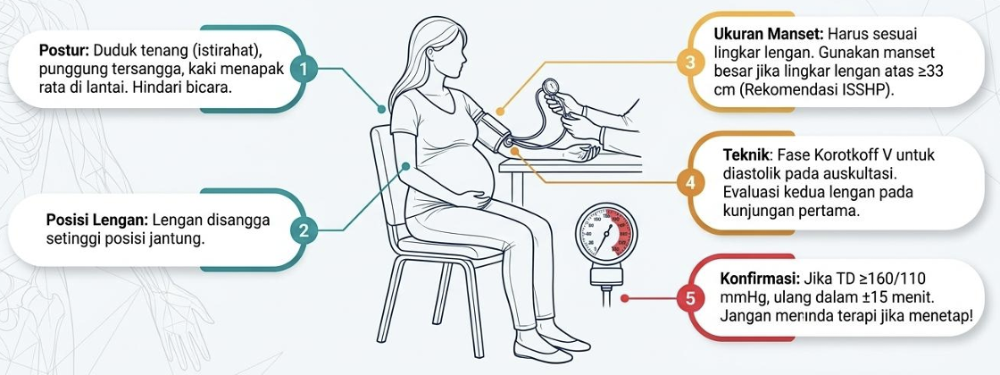

**Catatan klinis untuk dokter umum**

**Pembaruan acuan:** PNPK Tata Laksana Hipertensi dalam Kehamilan, KMK No. HK.01.07/MENKES/701/2026; Panduan Penatalaksanaan Hipertensi pada Periode Peripartum PERHI--POGI 2025; serta pedoman ACOG dan ISSHP.

> **Prioritas keselamatan:** hipertensi berat pada kehamilan atau postpartum adalah kegawatdaruratan. Kejang pada ibu hamil atau postpartum harus ditangani sebagai kemungkinan eklamsia sampai penyebab lain dinilai. Stabilkan ibu, berikan terapi awal yang sesuai, dan rujuk segera ke fasilitas dengan layanan obstetri emergensi. Materi ini merupakan pegangan belajar; ikuti protokol lokal dan konsultasi obstetri untuk keputusan individual.

# 1. Tujuan Belajar dan Inti Klinis

Dokter umum harus mampu:
- Mengukur dan mengonfirmasi tekanan darah (TD) dengan benar pada ibu hamil maupun postpartum.
- Membedakan hipertensi kronik, hipertensi gestasional, preeklamsia, preeklamsia dengan gambaran berat, preeklamsia superimposed, dan eklamsia.
- Mengenali tanda bahaya dan komplikasi pada ibu serta janin.
- Memulai stabilisasi, antihipertensi emergensi, dan magnesium sulfat (MgSO₄) sesuai indikasi serta protokol.
- Menentukan pemeriksaan awal, pemantauan, dan urgensi rujukan.
- Memahami prinsip pencegahan, waktu persalinan, serta pemantauan setelah persalinan.

## Prinsip yang paling penting

1. Hipertensi dalam kehamilan umumnya didefinisikan sebagai TD sistolik **≥140 mmHg** dan/atau diastolik **≥90 mmHg**. #Ingat
2. TD **≥160 sistolik** dan/atau **≥110 diastolik** adalah **hipertensi berat** dan perlu penanganan segera. #Ingat
3. Preeklamsia tidak selalu disertai proteinuria.
4. Edema tungkai saja tidak cukup untuk mendiagnosis preeklamsia; ketiadaan edema juga tidak menyingkirkannya.
5. MgSO₄ mencegah dan mengobati kejang, tetapi **bukan obat utama untuk menurunkan TD**.
6. **Persalinan merupakan terapi definitif untuk preeklamsia**, tetapi ibu harus distabilkan terlebih dahulu. Cara persalinan ditentukan oleh kondisi obstetri, bukan diagnosis preeklamsia semata.
7. Risiko preeklamsia/eklamsia tetap ada setelah bayi lahir.

# 2. Definisi dan Klasifikasi

Hipertensi dalam kehamilan (HDK) mencakup gangguan hipertensi yang muncul sebelum, selama, atau setelah kehamilan. Klasifikasi utama:

## 2.1 Hipertensi kronik

- Hipertensi sudah diketahui sebelum kehamilan, terdeteksi sebelum usia kehamilan 20 minggu, atau pasien sudah menggunakan antihipertensi sebelum hamil.
- Bila hipertensi yang baru muncul selama kehamilan menetap hingga ≥12 minggu postpartum, klasifikasinya menjadi hipertensi kronik.
- Dapat berupa hipertensi esensial atau sekunder, misalnya akibat penyakit ginjal atau endokrin.

## 2.2 Hipertensi gestasional

- Hipertensi baru **setelah usia kehamilan 20 minggu**.
- Tidak ditemukan proteinuria maupun bukti disfungsi organ maternal yang memenuhi kriteria preeklamsia.
- Dapat berkembang menjadi preeklamsia sehingga perlu pemantauan berulang.

## 2.3 Preeklamsia

**Hipertensi baru setelah 20 minggu** disertai salah satu atau keduanya:
- **Proteinuria**; atau
- **Disfungsi organ maternal** dan/atau **komplikasi uteroplasenta** yang sesuai, walaupun proteinuria tidak ada.

Preeklamsia dapat muncul pada masa antepartum, intrapartum, atau postpartum. Pada hipertensi kronik, munculnya proteinuria baru, perburukan TD, atau disfungsi organ baru mengarah pada preeklamsia superimposed.

## 2.4 Preeklamsia dengan gambaran berat (*with severe features*)

Preeklamsia dengan setidaknya satu gambaran berat, seperti:
- TD sistolik ≥160 mmHg atau diastolik ≥110 mmHg.
- Trombosit \<100.000/µL.
- Gangguan fungsi hati: transaminase meningkat sekitar ≥2 kali batas normal, terutama bila disertai nyeri epigastrium/kuadran kanan atas yang menetap.
- Gangguan ginjal: kreatinin serum \>1,1 mg/dL atau dua kali nilai dasar tanpa penyebab ginjal lain.
- Edema paru.
- Gejala neurologis baru yang menetap, seperti nyeri kepala berat yang tidak membaik dengan terapi atau gangguan penglihatan.

Kriteria dan batas laboratorium harus ditafsirkan dalam konteks klinis serta pedoman yang digunakan. Jangan menunggu semua kriteria muncul; satu gambaran berat dapat cukup.

## 2.5 Preeklamsia superimposed pada hipertensi kronik

Preeklamsia yang berkembang pada pasien dengan hipertensi kronik. Petunjuknya meliputi:
- Proteinuria baru atau meningkat secara bermakna.
- TD makin sulit dikendalikan.
- Trombosit turun, kreatinin atau transaminase meningkat.
- Gejala neurologis, edema paru, atau gangguan uteroplasenta yang baru.

## 2.6 Eklamsia

**Kejang tonik-klonik baru** yang berhubungan dengan preeklamsia dan tidak lebih baik dijelaskan oleh penyebab lain. Dapat terjadi sebelum persalinan, saat persalinan, maupun postpartum. Eklamsia dapat muncul tanpa hipertensi sangat tinggi atau tanpa proteinuria yang sebelumnya terdeteksi.

## 2.7 HELLP syndrome

Sindrom yang terdiri atas: 

- **H**emolysis.
- **EL**evated **L**iver enzymes.
- **L**ow **P**latelets.

HELLP merupakan komplikasi berat spektrum preeklamsia. Pasien dapat datang dengan nyeri epigastrium/kuadran kanan atas, mual-muntah, malaise, sakit kepala, atau gejala yang tidak spesifik. TD dan proteinuria tidak selalu sangat menonjol.

# 3. Pengukuran Tekanan Darah yang Benar

Pengukuran yang salah dapat menyebabkan diagnosis dan keputusan klinis keliru.

1. Istirahatkan pasien sekitar 5 menit; bila memungkinkan hindari rokok, kafein, dan aktivitas fisik selama 30 menit sebelum pengukuran.
2. Pasien duduk dengan punggung tersangga, kaki menapak dan tidak menyilang, lengan disangga setinggi jantung.
3. Gunakan manset sesuai lingkar lengan dan alat yang tervalidasi untuk kehamilan. Hindari alat pergelangan tangan.
4. Ukur pada lengan yang sama untuk pemeriksaan ulang dan catat posisi serta waktu.
5. Untuk diagnosis nonberat, konfirmasi TD ≥140/90 pada pengukuran berulang sesuai protokol klinis. Pedoman dapat menggunakan interval berbeda; PNPK Indonesia 2026 menyebut dua pengukuran dengan jarak 15 menit.
6. Bila TD ≥160 sistolik atau ≥110 diastolik, ulangi dalam waktu singkat (umumnya dalam 15 menit). Jangan menunda terapi emergensi hanya untuk menunggu interval 4 jam.
7. Catat angka sistolik dan diastolik secara terpisah. Salah satu yang memenuhi ambang sudah bermakna.

# 4. Patofisiologi Preeklamsia

Preeklamsia bukan sekadar tekanan darah tinggi. Penyakit ini merupakan sindrom multisistem yang berawal terutama dari gangguan plasentasi dan respons vaskular maternal.

## 4.1 Plasentasi abnormal

- Pada kehamilan normal, trofoblas menginvasi arteri spiralis uterus dan mengubahnya menjadi pembuluh berdiameter besar, beresistensi rendah, sehingga aliran darah ke plasenta memadai.
- Pada preeklamsia, invasi trofoblas dan remodeling arteri spiralis dapat tidak optimal.
- Akibatnya, perfusi plasenta menjadi kurang baik dan dapat mengalami hipoksia/iskemia serta stres oksidatif.

## 4.2 Pelepasan faktor plasenta ke sirkulasi ibu

Plasenta yang mengalami stres melepaskan mediator yang mengganggu endotel, termasuk peningkatan faktor antiangiogenik seperti sFlt-1 dan penurunan ketersediaan faktor proangiogenik seperti PlGF, sehingga menyebabkan disfungsi endotel sistemik.

## 4.3 Disfungsi endotel sistemik

Endotel yang terganggu menyebabkan:
- Vasokonstriksi dan peningkatan resistensi vaskular, sehingga TD meningkat.
- Peningkatan permeabilitas kapiler, sehingga cairan berpindah ke jaringan dan dapat terjadi edema.
- Aktivasi trombosit dan koagulasi, yang dapat berkontribusi pada trombositopenia dan mikroangiopati.
- Gangguan perfusi organ, terutama otak, ginjal, hati, paru, dan plasenta.

## 4.4 Dampak pada organ

- **Ginjal:** endoteliosis glomerulus dan gangguan filtrasi, proteinuria, serta kenaikan kreatinin.
- **Otak:** gangguan autoregulasi vaskular dan edema vasogenik dapat menyebabkan sakit kepala, gangguan penglihatan, PRES, stroke, atau kejang.
- **Hati:** iskemia dan cedera hepatoseluler menyebabkan kenaikan transaminase serta nyeri epigastrium/kuadran kanan atas.
- **Hematologi:** aktivasi trombosit, hemolisis mikroangiopatik, dan trombositopenia; pada HELLP, hemolisis dan gangguan hati menonjol.
- **Plasenta/janin:** insufisiensi uteroplasenta dapat menyebabkan pertumbuhan janin terhambat (FGR), oligohidramnion, hipoksia, solusio plasenta, atau kematian janin.

**Tips memahami mekanisme:** plasenta bermasalah → faktor antiangiogenik meningkat → endotel ibu terganggu → vasokonstriksi + kebocoran kapiler + aktivasi koagulasi → hipertensi dan kerusakan organ.

# 5. Faktor Risiko

Faktor risiko meningkatkan kewaspadaan, tetapi preeklamsia dapat terjadi tanpa faktor risiko yang jelas.

## Risiko tinggi

- Riwayat preeklamsia, terutama dengan luaran buruk atau onset dini.
- Kehamilan multipel.
- Hipertensi kronik.
- Penyakit ginjal kronik.
- Diabetes tipe 1 atau tipe 2 sebelum kehamilan.
- Penyakit autoimun tertentu, misalnya lupus atau sindrom antifosfolipid.

## Risiko sedang atau faktor tambahan

- Kehamilan pertama/nulliparitas.
- Usia maternal ≥35 tahun (sebagian pedoman menggunakan ambang ≥40 tahun untuk kategori tertentu).
- Obesitas.
- Riwayat keluarga preeklamsia pada ibu atau saudara perempuan.
- Jarak kehamilan yang panjang, riwayat luaran kehamilan buruk, atau faktor sosial/akses layanan yang meningkatkan risiko.
- Kehamilan melalui teknologi reproduksi berbantu pada konteks tertentu.

Risiko dinilai secara keseluruhan, bukan berdasarkan satu faktor saja.

# 6. Gambaran Klinis dan Tanda Bahaya

## 6.1 Gejala yang perlu ditanyakan

- Sakit kepala baru, berat, progresif, atau tidak membaik dengan analgesik.
- Penglihatan kabur, kilatan cahaya, skotoma, atau kehilangan penglihatan sementara.
- Nyeri epigastrium atau kuadran kanan atas, terutama menetap.
- Sesak napas, ortopnea, atau nyeri dada.
- Mual-muntah berat yang baru muncul, terutama bila disertai gejala lain.
- Penurunan gerak janin.
- Kejang, penurunan kesadaran, kebingungan, atau kelemahan fokal.
- Bengkak wajah/tangan yang mendadak atau kenaikan berat badan cepat dapat menjadi petunjuk, tetapi bukan kriteria diagnostik tunggal.

## 6.2 Pemeriksaan fisik

- TD dengan teknik benar dan pengukuran berulang.
- Kesadaran, orientasi, pemeriksaan neurologis, refleks tendon dalam, dan klonus bila relevan.
- Frekuensi napas, saturasi oksigen, nadi, tanda edema paru, dan kerja napas.
- Nyeri tekan epigastrium/kuadran kanan atas.
- Edema dan status volume; edema tungkai fisiologis sering terjadi dan tidak spesifik.
- Denyut jantung janin dan penilaian obstetri sesuai usia kehamilan serta fasilitas.

## 6.3 Tanda bahaya untuk rujukan emergensi

- **TD ≥160/110 mmHg**.
- Kejang, penurunan kesadaran, gejala neurologis fokal.
- Sakit kepala berat menetap atau gangguan penglihatan.
- Sesak/edema paru, hipoksemia, nyeri dada.
- Nyeri epigastrium/kuadran kanan atas berat atau menetap.
- Oliguria, perdarahan, kecurigaan solusio plasenta.
- Trombositopenia, hemolisis, gangguan fungsi hati/ginjal.
- Gerak janin berkurang atau kondisi janin tidak meyakinkan.

# 7. Diagnosis dan Pemeriksaan Penunjang

## 7.1 Pemeriksaan awal pada dugaan preeklamsia

Pemeriksaan disesuaikan dengan beratnya kondisi, tetapi umumnya meliputi:
- Darah lengkap, khususnya hemoglobin dan trombosit.
- AST/ALT.
- Kreatinin serum; pertimbangkan elektrolit sesuai kondisi.
- Evaluasi proteinuria.
- Bila dicurigai HELLP/hemolisis: LDH, bilirubin, apusan darah tepi, dan pemeriksaan hemolisis sesuai fasilitas.
- Pemeriksaan koagulasi bila ada perdarahan, dugaan DIC, solusio plasenta, atau trombositopenia berat.
- Pemeriksaan janin: USG pertumbuhan dan cairan amnion, serta NST/CTG atau Doppler sesuai indikasi dan ketersediaan.

## 7.2 Proteinuria

Proteinuria mendukung diagnosis, tetapi tidak wajib bila terdapat disfungsi organ yang memenuhi kriteria.

Pilihan pemeriksaan:
- Rasio protein/kreatinin urin (UPCR) ≥0,3 mg/mg atau sekitar ≥30 mg/mmol.
- Protein urin 24 jam ≥300 mg.
- Dipstick dapat digunakan bila metode kuantitatif tidak tersedia, tetapi kurang akurat; hasil negatif tidak menyingkirkan preeklamsia bila gejala atau pemeriksaan lain mencurigakan.

Interpretasi:
- Proteinuria bukan ukuran tunggal keparahan.
- Jangan menunda stabilisasi atau rujukan hanya untuk mengumpulkan urin 24 jam.
- Hematuria, infeksi saluran kemih, atau kontaminasi dapat memengaruhi interpretasi.

## 7.3 Kriteria disfungsi organ maternal yang penting

- Trombosit \<100.000/µL.
- Kreatinin \>1,1 mg/dL atau meningkat dua kali lipat dari dasar tanpa penyebab lain.
- Transaminase sekitar ≥2 kali batas normal, terutama dengan nyeri epigastrium/kuadran kanan atas.
- Edema paru.
- Gejala neurologis baru: sakit kepala refrakter, gangguan penglihatan, perubahan status mental, stroke, atau kejang.

Sebagian pedoman internasional juga mempertimbangkan insufisiensi uteroplasenta seperti FGR sebagai bagian dari spektrum preeklamsia. Gunakan definisi pada pedoman dan protokol setempat.

## 7.4 Diagnosis banding

- Hipertensi kronik tanpa preeklamsia.
- Hipertensi gestasional.
- Migren, stroke, perdarahan intrakranial, meningitis, atau epilepsi pada pasien dengan kejang/sakit kepala.
- Hepatitis, kolelitiasis/kolesistitis, gastritis, atau pankreatitis pada nyeri epigastrium.
- Trombositopenia imun, TTP, HUS, DIC, atau penyakit hati lain bila gambaran HELLP tidak khas.
- Edema paru akibat gagal jantung, penyakit ginjal, atau kelebihan cairan.

**Catatan klinis:** kejang postpartum tidak boleh otomatis dianggap eklamsia tanpa evaluasi penyebab lain, tetapi penanganan awal tidak boleh tertunda bila eklamsia sangat mungkin.

# 8. Prinsip Tata Laksana

Tujuan penanganan:
1. Mencegah stroke, kejang, edema paru, gagal ginjal, HELLP, dan kematian ibu.
2. Menjaga kesejahteraan janin.
3. Menentukan waktu dan cara persalinan yang paling aman.
4. Mencegah keterlambatan rujukan.

## 8.1 Lokasi perawatan

- Preeklamsia dengan gambaran berat, eklamsia, hipertensi berat persisten, atau komplikasi organ memerlukan perawatan rumah sakit dengan kemampuan obstetri emergensi.
- Pasien dengan hipertensi gestasional atau preeklamsia tanpa gambaran berat hanya dapat dipantau rawat jalan pada pasien terpilih, bila ibu dan janin stabil, akses kembali cepat tersedia, dan pemantauan dapat dipatuhi.
- Di fasilitas primer, lakukan penilaian awal, stabilisasi yang sesuai, komunikasi dengan rumah sakit penerima, dan rujukan. Jangan menunda rujukan untuk menyelesaikan seluruh pemeriksaan.

## 8.2 Langkah awal di fasilitas kesehatan

- Panggil bantuan dan koordinasikan tim obstetri, anestesi, dan neonatal sesuai kebutuhan.
- Nilai ABC, kesadaran, TD, nadi, frekuensi napas, SpO₂, dan tanda edema paru.
- Pasang akses IV bila diperlukan; ambil darah untuk pemeriksaan tanpa menunda terapi.
- Posisikan miring kiri bila sesuai, terutama pada kehamilan lanjut; lindungi pasien dari jatuh/cedera.
- Hindari pemberian cairan IV berlebihan karena risiko edema paru.
- Pantau diuresis dan keseimbangan cairan.
- Evaluasi janin sesuai usia kehamilan dan stabilitas ibu.
- Atasi hipertensi berat dan berikan MgSO₄ bila ada indikasi kejang, sesuai protokol serta kemampuan pemantauan.
- Rujuk ke rumah sakit dengan kemampuan operasi sesar, perawatan intensif maternal, dan neonatal.

# 9. Antihipertensi

## 9.1 Kapan terapi emergensi diperlukan?

TD sistolik ≥160 mmHg dan/atau diastolik ≥110 mmHg yang menetap pada pengukuran ulang singkat merupakan kegawatdaruratan obstetri. Terapi sebaiknya dimulai secepatnya, idealnya dalam 30-60 menit sejak hipertensi berat dikonfirmasi, untuk menurunkan risiko stroke maternal.

Target awal adalah keluar dari rentang berat secara terkendali; hindari penurunan mendadak yang dapat mengganggu perfusi uteroplasenta. Target pemeliharaan selanjutnya mengikuti protokol spesialis dan kondisi pasien.

## 9.2 Obat yang lazim digunakan

Pilihan untuk hipertensi akut berat di rumah sakit meliputi:

- **Labetalol IV**, bila tersedia dan tidak ada kontraindikasi. 
- **Hidralazin IV**, alternatif yang lazim. 
- **Nifedipin oral kerja cepat/immediate-release**, terutama bila akses IV belum tersedia atau sesuai protokol. Berikan oral, bukan sublingual, karena penurunan TD yang tidak terkontrol berisiko.

Pemilihan obat, dosis, interval pengulangan, serta batas dosis harus mengikuti protokol emergensi obstetri setempat dan dilakukan oleh klinisi yang mampu memantau respons. Jangan menggunakan nifedipin sublingual.

## 9.3 Terapi pemeliharaan

Obat yang sering digunakan untuk mengendalikan hipertensi selama kehamilan:

- **Nifedipin lepas lambat (extended-release/modified-release)**. 
- **Labetalol oral**. 
- **Metildopa**.

Pemilihan bergantung pada derajat hipertensi, komorbid, ketersediaan, efek samping, dan protokol. Metildopa dapat menyebabkan sedasi atau depresi mood. Labetalol perlu kehati-hatian pada asma/bradikardia. Nifedipin dapat menyebabkan sakit kepala, flushing, atau edema perifer.

## 9.4 Obat yang dihindari

- **ACE inhibitor** (misalnya captopril, enalapril) dan **ARB** (misalnya losartan) tidak digunakan untuk terapi hipertensi selama kehamilan karena risiko pada janin.
- Diuretik bukan terapi rutin untuk preeklamsia; penggunaannya dipertimbangkan pada indikasi khusus seperti edema paru/gagal jantung dengan pemantauan ketat.
- Hindari penurunan TD yang terlalu cepat atau penggunaan obat tanpa pemantauan.

# 10. Magnesium Sulfat (MgSO₄)

## 10.1 Indikasi

MgSO₄ adalah pilihan utama untuk:
- Mencegah kejang pada preeklamsia dengan gambaran berat atau gejala yang mengarah pada impending eclampsia.
- Mengobati eklamsia dan mencegah kejang berulang.
- Neuroproteksi janin pada persalinan preterm sangat dini sesuai usia kehamilan dan protokol lokal.

MgSO₄ **tidak menggantikan antihipertensi** dan tidak menyembuhkan preeklamsia. Pada preeklamsia tanpa gambaran berat, penggunaannya diputuskan berdasarkan penilaian klinis dan protokol.

## 10.2 Regimen IV yang sering digunakan

Salah satu regimen yang lazim: 

- **Dosis muatan: MgSO₄ 4g IV**, diencerkan dan diberikan perlahan selama sekitar 5-20 menit sesuai protokol. 
- **Dosis pemeliharaan: 1-2 g/jam IV**.
- Umumnya dilanjutkan sampai 24 jam setelah persalinan atau 24 jam setelah kejang terakhir, mana yang lebih akhir, sesuai protokol.

Regimen IM alternatif (misalnya regimen Pritchard) digunakan dalam protokol tertentu, terutama bila infus IV tidak memungkinkan. Dosis dan teknik harus mengikuti pedoman resmi serta pelatihan setempat. Perhatikan konsentrasi sediaan untuk mencegah kesalahan dosis.

## 10.3 Jika kejang berulang

- Panggil bantuan, lindungi jalan napas dan pasien dari cedera, posisikan miring, dan berikan oksigen bila hipoksemia.
- Pastikan MgSO₄ telah diberikan dan periksa apakah kejang berulang memerlukan bolus tambahan sesuai protokol (sering digunakan tambahan 2 g IV).
- Bila kejang menetap atau diagnosis tidak pasti, evaluasi penyebab lain dan tata laksana status epileptikus bersama tim emergensi/anestesi.
- Jangan memasukkan benda atau jari ke dalam mulut pasien saat kejang.

## 10.4 Pemantauan toksisitas MgSO₄

Pantau secara berkala:
- Frekuensi napas dan SpO₂.
- Refleks patela/refleks tendon dalam.
- Produksi urin (umumnya diharapkan ≥25-30 mL/jam).
- Kesadaran, kekuatan otot, dan tanda vital.

Risiko toksisitas meningkat pada gangguan ginjal/oliguria karena magnesium diekskresikan melalui ginjal. Penyesuaian dosis dan pemantauan ketat diperlukan pada gangguan fungsi ginjal.

Tanda toksisitas:
- Refleks tendon menghilang.
- Depresi napas atau frekuensi napas \<12/menit.
- Oliguria, kelemahan berat, penurunan kesadaran.
- Pada kasus berat: gangguan konduksi jantung atau henti jantung.

**Antidot:** kalsium glukonat 1 g IV (umumnya 10 mL larutan 10%) diberikan perlahan selama sekitar 10 menit sesuai protokol. Hentikan MgSO₄, dukung ventilasi, dan minta bantuan emergensi bila toksisitas dicurigai.

# 11. Eklamsia: Tata Laksana Emergensi

Eklamsia adalah kegawatdaruratan yang mengancam nyawa. Prioritas awal adalah mencegah cedera dan hipoksia, menghentikan kejang, mengendalikan TD berat, kemudian merencanakan persalinan setelah stabilisasi.

## 11.1 Saat kejang

1. Panggil bantuan dan catat waktu mulai kejang.
2. Lindungi pasien dari jatuh/cedera; jangan menahan gerakan secara paksa dan jangan memasukkan benda ke mulut.
3. Posisikan lateral/miring untuk mengurangi aspirasi; lindungi jalan napas.
4. Nilai airway, breathing, circulation. Suction bila diperlukan dan aman; berikan oksigen bila hipoksemia.
5. Periksa glukosa darah dan pertimbangkan penyebab kejang lain, tetapi jangan menunda MgSO₄ bila eklamsia sangat mungkin.
6. Berikan MgSO₄ sesuai protokol.
7. Setelah kejang berhenti, evaluasi kesadaran, tanda vital, trauma, aspirasi, dan kondisi janin.
8. Tangani hipertensi berat dengan antihipertensi yang sesuai.
9. Rujuk/kelola di rumah sakit dengan fasilitas obstetri emergensi, anestesi, dan perawatan intensif bila diperlukan.

## 11.2 Setelah kejang

- Evaluasi apakah terdapat status epileptikus, stroke/perdarahan intrakranial, PRES, hipoglikemia, infeksi SSP, atau penyebab lain.
- Lakukan pemeriksaan darah, fungsi ginjal/hati, trombosit, proteinuria, dan penilaian janin.
- Persalinan diperlukan setelah stabilisasi maternal; eklamsia bukan indikasi otomatis untuk operasi sesar. Cara persalinan ditentukan oleh keadaan ibu, janin, serviks, usia kehamilan, dan urgensi obstetri.

# 12. Waktu Persalinan dan Pemantauan Janin

Persalinan adalah **terapi definitif untuk preeklamsia**, tetapi keputusan mempertimbangkan usia kehamilan, kondisi ibu, kondisi janin, dan sumber daya rumah sakit.

## 12.1 Prinsip umum

- **Preeklamsia dengan gambaran berat pada ≥34 minggu:** persalinan umumnya dianjurkan setelah stabilisasi maternal.
- **Preeklamsia tanpa gambaran berat pada ≥37 minggu:** inisiasi persalinan umumnya dianjurkan.
- **Sebelum 34 minggu:** tata laksana ekspektatif hanya dipertimbangkan pada pasien terpilih yang stabil, di rumah sakit dengan pemantauan ketat maternal-fetal dan fasilitas neonatal memadai. Ini bukan perawatan rawat jalan.
- **Persalinan segera pada usia kehamilan berapa pun** bila ada indikasi maternal/fetal yang tidak dapat ditangani dengan aman sambil menunggu, misalnya hipertensi berat tidak terkontrol, eklamsia, edema paru, HELLP yang memburuk, solusio plasenta, atau kondisi janin tidak meyakinkan.
- Kortikosteroid antenatal dapat diberikan bila persalinan preterm diperkirakan dan memenuhi kriteria, tetapi persalinan yang diperlukan demi keselamatan ibu tidak boleh ditunda hanya untuk menyelesaikan steroid.

## 12.2 Cara persalinan

- Persalinan pervaginam dapat dilakukan bila kondisi klinis dan obstetri memungkinkan.
- Operasi sesar dipilih berdasarkan indikasi obstetri, kondisi janin, urgensi, dan kemungkinan keberhasilan induksi.
- Diagnosis preeklamsia saja tidak otomatis berarti harus dilakukan sesar.

## 12.3 Pemantauan janin

Dapat mencakup:
- Gerak janin.
- USG pertumbuhan janin dan volume cairan amnion.
- NST/CTG sesuai usia kehamilan dan kondisi klinis.
- Doppler arteri umbilikalis bila dicurigai FGR/insufisiensi uteroplasenta.

# 13. Pencegahan Preeklamsia

## 13.1 Aspirin dosis rendah

Aspirin dosis rendah dapat direkomendasikan pada ibu dengan risiko tinggi atau kombinasi faktor risiko sedang. Pedoman berbeda dalam dosis dan waktu mulai; banyak pedoman merekomendasikan **75-150 mg/hari**, dimulai sekitar usia kehamilan 12 minggu (idealnya sebelum 16 minggu) dan dilanjutkan sesuai pedoman setempat, sering hingga 36 minggu atau menjelang persalinan. Penentuan harus mengikuti PNPK/protokol obstetri dan mempertimbangkan kontraindikasi.

Faktor yang umumnya mendukung profilaksis meliputi riwayat preeklamsia, kehamilan multipel, hipertensi kronik, penyakit ginjal, diabetes pregestasional, dan penyakit autoimun tertentu. Jangan memulai atau menghentikan aspirin tanpa menilai indikasi klinis.

## 13.2 Kalsium

Suplementasi kalsium dapat dipertimbangkan pada populasi dengan asupan kalsium rendah sesuai rekomendasi nasional/WHO dan protokol antenatal. Dosis disesuaikan dengan pedoman serta asupan diet.

## 13.3 Langkah lain

- Pemeriksaan antenatal teratur dan skrining faktor risiko.
- Kontrol penyakit kronik sebelum dan selama kehamilan.
- Edukasi tanda bahaya dan akses cepat ke fasilitas kesehatan.
- Pola makan seimbang, aktivitas fisik yang sesuai, serta pengelolaan berat badan yang aman.
- Pembatasan garam ekstrem atau tirah baring rutin tidak terbukti sebagai pencegahan universal dan tidak dianjurkan tanpa indikasi.

# 14. Hipertensi Postpartum

Preeklamsia dapat muncul pertama kali setelah persalinan, termasuk pada pasien yang tekanan darahnya sebelumnya normal. TD dapat meningkat beberapa hari setelah persalinan.

## 14.1 Tanda bahaya postpartum

- Sakit kepala berat, gangguan penglihatan, kejang, atau kebingungan.
- TD ≥160/110 mmHg.
- Sesak napas, nyeri dada, atau edema paru.
- Nyeri epigastrium/kuadran kanan atas.
- Oliguria atau gejala gangguan organ.

Keluhan ini memerlukan evaluasi emergensi. Jangan menganggap sakit kepala postpartum sebagai kelelahan biasa.

## 14.2 Prinsip penanganan

- Ukur TD dan lakukan evaluasi preeklamsia/komplikasi organ.
- Hipertensi berat ditangani segera; MgSO₄ dipertimbangkan untuk eklamsia atau risiko kejang sesuai evaluasi klinis.
- Pilihan antihipertensi postpartum harus mempertimbangkan fungsi ginjal, komorbid, dan menyusui.
- Berikan rencana kontrol TD yang jelas dan edukasi tanda bahaya sebelum pasien pulang.

## 14.3 Tindak lanjut

- TD perlu dinilai pada periode awal postpartum, khususnya sekitar hari ke-3 sampai ke-7 ketika TD sering meningkat, dan kembali diperiksa sesuai tingkat risiko.
- Evaluasi ulang sekitar 6-12 minggu postpartum untuk memastikan hipertensi telah pulih atau menetap.
- Hipertensi yang menetap ≥12 minggu postpartum perlu dinilai sebagai hipertensi kronik dan ditangani sesuai pedoman.
- Riwayat HDK meningkatkan risiko hipertensi, penyakit kardiovaskular, stroke, dan penyakit ginjal di kemudian hari. Anjurkan pemantauan faktor risiko jangka panjang.

# 15. Komplikasi

## Maternal

- Eklamsia dan cedera neurologis.
- Stroke/perdarahan intrakranial, PRES.
- HELLP syndrome, hemolisis, trombositopenia, DIC.
- Cedera ginjal akut.
- Edema paru dan gagal jantung.
- Solusio plasenta, perdarahan, syok.
- Kematian maternal.

## Janin/neonatal

- Pertumbuhan janin terhambat.
- Prematuritas akibat persalinan dini.
- Hipoksia, gawat janin, oligohidramnion.
- Solusio plasenta dan kematian janin.
- Komplikasi neonatal terkait prematuritas.

# 16. Rujukan dari Layanan Primer: Apa yang Harus Dilakukan Dokter Umum?

## Jangan menunda rujukan bila

- TD ≥160/110 mmHg.
- Diduga preeklamsia dengan gambaran berat atau eklamsia.
- Ada gejala neurologis, sesak, nyeri epigastrium menetap, oliguria, perdarahan, atau gerak janin berkurang.
- Hasil pemeriksaan menunjukkan trombositopenia atau gangguan fungsi ginjal/hati.

## Sebelum dan selama proses rujukan

- Stabilkan ABC dan ukur tanda vital berulang.
- Pasang akses IV bila diperlukan dan sesuai kompetensi.
- Berikan antihipertensi emergensi dan/atau MgSO₄ bila diindikasikan, sesuai protokol serta kemampuan pemantauan.
- Hindari cairan berlebihan.
- Hubungi fasilitas penerima dan sampaikan kondisi, usia kehamilan, TD, gejala, obat/dosis/waktu pemberian, hasil laboratorium, dan kondisi janin.
- Sertakan catatan rujukan yang jelas. Jangan menunda keberangkatan hanya untuk menyelesaikan semua pemeriksaan.

## Informasi penting saat serah terima

- Usia kehamilan dan status postpartum.
- Waktu onset gejala, riwayat hipertensi/preeklamsia, dan komorbid.
- Serial TD dan tanda vital.
- Status neurologis, respirasi, refleks, serta diuresis.
- Obat yang sudah diberikan, dosis, rute, dan waktu.
- Hasil darah/urin yang tersedia.
- Denyut jantung dan penilaian janin.

# 17. Algoritme Ringkas Pengambilan Keputusan

1. **TD ≥140/90?** Ulangi dengan teknik benar, nilai usia kehamilan, gejala, dan riwayat.
2. **TD ≥160 sistolik atau ≥110 diastolik?** Konfirmasi dalam waktu singkat; mulai tata laksana hipertensi berat dan rujuk emergensi.
3. **Hipertensi baru setelah 20 minggu?** Evaluasi proteinuria dan disfungsi organ untuk membedakan hipertensi gestasional dari preeklamsia.
4. **Ada gambaran berat atau gejala neurologis/respirasi/hepatik/renal?** Rawat/rujuk emergensi, pertimbangkan MgSO₄, kendalikan TD, evaluasi ibu dan janin.
5. **Kejang pada ibu hamil atau postpartum?** Tangani sebagai kemungkinan eklamsia: lindungi jalan napas, posisi lateral, MgSO₄, kontrol TD, dan perawatan emergensi.
6. **Setelah stabil?** Tim obstetri menentukan waktu dan cara persalinan berdasarkan usia kehamilan serta kondisi ibu-janin.
7. **Setelah persalinan?** Lanjutkan pemantauan TD, gejala, fungsi organ sesuai indikasi, dan jadwalkan tindak lanjut postpartum.

# 18. Tips Menghafal

- **140/90 = hipertensi; 160/110 = emergensi.**
- **Preeklamsia = hipertensi setelah 20 minggu + proteinuria atau disfungsi organ.** Proteinuria tidak wajib.
- **HELLP = Hemolysis, Elevated Liver enzymes, Low Platelets.**
- **MgSO₄ = mencegah/mengobati kejang; antihipertensi = menurunkan TD; persalinan = terapi definitif.**
- **Gejala bahaya utama:** kepala/mata, ulu hati, paru, urin, kejang, dan gerak janin.
- **Ingat postpartum:** bayi sudah lahir bukan berarti risiko preeklamsia selesai.

# 19. Kesalahan Klinis yang Harus Dihindari

- Menganggap preeklamsia mustahil bila proteinuria negatif.
- Menilai edema tungkai sebagai satu-satunya dasar diagnosis.
- Menunggu 4 jam untuk menangani hipertensi berat yang persisten.
- Menganggap MgSO₄ sebagai obat antihipertensi utama.
- Menghentikan pemantauan setelah persalinan.
- Memberi cairan IV berlebihan pada pasien yang berisiko edema paru.
- Menunda rujukan demi menunggu hasil pemeriksaan lengkap.
- Menganggap semua pasien preeklamsia harus menjalani operasi sesar.
- Menganggap semua kejang pada kehamilan pasti eklamsia tanpa evaluasi banding; namun, jangan menunda penanganan awal eklamsia bila sangat mungkin.

# 20. Rangkuman Akhir

- Hipertensi dalam kehamilan adalah spektrum penyakit yang meliputi hipertensi kronik, hipertensi gestasional, preeklamsia, preeklamsia superimposed, dan eklamsia. 
- Hipertensi didiagnosis pada TD ≥140/90 mmHg, sedangkan TD ≥160/110 mmHg merupakan kondisi berat yang membutuhkan terapi segera.
- Preeklamsia adalah hipertensi baru setelah 20 minggu dengan proteinuria **atau** disfungsi organ maternal; proteinuria tidak harus ada.

- Gangguan plasentasi dan disfungsi endotel menyebabkan vasokonstriksi, kebocoran kapiler, aktivasi koagulasi, serta gangguan perfusi organ.
- Waspadai sakit kepala berat, gangguan penglihatan, nyeri epigastrium/kuadran kanan atas, sesak, oliguria, trombositopenia, dan gejala neurologis.
- Pemeriksaan utama meliputi darah lengkap/trombosit, fungsi hati dan ginjal, proteinuria, serta penilaian janin.

- Pada hipertensi berat, stabilisasi dan antihipertensi emergensi tidak boleh ditunda.
- MgSO₄ digunakan untuk profilaksis atau terapi kejang pada pasien yang sesuai indikasi, dengan pemantauan refleks, pernapasan, dan diuresis; kalsium glukonat merupakan antidot toksisitas. 
- Persalinan adalah terapi definitif untuk preeklamsia, tetapi ibu harus distabilkan dan waktu persalinan ditentukan berdasarkan kondisi ibu, janin, serta usia kehamilan. 
- Risiko berlanjut setelah persalinan sehingga pemantauan postpartum dan tindak lanjut jangka panjang wajib direncanakan.

# Referensi utama

1. Kementerian Kesehatan Republik Indonesia. **Keputusan Menteri Kesehatan Nomor HK.01.07/MENKES/701/2026: Pedoman Nasional Pelayanan Klinis Tata Laksana Hipertensi dalam Kehamilan.** https://keslan.kemkes.go.id/unduhan/fileunduhan1787209680_155276.pdf
2. Perhimpunan Dokter Hipertensi Indonesia (PERHI) dan Perkumpulan Obstetri dan Ginekologi Indonesia (POGI). **Panduan Penatalaksanaan Hipertensi pada Periode Peripartum 2025.** https://admin.inash.or.id/cdn/File/2025.pdf
3. American College of Obstetricians and Gynecologists (ACOG). **Gestational Hypertension and Preeclampsia, Practice Bulletin No. 222.** https://www.acog.org/clinical/clinical-guidance/practice-bulletin/articles/2020/06/gestational-hypertension-and-preeclampsia
4. International Society for the Study of Hypertension in Pregnancy (ISSHP). **2021 Recommendations for classification, diagnosis and management of hypertensive disorders of pregnancy.** https://isshp.org/wp-content/uploads/2023/09/ISSHP-2021-guidelines.pdf
5. European Society of Cardiology. **2025 ESC Guidelines for the management of cardiovascular disease and pregnancy.** https://academic.oup.com/eurheartj/article/46/43/4462/8234877

*Catatan:* Dosis obat di atas merupakan ringkasan regimen yang lazim dan harus diverifikasi dengan protokol emergensi obstetri di fasilitas masing-masing, formularium, konsentrasi sediaan, fungsi ginjal, serta arahan dokter obstetri. Pada pasien nyata, gunakan penilaian klinis dan sistem rujukan setempat.
