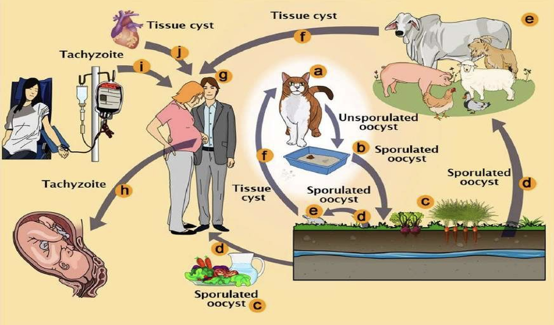
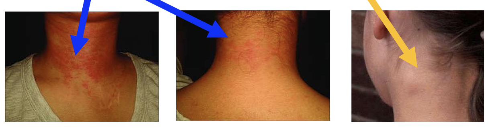
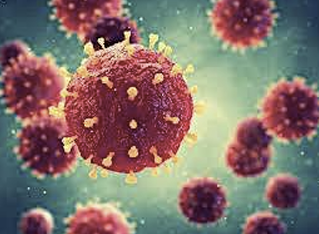
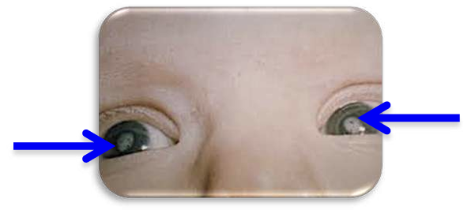
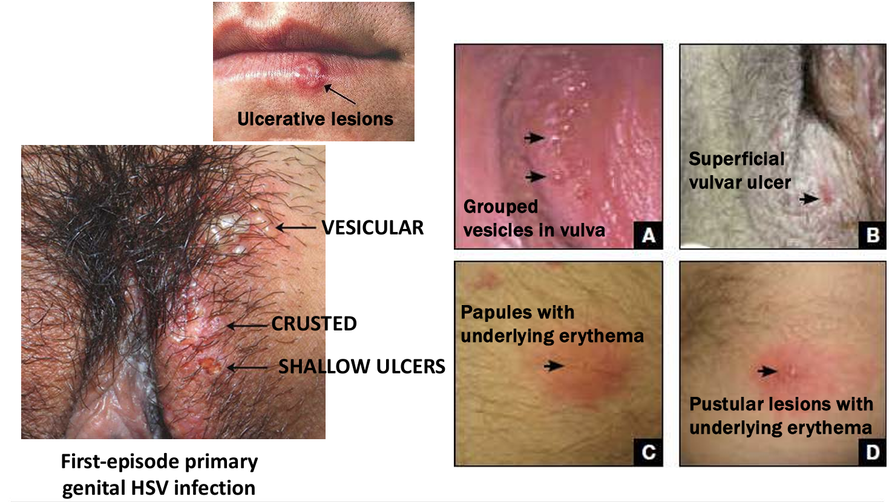
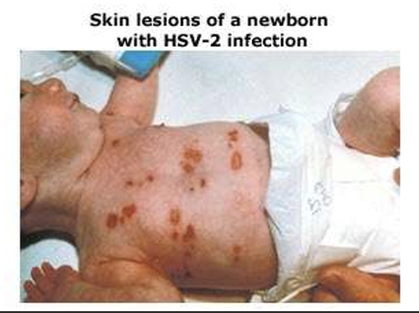

> [!NOTE] Level Kompetensi SKDI: 3A

# 1. Gambaran Umum

TORCH adalah **kelompok infeksi yang dapat ditularkan dari ibu ke janin** dan menyebabkan **infeksi kongenital**. TORCH meliputi:

- **T** — *Toxoplasmosis*, disebabkan oleh parasit *Toxoplasma gondii*.
- **O** — *Others*, misalnya *sifilis* dan *Group B Streptococcus*.
- **R** — *Rubella*.
- **C** — *Cytomegalovirus* (CMV).
- **H** — *Herpes simplex virus* (HSV).

Infeksi pada kehamilan perlu dinilai berdasarkan cara penularan, usia gestasi saat infeksi terjadi, status serologis ibu, serta status imunologis ibu dan janin. Faktor-faktor tersebut ikut menentukan luaran janin.

# 2. Patofisiologi dan Penularan Infeksi pada Kehamilan
## Perubahan sistem imun pada kehamilan

Kehamilan melibatkan **perubahan regulasi sistem imun untuk mempertahankan toleransi terhadap janin tanpa menghilangkan kemampuan ibu dalam melawan infeksi**.

**Respons sel T helper dapat bergeser ke arah respons Th2**, dengan peningkatan sitokin seperti IL-4, IL-5, IL-10, dan IL-13. Perubahan keseimbangan respons imun ini dapat **memengaruhi kemampuan tubuh mengeliminasi patogen intraseluler tertentu**.

- Toleransi imun maternal terhadap janin melibatkan interaksi antara *extravillous trophoblast* (EVT) dan *decidual natural killer* (dNK) cells melalui *human leukocyte antigen-G* (HLA-G).
- Keberhasilan kehamilan membutuhkan keseimbangan sistem imun innate dan adaptive.
- *Noncoding microRNA* (miRNA) mengatur aktivasi dan proliferasi sel imun.
- Sel T regulator (Treg) merupakan subset sel T helper CD4+ yang mengekspresikan faktor transkripsi FOXP3 (*forkhead box P3*).
- **Treg menekan respons imun untuk mempertahankan toleransi terhadap janin**.
- Aktivitas imunosupresif yang mempertahankan toleransi janin **juga dapat mengurangi pertahanan maternal terhadap patogen bakteri tertentu**.
- Infeksi virus memicu pelepasan sitokin yang memengaruhi aktivitas sel imun, termasuk dNK cells.
- Respons sitotoksik diperlukan untuk melawan infeksi, tetapi harus diatur agar tidak mengganggu toleransi imun terhadap janin.

> [!NOTE] **Intinya** 🧠
> 
> EVT berinteraksi dengan dNK melalui HLA-G → interaksi imun di desidua
> Treg ekspresikan FOXP3 → menekan respons imun supaya toleran terhadap janin
> **Karena imun ditekan, pertahanan ibu terhadap patogen tertentu juga berkurang!**

## Jalur penularan

- **Penularan horizontal**: perpindahan agen infeksi dari satu individu ke individu lain, misalnya melalui droplet atau kontak.
- **Penularan vertikal**: perpindahan agen infeksi dari ibu ke janin atau bayi melalui plasenta, selama persalinan, atau melalui menyusui.
- **Secondary attack rate**: probabilitas individu rentan mengalami infeksi setelah diketahui berkontak dengan orang yang terinfeksi.

Risiko infeksi neonatus dapat meningkat pada ketuban pecah dini (*premature rupture of membranes*, PROM), persalinan lama, dan manipulasi selama persalinan.

## Kapan infeksi kongenital perlu dicurigai?

Pertimbangkan infeksi kongenital, termasuk TORCH, pada janin dengan temuan seperti:

- Hambatan pertumbuhan janin yang dini atau berat.
- Mikrosefali.
- Kelainan intrakranial atau kalsifikasi intrakranial.
- Hepatomegali.

Dampak infeksi bergantung pada agen penyebab dan usia gestasi saat infeksi. Secara umum, infeksi saat organogenesis dapat menimbulkan kelainan struktural yang berat.

# 3. Toksoplasmosis dalam Kehamilan

## Agen dan gambaran umum

Toksoplasmosis disebabkan oleh parasit *Toxoplasma gondii*. Prevalensinya berbeda-beda menurut wilayah geografis dan genotipe parasit. Infeksi prenatal dapat menyebabkan toksoplasmosis kongenital.

Pada orang dewasa imunokompeten, infeksi awal umumnya menimbulkan kekebalan. Infeksi sebelum kehamilan hampir menghilangkan risiko penularan vertikal pada ibu imunokompeten. Sebaliknya, pada orang dengan gangguan imunitas, penyakit dapat berat atau mengalami reaktivasi, misalnya berupa ensefalitis, korioretinitis, atau lesi massa.

## Jalur Transmisi Toxoplasma gondii

- **Kucing sebagai hospes definitif** mengeluarkan ookista melalui feses dalam bentuk unsporulated oocyst.
- Ookista mengalami sporulasi di lingkungan dan menjadi **sporulated oocyst yang infektif**.
- Ookista infektif mencemari tanah, air, dan tanaman atau sayuran.
- Hewan ternak dapat terinfeksi setelah menelan ookista dari lingkungan yang tercemar. Parasit kemudian dapat membentuk **kista jaringan** di otot hewan, yang menjadi sumber infeksi bagi manusia ketika dagingnya dikonsumsi tanpa dimasak hingga matang.
- Manusia dapat terinfeksi melalui beberapa jalur:
    - Makanan atau air yang terkontaminasi sporulated oocyst.
    - Daging mentah atau kurang matang yang mengandung kista jaringan (*tissue cyst*).
    - Transplantasi organ atau transfusi darah yang mengandung parasit, termasuk takizoit (tachyzoite).
    - **Transmisi transplasenta, yaitu takizoit dari ibu yang mengalami infeksi menembus plasenta dan menginfeksi janin.**

> **Tips menghafal** 🧠
> - Kucing → feses → tanah/air/sayuran → manusia = jalur ookista.
> - Daging kurang matang → kista jaringan → manusia = jalur makanan.
> - Ibu → plasenta → janin = transmisi kongenital melalui takizoit.

## Manifestasi klinis pada ibu

**Sebagian besar infeksi maternal tidak bergejala**. Masa inkubasi sekitar **4–21 hari**. Bila bergejala, manifestasi dapat berupa:

- Kelelahan.
- Demam.
- Sakit kepala.
- Nyeri otot.
- Ruam makulopapular (panah biru).
- Limfadenopati servikal posterior (panah kuning).

## Manifestasi pada janin

Risiko penularan vertikal meningkat seiring bertambahnya usia gestasi saat ibu terinfeksi, tetapi infeksi pada awal kehamilan cenderung menyebabkan kerusakan janin yang lebih berat.

Angka penularan:
- Usia gestasi 13 minggu: sekitar 15%.
- Usia gestasi 26 minggu: sekitar 44%.
- Usia gestasi 36 minggu: sekitar 71%.

#Ingat Trias klasik toksoplasmosis kongenital:
1. **Korioretinitis.**
2. **Kalsifikasi intrakranial.**
3. **Hidrosefalus.**

Temuan ultrasonografi yang dapat mengarah pada toksoplasmosis kongenital:
- Hidrosefalus.
- Kalsifikasi intrakranial atau hepatik.
- Asites.
- Penebalan plasenta.
- Usus hiperekoik.
- Hambatan pertumbuhan janin.

Sensitivitas PCR untuk DNA *Toxoplasma* bervariasi menurut usia gestasi dan paling rendah sebelum usia kehamilan 18 minggu.

## Pemeriksaan dan interpretasi serologi

- **IgG** mulai terbentuk sekitar 2–3 minggu setelah infeksi, mencapai puncak dalam 1–2 bulan, lalu dapat menetap seumur hidup.
- **IgM** dapat muncul sekitar 10 hari setelah infeksi. Kadar/positivitasnya biasanya menurun dalam 3–4 bulan, tetapi dapat tetap terdeteksi selama bertahun-tahun. Karena itu, IgM positif saja tidak cukup untuk memastikan infeksi akut.
- **Aviditas IgG tinggi** membantu menyingkirkan infeksi yang terjadi dalam sekitar 3–5 bulan sebelumnya, sesuai konteks dan metode pemeriksaan.
- Hasil yang mengarah pada infeksi baru perlu dikonfirmasi dengan pemeriksaan lanjutan dan interpretasi serologis yang tepat.

Skrining toksoplasmosis prenatal tidak direkomendasikan secara rutin oleh ACOG (2020) di wilayah dengan prevalensi rendah. Pemeriksaan IgG dapat dipertimbangkan pada ibu hamil dengan gangguan imunitas, misalnya infeksi HIV. Sementara itu, IgG yang telah terkonfirmasi positif sebelum kehamilan pada ibu imunokompeten menunjukkan risiko infeksi janin yang sangat rendah.

> [!NOTE] Intinya:
> 
> Jadi kalau ibu imunokompeten dan sudah pernah terinfeksi Toxoplasma sebelum hamil (ditandai dengan IgG positif), hampir tidak ada risiko toxoplasmosis sama sekali selama kehamilan. Tapi kalau IgM dan IgG positif selama kehamilan maka hati-hati infeksi akut.

## Tata laksana awal

Pilihan terapi prenatal pada toksoplasmosis akut maternal meliputi:

- **Spiramycin**, terutama untuk infeksi maternal ketika infeksi janin belum dicurigai atau belum terbukti.
- **Pyrimethamine + sulfonamide (misalnya sulfadiazine) + folinic acid**, terutama pada infeksi maternal setelah usia gestasi 18 minggu atau bila dicurigai terdapat infeksi janin.

Terapi ditujukan **untuk menurunkan risiko sekuela neurologis berat dan kematian neonatus**. Pemilihan regimen harus dilakukan oleh tim obstetri/penyakit infeksi berdasarkan usia gestasi dan bukti infeksi janin.

## Komplikasi dan pencegahan

Komplikasi yang dapat terjadi pada janin atau neonatus meliputi kelahiran prematur, berat lahir rendah, hepatosplenomegali, ikterus, dan anemia.

Pencegahan:
- Masak daging hingga mencapai suhu aman; hindari daging mentah atau kurang matang.
- Kupas atau cuci bersih buah dan sayuran.
- Bersihkan permukaan dan peralatan yang bersentuhan dengan daging mentah, unggas, makanan laut, atau hasil bumi yang belum dicuci.
- Gunakan sarung tangan saat membersihkan kotak pasir kucing atau minta orang lain melakukannya.
- Jangan memberi kucing daging mentah atau kurang matang dan, bila memungkinkan, pelihara kucing di dalam rumah.
- Belum tersedia vaksin.

**Tips menghafal:** triad toksoplasmosis kongenital adalah **“K-K-H”**: **K**orioretinitis, **K**alsifikasi intrakranial, **H**idrosefalus.

# 4. Rubella dalam Kehamilan

## Agen dan dampak berdasarkan usia gestasi

- Rubella disebabkan oleh **virus RNA dari kelompok Togavirus**.
- Infeksi pada trimester pertama berhubungan dengan **peningkatan risiko keguguran dan kelainan kongenital**.
- Rubella disebut sebagai **salah satu teratogen yang paling sempurna**.
- Risiko kelainan janin paling **berat ketika** infeksi terjadi selama **organogenesis**.
- Kelainan cenderung **lebih ringan pada usia gestasi yang lebih lanjut**.

Masa inkubasi sekitar 12–23 hari. Neonatus dengan rubella kongenital dapat tetap menularkan virus selama beberapa bulan.

## Manifestasi klinis pada ibu

Rubella dapat menimbulkan gejala mirip influenza yang relatif ringan:
- Demam.
- Ruam makulopapular yang dimulai dari wajah.
- Artralgia.
- Limfadenopati kepala dan leher.
- Konjungtivitis.

## Diagnosis

Pemeriksaan yang dapat digunakan meliputi:
- Deteksi virus dari urine, darah, usap nasofaring, atau cairan serebrospinal; deteksi dapat dilakukan hingga sekitar dua minggu setelah ruam muncul.
- **IgM rubella dengan ELISA**: dapat terdeteksi 4–5 hari setelah gejala klinis dimulai dan dapat bertahan hingga enam minggu setelah ruam muncul.
- Pada reinfeksi, IgG dapat meningkat dan IgM dapat meningkat sementara dengan kadar rendah.
- **Aviditas IgG tinggi** mengarah pada infeksi yang telah terjadi setidaknya sekitar dua bulan sebelumnya.

## Sindrom rubella kongenital

Kelainan yang dapat ditemukan meliputi:

- **Mata**: katarak dan glaukoma kongenital. #Ingat

- **Jantung**: patent ductus arteriosus (PDA) dan stenosis arteri pulmonalis.
- **Pendengaran**: tuli sensorineural, salah satu kelainan tunggal yang paling sering.
- **Sistem saraf pusat**: mikrosefali, keterlambatan perkembangan, gangguan intelektual, dan meningoensefalitis.
- **Mata/retina**: retinopati pigmentosa.
- **Manifestasi sistemik**: purpura neonatus, hepatosplenomegali, ikterus, dan penyakit tulang radiolusen.
- Sindrom rubella yang lebih luas dapat berkaitan dengan **panensefalopati progresif** dan **diabetes tipe 1 pada usia dewasa**. #Ingat

## Tata laksana dan pencegahan

**Tidak ada terapi spesifik untuk mengeradikasi rubella**. Penatalaksanaan berfokus pada evaluasi, konseling, dan perencanaan kehamilan berikutnya.

- **Vaksinasi rubella dianjurkan bagi perempuan usia reproduktif yang tidak hamil** dan tenaga kesehatan yang belum imun.
- Vaksin rubella menggunakan virus hidup yang dilemahkan, sehingga tidak diberikan selama kehamilan.
- **Hindari vaksinasi selama hamil atau sekitar satu bulan sebelum kehamilan**.
- **Ibu hamil yang tidak memiliki imunitas dapat menerima vaksin setelah persalinan**.
- Isolasi selama tujuh hari setelah munculnya gejala klinis membantu mencegah penularan melalui droplet.
- Serologi rubella dilakukan pada perempuan hamil untuk mengetahui status imunitas.
- Ibu hamil yang dicurigai terinfeksi atau memiliki riwayat anak dengan sindrom rubella kongenital perlu dirujuk ke fasilitas kesehatan lanjutan untuk evaluasi dan konseling.

**Tips menghafal sindrom rubella kongenital:** #Ingat **“mata–jantung–telinga”**: katarak, PDA/stenosis arteri pulmonalis, dan tuli sensorineural.

# 5. Cytomegalovirus (CMV) dalam Kehamilan

## Agen dan cara penularan

- CMV merupakan **virus DNA dari keluarga herpesvirus** dan tersebar luas.
- Virus dapat ditemukan **dalam berbagai cairan tubuh**, termasuk saliva, semen, urine, darah, sekret nasofaring, dan sekret serviks.
- Penularan dapat terjadi melalui kontak dengan cairan tubuh yang terinfeksi.
- Infeksi pada janin dapat berasal dari **transmisi iatrogenik**.
- Faktor sosial ekonomi rendah merupakan faktor penularan yang relevan.

## Patofisiologi Infeksi CMV pada Kehamilan

### 1. Infeksi primer CMV

Ibu **pertama kali terinfeksi** *Cytomegalovirus* (CMV). Infeksi ini **sering tidak bergejala** atau hanya menimbulkan gejala ringan. Kehamilan sendiri tidak otomatis meningkatkan risiko ibu terinfeksi maupun memperberat infeksi karena perubahan sistem imun selama kehamilan tidak berarti seluruh pertahanan antivirus menjadi lemah.

### 2. Respons imun dan pembentukan antibodi IgG

Setelah infeksi, sistem imun membentuk antibodi anti-CMV IgG dan respons imun seluler untuk mengendalikan virus. IgG **membantu menetralkan virus dan membatasi penyebarannya**, tetapi **tidak mampu mengeliminasi seluruh virus dari tubuh**.

### 3. Virus memasuki fase laten

CMV dapat bertahan di dalam sel tubuh dalam keadaan laten. Pada fase ini, virus tidak aktif bereplikasi secara terus-menerus, tetapi **materi genetiknya tetap ada bersembunyi di dalam sel**. Karena itu, **antibodi IgG tidak dapat menghilangkan seluruh reservoir virus laten**.

### 4. Reaktivasi, rekurensi, dan reinfeksi dapat terjadi

Meskipun ibu telah memiliki IgG, infeksi CMV masih dapat muncul kembali melalui beberapa mekanisme:

- Reaktivasi (reactivation): CMV laten kembali aktif dan mulai bereplikasi.
- Rekurensi (recurrence): infeksi CMV muncul kembali; istilah ini dapat mencakup reaktivasi maupun reinfeksi, bergantung pada konteks penggunaannya.
- Reinfeksi (reinfection): ibu terinfeksi kembali oleh strain CMV lain meskipun telah memiliki antibodi dari infeksi sebelumnya.

Hal ini terjadi karena IgG memberikan perlindungan parsial, bukan kekebalan yang sepenuhnya mencegah infeksi atau menghilangkan virus laten.

### 5. Multiplikasi virus dan perubahan laboratorium

Ketika virus kembali aktif dan bereplikasi, infeksi dapat disertai peningkatan aminotransferase serum dan limfositosis. Namun, temuan tersebut tidak selalu muncul pada setiap ibu yang mengalami infeksi CMV.

### 6. Virus dapat mencapai plasenta dan menginfeksi janin

**CMV yang bereplikasi pada ibu dapat mencapai plasenta dan menembusnya, kemudian menginfeksi janin. Antibodi IgG maternal dapat melewati plasenta dan memberikan perlindungan pasif, tetapi tidak selalu mampu mencegah transmisi virus.**

Risiko transmisi vertikal dapat terjadi pada infeksi primer maupun infeksi nonprimer, yaitu reaktivasi atau reinfeksi. Dampaknya terhadap janin bergantung pada berbagai faktor, termasuk waktu terjadinya infeksi selama kehamilan.

### 7. Infeksi kongenital dan neonatal

Janin yang terinfeksi dapat mengalami **infeksi CMV kongenital**. Sebagian bayi tidak menunjukkan gejala saat lahir, tetapi tetap berisiko mengalami komplikasi, terutama gangguan pendengaran sensorineural. Bayi lainnya dapat mengalami manifestasi seperti gangguan pertumbuhan, mikrosefali, dan kelainan sistem saraf pusat.

Dengan demikian, **infeksi maternal yang ringan atau tanpa gejala tidak menjamin janin bebas dari infeksi**.

> [!NOTE] Tips menghafal 🧠
> 
> Infeksi primer → pembentukan IgG → virus laten → reaktivasi/reinfeksi → multiplikasi virus → transmisi melalui plasenta → infeksi kongenital.
> 
> **Pahami tiga konsep utama**:
> 
> - Kehamilan tidak otomatis memperberat infeksi maternal karena perubahan sistem imun selama kehamilan tidak berarti pertahanan antivirus hilang.
> - IgG mengendalikan virus, tetapi tidak menghilangkan virus laten dan tidak memberikan perlindungan penuh terhadap reinfeksi.
> - Infeksi ringan pada ibu tetap dapat menginfeksi janin karena tingkat keparahan penyakit pada ibu tidak selalu mencerminkan risiko atau dampak infeksi pada janin.

## Manifestasi pada ibu

**Infeksi maternal sering asimtomatik** dan dapat diketahui melalui serokonversi. Bila bergejala, dapat menyerupai mononukleosis:
- Demam.
- Faringitis.
- Limfadenopati.
- Poliartritis.

Pada individu dengan gangguan imunitas, CMV dapat menyebabkan miokarditis, pneumonitis, hepatitis, retinitis, gastroenteritis, atau meningoensefalitis. Pemeriksaan laboratorium dapat menunjukkan peningkatan aminotransferase dan limfositosis.

## Manifestasi pada janin dan bayi

Infeksi CMV kongenital dapat menyebabkan:
- Hambatan pertumbuhan intrauterin.
- Mikrosefali.
- Kalsifikasi intrakranial.
- Korioretinitis.
- Keterlambatan mental dan motorik.
- Gangguan pendengaran sensorineural.
- Hepatosplenomegali dan ikterus.
- Anemia hemolitik.
- Trombositopenia dengan purpura.

Sekuela yang muncul kemudian dapat berupa tuli, defisit neurologis, korioretinitis, keterlambatan psikomotor, dan gangguan kemampuan belajar. Sebagian bayi yang terinfeksi dapat mengalami sekuela meskipun manifestasi saat lahir tidak menonjol.

## Pemeriksaan

- **NAAT/PCR CMV pada cairan amnion** dapat digunakan untuk mengevaluasi infeksi janin. Waktu pemeriksaan sebaiknya **setelah usia gestasi 21 minggu** dan setidaknya **enam minggu setelah infeksi maternal** untuk mencapai **sensitivitas 70-99%**.
- Ultrasonografi dapat menunjukkan mikrosefali, ventrikulomegali, kalsifikasi serebral, asites, hepatomegali, splenomegali, usus hiperekoik, hidrops, atau oligohidramnion.
- Temuan ultrasonografi abnormal yang mengarah pada CMV kongenital memiliki **75% risiko infeksi kongenital simptomatik**.

### Algoritme Interpretasi Serologi CMV pada Ibu Hamil

Pemeriksaan dilakukan jika dicurigai infeksi CMV primer pada ibu atau ditemukan kelainan USG yang mengarah ke infeksi kongenital. Pemeriksaan awal meliputi CMV-specific IgG, IgM, dan IgG avidity.

|Hasil serologi|IgM|IgG avidity|Interpretasi|Risiko infeksi kongenital|
|---|---|---|---|---|
|IgG/IgM indeterminate|Belum pasti|—|Ulangi pemeriksaan IgG dan IgM dalam 2–4 minggu|Belum dapat ditentukan|
|IgG (−)|IgM (−)|—|Tidak ada bukti infeksi saat ini; jika kecurigaan tinggi, ulangi IgG dan IgM dalam 2–4 minggu|Belum ada bukti infeksi, tetapi infeksi sangat dini belum dapat disingkirkan|
|IgG (+)|IgM (−)|Aviditas tinggi|Infeksi laten/infeksi lampau|Lebih rendah|
|IgG (+)|IgM (+)|Aviditas rendah|Infeksi primer|Lebih tinggi|
|IgG (+)|IgM (+)|Aviditas tinggi|Infeksi primer atau infeksi berulang|Infeksi kongenital tetap mungkin|

### Pemeriksaan untuk memastikan infeksi kongenital

|Pemeriksaan|Keterangan|
|---|---|
|Amniosentesis|Mengambil sampel cairan amnion untuk mendeteksi CMV|
|PCR CMV pada cairan amnion|Mendeteksi materi genetik CMV|
|Kultur CMV pada cairan amnion|Mendeteksi virus yang hidup|
|Hasil positif PCR atau kultur|Menegakkan diagnosis infeksi CMV kongenital|

Catatan penting: IgG avidity rendah mendukung infeksi primer yang relatif baru, sedangkan avidity tinggi lebih mendukung infeksi yang sudah berlangsung lebih lama. Namun, avidity tinggi bersama IgM positif tidak menyingkirkan infeksi kongenital, karena infeksi berulang atau reaktivasi tetap mungkin terjadi.

## Tata laksana awal

- **Terapi simptomatik untuk meredakan gejala ibu**, baik pada infeksi primer, reaktivasi, maupun infeksi berulang.
- Amniosentesis + PCR CMV untuk mendeteksi infeksi janin.
- Konseling mengenai risiko dan prognosis janin, termasuk kemungkinan gangguan pendengaran dan neurologis.
- Terminasi kehamilan dipertimbangkan secara individual berdasarkan evaluasi janin dan ketentuan yang berlaku.
- Valacyclovir oral 8 g/hari dapat dipertimbangkan pada infeksi primer maternal dini berdasarkan pedoman tertentu, dengan pengawasan spesialis.
- CMV hyperimmune globulin (HIG) belum direkomendasikan secara rutin karena bukti manfaatnya belum konsisten.
- Valganciclovir terutama digunakan pada bayi dengan CMV kongenital simptomatik tertentu, bukan terapi rutin ibu hamil.

## Pencegahan

- Upayakan menghindari infeksi primer, terutama pada awal kehamilan.
- Cuci tangan dengan baik, terutama setelah kontak dengan saliva atau urine anak kecil.
- Hindari berbagi makanan, minuman, atau peralatan makan dengan anak kecil.
- Vaksin CMV masih dalam pengembangan.

**Tips menghafal:** CMV kongenital sangat berkaitan dengan **mikrosefali, kalsifikasi intrakranial, dan gangguan pendengaran sensorineural**.

# 6. Herpes Simplex Virus (HSV) dalam Kehamilan

## Jenis virus dan penularan

HSV adalah virus DNA.

- **HSV-1** terutama menyebabkan **infeksi orolabial** dan umumnya didapat sejak masa kanak-kanak, tetapi juga dapat menyebabkan herpes genital.
- **HSV-2** lebih sering berhubungan dengan **infeksi genital** dan biasanya ditularkan melalui hubungan seksual.

## Epidemiologi HSV pada Kehamilan

- Semakin sedikit jumlah pasangan seksual, semakin besar proporsi ibu hamil yang seronegatif terhadap HSV-1 dan HSV-2.
- Ibu hamil yang seronegatif terhadap kedua tipe HSV memiliki risiko sekitar 4–5% untuk mengalami infeksi salah satu tipe selama kehamilan.
- Ibu yang seropositif HSV-1 memiliki risiko sekitar 2% untuk mengalami infeksi HSV-2.
- Di Amerika Serikat, angka infeksi HSV neonatal pada 2019 diperkirakan 1–5 kasus per 10.000 kelahiran.

## Patofisiologi Infeksi HSV

1. **Kontak**: virus ditularkan melalui kontak langsung dengan permukaan atau sekresi yang terinfeksi.
2. **Transmisi**: virus memasuki tubuh **melalui kulit atau mukosa**.
3. **Replikasi**: virus bereplikasi di lokasi masuk.
4. **Infeksi mukokutaneus**: terjadi infeksi pada kulit atau mukosa.
5. **Perjalanan retrograd**: virus bergerak **melalui saraf sensorik menuju ganglion saraf**.
6. **Latensi**: HSV menetap **laten di ganglion saraf kranial** atau **ganglion akar dorsal medula spinalis**.
7. **Reaktivasi**: virus dapat aktif kembali dan bergerak melalui saraf menuju kulit atau mukosa, sehingga menimbulkan lesi berulang.

## Kategori infeksi genital HSV

1. **Infeksi primer episode pertama**: HSV-1 atau HSV-2 terdeteksi dari lesi, tanpa antibodi terhadap kedua tipe tersebut. Masa inkubasi sekitar 6–8 hari. Gejala dapat dimulai dengan papula, gatal atau kesemutan, kemudian vesikel yang nyeri dan ulserasi. Lesi multipel dapat menyatu, disertai limfadenopati inguinal. Gejala dapat menghilang dalam 2–4 minggu.
2. **Infeksi nonprimer episode pertama**: satu tipe HSV ditemukan pada lesi, tetapi pasien sudah memiliki antibodi terhadap tipe HSV yang lain. Manifestasi sistemik dan lesi umumnya lebih ringan dibandingkan infeksi primer.
3. **Infeksi rekuren**: reaktivasi virus laten pada orang yang telah memiliki antibodi terhadap tipe virus yang sama. Lesi cenderung lebih sedikit, lebih ringan, berlangsung lebih singkat, dan sering muncul di lokasi yang sama. Rekurensi lebih sering pada tahun pertama setelah infeksi awal, kemudian menurun.

**Pelepasan virus asimtomatik** dapat terjadi tanpa lesi yang terlihat. Karena itu, penularan kepada pasangan atau bayi tetap mungkin terjadi meskipun ibu tidak memiliki gejala.

## Manifestasi pada ibu

Infeksi biasanya terjadi setelah kontak seksual genital atau oral dengan orang terinfeksi. Masa inkubasi umumnya kurang dari satu minggu. Sebagian pembawa virus tidak bergejala sehingga sumber dan waktu infeksi sulit ditentukan.

Gejala lokal dapat berupa vesikel berkelompok, papula, lesi berkrusta, dan ulkus superfisial yang nyeri pada vulva atau perineum. Infeksi berat dapat menimbulkan:
- Demam, malaise, dan mialgia.
- Meningitis aseptik atau ensefalitis.
- Hepatitis.
- Disfungsi neuron motorik bawah yang menyebabkan atonia kandung kemih dan retensi urine.
- Disfungsi otonom.

Risiko morbiditas meningkat bila infeksi genital primer terjadi pada trimester ketiga.

## Dampak pada janin dan neonatus

Infeksi neonatal dapat muncul sebagai:
- **Penyakit kulit, mata, dan mulut (SEM)**, sekitar 40% kasus.
- **Penyakit sistem saraf pusat**, termasuk ensefalitis, sekitar 30%.
- **Penyakit diseminata**, yang melibatkan beberapa organ utama, sekitar 32%.

Manifestasi dapat meliputi lepuh atau jaringan parut kulit, hidranensefali, mikrosefali, kalsifikasi intrakranial, korioretinitis, dan mikroftalmia. Infeksi terlokalisasi memiliki luaran yang lebih baik dibandingkan infeksi diseminata. Mortalitas sekitar 30% pada penyakit diseminata meskipun diberikan asiklovir; penyintas infeksi diseminata atau serebral dapat mengalami gangguan perkembangan dan neurologis serius.

## Jalur penularan vertikal

- **Peripartum (sekitar 85%)**: bayi terpajan virus dari saluran genital bawah ibu selama persalinan, terutama bila virus sedang dilepaskan atau selaput ketuban telah pecah.
- **Pascapersalinan (sekitar 10%)**: kontak dengan ibu, anggota keluarga, atau petugas kesehatan yang memiliki lesi terinfeksi.
- **Intrauterin (sekitar 5%)**: infeksi selama kehamilan; dapat menyebabkan kelainan kulit, sistem saraf pusat, mata, tulang, dan organ dalam.

Bayi yang lahir dari ibu yang baru mengalami herpes genital mendekati waktu persalinan memiliki risiko infeksi neonatal sekitar 30–50%, karena jumlah virus dapat tinggi dan antibodi protektif transplasenta belum terbentuk memadai. Pada HSV rekuren, angka infeksi neonatal kurang dari 1%.

Faktor risiko penularan neonatal meliputi keberadaan HSV di saluran genital, tipe HSV, prosedur obstetri invasif, dan tahap infeksi maternal. Banyak bayi yang terinfeksi lahir dari ibu yang tidak memiliki riwayat HSV yang diketahui.

## Diagnosis

- Skrining serologi HSV rutin tidak dianjurkan pada ibu hamil asimtomatik.
- Ibu dengan riwayat lesi oral atau genital dapat menjalani evaluasi serologis sesuai indikasi.
- Pada ulkus yang mencurigakan atau temuan janin yang mengarah pada infeksi kongenital, lakukan pemeriksaan virologis langsung dan serologi HSV.
- Lesi genital juga perlu dievaluasi untuk sifilis dan infeksi menular seksual lainnya.
- #Ingat **Kultur virus** merupakan **gold standart**; NAAT/PCR dapat digunakan untuk mendeteksi virus dari lesi.
- Tes IgG spesifik glikoprotein HSV-1/HSV-2 dapat membantu. IgG biasanya terbentuk 1–2 minggu setelah infeksi primer dan menetap.
- Hasil negatif palsu dapat terjadi pada infeksi dini atau infeksi nonprimer; pemeriksaan langsung dari lesi bersama serologi tipe-spesifik dapat membantu.
- IgM HSV tidak bermanfaat sebagai pemeriksaan rutin karena dapat terdeteksi juga pada episode rekuren.
- Serologi pada kehamilan sering kali kurang bermanfaat sebagai skrining karena banyak orang sudah positif HSV-1 atau HSV-2. Namun, bila pasangan memiliki riwayat HSV dan ibu seronegatif, risiko infeksi primer selama kehamilan perlu diperhatikan.

## Tata laksana maternal

- **Asiklovir atau valasiklovir** dapat digunakan untuk mengurangi gejala dan durasi pelepasan virus.
- Infeksi primer selama kehamilan perlu ditangani dan dipantau dengan cermat.
- Pada **infeksi berat atau diseminata**, berikan **asiklovir intravena 5–10 mg/kg setiap 8 jam** selama **2–7 hari** sampai membaik secara klinis, **kemudian terapi oral** untuk menyelesaikan **sedikitnya 10 hari total pengobatan**. Regimen aktual ditentukan oleh dokter berdasarkan kondisi pasien.
- **Analgesik oral dan lidokain topikal** dapat membantu meredakan nyeri.
- Retensi urine yang jarang terjadi dapat memerlukan kateter kandung kemih.
- Prosedur invasif tertentu dapat dilakukan bila diperlukan, tetapi prosedur transcervical sebaiknya ditunda sampai lesi sembuh bila memungkinkan.

## Persalinan dan pencegahan penularan neonatal

- **Lesi genital aktif atau gejala prodromal saat persalinan merupakan indikasi seksio sesarea** untuk menurunkan risiko penularan vertikal. Seksio sesarea tidak menjamin pencegahan infeksi neonatal sepenuhnya.
- Persalinan pervaginam dapat dipertimbangkan bila tidak terdapat lesi genital yang terlihat saat persalinan dimulai, sesuai evaluasi klinis.
- Pada ibu dengan riwayat herpes genital, periksa serviks, vagina, dan perineum saat masuk untuk persalinan.
- **Terapi supresif asiklovir 400 mg tiga kali sehari** sejak **kehamilan 36 minggu hingga persalinan** pada ibu dengan **riwayat herpes genital**. Tujuannya mengurangi rekurensi dan pelepasan virus menjelang persalinan.
- Jika terdapat risiko infeksi asendens, profilaksis asiklovir intravena untuk bayi dapat dipertimbangkan oleh tim spesialis.

## Menyusui

- Ibu dengan lesi HSV aktif dapat menyusui bila kulit payudara tidak memiliki lesi.
- Cuci tangan dengan ketat sebelum menyentuh bayi atau memerah ASI.
- Asiklovir dan valasiklovir dapat digunakan untuk lesi maternal selama menyusui sesuai penilaian klinis; konsentrasi obat dalam ASI rendah.

**Tips menghafal:** risiko neonatal paling tinggi pada **infeksi genital primer yang dekat dengan waktu persalinan**. HSV rekuren memiliki risiko jauh lebih rendah.

# 7. Ringkasan Perbandingan TORCH

| Infeksi | Agen | Petunjuk maternal | Temuan penting pada janin/neonatus | Pencegahan atau prinsip tata laksana |
|---|---|---|---|---|
| Toksoplasmosis | Parasit *T. gondii* | Sering asimtomatik; dapat berupa demam, kelelahan, limfadenopati | Trias: korioretinitis, kalsifikasi intrakranial, hidrosefalus | Keamanan makanan, higiene, pencegahan paparan kotoran kucing; spiramycin atau kombinasi pyrimethamine-sulfonamide-folinic acid sesuai indikasi |
| Rubella | Virus RNA | Demam ringan, ruam mulai dari wajah, artralgia, limfadenopati | Katarak, kelainan jantung, tuli sensorineural, mikrosefali | Vaksinasi sebelum kehamilan atau postpartum bila belum imun; tidak memberikan vaksin hidup selama hamil |
| CMV | Virus DNA | Sering asimtomatik; dapat menyerupai mononukleosis | Mikrosefali, kalsifikasi intrakranial, gangguan pendengaran, hepatosplenomegali | Cuci tangan dan hindari berbagi makanan/peralatan dengan anak kecil; evaluasi spesialis |
| HSV | Virus DNA HSV-1/HSV-2 | Vesikel atau ulkus nyeri; dapat asimtomatik | Penyakit SEM, ensefalitis/penyakit SSP, penyakit diseminata | Antivirus sesuai indikasi; seksio sesarea bila ada lesi genital aktif atau prodrom saat persalinan; terapi supresif pada akhir kehamilan sesuai indikasi |

# 8. Rangkuman

- **Usia gestasi saat infeksi** memengaruhi risiko dan beratnya dampak pada janin.
- Toksoplasmosis: IgM dapat menetap lama sehingga **IgM positif saja tidak membuktikan infeksi akut**; aviditas IgG membantu memperkirakan waktu infeksi.
- Rubella: infeksi trimester pertama paling berisiko menyebabkan kelainan kongenital; vaksin rubella adalah vaksin hidup yang tidak diberikan selama kehamilan.
- CMV: pikirkan mikrosefali, kalsifikasi intrakranial, dan tuli sensorineural; infeksi maternal sering tidak bergejala.
- HSV: pelepasan virus dapat terjadi tanpa lesi; infeksi primer menjelang persalinan paling berisiko bagi neonatus.
- Lesi genital HSV aktif atau gejala prodromal saat persalinan mengarah pada seksio sesarea untuk mengurangi risiko penularan.
- Infeksi kongenital perlu dicurigai pada hambatan pertumbuhan dini/berat, mikrosefali, kalsifikasi intrakranial, atau hepatomegali.