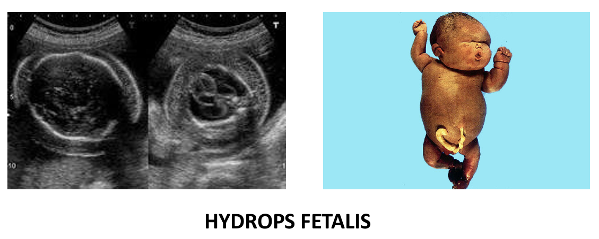
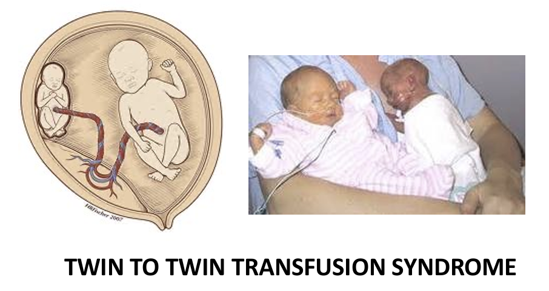
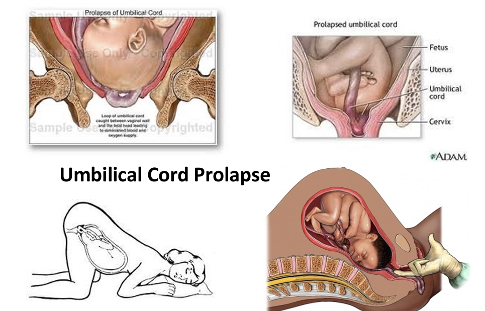
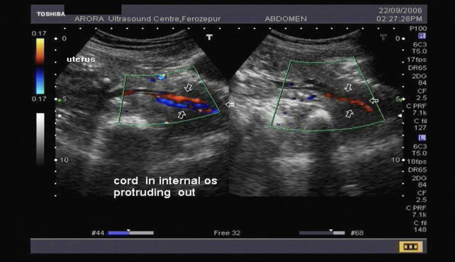
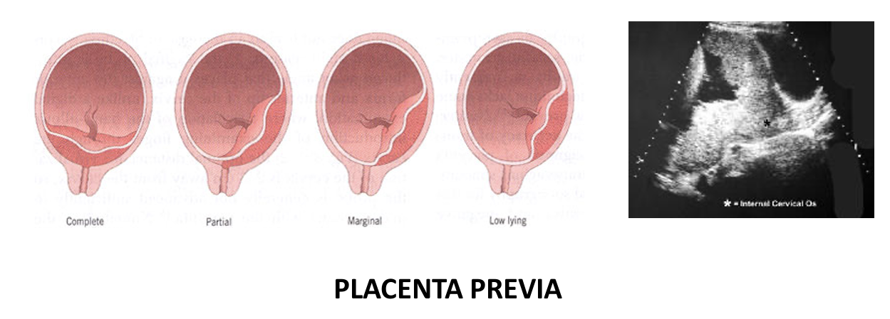
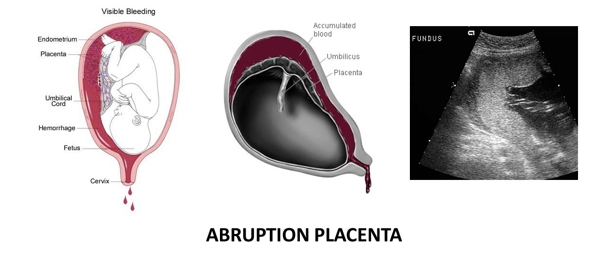
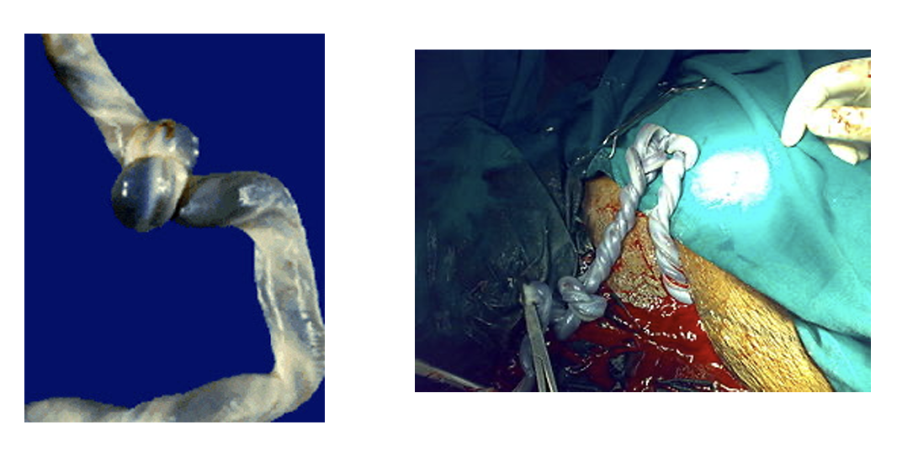
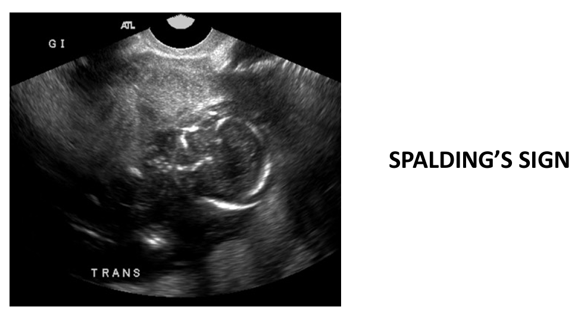

# 1. Definisi dan Epidemiologi

Intrauterine fetal death (IUFD) adalah **kematian janin di dalam uterus sebelum dilahirkan**. IUFD didefinisikan pada **usia kehamilan >20 minggu** dengan **berat janin 500 gram atau lebih**.

Angka kejadian IUFD sekitar 1% dari 1.000 kehamilan. Angka ini dapat berbeda bergantung pada populasi dan definisi yang digunakan.

# 2. Anamnesis, Pemeriksaan Fisik, dan Pemeriksaan Penunjang

| Pemeriksaan           | Temuan                                                                                                                                                                                                                         |
| --------------------- | ------------------------------------------------------------------------------------------------------------------------------------------------------------------------------------------------------------------------------ |
| Anamnesis             | Ibu merasa **gerakan janin berkurang** atau tidak lagi dirasakan.                                                                                                                                                              |
| Pemeriksaan fisik     | **Denyut jantung janin tidak terdengar** pada pemeriksaan klinis.                                                                                                                                                              |
| Pemeriksaan penunjang | **USG** merupakan pemeriksaan utama untuk memastikan tidak adanya aktivitas jantung janin. Gerakan janin juga dapat dinilai melalui USG. Jika hasil meragukan, lakukan evaluasi USG yang memadai sebelum menegakkan diagnosis. |

🧠**Tips menghafal**: Kecurigaan IUFD muncul ketika gerakan janin tidak terasa, pemeriksaan klinis tidak menemukan denyut jantung janin, lalu **diagnosis dikonfirmasi dengan USG**. #Ingat

# 3. Faktor Risiko

Faktor risiko yang berkaitan dengan IUFD meliputi:

- Usia ibu ekstrem, terlalu muda atau lebih tua.
- Status perkawinan, yang dapat berkaitan dengan faktor sosial dan akses pelayanan kesehatan, tetapi bukan penyebab biologis langsung.
- Jenis kelamin janin laki-laki memiliki prevalensi lebih tinggi pada sejumlah populasi.
- Kehamilan multipel, terutama kehamilan kembar dengan komplikasi.
- Multiparitas tinggi, terutama lebih dari lima kali persalinan.
- Presentasi janin non-oksiput, misalnya presentasi sungsang atau lintang.

# 4. Etiologi

Sekitar 50% kasus IUFD tidak diketahui penyebabnya. Penyebab yang diketahui dapat dikelompokkan menjadi faktor maternal, janin, plasenta, dan tali pusat.

## A. Faktor maternal

- Hipertensi kronis, yang dapat menyebabkan gangguan perfusi uteroplasenta.
- Diabetes melitus gestasional (DMG/GDM).
- Preeklamsia, yang dapat mengganggu fungsi plasenta dan suplai oksigen kepada janin.
- Penyakit metabolik lainnya.
- Gangguan trombofilia, yaitu kondisi yang meningkatkan kecenderungan pembentukan trombus.
- Infeksi virus atau bakteri, yang dapat memengaruhi ibu, plasenta, atau janin.
- Inkompetensi serviks, yaitu ketidakmampuan serviks mempertahankan kehamilan akibat pembukaan prematur.
- Kelainan anatomi uterus.
- Perdarahan fetomaternal, yaitu perpindahan darah janin ke sirkulasi ibu.

## B. Kelainan janin

- Kelainan struktural atau kromosom, termasuk malformasi kongenital dan kelainan genetik.
- Infeksi virus atau bakteri.
- Penyakit autoimun janin.
- Penyakit metabolik.
- **Hydrops fetalis**, yaitu akumulasi cairan patologis pada setidaknya dua kompartemen tubuh janin, misalnya edema kulit dan efusi rongga tubuh.

## C. Gangguan plasenta dan tali pusat

Gangguan plasenta dapat mengurangi suplai oksigen dan nutrisi kepada janin sehingga menyebabkan hipoksemia dan dapat berkaitan dengan pertumbuhan janin terhambat (PJT/FGR).

Penyebab yang dapat ditemukan meliputi:

- Disfungsi plasenta, yang menyebabkan gangguan pertukaran oksigen dan nutrisi.
- Kehamilan postterm atau postmaturitas.
- Solusio plasenta (abruptio placentae), yaitu pelepasan plasenta sebelum janin dilahirkan.
- Plasenta previa, yaitu plasenta yang menutupi sebagian atau seluruh ostium uteri internum.
- Infark plasenta.
- Twin-to-twin transfusion syndrome (TTTS), yaitu ketidakseimbangan aliran darah antara kedua janin pada kehamilan kembar monokorionik.

- Ketuban pecah sebelum waktunya (KPD/PROM), terutama jika disertai infeksi atau komplikasi lain.
- Kelainan tali pusat, seperti:
    - Prolaps tali pusat.
    - Trombosis tali pusat.
    - Lilitan tali pusat yang menyebabkan kompresi.
    - Simpul tali pusat.
    - Torsi atau puntiran tali pusat.

# 5. Diagnosis dan Tanda Pascakematian Janin

## A. Konfirmasi diagnosis

- **USG** memastikan tidak adanya aktivitas jantung janin.
- Tidak adanya gerakan janin saja tidak cukup untuk memastikan IUFD.
- Denyut jantung janin yang tidak terdengar dengan alat pemeriksaan klinis juga perlu dikonfirmasi menggunakan USG.

## B. Tanda setelah kematian janin berlangsung beberapa waktu

Beberapa perubahan dapat ditemukan pada pemeriksaan pencitraan, terutama jika kematian janin telah berlangsung selama beberapa waktu.

- Edema kulit kepala: pembengkakan jaringan kulit kepala janin.
- *Spalding sign*: tulang-tulang tengkorak saling tumpang tindih akibat perubahan setelah kematian janin.
- *Robert sign*: adanya gas di dalam jantung atau pembuluh darah besar janin. #Ingat

**Tips menghafal** 🧠:

- *Spalding* = Skull bones overlap, yaitu tulang tengkorak saling tumpang tindih.
- *Robert* = gas, yaitu gas di jantung atau pembuluh darah besar.

Tanda-tanda tersebut merupakan temuan tambahan dan tidak menggantikan USG untuk memastikan diagnosis.

# 6. Komplikasi IUFD

## A. Koagulopati maternal

Retensi janin yang telah meninggal dalam waktu lama dapat berkaitan dengan **gangguan pembekuan darah**, termasuk **koagulopati konsumtif** dan **hipofibrinogenemia**.

Hipofibrinogenemia adalah penurunan kadar fibrinogen, yaitu protein yang diperlukan dalam pembentukan bekuan darah. Pada kasus berat, kondisi ini dapat meningkatkan risiko perdarahan.

Namun, gangguan pembekuan tidak terjadi pada semua kasus IUFD. Risiko dipengaruhi oleh penyebab kematian janin, lamanya retensi, dan kondisi klinis ibu.

## B. Dampak psikologis

IUFD dapat menimbulkan kesedihan mendalam, kecemasan, dan respons berduka pada ibu serta keluarga. Karena itu, komunikasi yang empatik dan dukungan psikologis merupakan bagian penting dari penatalaksanaan.

# 7. Penatalaksanaan IUFD

Penatalaksanaan ditentukan oleh kondisi ibu, usia kehamilan, kondisi serviks, riwayat operasi uterus, serta pilihan pasien setelah mendapatkan penjelasan yang memadai.

## A. Pemeriksaan sebelum menentukan penatalaksanaan

Pemeriksaan yang dapat diperlukan meliputi:

- Darah lengkap, untuk menilai hemoglobin, leukosit, dan trombosit.
- PT/INR dan aPTT, untuk menilai proses pembekuan darah.
- Kadar fibrinogen, terutama bila terdapat kekhawatiran koagulopati.
- Pemeriksaan tambahan sesuai penyebab yang dicurigai dan kondisi klinis ibu.

## B. Penatalaksanaan ekspektatif

- Penatalaksanaan ekspektatif adalah **menunggu terjadinya persalinan spontan** dengan pemantauan kondisi ibu secara ketat.
- **Pada ibu yang stabil, tanpa perdarahan, infeksi, atau koagulopati**, pendekatan ini dapat dipertimbangkan setelah konseling dan pengambilan keputusan bersama.
- 80% pasien akan mengalami **persalinan spontan dalam 2-3 minggu**.

Hal yang perlu dipertimbangkan:

- Kondisi ibu harus tetap stabil.
- Pantau tanda perdarahan, demam, nyeri, atau gejala lain yang mengarah pada komplikasi.
- Lakukan pemeriksaan koagulasi secara berkala bila janin tetap berada di uterus, sesuai penilaian klinis.
- Pertimbangkan risiko gangguan pembekuan darah jika retensi berlangsung lama.
- Perhatikan kondisi emosional ibu dan kebutuhan dukungan psikologis.

Kelemahan penatalaksanaan ekspektatif:

- Risiko koagulopati, termasuk hipofibrinogenemia.
- Ketidakpastian waktu terjadinya persalinan.
- Beban emosional bagi ibu dan keluarga.

## C. Persalinan segera

Persalinan perlu dipercepat jika terdapat kondisi yang membuat penundaan tidak aman, seperti:

- **Koagulopati atau penurunan fibrinogen yang bermakna.**
- Perdarahan atau dugaan solusio plasenta.
- Infeksi.
- Kondisi maternal yang tidak stabil.
- Indikasi klinis lain yang memerlukan terminasi segera.

Jika ditemukan koagulopati, diperlukan penanganan segera, stabilisasi ibu, perencanaan persalinan, dan koreksi gangguan pembekuan sesuai indikasi.

## D. Metode persalinan

Pemilihan metode bergantung pada usia kehamilan, kondisi serviks, riwayat operasi uterus, kondisi ibu, dan fasilitas yang tersedia.

### 1. Evakuasi uterus pada usia kehamilan dini

Pada usia kehamilan yang sangat dini, evakuasi uterus dapat dilakukan menggunakan:
	
- **Aspirasi vakum** atau *suction curettage*.
- **Dilatasi dan evakuasi** (*dilation and evacuation/D&E*), sesuai usia kehamilan, kondisi klinis, dan kompetensi operator.

Riwayat operasi sesar atau pembedahan uterus perlu diperhatikan karena dapat memengaruhi pemilihan metode dan risiko komplikasi.

### 2. Induksi persalinan

- **Oksitosin intravena** dapat digunakan untuk **merangsang kontraksi uterus** sesuai kondisi serviks dan protokol klinis.
- **Amniotomi**, yaitu pemecahan selaput ketuban secara buatan, dapat dipertimbangkan bila sesuai secara klinis.
- Risiko ruptur uteri perlu diperhatikan, terutama pada pasien dengan riwayat operasi sesar atau pembedahan uterus.

Pemilihan obat, dosis, dan metode induksi harus disesuaikan dengan kondisi pasien dan jenis bekas luka uterus.

### 3. Operasi sesar

Operasi sesar bukan pilihan rutin hanya karena terjadi IUFD. Cara persalinan harus mempertimbangkan keselamatan ibu, riwayat obstetri, dan indikasi obstetri lainnya.

# 8. Evaluasi Penyebab Setelah IUFD

Evaluasi dilakukan untuk membantu menentukan penyebab kematian janin dan memperkirakan risiko pada kehamilan berikutnya. Pemeriksaan disesuaikan dengan riwayat, temuan klinis, ketersediaan fasilitas, dan persetujuan keluarga.

## A. Evaluasi maternal

- Evaluasi diabetes melitus bila dicurigai sebagai faktor penyebab.
- Evaluasi hipertensi dan gangguan vaskular.
- Pemeriksaan tambahan berdasarkan riwayat penyakit, komplikasi kehamilan, atau dugaan penyebab IUFD.

## B. Evaluasi perdarahan fetomaternal

- Uji Kleihauer–Betke dapat digunakan untuk mendeteksi dan memperkirakan jumlah eritrosit janin dalam sirkulasi ibu.
- Pemeriksaan ini membantu mengevaluasi kemungkinan perdarahan fetomaternal sebagai penyebab IUFD.

## C. Pemeriksaan genetik

- Pemeriksaan kromosom atau pemeriksaan genetik janin dapat dilakukan bila dicurigai adanya kelainan kromosom atau genetik.
- Pemeriksaan dipilih berdasarkan temuan klinis dan ketersediaan layanan.

## D. Pemeriksaan plasenta

- Evaluasi plasenta secara makroskopis.
- Pemeriksaan histopatologi plasenta untuk mencari tanda infeksi, gangguan vaskular, infark, atau kelainan lain.

## E. Pemeriksaan janin

- Autopsi janin dapat membantu mengidentifikasi kelainan struktural atau penyakit yang mendasari kematian.
- Pencitraan janin, termasuk radiografi, dapat digunakan untuk mengevaluasi kelainan struktural tertentu.

Tidak semua pemeriksaan harus dilakukan pada setiap kasus. Pemeriksaan ditentukan berdasarkan kemungkinan penyebab, manfaat klinis, ketersediaan fasilitas, dan persetujuan keluarga.

# 9. Rangkuman

- IUFD adalah kematian janin di dalam uterus dengan batas usia kehamilan lebih dari 20 minggu dan berat janin ≥500 gram.
- Gejala utama adalah gerakan janin berkurang atau tidak dirasakan.
- Diagnosis dikonfirmasi melalui USG yang memastikan tidak adanya aktivitas jantung janin.

- Sekitar 50% kasus dapat tidak diketahui penyebabnya.
- Etiologi dikelompokkan menjadi faktor maternal, janin, plasenta, dan tali pusat.

- Tanda pascakematian dapat berupa edema kulit kepala, Spalding sign, dan Robert sign.
- Retensi janin dapat berkaitan dengan koagulopati dan hipofibrinogenemia, sehingga kondisi ibu dan parameter pembekuan darah perlu dinilai.

- Penatalaksanaan dapat berupa ekspektatif atau persalinan segera, bergantung pada kondisi ibu dan risiko komplikasi.
- Metode persalinan dipilih berdasarkan usia kehamilan, kondisi serviks, riwayat operasi uterus, dan keselamatan ibu.
- Evaluasi penyebab dapat meliputi pemeriksaan maternal, uji perdarahan fetomaternal, pemeriksaan genetik, histopatologi plasenta, autopsi, dan pencitraan sesuai indikasi.
- Komunikasi yang empatik dan dukungan psikologis harus menjadi bagian dari penatalaksanaan.

## Tips menghafal akhir 🧠

- Diagnosis: gerakan janin tidak terasa → curiga IUFD → USG memastikan tidak ada aktivitas jantung.
- Etiologi: Ibu – Janin – Plasenta/Tali pusat.
- Tanda pascakematian: *Spalding* = tulang tengkorak tumpang tindih; *Robert* = gas di jantung atau pembuluh darah besar.
- Komplikasi penting: retensi janin dapat berkaitan dengan **gangguan koagulasi**.
- Prioritas penatalaksanaan: nilai stabilitas ibu, perdarahan atau infeksi, serta koagulasi sebelum menentukan waktu dan metode persalinan.