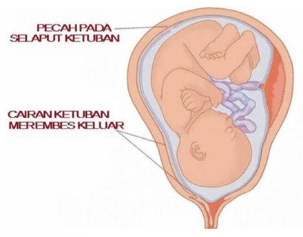

> [!NOTE] Level Kompetensi SKDI: 3B

# 1. Definisi

**Ketuban pecah dini (KPD)** atau **ketuban pecah sebelum waktunya (KPSW)** adalah pecahnya selaput ketuban sebelum persalinan dimulai, yaitu sebelum timbul tanda-tanda persalinan.

**KPD preterm (preterm premature rupture of membranes/PPROM)** adalah KPD yang terjadi sebelum usia kehamilan 37 minggu.

**Perbedaan penting:**
- **KPD aterm:** selaput ketuban pecah pada usia kehamilan ≥37 minggu sebelum persalinan dimulai.
- **KPD preterm/PPROM:** selaput ketuban pecah sebelum usia kehamilan 37 minggu dan sebelum persalinan dimulai.

# 2. Epidemiologi

- KPD terjadi pada sekitar **8–10% dari seluruh kehamilan**.
- Angka kejadian yang dilaporkan bervariasi menurut populasi dan definisi; KPD preterm terjadi pada sekitar **2–3% kehamilan**.
- Sekitar **30–40% persalinan prematur** didahului oleh KPD.
- Setelah KPD aterm, banyak ibu akan mulai mengalami persalinan spontan dalam 24 jam berikutnya. Angka yang sering dilaporkan adalah sekitar 50% dalam 24 jam dan sekitar 80% dalam 48 jam, tetapi waktunya dapat bervariasi.

# 3. Etiologi dan Faktor Risiko

Penyebab KPD sering kali multifaktorial dan tidak selalu dapat ditentukan secara pasti. Faktor yang dapat meningkatkan risiko meliputi:

- **Infeksi atau inflamasi**, misalnya infeksi saluran kemih atau infeksi genital.
- **Trauma atau tindakan pada kehamilan**, misalnya amniosentesis; pemeriksaan vaginal digital dan hubungan seksual dapat berkaitan dengan keluarnya cairan atau trauma pada kondisi tertentu, tetapi bukan penyebab utama pada semua kasus.
- **Inkompetensi serviks**, yaitu kemampuan serviks mempertahankan kehamilan yang berkurang.
- **Kelainan letak atau presentasi janin.**
- **Peningkatan peregangan uterus**, misalnya pada kehamilan ganda atau hidramnion.
- **Gangguan pembentukan dan pemeliharaan kolagen**, yang dapat berkaitan dengan kekurangan zat gizi tertentu, termasuk vitamin C (asam askorbat).
- **Merokok.**
- Riwayat KPD atau persalinan prematur sebelumnya juga merupakan faktor risiko penting.

# 4. Patofisiologi

Selaput ketuban terdiri terutama atas amnion dan korion. Kekuatan serta elastisitasnya bergantung pada susunan matriks ekstraseluler, terutama kolagen dan protein jaringan ikat lainnya. Menjelang persalinan, terjadi perubahan fisiologis pada serviks dan selaput ketuban yang membuat selaput lebih mudah mengalami ruptur.

KPD dapat terjadi ketika kekuatan selaput ketuban menurun lebih awal atau tekanan mekanis yang diterima meningkat.

## Mekanisme utama

1. **Perubahan jaringan ikat dan kolagen.** Gangguan pembentukan, susunan, atau pemeliharaan kolagen dapat membuat selaput ketuban lebih tipis dan lemah. Vitamin C berperan dalam pembentukan kolagen, sedangkan tembaga merupakan kofaktor bagi enzim yang membantu pembentukan ikatan silang kolagen dan elastin.
2. **Peningkatan degradasi matriks ekstraseluler.** Enzim matrix metalloproteinases (MMP), termasuk kolagenase, memecah komponen matriks. Tissue inhibitors of metalloproteinases (TIMP), termasuk TIMP-1, menghambat aktivitas MMP. Ketidakseimbangan antara MMP dan TIMP dapat meningkatkan degradasi jaringan.
3. **Infeksi dan inflamasi.** Mikroorganisme atau respons inflamasi dapat merangsang pelepasan sitokin, seperti interleukin-1 (IL-1), serta prostaglandin dan enzim pemecah kolagen. Akibatnya, kolagen pada amnion dan korion terdegradasi dan selaput menjadi lebih rapuh.
4. **Faktor mekanis.** Peregangan berlebihan, misalnya pada hidramnion atau kehamilan ganda, dapat menambah tekanan pada selaput yang sudah melemah.
5. **Ruptur selaput ketuban.** Ketika kekuatan selaput tidak lagi mampu menahan tekanan intrauterin, selaput dapat pecah sebelum persalinan dimulai.

Bakteri seperti *Mycoplasma* dan *Ureaplasma* pernah sering diisolasi dari saluran genital atau selaput ketuban pada kasus persalinan prematur dan KPD. Namun, ditemukannya mikroorganisme tersebut tidak selalu berarti bahwa infeksi merupakan penyebab langsung pada setiap kasus.

**Catatan:** Pada persalinan normal, perubahan serviks dan kontraksi umumnya mendahului atau menyertai pecahnya ketuban. Jika selaput pecah sebelum kontraksi dan tanda persalinan muncul, perlu dipertimbangkan proses patologis atau faktor risiko yang mendasarinya.

## Tips menghafal 🧠

Ingat tiga kelompok mekanisme: **selaput melemah, enzim merusak, tekanan meningkat**.
- Selaput melemah: gangguan kolagen, merokok, faktor nutrisi.
- Enzim merusak: infeksi/inflamasi, MMP meningkat atau aktivitas TIMP tidak cukup.
- Tekanan meningkat: kehamilan ganda, hidramnion, atau faktor mekanis.

# 5. Anamnesis

Keluhan utama adalah **keluarnya cairan dari vagina** yang dirasakan merembes atau mengalir, sering kali tanpa dapat ditahan seperti berkemih.

Hal yang perlu ditanyakan:
- Waktu pertama kali cairan keluar, jumlah, warna, bau, dan apakah cairan terus merembes.
- Ada atau tidaknya kontraksi, nyeri perut, perdarahan, atau lendir bercampur darah.
- Gerakan janin.
- Demam, menggigil, atau keluhan lain yang mengarah pada infeksi.
- Usia kehamilan dan riwayat KPD, persalinan prematur, infeksi saluran kemih, atau tindakan pada kehamilan.

Karakter cairan:
- **Jernih atau pucat:** dapat sesuai dengan cairan ketuban normal.
- **Hijau atau kecokelatan:** dapat menunjukkan campuran mekonium dan perlu penilaian kondisi janin.
- **Berbau tidak sedap:** dapat mengarah pada infeksi, terutama jika disertai demam atau nyeri tekan uterus.
- Cairan ketuban umumnya encer; tetapi tampilan saja tidak cukup untuk memastikan diagnosis.

# 6. Pemeriksaan Fisik dan Penunjang

## Pemeriksaan fisik

Nilai keadaan umum dan tanda vital ibu, khususnya suhu, nadi, serta tanda infeksi. Periksa nyeri tekan uterus, kontraksi, perdarahan, dan kondisi janin sesuai fasilitas yang tersedia.

## Pemeriksaan dengan spekulum steril

Pemeriksaan spekulum steril dapat menunjukkan cairan yang menggenang di vagina atau mengalir dari ostium uteri eksternum. Cairan dapat mengandung verniks kaseosa, rambut lanugo, atau mekonium.

**Hindari pemeriksaan vaginal digital berulang** bila persalinan belum jelas dimulai karena dapat meningkatkan risiko infeksi. Pemeriksaan digital dilakukan hanya jika ada indikasi klinis yang kuat dan hasilnya akan memengaruhi penatalaksanaan segera.

## Pemeriksaan penunjang

- **Tes pH/nitrazin:** cairan ketuban cenderung lebih basa dibandingkan sekret vagina. Hasil positif dapat mendukung diagnosis, tetapi tidak spesifik karena darah, semen, atau infeksi vagina dapat menyebabkan hasil positif palsu.
- **Ferning test:** pola kristalisasi seperti daun pakis pada cairan yang dikeringkan dapat mendukung diagnosis bila tersedia.
- **Ultrasonografi (USG):** menilai usia kehamilan, presentasi janin, perkiraan berat janin, letak plasenta, dan volume cairan ketuban. Volume cairan yang rendah mendukung tetapi tidak membuktikan KPD; volume normal tidak menyingkirkannya.
- **Pemeriksaan darah dan evaluasi infeksi:** hitung leukosit dapat membantu penilaian klinis, tetapi leukositosis saja tidak cukup untuk memastikan infeksi. Nilai leukosit >15.000/mm³ dapat menimbulkan kecurigaan, terutama bila disertai demam, takikardia, nyeri tekan uterus, atau temuan lain. Kortikosteroid juga dapat meningkatkan jumlah leukosit.
- Tes tambahan khusus, misalnya pemeriksaan protein yang berkaitan dengan cairan ketuban, dapat dipertimbangkan jika diagnosis masih meragukan dan tersedia.

**Penting:** Diagnosis terutama didasarkan pada anamnesis dan pemeriksaan spekulum. Tidak ada satu temuan penunjang yang boleh digunakan secara terpisah tanpa mempertimbangkan gambaran klinis.

# 7. Diagnosis

#Ingat KPD dicurigai pada ibu hamil yang melaporkan cairan keluar dari vagina sebelum kontraksi persalinan dimulai. Temuan yang mendukung meliputi:
- Riwayat cairan merembes atau mengalir dari vagina.
- Cairan terlihat menggenang di vagina atau keluar melalui ostium uteri eksternum pada pemeriksaan spekulum steril.
- Tes pendukung, seperti **nitrazin atau ferning**, sesuai dengan cairan ketuban.

Tidak adanya kontraksi, pembukaan serviks, atau pengeluaran lendir bercampur darah **tidak wajib ditemukan** untuk mendiagnosis KPD. KPD dapat terjadi sebelum persalinan dimulai, sedangkan kontraksi dan perubahan serviks dapat muncul kemudian.

## Diagnosis banding

- Inkontinensia urine.
- Sekret vagina yang berlebihan.
- Semen setelah hubungan seksual.
- Keluarnya lendir serviks.
- Keringat atau cairan lain yang mengontaminasi area genital.

# 8. Penatalaksanaan

Penatalaksanaan ditentukan terutama oleh **usia kehamilan**, adanya infeksi atau gangguan kesejahteraan janin, status persalinan, presentasi janin, serta kondisi ibu dan janin. KPD membutuhkan evaluasi obstetri segera di fasilitas kesehatan.

## A. Penilaian awal

1. Pastikan diagnosis dan tentukan usia kehamilan.
2. Nilai keadaan ibu: tanda vital, demam, nyeri tekan uterus, perdarahan, dan tanda infeksi.
3. Nilai kondisi janin: gerakan janin dan pemantauan denyut jantung janin sesuai indikasi.
4. Tentukan ada tidaknya persalinan aktif, presentasi janin, serta komplikasi seperti prolaps tali pusat atau solusio plasenta.
5. Hindari pemeriksaan vaginal digital berulang jika tidak diperlukan.

## B. KPD preterm tanpa infeksi atau gawat janin

Pada kehamilan sebelum 37 minggu, bila ibu dan janin stabil serta tidak terdapat kontraindikasi untuk melanjutkan kehamilan, penatalaksanaan ekspektatif dapat dipertimbangkan di rumah sakit dengan pemantauan ketat. Keputusan harus disesuaikan dengan usia kehamilan dan protokol obstetri setempat.

Komponen penatalaksanaan dapat meliputi:
- **Rawat inap dan observasi**, terutama untuk mendeteksi infeksi, persalinan, perdarahan, atau gangguan kondisi janin.
- **Antibiotik untuk memperpanjang masa laten dan menurunkan risiko infeksi** pada PPROM sesuai pedoman yang digunakan. Regimen dan durasi mengikuti protokol rumah sakit; pilihan antibiotik tidak boleh ditentukan hanya dari satu skema lama karena rekomendasi berbeda menurut pedoman dan keadaan klinis.
- **Kortikosteroid antenatal** pada usia kehamilan yang sesuai untuk membantu pematangan paru janin dan menurunkan komplikasi prematuritas.
- **Magnesium sulfat untuk neuroproteksi janin** dapat dipertimbangkan jika persalinan sangat prematur diperkirakan segera, sesuai batas usia kehamilan dan protokol setempat.
- **Tokolisis** tidak diberikan secara rutin pada semua kasus KPD. Penggunaan selektif dapat dipertimbangkan oleh dokter spesialis pada keadaan tertentu, misalnya untuk memungkinkan pemberian kortikosteroid atau transfer ke pusat yang sesuai, selama tidak ada infeksi, solusio plasenta, atau indikasi persalinan segera.
- Pemantauan klinis ibu dan janin secara berkala.

Tirah baring ketat dalam waktu lama tidak dianjurkan secara rutin karena dapat meningkatkan risiko tromboemboli dan dekondisi; aktivitas ditentukan oleh kondisi klinis dan kebijakan perawatan.

## C. KPD aterm (usia kehamilan ≥37 minggu)

Pada KPD aterm, persalinan umumnya direncanakan untuk mengurangi risiko infeksi, sering kali melalui induksi persalinan jika tidak ada kontraindikasi. Metode induksi dipilih sesuai kondisi serviks, presentasi janin, dan keadaan obstetri.

- Antibiotik diberikan bila terdapat indikasi, misalnya profilaksis terhadap streptokokus grup B sesuai status skrining dan protokol, atau terapi jika dicurigai/terdiagnosis infeksi.
- Seksio sesarea dilakukan berdasarkan indikasi obstetri, misalnya presentasi atau kondisi janin yang tidak memungkinkan persalinan pervaginam, atau bila terdapat indikasi lain. KPD sendiri bukan indikasi otomatis untuk seksio sesarea.

## D. Kapan kehamilan perlu segera diakhiri?

Persalinan perlu dipertimbangkan atau dilakukan segera bila terdapat kondisi yang membuat melanjutkan kehamilan berbahaya, antara lain:
- **Infeksi intra-amnion/korioamnionitis yang dicurigai atau terdiagnosis.**
- **Gangguan kesejahteraan janin.**
- **Prolaps tali pusat.**
- **Solusio plasenta atau perdarahan bermakna.**
- Persalinan yang sudah berlangsung atau indikasi obstetri lain.

Cara persalinan ditentukan berdasarkan kondisi ibu dan janin serta indikasi obstetri. Antibiotik spektrum luas digunakan jika ada kecurigaan atau diagnosis infeksi, sesuai protokol klinis.

## E. Hal yang perlu dihindari

- Pemeriksaan vaginal digital berulang tanpa indikasi.
- Mengandalkan warna atau bau cairan saja untuk memastikan diagnosis.
- Menganggap leukositosis saja sebagai bukti pasti infeksi.
- Memberikan tokolitik atau antibiotik secara rutin tanpa mempertimbangkan usia kehamilan, kondisi klinis, dan pedoman yang berlaku.
- Menunda evaluasi bila muncul demam, nyeri perut/uterus, perdarahan, cairan berbau tidak sedap, gerakan janin berkurang, atau cairan keluar mendadak dalam jumlah banyak.

## Tips menghafal tatalaksana 🧠

Gunakan urutan **“Usia – Infeksi – Janin – Persalinan”**:
1. **Usia:** aterm atau preterm?
2. **Infeksi:** ada tanda infeksi atau tidak?
3. **Janin:** apakah kondisi janin meyakinkan?
4. **Persalinan:** apakah sudah inpartu atau ada indikasi untuk segera melahirkan?

Jika ada infeksi, gawat janin, prolaps tali pusat, atau komplikasi serius, jangan meneruskan observasi ekspektatif tanpa evaluasi obstetri segera.

# 9. Prognosis

Prognosis bergantung pada usia kehamilan saat ketuban pecah, lamanya interval antara pecah ketuban dan persalinan, ada tidaknya infeksi, serta kondisi ibu dan janin.

- Prognosis cenderung lebih baik jika tidak terjadi infeksi maternal atau neonatal dan tidak terdapat komplikasi prematuritas yang berat.
- KPD preterm meningkatkan risiko komplikasi akibat prematuritas, termasuk gangguan pernapasan, perdarahan intraventrikular, dan masalah neonatal lainnya.
- Infeksi intra-amnion dapat berkembang menjadi sepsis pada ibu atau bayi baru lahir.
- Semakin dini usia kehamilan saat KPD terjadi, semakin besar tantangan dalam menyeimbangkan risiko prematuritas dengan risiko infeksi dan komplikasi lainnya.

# 10. Rangkuman

- **KPD** adalah pecahnya selaput ketuban sebelum persalinan dimulai.
- **PPROM/KPD preterm** terjadi sebelum usia kehamilan 37 minggu.
- Faktor risiko meliputi infeksi/inflamasi, riwayat KPD atau persalinan prematur, merokok, gangguan jaringan ikat, inkompetensi serviks, dan peregangan uterus berlebihan.
- Patofisiologi utama meliputi kelemahan kolagen, peningkatan degradasi matriks oleh MMP, inflamasi, serta tekanan mekanis.
- Gejala utama adalah cairan yang merembes atau mengalir dari vagina. Diagnosis terutama melalui anamnesis dan pemeriksaan spekulum steril; tes pH dan USG merupakan pemeriksaan pendukung.
- Hindari pemeriksaan vaginal digital berulang karena meningkatkan risiko infeksi.
- Tatalaksana bergantung pada usia kehamilan serta kondisi ibu dan janin. KPD preterm yang stabil dapat dikelola secara ekspektatif dengan pemantauan dan terapi sesuai pedoman; KPD aterm umumnya memerlukan perencanaan persalinan.
- Infeksi intra-amnion, gangguan kesejahteraan janin, prolaps tali pusat, solusio plasenta, atau komplikasi serius merupakan alasan untuk evaluasi dan tindakan segera.
- Prognosis terutama ditentukan oleh usia kehamilan, infeksi, dan komplikasi maternal maupun neonatal.
