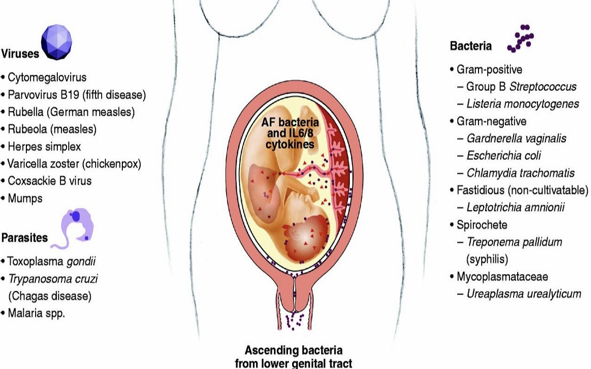

> [!NOTE] Level Kompetensi SKDI: 3B

# 1. Definisi

Korioamnionitis adalah **infeksi pada korioresidua dan/atau amnion**. Infeksi dapat melibatkan cairan amnion, janin, tali pusat, plasenta, serta membran janin.

Korioamnionitis merupakan **salah satu penyebab tersering demam intrapartum** dan penting dikenali karena dapat menimbulkan komplikasi pada ibu maupun janin.

# 2. Epidemiologi

- Pada tinjauan sistematis, sekitar 20–25% kehamilan dengan ketuban pecah dini (KPD) yang tidak mendapatkan terapi antibiotik mengalami korioamnionitis.
- Korioamnionitis dilaporkan pada sekitar 1–4% persalinan cukup bulan.
- Kejadiannya lebih sering berkaitan dengan persalinan preterm dengan angka 40–70%.
- Risiko meningkat pada ibu yang menjalani pemeriksaan dalam vagina (PDV) berulang kali. Sekitar 20% kasus dilaporkan pada ibu yang menjalani PDV lebih dari delapan kali.

Angka kejadian dapat bervariasi berdasarkan populasi dan metode diagnosis.

# 3. Etiologi

Korioamnionitis umumnya merupakan infeksi polimikroba, yaitu infeksi yang melibatkan lebih dari satu jenis mikroorganisme. Kuman sering berasal dari flora komensal vagina yang naik ke rongga uterus.

Mikroorganisme yang dapat terlibat meliputi:

- Ureaplasma
- **Mycoplasma (70%)**
- Gardnerella
- Streptokokus
- Escherichia coli dan bakteri Gram-negatif lainnya

Infeksi dapat terjadi ketika mikroorganisme naik melalui serviks menuju membran dan cairan amnion. Risiko dapat meningkat ketika pertahanan membran terganggu, misalnya setelah ketuban pecah.

# 4. Patofisiologi

Dalam keadaan normal, kavum uteri dipertahankan relatif steril. Mikroorganisme dari vagina dapat naik melalui serviks dan menyebabkan infeksi pada membran janin.

Urutan mekanismenya sebagai berikut.

1. Mikroorganisme naik dari vagina melalui serviks menuju korion, amnion, atau cairan amnion.
2. Respons imun memicu inflamasi dan pelepasan mediator inflamasi.
3. **Prostaglandin meningkat dan merangsang kontraksi uterus.**
4. Inflamasi juga dapat melemahkan membran amnion dan korion melalui kerusakan jaringan.
5. **Membran yang melemah lebih rentan mengalami ketuban pecah dini (KPD)**, sedangkan kontraksi dapat memicu atau mempercepat persalinan.
6. Jika infeksi melibatkan janin atau tali pusat, dapat timbul komplikasi pada janin dan neonatus.

**KPD dan korioamnionitis dapat saling berkaitan**. Infeksi dapat melemahkan membran sehingga ketuban pecah, sedangkan setelah ketuban pecah, perlindungan terhadap mikroorganisme yang naik dari vagina berkurang.

## Tips menghafal 🧠

#Ingat urutan infeksi → inflamasi → prostaglandin → kontraksi dan kelemahan membran → KPD atau persalinan preterm.

# 5. Faktor Risiko

Faktor risiko korioamnionitis meliputi:

- Persalinan lama.
- Nulliparitas, yaitu belum pernah melahirkan.
- Pemeriksaan dalam vagina (PDV) berulang kali.
- Pemantauan janin internal.
- Bacterial vaginosis.
- Infeksi organ reproduksi, termasuk Chlamydia trachomatis, Neisseria gonorrhoeae, dan Ureaplasma urealyticum.
- Merokok.
- Riwayat persalinan preterm atau KPD sebelumnya.
- Status sosioekonomi rendah.

## Tips menghafal 🧠

Kelompokkan faktor risiko menjadi lama – berulang – infeksi – riwayat.

- Lama: persalinan berlangsung lama.
- Berulang: pemeriksaan dalam vagina berulang.
- Infeksi: bacterial vaginosis atau infeksi organ reproduksi.
- Riwayat: pernah mengalami KPD atau persalinan preterm.

Tambahkan faktor lain yang khas, yaitu pemantauan janin internal, merokok, nulliparitas, dan status sosioekonomi rendah.

# 6. Gejala dan Tanda Klinis

Gejala atau tanda yang dapat ditemukan meliputi:

- **Demam**, merupakan tanda klinis utama.
- **Leukositosis**, terutama jumlah leukosit >15.000/mm³. Jika leukositosis terjadi tanpa demam, diagnosis perlu dievaluasi kembali karena leukositosis saja tidak cukup untuk menegakkan korioamnionitis.
- Takikardia ibu.
- Takikardia janin, yaitu denyut jantung janin >160 kali/menit.
- Nyeri perut.
- Cairan atau sekret vagina berbau tidak sedap (**foetor**).
- **Cairan purulen** yang keluar dari serviks.

Tidak semua tanda harus muncul sekaligus. Interpretasi harus mempertimbangkan keadaan klinis, usia kehamilan, penggunaan obat seperti kortikosteroid, dan kemungkinan penyebab demam lainnya.

# 7. Diagnosis

Kriteria klinis: **demam** dengan suhu **≥39°C** pada satu kali pemeriksaan atau 38–38,9°C pada dua kali pemeriksaan dengan jarak 30 menit, tanpa penyebab yang jelas, ditambah satu atau lebih temuan berikut.

- **Denyut jantung janin baseline >160 kali/menit selama ≥10 menit**, tidak termasuk perubahan yang disebabkan akselerasi, deselerasi, atau variabilitas.
- **Leukosit >15.000/mm³** tanpa penggunaan kortikosteroid.
- **Cairan purulen** yang terlihat keluar dari serviks pada pemeriksaan inspekulo.

Diagnosis ditentukan melalui gabungan anamnesis, pemeriksaan fisik, dan pemeriksaan penunjang sesuai kondisi klinis. Demam intrapartum tetap perlu dinilai untuk membedakan korioamnionitis dari penyebab demam lainnya.

## Pemeriksaan yang relevan

- Suhu dan tanda vital ibu untuk menilai demam serta kondisi umum.
- Denyut jantung janin untuk mendeteksi takikardia janin.
- Hitung darah lengkap, dengan mempertimbangkan bahwa leukositosis dapat disebabkan oleh kondisi lain atau penggunaan kortikosteroid.
- Pemeriksaan spekulum untuk melihat cairan purulen dari serviks.
- Pemeriksaan lain sesuai kondisi ibu, janin, dan fasilitas kesehatan.

## Tips menghafal diagnosis 🧠

#Ingat **demam** + minimal satu tanda pendukung:

- **Takikardia** janin: >160 kali/menit.
- **Leukositosis**: >15.000/mm³ tanpa kortikosteroid.
- **Pus**: cairan purulen dari serviks.

> Dengan demikian, rumus singkatnya adalah demam + T/L/P.

# 8. Penatalaksanaan

Korioamnionitis memerlukan evaluasi dan penanganan obstetri segera karena dapat membahayakan ibu dan janin. Penanganan mencakup antibiotik spektrum luas, pemantauan kondisi ibu dan janin, serta perencanaan persalinan.

## A. Antibiotik

#Ingat Regimen antibiotik meliputi:

- **Ampisilin 2 gr** setiap 6 jam + **gentamisin 1,5 mg/kgBB** setiap 8 jam.
- **Amoksisilin** + **eritromisin**.
- **Klindamisin 2x300 mg** selama 7 hari.
- Antibiotik dipertahankan sampai 24–48 jam setelah bebas demam.

## B. Persalinan dan pemantauan

- Lakukan penilaian segera terhadap keadaan ibu, tanda vital, dan kondisi janin.
- Berikan antibiotik spektrum luas sesuai protokol.
- Rencanakan persalinan berdasarkan kondisi obstetri serta keadaan ibu dan janin. Korioamnionitis umumnya merupakan alasan untuk tidak menunda persalinan yang diperlukan hanya demi menyelesaikan terapi lain.
- Cara persalinan ditentukan oleh indikasi obstetri. Korioamnionitis sendiri tidak otomatis mengharuskan seksio sesarea.
- Kortikosteroid untuk pematangan paru tidak diberikan bila terdapat korioamnionitis.

## Tips mengingat penanganan 🧠

#Ingat antibiotik – pantau – lahirkan sesuai indikasi.

1. **Antibiotik**: tangani infeksi dengan antibiotik spektrum luas.
2. **Pantau**: evaluasi kondisi ibu dan janin.
3. **Persalinan**: jangan menunda persalinan yang diperlukan karena infeksi; cara persalinan mengikuti indikasi obstetri.

# 9. Komplikasi

Korioamnionitis dapat menyebabkan komplikasi pada ibu, janin, dan neonatus.

## Komplikasi maternal

- Persalinan sesar (cesarean delivery)
- Endomiometritis (endomyometritis), yaitu infeksi pada endometrium dan miometrium
- Perdarahan postpartum (postpartum hemorrhage)
- Kebutuhan transfusi darah
- Perawatan di ICU (intensive care unit)
- Kebutuhan histerektomi (pengangkatan uterus)

## Komplikasi neonatal

- Bakteremia
- Sepsis
- Kematian neonatal
- Peningkatan risiko palsi serebral (cerebral palsy)
- Respiratory distress syndrome (RDS).
- Kejang.
- Perdarahan intraventrikular.
- Leukomalasia periventrikular.

Infeksi juga dapat berkaitan dengan persalinan preterm dan morbiditas neonatal. Risiko bergantung pada derajat infeksi, usia kehamilan, dan kondisi klinis.

# 10. Pencegahan

Pencegahan berfokus pada pengurangan faktor risiko dan deteksi dini infeksi.

- Identifikasi serta tangani infeksi genital atau bacterial vaginosis bila ada indikasi klinis.
- Kurangi pemeriksaan dalam vagina yang tidak diperlukan, terutama pada pasien dengan ketuban pecah.
- Gunakan pemantauan janin internal hanya bila ada indikasi.
- Kenali dan tangani KPD secara tepat serta pantau tanda infeksi.
- Berikan edukasi agar ibu segera mencari pertolongan bila mengalami demam, nyeri perut, cairan vagina berbau tidak sedap, atau keluhan yang mengarah pada infeksi.

# 11. Kriteria Rujukan

Pasien dengan dugaan korioamnionitis memerlukan penilaian obstetri segera. Rujuk atau lakukan penanganan di fasilitas dengan kemampuan obstetri dan neonatal yang memadai, terutama bila:

- Terdapat demam intrapartum dengan tanda yang mengarah pada infeksi intrauterin.
- Ibu mengalami tanda bahaya atau kondisi umum memburuk.
- Terdapat takikardia janin atau kekhawatiran terhadap kesejahteraan janin.    
- Dibutuhkan antibiotik intravena, pemantauan kontinu, atau persalinan segera.
- Fasilitas awal tidak mampu melakukan pemantauan dan penanganan ibu serta bayi baru lahir.

Jangan menunda stabilisasi awal dan komunikasi rujukan sambil menunggu semua pemeriksaan selesai.

# 12. Rangkuman

- Korioamnionitis adalah infeksi pada korioresidua dan/atau amnion yang dapat melibatkan cairan amnion, janin, tali pusat, dan plasenta.
- Penyebabnya umumnya polimikroba, sering berasal dari flora vagina yang naik melalui serviks.
- Infeksi memicu inflamasi, meningkatkan prostaglandin dan kontraksi, serta melemahkan membran sehingga dapat berhubungan dengan KPD dan persalinan preterm.
- Faktor risiko meliputi persalinan lama, PDV berulang, pemantauan janin internal, bacterial vaginosis atau infeksi genital, merokok, nulliparitas, status sosioekonomi rendah, dan riwayat KPD atau persalinan preterm.
- Tanda klinis utama adalah **demam**. Tanda pendukung meliputi **takikardia janin >160 kali/menit, leukosit >15.000/mm³** tanpa kortikosteroid, dan **cairan purulen dari serviks**.
- Penanganan memerlukan **antibiotik spektrum luas**, pemantauan ibu dan janin, serta perencanaan persalinan berdasarkan kondisi klinis dan indikasi obstetri.
- Komplikasi janin/neonatus meliputi RDS, kejang, perdarahan intraventrikular, dan leukomalasia periventrikular.
- Dugaan korioamnionitis memerlukan evaluasi obstetri segera dan rujukan bila fasilitas tidak mampu memberikan penanganan yang memadai.