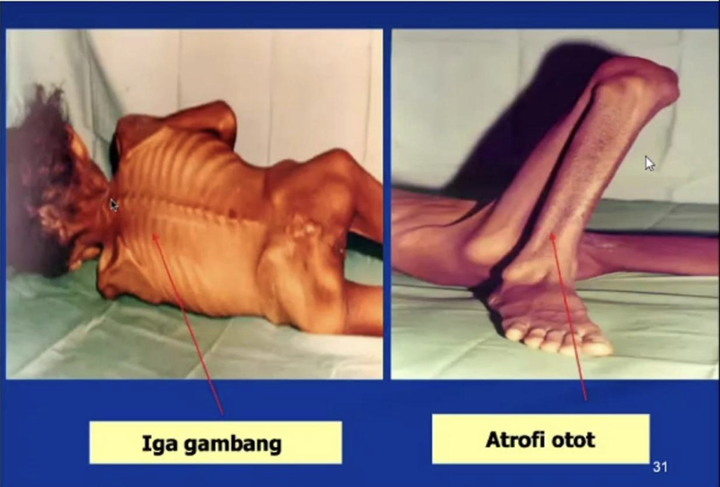
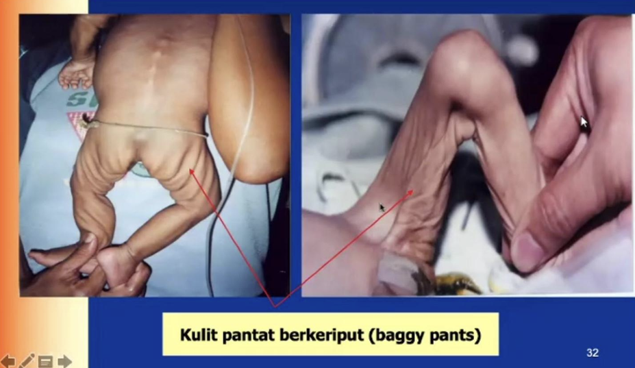
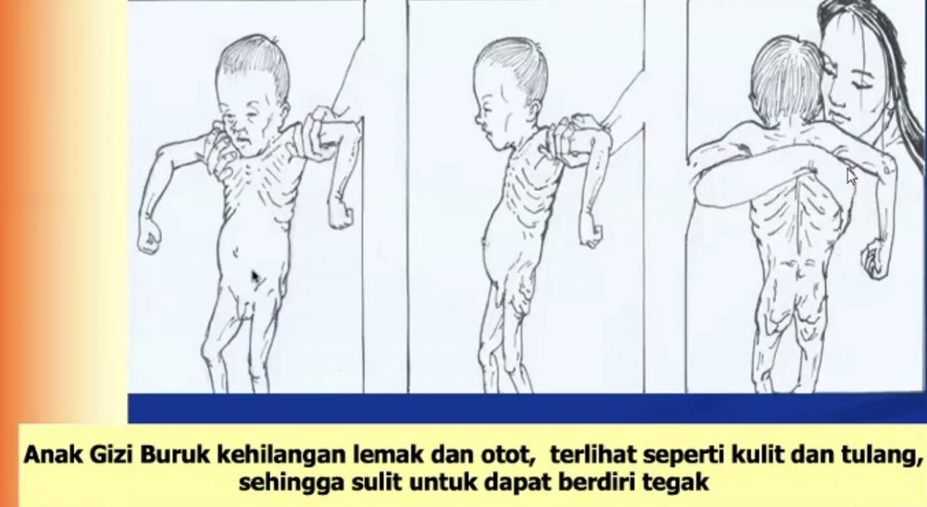
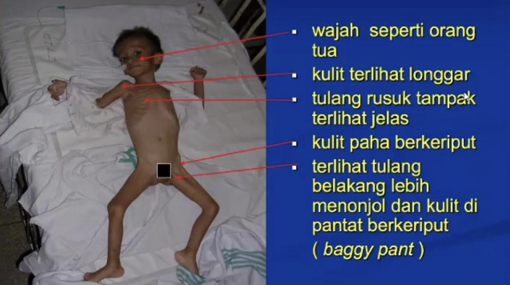
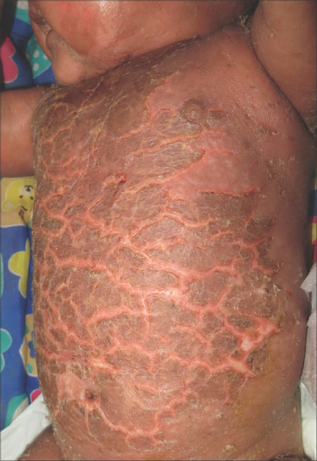
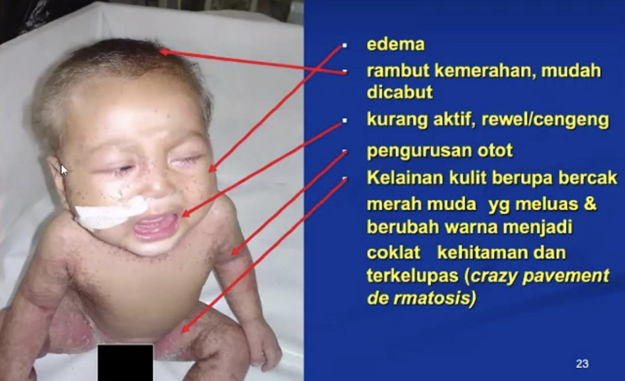
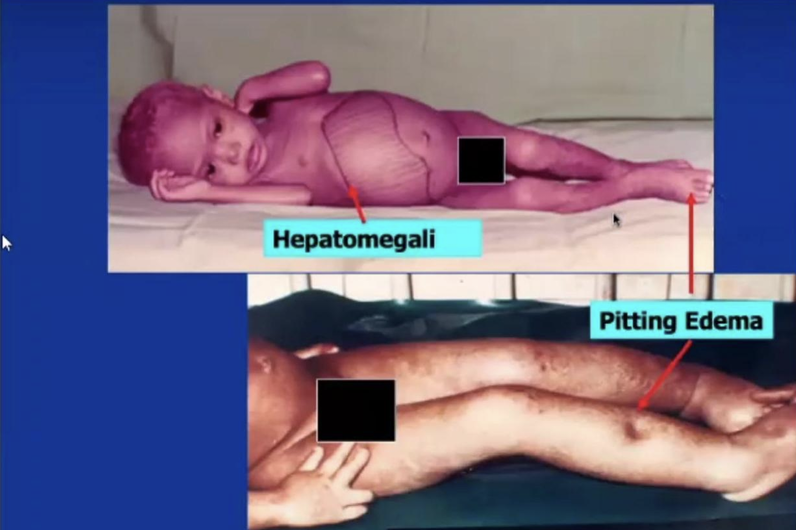
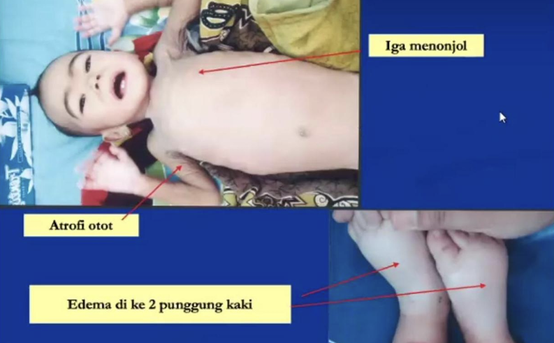
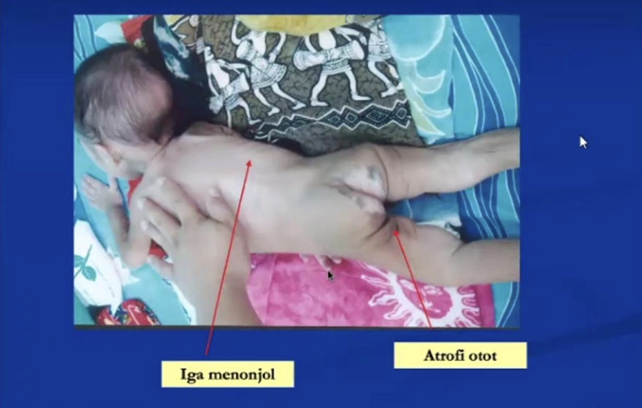
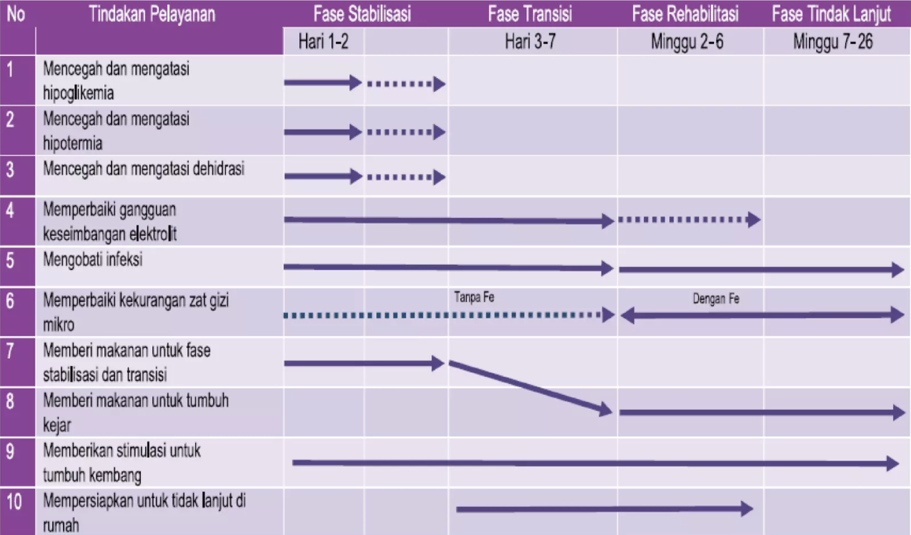

# 1. Malnutrisi 🥣

**Malnutrisi** adalah keadaan yang disebabkan oleh kekurangan atau kelebihan satu atau beberapa zat gizi esensial, secara relatif atau absolut, dalam waktu cukup lama hingga menimbulkan keadaan patologik.

> [!NOTE] Important Note!
> Malnutrisi yang dibahas di materi ini yaitu **malnutrisi akut** jadi bedakan dengan malnutrisi yang kronik yaitu stunting.

## Empat Bentuk Umum Malnutrisi

1. **Undernutrition**: kekurangan jumlah kalori; contohnya *starvation* dan marasmus.
2. **Defisiensi spesifik**: kekurangan satu jenis zat gizi; contohnya kwashiorkor, xerophthalmia, dan beri-beri.
3. **Imbalans**: ketidakseimbangan antara berbagai zat gizi, misalnya protein dengan vitamin A atau kalori dengan vitamin B kompleks.
4. **Overnutrition**: kelebihan jumlah kalori; contohnya obesitas.

# 2. Patogenesis dan Faktor yang Berpengaruh
## Patogenesis Penyakit Defisiensi Gizi

1. **Primary (dietary) inadequacy** dan **secondary (conditioned) inadequacy** menyebabkan **nutritional inadequacy**.

	- **Primer (dietetik):** asupan makanan tidak adekuat.
	- **Sekunder (kondisional):** ada faktor yang mengganggu digesti, absorpsi, atau metabolisme makanan. Contohnya malabsorpsi, peningkatan kebutuhan atau katabolisme, ekskresi berlebihan, dan *inborn error of metabolism* (IEM).

2. **Cadangan dalam tubuh (reserve)** membantu memenuhi kebutuhan saat asupan tidak adekuat.
3. Jika ketidakcukupan gizi berlanjut, cadangan tubuh menurun dan terjadi **tissue depletion** (defisiensi dalam jaringan).
4. Selanjutnya dapat timbul berurutan:
    - **Biochemical lesions** (kelainan biokimia)
    - **Functional changes** (perubahan fungsi)
    - **Anatomical changes** (perubahan anatomi)

🧠 **Tips menghafal urutannya:** _asupan kurang → cadangan menipis → jaringan kekurangan → perubahan: biokimia → fungsi → anatomi_. #Ingat

## Faktor yang Berpengaruh

- Sosioekonomi (**paling banyak, sekitar 40% kasus**).
- Ketidaktahuan (*ignorance*).
- Tahayul, tabu, atau kepercayaan tentang makanan.
- Kondisi lokal dan musim.
- Gangguan saluran pencernaan dan faktor lainnya.

# 3. Diagnosis dan Klasifikasi Gizi Buruk
## Pemeriksaan untuk Diagnosis Defisiensi Gizi

- Anamnesis makanan atau diet.
- Pemeriksaan fisik (gejala klinik).
- Pemeriksaan laboratorium.
- Pemeriksaan antropometrik untuk skrining dini *protein-energy malnutrition* (PEM).
- Survei diet.
- Pemeriksaan khusus, misalnya radiologik.

## Kriteria Diagnosis Gizi Buruk pada Anak

Cara diagnosis **bisa secara klinis dan/atau antropometris**. Anak termasuk gizi buruk bila ditemukan **salah satu** kriteria berikut: #Ingat

- Klinis:
	- Terlihat **sangat kurus** dan/atau **edema**.
- Antropometris:
	- BB/TB atau BB/PB **<-3 SD**.
	- LILA **<11,5 cm**.

## Klasifikasi Klinis

1. Kwashiorkor.
2. Marasmus.
3. Marasmik-kwashiorkor.

# 4. Marasmus

## Etiologi dan Gambaran Klinis

Marasmus disebabkan oleh **defisiensi kalori**.

### Gambaran Klinis

- Berat badan sangat rendah.
- Degenerasi hebat jaringan lemak subkutan dan atrofi otot (*wasting* hebat).
- Ekspresi wajah seperti orang tua (*old man's face*).
- Rasio BB/TB rendah.
- **Tidak ada edema** (Bedakan dengan Kwashiorkor yang ciri khasnya edema!).
- Kelainan kulit dan rambut ringan serta jarang.
- Diare berulang, tetapi lebih ringan.
- Resistensi tubuh rendah.
- Gambaran fisik: **iga gambang, atrofi otot, serta kulit pantat berkeriput** (*baggy pants*). #Ingat

## Laboratorium

- Protein serum normal atau subnormal.
- Anemia tidak ada atau ringan; bila berat, pertimbangkan ankilostomiasis/amoebiasis.
- Kadar enzim pencernaan normal.
- Biopsi hati/pankreas tidak menunjukkan kelainan.

# 5. Kwashiorkor
## Etiologi dan Usia

Kwashiorkor terjadi akibat **defisiensi protein** bernilai biologik tinggi dalam waktu lama. Insidens umum pada usia 1–3 tahun.

## Gejala Klinis

- **Wujud umum**
    - Pucat dan kurus.
    - Atrofi ekstremitas superior dan bokong.
    - **Edema pretibial**, asites, dan _moon face_.
- **Pertumbuhan**
    - Retardasi pertumbuhan tidak khas.
    - Berat badan kurang atau menurun.
- **Mental dan motorik**
    - Cengeng, kesadaran menurun, atau pasif.
    - Gangguan fungsi motorik statis.
- **Edema**
    - Dapat muncul di dorsum pedis, **pretibial**, asites, hingga [anasarka]{Anasarka = edema seluruh tubuh. **Tanda khas: edema skrotum/vulva**.}.
    - Bersifat _pitting_.
- **Rambut**
    - Mudah dicabut, lurus, kering, halus, dan rapuh.
    - Warna rambut dapat mengalami hipopigmentasi, depigmentasi, atau _flag sign_.
    - Bulu mata dapat panjang dan lentik.
- **Kulit dan mukosa**
    - **_Crazy-pavement dermatosis_** merupakan tanda spesifik/patognomonik, terutama pada **kwashiorkor dengan edema berat** dan di bagian yang mengalami tekanan berat badan. #Ingat
    - Kelainan lain: hipopigmentasi, hiperpigmentasi, deskuamasi, _mosaic skin_, gambaran _pellagra-like_, purpura, dan sianosis.
    - Kelainan mukosa dapat berkaitan dengan defisiensi B2.

Gambar *crazy pavement dermatosis*:

- **Gigi dan tulang**
    - Dekalsifikasi dan osteoporosis.
    - Hambatan pertumbuhan tulang.
    - Karies gigi.
- **Hati**
    - Hepatomegali.
    - Pada pemeriksaan patologi anatomi dapat ditemukan perlemakan, nekrosis, dan fibrosis.
    - Hipoproteinemia ringan sampai berat (albumin rendah **<2 g/dL**); [globulin normal atau meningkat]{Anak dengan kwashiorkor memiliki daya tahan tubuh yang rendah sehingga mudah kena **infeksi yang memicu produksi antibodi** (gamma globulin) sehingga kadarnya dapat normal atau meningkat.}
    - Perlemakan dapat terjadi akibat defisiensi [faktor lipotropik]{**Faktor lipotropik** adalah senyawa atau nutrisi yang membantu **mencegah atau mengurangi penumpukan lemak berlebih di hati**. Zat ini bekerja dengan mempercepat proses metabolisme dan pengangkutan lemak agar tidak "terjebak" di dalam sel hati.}.
- **Darah dan sumsum tulang**
    - Anemia ringan sampai berat.
    - Penyebab anemia: defisiensi protein; mineral terutama Fe; vitamin B kompleks (B12, folat, B6); infestasi parasit; dan infeksi berulang.
    - Leukosit dapat normal, meningkat dengan _shift to the left_, atau menurun.
    - Dapat terlihat vakuolisasi dan granulasi toksik pada PMN.
    - Kolesterol menurun; dapat terjadi hipoglikemia dan hipoalbuminemia.
- **Imunitas**
    - Defek imunitas seluler.
    - Gangguan sistem komplemen.
    - Defek IgA.
- **Pankreas dan kelenjar lain**
    - Pankreas dapat mengalami perlemakan, fibrosis, dan atrofi; lipase, tripsin, serta amilase menurun.
    - Parotis, kelenjar lakrimal, saliva, dan usus halus dapat mengalami perlemakan serta hipoplasia.
- **Jantung**
    - Miodegenerasi jantung.
    - Gangguan fungsi jantung karena hipokalemia dan hipomagnesemia.
    - Penyakit jantung-anemia.
    - Pemeriksaan yang diperlukan: foto toraks, EKG, dan elektrolit serum.
- **Saluran cerna**
    - Diare berulang.
    - Infeksi atau infestasi usus.
    - Intoleransi laktosa akibat defisiensi laktase.
    - Malabsorpsi lemak.
    - Defisiensi lipase pankreas atau garam empedu terkonjugasi hati.
    - Atrofi vili mukosa usus halus.

## Penyakit yang Sering Menyertai

- Diare atau gastroenteritis berulang.
- Infeksi berulang, termasuk ISK dan infeksi saluran napas seperti bronkopneumonia/KP.
- Defisiensi vitamin A, Fe, dan vitamin B kompleks, terutama B2.

## Koreksi Berat Edema

- Edema laten, pedis, atau pretibial: **10–15%**.
- Asites ringan: **>15–20%**.
- Asites berat: **20–25%**.
- Anasarka: **30%**.

Penyebab edema meliputi hipoalbuminemia, gangguan dinding kapiler, gangguan hormonal (eliminasi ADH), serta kerusakan membran endotel akibat katalisis reaksi peroksidasi oleh Fe bebas dalam serum.

# 6. Marasmik-kwashiorkor

Gambaran klinisnya merupakan campuran beberapa gejala kwashiorkor dan marasmus, dengan BB/TB atau BB/PB **<-3 SD**, disertai edema yang tidak mencolok.

> [!NOTE] **Pembeda cepat:** 🧠 #Ingat
> - Marasmus = sangat kurus dan **tanpa edema**, khas: iga gambang, atrofi otot, *baggy pants*;
> - Kwashiorkor = **edema** menonjol, tanda khas: *crazy pavement dermatosis*;
> - Marasmik-kwashiorkor = tanda campuran, sangat kurus, edema dapat samar.

# 7. Diagnosa Diferensial antara Marasmus dan Kwashiorkor

| Aspek                | Marasmus                                    | Kwashiorkor                                                                                |
| -------------------- | ------------------------------------------- | ------------------------------------------------------------------------------------------ |
| **Etiologi**         | Defisiensi **kalori**                       | Defisiensi **protein**                                                                     |
| **Usia**             | Terbanyak **0–2 tahun**                     | Terbanyak **1–3 tahun**                                                                    |
| **Edema**            | Tidak ada                                   | Selalu ada; biasanya di dorsum pedis, pretibial, kadang-kadang muka, asites, atau anasarka |
| **Wasting**          | Sangat hebat                                | Ringan dan tersembunyi edema                                                               |
| **Muscle wasting**   | Jelas atrofi otot                           | Dapat ada, tetapi tersembunyi                                                              |
| **Berat badan**      | Jelas _growth retardation_                  | _Growth retardation_ tersembunyi oleh edema                                                |
| **Perubahan mental** | Biasanya apatis atau pendiam                | Biasanya iritabel, cengeng, dapat juga apatis                                              |
| **Nafsu makan**      | Biasanya baik                               | Biasanya jelek                                                                             |
| **Diare**            | Relatif lebih baik daripada kwashiorkor     | Sering kali, sebelum dan selama dirawat                                                    |
| **Kelainan kulit**   | Jarang dan ringan                           | Sering, bervariasi, bisa berat (_crazy-pavement dermatosis_)                               |
| **Kelainan rambut**  | Jarang                                      | Sering                                                                                     |
| **Wajah muka**       | _Old man's face_                            | _Moon face_                                                                                |
| **Hepatomegali**     | Tidak ada; bila ada, karena kausa lain      | Selalu                                                                                     |
| **Albumin serum**    | Biasanya normal atau subnormal (**6 g/dL**) | Rendah, dapat berat sekali (**2 g/dL**)                                                    |
| **Anemia**           | Tidak ada atau ringan saja                  | Umumnya ada, ringan sampai berat                                                           |
| **Biopsi hati**      | Normal atau sedikit atrofi                  | _Fatty infiltration_, nekrosis, fibrosis                                                   |
| **Enzim-enzim**      | Normal                                      | Berkurang                                                                                  |

# 8. Perawatan dan Tatalaksana

## 4 Fase Perawatan dan Pengobatan Anak Gizi Buruk

**Stabilisasi → transisi → rehabilitasi → tindak lanjut**. #Ingat

### Fase Stabilisasi (1-2 Hari)
    
- Fase awal untuk segera menstabilkan kondisi klinis anak dan mengatasi kedaruratan medis.
- Berikan formula khusus **F75**:
    - Energi: **80–100 kkal/kgBB/hari**
    - Protein: **1–1,5 g/kgBB/hari**
    - Cairan: **130 ml/kgBB/hari** tanpa edema; **100 ml/kgBB/hari** dengan edema
- Hati-hati terhadap kelebihan cairan (_overload_) karena dapat menyebabkan gagal jantung.
- Umumnya berlangsung **1–2 hari**.

### Fase Transisi (5-7 Hari)
    
- Masa peralihan dari stabilisasi ke rehabilitasi.
- Beri kesempatan tubuh beradaptasi terhadap pemberian energi dan protein yang lebih tinggi secara bertahap:
    - Energi: **100–150 kkal/kgBB/hari**
    - Protein: **2–3 g/kgBB/hari**
    - Cairan sesuai kebutuhan
    - Formula **F75 → F100**
- Hati-hati terhadap kelebihan cairan (_overload_) karena dapat menyebabkan gagal jantung.
 - Umumnya berlangsung **5–7 hari**.

### Fase Rehabilitasi (2-4 Minggu)
    
- Fase tumbuh kejar untuk memulihkan jaringan tubuh yang hilang.
- Energi dan protein ditingkatkan sesuai kemampuan:
    - Energi: **150–220 kkal/kgBB/hari**
    - Protein: **4–6 g/kgBB/hari**
    - Cairan sesuai kebutuhan
    - **F100**, bertahap ditambah makanan
 - Evaluasi kenaikan berat badan: minimal **5 g/kgBB/hari** atau **50 g/kgBB/minggu**.
- Berlangsung **2–4 minggu**.

### Fase Tindak Lanjut (4-5 Bulan)
    
- Setelah anak pulang dari rawat inap:
    - Teruskan pemberian makanan tumbuh kejar.
    - Kontrol teratur: setiap minggu pada bulan pertama, setiap 2 minggu pada bulan kedua, lalu setiap bulan.
    - Lanjutkan atau lengkapi imunisasi dan vitamin A.
    - Lanjutkan pengobatan penyakit penyerta.
    - Ibu diberi konseling gizi.
- Berlangsung sampai **4–5 bulan**.

## 10 Langkah Tatalaksana Anak Gizi Buruk

## Mencegah dan Mengatasi Hipoglikemia

- **Sadar (tidak letargis):** berikan larutan glukosa 10% atau larutan gula pasir 10% secara oral/NGT (bolus) sebanyak **50 ml**.
- **Tidak sadar (letargis):**
    - Berikan larutan glukosa 10% IV (bolus) sebanyak **5 ml/kgBB**.
    - Selanjutnya, berikan larutan glukosa 10% atau larutan gula pasir 10% secara oral atau NGT (bolus) sebanyak **50 ml**.

**Larutan gula pasir 10%:** 5 gram gula pasir (1 sendok teh munjung) + air matang sampai **50 ml**.
## Mencegah dan Mengatasi Hipotermia

**Suhu tubuh 36–37°C:**

- Tutup tubuh anak termasuk kepala dan selimuti.
- Hindari hembusan angin dan pertahankan suhu ruangan **28–30°C**.
- Jangan biarkan anak tanpa baju terlalu lama saat pemeriksaan dan penimbangan.
- Segera ganti baju atau perlengkapan tidur yang basah.
- Segera keringkan badan setelah mandi.
- Tangan yang merawat jangan dingin.

**Suhu tubuh <36°C (hipotermia):**

- Lakukan pemanasan aktif: kontak langsung kulit ibu dan kulit anak (**cara “kanguru”**), lampu pada jarak **50 cm** dari tubuh anak, atau selimut yang dipanaskan. Jangan gunakan botol air panas untuk menghangatkan anak karena dapat menyebabkan kulit terbakar.
- Ganti baju atau perlengkapan tidur yang basah.
- Pastikan seluruh tubuh sampai kepala tertutup pakaian dan diselimuti.
- Pertahankan suhu ruangan sekitar **28–30°C** dan hindari hembusan angin.

## Mencegah dan Mengatasi Dehidrasi

Beri **ReSoMal** (*Rehydration Solution for Malnutrition*) untuk rehidrasi. ReSoMal terbuat dari oralit yang diencerkan, gula pasir, serta larutan elektrolit/mineral mix. Bila larutan elektrolit/mineral mix tidak tersedia, cairan pengganti ReSoMal dapat dibuat sebagai alternatif.

## Memperbaiki Gangguan Keseimbangan Elektrolit

Pada anak gizi buruk:

- Terjadi gangguan keseimbangan cairan dan elektrolit.
- Tubuh relatif mengandung kadar natrium (Na) lebih tinggi dan kalium (K) lebih rendah.
- Berikan _mineral mix_ yang dicampurkan ke dalam formula khusus (F75, F100) dan ReSoMal.

## Mengobati Infeksi

| Kondisi                                 | Antibiotika                                                                                                                                                               |
| --------------------------------------- | ------------------------------------------------------------------------------------------------------------------------------------------------------------------------- |
| Tidak ada komplikasi/infeksi yang jelas | **Kotrimoksasol** oral setiap **12 jam selama 5 hari**                                                                                                                    |
| Ada komplikasi                          | **Gentamisin** IV atau IM selama **7 hari**, ditambah **ampisilin** IV atau IM setiap **6 jam selama 2 hari**; dilanjutkan **amoksisilin** setiap **8 jam selama 5 hari** |
| Tidak membaik dalam **48 jam**          | **Kloramfenikol** IV atau IM setiap **6 jam selama 10 hari**                                                                                                              |
| Ada infeksi khusus                      | Antibiotika khusus sesuai penyakitnya                                                                                                                                     |

## Memperbaiki Kekurangan Zat Gizi Mikro

- Vitamin B (B1, B2, B6, B12)
- Vitamin C
- Vitamin A
- Asam folat
- Zat besi/Fe

### Dosis Vitamin dan Mineral untuk Anak **Umur 6 Bulan sampai 5 Tahun**

**Dosis vitamin C, asam folat, dan vitamin B kompleks:**

| Zat gizi | Dosis |
|---|---|
| Vitamin C, BB <5 kg | 50 mg/hari (1 tablet) |
| Vitamin C, BB ≥5 kg | 100 mg/hari (2 tablet) |
| Asam folat | Hari I: 5 mg/hari; selanjutnya 1 mg/hari |
| Vitamin B kompleks | 1 tablet/hari |

**Kapsul vitamin A dosis tinggi:**

| Umur | Dosis |
|---|---|
| <6 bulan | 50.000 SI (½ kapsul biru) |
| 6–11 bulan | 100.000 SI (1 kapsul biru) |
| 1–5 tahun | 200.000 SI (1 kapsul merah) |

## Memberikan Stimulasi untuk Tumbuh Kembang

Anak gizi buruk dapat mengalami keterlambatan perkembangan mental dan perilaku. Stimulasi diberikan bertahap dan berkelanjutan sesuai umur, mencakup empat aspek kemampuan dasar:

- Gerak kasar.
- Gerak halus.
- Bicara dan bahasa.
- Sosialisasi dan kemandirian.

Stimulasi terstruktur selama 15–30 menit/hari, melalui permainan, misalnya *ci luk ba* atau menggunakan alat permainan edukatif.

## Hal Penting Selama Perawatan

1. Jangan berikan Fe sebelum minggu ke-2; Fe diberikan pada fase rehabilitasi.
2. Jangan berikan cairan intravena, kecuali syok atau dehidrasi berat.
3. Jangan berikan protein terlalu tinggi.
4. Jangan berikan diuretik pada penderita kwashiorkor.

## Mempersiapkan Tindak Lanjut di Rumah

- Persiapan dilakukan sejak anak dalam perawatan; ibu dilibatkan dalam kegiatan merawat anak.
- Pola pemberian makan yang baik dan stimulasi tetap dilanjutkan setelah anak dipulangkan.
- Kontrol teratur setelah pulang: **1 kali/minggu pada bulan pertama**, **1 kali/2 minggu pada bulan kedua**, lalu **1 kali/bulan sampai 6 bulan atau lebih**.
- Lengkapi imunisasi dasar atau ulangan sesuai program PPI (Program Pengembangan Imunisasi).

### Kriteria Pemulangan Anak Gizi Buruk

Anak dapat dipulangkan bila:

- Edema sudah berkurang atau hilang.
- Anak sadar dan aktif, serta nafsu makan baik.
- BB/TB-PB **≥ -3 SD**.
- Komplikasi sudah teratasi.
- Ibu sudah memahami cara merawat anaknya dan mendapat konseling gizi.

# Rangkuman ⚡

- **Diagnosis gizi buruk:** tampak sangat kurus dan/atau edema; BB/TB atau BB/PB **<-3 SD**; LILA **<11,5 cm**.
- **Kwashiorkor:** defisiensi protein bernilai biologik tinggi; edema; umum pada usia **1–3 tahun**.
- **Marasmus:** defisiensi kalori, *wasting* hebat, BB/TB rendah, **tanpa edema**.
- **Marasmik-kwashiorkor:** campuran, BB/TB atau BB/PB **<-3 SD**, edema tidak mencolok.
- **Empat fase:** stabilisasi → transisi → rehabilitasi → tindak lanjut.
- **Sepuluh langkah:** hipoglikemia, hipotermia, dehidrasi, elektrolit, infeksi, zat gizi mikro, makanan stabilisasi/transisi, makanan tumbuh kejar, stimulasi tumbuh kembang, tindak lanjut rumah.
- **Fe:** mulai pada fase rehabilitasi, jangan sebelum minggu ke-2.
- **Kontrol pulang:** mingguan pada bulan 1 → dua mingguan pada bulan 2 → bulanan sampai setidaknya 6 bulan.

🧠 **Jembatan ingatan 10 langkah:** kelompokkan **3 bahaya awal** (gula, suhu, cairan), lanjutkan **2 koreksi** (elektrolit, infeksi), lalu **5 pemulihan** (mikronutrien, makan stabilisasi, tumbuh kejar, stimulasi, tindak lanjut).

