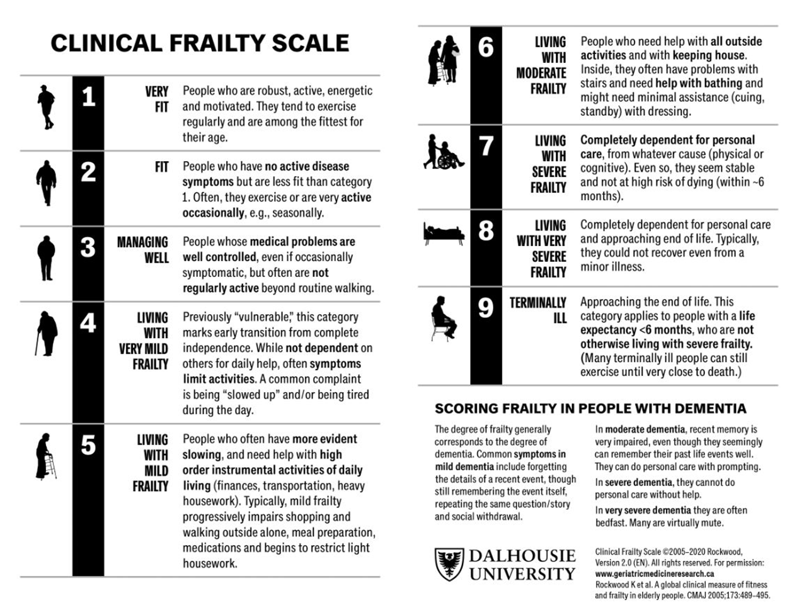

# Gizi pada Lansia: Penilaian, Kebutuhan, dan Intervensi
## 1. Mengapa gizi lansia perlu diperhatikan?

Malnutrisi pada lansia sering tidak dikenali karena penurunan berat badan dianggap bagian normal dari penuaan. Padahal, penurunan berat badan yang tidak disengaja perlu dicari penyebabnya.

Data gabungan skrining MNA yang dirangkum Kaiser dan kolega (2010) memperkirakan sekitar **23% lansia mengalami malnutrisi** dan **46% berisiko**. Perkiraan malnutrisi berbeda menurut tempat perawatan: sekitar 6% di komunitas, 14% di panti, 39% di rumah sakit, dan 51% di fasilitas rehabilitasi.

Malnutrisi berkaitan dengan infeksi, luka tekan, jatuh, rawat inap yang lebih lama, rawat ulang, dan kematian. Dehidrasi juga dapat memicu delirium, konstipasi, infeksi saluran kemih, cedera ginjal akut, jatuh, dan kematian.

## 2. Mengapa lansia rentan mengalami malnutrisi?

Faktor risiko biasanya saling berinteraksi:

- **Fisik dan fisiologis:** nafsu makan menurun, gigi tidak lengkap atau gigi palsu tidak pas, gangguan mengunyah atau menelan, penyakit akut maupun kronis, kelemahan fisik, dan gangguan kognitif.
- **Saluran cerna:** perubahan pengecapan, gastritis atrofi antrum, produksi asam dan sekresi lambung yang berkurang, pertumbuhan bakteri berlebih di saluran cerna atas, penyerapan vitamin B12 yang menurun, motilitas usus yang melambat, serta kemungkinan defisiensi ringan enzim pencernaan. Obat dan komorbiditas dapat memperberat perubahan ini.
- **Psikologis:** depresi, kehilangan pasangan, kesepian, atau kehilangan minat makan.
- **Sosial ekonomi:** kemiskinan, tinggal sendiri, kesulitan berbelanja atau memasak, dan terbatasnya dukungan sosial.
- **Obat:** polifarmasi, efek samping, perubahan rasa, mulut kering, mual, atau konstipasi dapat menurunkan asupan.

Penuaan juga mengubah komposisi tubuh: massa otot dan massa bebas lemak cenderung turun, sedangkan massa lemak dapat meningkat. Pengeluaran energi menurun akibat ukuran tubuh, komposisi tubuh, laju metabolisme basal, dan aktivitas fisik yang lebih rendah. Karena itu, kebutuhan kalori bisa turun, tetapi kepadatan zat gizi makanan tetap harus tinggi.

## 3. Skrining dan diagnosis malnutrisi

### Metode-metode penilaian gizi pada lansia

- **Mini Nutritional Assesment (MNA):** penilaian status gizi secara menyeluruh.
- **MNA-Short Form (MNA-SF):** skrining awal yang lebih singkat dan praktis.
- **Subjective Global Assesment (SGA):** menilai perubahan berat badan dan asupan, gejala, fungsi, serta pemeriksaan fisik.
- **Patient Derived-SGA (PD-SGA):** pengembangan SGA yang banyak digunakan pada pasien kanker.
- **•Global Leadership Initiative on Malnutrition (GLIM):** kriteria untuk menegakkan diagnosis malnutrisi setelah risiko teridentifikasi; bukan alat skrining.

MNA-SF dipilih karena dirancang khusus untuk lansia dan lebih cepat serta praktis daripada MNA lengkap, sehingga cocok sebagai **skrining awal**. Jika hasilnya menunjukkan risiko, lanjutkan dengan penilaian lebih lengkap dan gunakan kriteria GLIM untuk diagnosis.

### Langkah pertama: skrining dengan MNA-SF

MNA-SF memiliki enam butir dengan skor maksimum 14:

1. Penurunan asupan makanan selama tiga bulan terakhir.
2. Penurunan berat badan selama tiga bulan terakhir.
3. Mobilitas.
4. Stres psikologis atau penyakit akut.
5. Masalah neuropsikologis.
6. Indeks massa tubuh (IMT); lingkar betis dapat dipakai bila IMT tidak tersedia pada versi formulir terkait.

#Ingat Interpretasi skor:

- **12–14:** status gizi normal.
- **8–11:** berisiko malnutrisi.
- **0–7:** malnutrisi.

Skor rendah menunjukkan perlunya penilaian lebih lanjut; skor skrining saja tidak menggantikan diagnosis klinis.

### Langkah kedua: diagnosis dengan kriteria GLIM

Diagnosis GLIM memerlukan **minimal satu kriteria fenotipik dan satu kriteria etiologis**.

#### Kriteria fenotipik (perubahan yang terlihat atau terukur):

| Kriteria fenotipik                        | Batas                                                                                                                                                                                                                         |
| ----------------------------------------- | ----------------------------------------------------------------------------------------------------------------------------------------------------------------------------------------------------------------------------- |
| **Penurunan berat badan tidak disengaja** | Lebih dari **5%** dalam **enam bulan** terakhir, atau lebih dari **10%** bila berlangsung **lebih dari enam bulan**.                                                                                                          |
| **IMT rendah**                            | Salah satu batas yang digunakan pada lansia adalah **<22 kg/m² untuk usia ≥70 tahun**; **batas Asia** yang digunakan pada sejumlah kriteria adalah **<20 kg/m²**. Gunakan kriteria yang sesuai populasi dan pedoman setempat. |
| **Massa otot berkurang**                  | Massa otot lebih rendah dari nilai rujukan yang sesuai populasi dan metode pengukuran.                                                                                                                                        |

#### Kriteria etiologis (penyebab atau mekanisme):

- **Asupan makanan berkurang** atau gangguan asimilasi/penyerapan.
- **Inflamasi** atau beban penyakit.

Sesudah diagnosis, **tentukan tingkat keparahan** berdasarkan kriteria fenotipik dan susun rencana intervensi.

### Contoh formulir MNA

## 4. Kebutuhan energi, protein, cairan, dan zat gizi

### Kebutuhan energi

- Kebutuhan energi cenderung menurun seiring usia karena:
    - laju metabolisme basal menurun;
    - massa bebas lemak dan massa otot berkurang;
    - aktivitas fisik biasanya menurun.
- Penurunan laju metabolisme basal diperkirakan sekitar **1–2% per dekade**. Kebutuhan energi juga dipengaruhi ukuran tubuh dan komposisi tubuh. 
- Lansia mungkin membutuhkan **15-20% lebih sedikit kalori** dibandingkan dengan dewasa muda.
- Meskipun kebutuhan kalori dapat menurun, lansia tetap membutuhkan makanan **padat zat gizi** agar vitamin, mineral, protein, dan serat tercukupi.
- Nilai panduan ESPEN untuk energi adalah sekitar **30 kkal/kg berat badan/hari**. Sesuaikan dengan status gizi, aktivitas, penyakit, dan toleransi pasien. [ESPEN](https://www.clinicalnutritionjournal.com/article/S0261-5614\(22\)00034-6/fulltext)

#### Perubahan kebutuhan energi seiring usia

|Usia|Laki-laki|Perempuan|
|---|--:|--:|
|51–59 tahun|2.550 kkal/hari|1.900 kkal/hari|
|60–64 tahun|2.380 kkal/hari|1.900 kkal/hari|
|65–74 tahun|2.330 kkal/hari|1.900 kkal/hari|
|≥75 tahun|2.100 kkal/hari|1.810 kkal/hari|

Angka tersebut merupakan perkiraan yang mengutip _Manual of Dietetic Practice_ edisi 2001. Untuk kebutuhan individual, gunakan penilaian klinis dan pantau berat badan serta asupan.

#### Angka Kecukupan Gizi Indonesia 2013 untuk lansia

AKG adalah angka kecukupan rata-rata berdasarkan kelompok umur dan jenis kelamin. Angka berikut berasal dari tabel AKG Indonesia 2013. [Permenkes No. 75 Tahun 2013](https://peraturan.bpk.go.id/Details/139226/permenkes-no-75-tahun-2013)

|Kelompok|Energi|Protein|Serat|Air|
|---|--:|--:|--:|--:|
|Laki-laki, 65–80 tahun|1.900 kkal|62 g|27 g|1.900 mL|
|Laki-laki, >80 tahun|1.525 kkal|60 g|22 g|1.600 mL|
|Perempuan, 65–80 tahun|1.550 kkal|56 g|22 g|1.600 mL|
|Perempuan, >80 tahun|1.425 kkal|55 g|20 g|1.500 mL|

### Kebutuhan protein

- Kehilangan massa otot (sarkopenia) biasa terjadi pada lansia, sehingga mereka membutuhkan asupan protein lebih untuk mempertahankan massa dan fungsi otot.
- Nilai panduan ESPEN untuk lansia adalah **≥1 g/kg berat badan/hari**.
- Kisaran **1,0–1,2 g/kg/hari** sering digunakan pada lansia sehat.
- Saat sakit akut atau kronis, kebutuhan dapat meningkat menjadi sekitar **1,2–1,5 g/kg/hari**, jika kondisi klinis memungkinkan.
- Sesuaikan target dengan fungsi ginjal, status gizi, penyakit, dan tujuan perawatan.
- Pilih sumber protein bermutu tinggi dengan asam amino esensial, seperti:
    - telur;
    - susu dan produk susu;
    - ikan;
    - daging tanpa lemak;
    - kacang-kacangan, karena lebih efektif untuk sintesis otot pada lansia.
- Distribusikan protein dalam beberapa waktu makan dan padukan dengan latihan kekuatan untuk membantu mempertahankan fungsi otot.

### Kebutuhan vitamin dan mineral

| Zat gizi                                       | Peran dan perhatian                                                                                                                                                                                                              |
| ---------------------------------------------- | -------------------------------------------------------------------------------------------------------------------------------------------------------------------------------------------------------------------------------- |
| **Vitamin D dan Kalsium**                      | Lansia memiliki risiko osteoporosis dan patah tulang yang lebih tinggi. Asupan harian vitamin D **(800–1.000 IU)** dan kalsium **(1.000–1.200 mg)** sering diperlukan karena kepadatan tulang menurun seiring bertambahnya usia. |
| **Vitamin B12**                                | Penyerapan dapat berkurang, antara lain karena perubahan keasaman lambung. Metformin dan PPI juga dapat menambah risiko rendahnya B12. Pertimbangkan pemeriksaan, pangan fortifikasi, atau suplementasi bila diperlukan.         |
| **Folat dan zat besi**                         | Defisiensi umum terjadi akibat malabsorpsi, penggunaan obat, atau asupan makanan yang buruk. Memastikan kecukupan folat dan zat besi membantu mencegah anemia dan mendukung fungsi kognitif.                                     |
| **Vitamin C, vitamin E, dan karotenoid**       | Vitamin C, vitamin E, dan karotenoid dari buah serta sayuran berwarna bermanfaat karena berpotensi mengurangi stres oksidatif, yang berkaitan dengan penuaan dan penyakit degeneratif.                                           |
| **Magnesium, selenium, dan mikronutrien lain** | Penuhi melalui pola makan seimbang; suplementasi disesuaikan dengan kebutuhan atau defisiensi tertentu.                                                                                                                          |

### Kebutuhan serat

- Perubahan sistem pencernaan seiring bertambahnya usia, seperti motilitas yang lebih lambat dan risiko konstipasi, membuat asupan serat yang cukup (25–30 gram per hari) menjadi penting.
- Target serat berkisar **21–30 g/hari**.
- Sumber serat:
    - serealia utuh;
    - buah;
    - sayur;
    - kacang-kacangan.
- Tingkatkan asupan serat secara bertahap agar lebih mudah ditoleransi.
- Pastikan asupan cairan memadai, kecuali terdapat pembatasan cairan karena kondisi klinis.

### Probiotik dan prebiotik

- **Probiotik** adalah mikroorganisme hidup yang bermanfaat bagi usus, sedangkan **prebiotik** adalah zat—umumnya serat—yang menjadi makanan bagi mikroorganisme tersebut.
- Menjaga keseimbangan mikrobioma usus dapat mendukung sistem imun dan pencernaan. Probiotik, seperti yang terdapat dalam yogurt, dan prebiotik dari makanan kaya serat dapat bermanfaat bagi lansia. Keduanya sebaiknya ditambahkan secara bertahap untuk menghindari gangguan pencernaan.

### Kebutuhan lemak dan kesehatan jantung

- Kebutuhan total lemak tidak berbeda secara bermakna dari orang dewasa yang lebih muda, tetapi **utamakan lemak sehat, terutama lemak tak jenuh tunggal**, misalnya:
    - ikan dan sumber omega-3 lainnya;
    - kacang-kacangan dan biji-bijian;
    - alpukat;
    - minyak zaitun.
- Lemak tak jenuh seperti di atas mendukung kesehatan kardiovaskular dan membantu mengurangi peradangan.
- **Membatasi asupan lemak jenuh dan lemak trans** penting untuk menurunkan risiko penyakit kardiovaskular, yang banyak terjadi pada lansia.

### Pola makan seimbang dan pertimbangan khusus

- Pola makan sehari-hari sebaiknya mencakup:
    - buah dan sayuran;
    - serealia utuh;
    - sumber protein;
    - lemak sehat;
    - energi yang cukup.
- Pola Mediterania, DASH, dan Okinawa merupakan contoh pola makan yang menekankan pangan beragam dan padat zat gizi. Sesuaikan dengan budaya, kemampuan makan, ketersediaan pangan, dan penyakit pasien.
- Bila nafsu makan rendah:
    - tawarkan porsi kecil tetapi lebih sering;
    - tambahkan kudapan;
    - perkaya makanan dengan energi dan protein;
    - gunakan minuman atau suplemen nutrisi oral bila makanan belum mencukupi.
- Pada penyakit kronis, atur intervensi secara individual. Pembatasan diet yang terlalu ketat dapat memperburuk asupan, terutama pada lansia rapuh atau malnutrisi.
- Hindari diet penurunan berat badan yang tidak perlu pada lansia rapuh. Tinjau manfaat dan risiko setiap pembatasan.

### Kebutuhan berdasarkan kondisi klinis

|Kondisi|Masalah gizi yang mungkin terjadi|Pendekatan|
|---|---|---|
|**Disfagia**|Asupan berkurang dan risiko aspirasi.|Sesuaikan tekstur makanan dan kekentalan cairan; pertimbangkan evaluasi oleh tenaga profesional menelan.|
|**Demensia**|Kesulitan makan, lupa makan, atau berat badan turun.|Bantu saat makan, buat suasana makan teratur, dan pertimbangkan _finger food_.|
|**Diabetes**|Pembatasan berlebihan dapat menyebabkan asupan energi dan zat gizi tidak cukup.|Individualisasikan pola makan; hindari diet penurunan berat badan yang tidak sesuai pada pasien rapuh.|
|**Penyakit ginjal kronis**|Risiko malnutrisi energi-protein, tetapi kebutuhan protein berbeda menurut kondisi ginjal.|Individualisasikan protein dan energi; hindari pembatasan berlebihan pada pasien rapuh atau malnutrisi.|
|**Fraktur panggul**|Kebutuhan meningkat akibat katabolisme dan kehilangan otot.|Pertimbangkan dukungan protein, ONS bila perlu, kecukupan vitamin D dan kalsium, serta mobilisasi dini.|
|**Luka tekan**|Kebutuhan energi dan protein dapat meningkat.|Kisaran yang digunakan dalam rekomendasi luka tekan adalah 30–35 kkal/kg/hari dan protein 1,25–1,5 g/kg/hari; sesuaikan dengan kondisi pasien.|

### Obat yang dapat memengaruhi gizi

|Obat atau kelompok obat|Dampak yang perlu diperhatikan|
|---|---|
|PPI dan metformin|Dapat menurunkan penyerapan vitamin B12.|
|Diuretik|Dapat meningkatkan risiko dehidrasi, hiponatremia, atau hipokalemia.|
|Antikolinergik dan sejumlah obat lain|Dapat menyebabkan mulut kering, perubahan rasa, nafsu makan turun, atau konstipasi.|
|SSRI|Dapat berkaitan dengan hiponatremia.|
|Kortikosteroid|Dapat memperburuk kehilangan otot dan tulang serta meningkatkan glukosa darah.|
|Antiepilepsi penginduksi enzim|Dapat meningkatkan risiko defisiensi vitamin D.|

Tinjau seluruh obat pada lansia dengan asupan rendah atau malnutrisi. Pertimbangkan penyesuaian atau penghentian obat bersama tim klinis bila aman dan sesuai indikasi.

### Dehidrasi pada lansia

- Faktor risiko:
    - rasa haus berkurang;
    - kemampuan ginjal memekatkan urine menurun;
    - total air tubuh lebih rendah;
    - penggunaan diuretik;
    - kesulitan memperoleh atau meminta minum;
    - ketergantungan pada bantuan orang lain.
- Mulut kering, turgor kulit, dan tekanan darah rendah **tidak cukup andal bila digunakan sendiri** untuk mengenali dehidrasi pada lansia. Oleh karena itu, tes osmolalitas serum lebih baik digunakan. Nilai osmolalitas serum **>300 mOsm/kg** mendukung dugaan dehidrasi.
- Rumus osmolalitas serum = $1,86 × (Na + K) + 1,15 × glukosa + 14$
- **Target minuman ESPEN:**
    - perempuan: **≥1,6 L/hari**;
    - laki-laki: **≥2,0 L/hari**.
- Jumlah tersebut perlu disesuaikan pada gagal jantung, penyakit ginjal, gangguan elektrolit, atau kondisi lain yang memerlukan pembatasan cairan.
- Tawarkan minuman secara berkala, termasuk setiap kali berinteraksi dengan pasien. Bila asupan oral tidak berhasil, kebutuhan cairan dapat dipenuhi melalui jalur subkutan atau intravena sesuai indikasi klinis.

### Prinsip dukungan nutrisi

1. Kenali risiko malnutrisi sedini mungkin dan cari penyebab asupan rendah atau berat badan turun.
2. Buat rencana gizi dan konseling yang disesuaikan dengan kondisi, pilihan, serta kemampuan pasien.
3. Mulai dengan makanan biasa yang diperkaya energi dan protein.
4. Tambahkan kudapan, porsi kecil lebih sering, atau _finger food_ jika lebih mudah dikonsumsi.
5. Sesuaikan tekstur makanan bila terdapat masalah mengunyah atau menelan.
6. Pertimbangkan suplemen nutrisi oral jika makanan belum memenuhi kebutuhan.
7. Bila nutrisi enteral diperlukan, gunakan formula yang mengandung serat bila sesuai kondisi klinis.
8. Pantau asupan, berat badan, hidrasi, toleransi, dan fungsi pasien; sesuaikan rencana berdasarkan respons.

## 5. Deplesi otot dan perubahan komposisi tubuh

- Seiring bertambahnya usia, **massa tubuh tanpa lemak dan fungsinya dapat menurun**, sedangkan massa lemak dapat meningkat.
- Perubahan massa otot terutama pada anggota gerak dapat mengurangi kekuatan, kecepatan berjalan, dan kemampuan melakukan aktivitas sehari-hari.
- Kurang asupan energi dan protein, tidak aktif bergerak, penyakit akut atau kronis, serta inflamasi dapat memperburuk kehilangan otot.
- **Deplesi otot** menggambarkan berkurangnya massa otot. **Sarkopenia** adalah kondisi klinis yang dinilai melalui kekuatan otot, jumlah atau kualitas otot, dan performa fisik.
- Dampak yang perlu diwaspadai meliputi kelemahan, kesulitan berdiri atau berjalan, jatuh, ketergantungan, dan pemulihan yang lebih sulit setelah sakit.

## 6. Frailty dan pencegahannya

### Frailty

**Frailty adalah keadaan kerentanan akibat penurunan cadangan dan ketahanan tubuh**. Keadaan ini membuat lansia lebih rentan mengalami masalah kesehatan saat menghadapi stresor seperti infeksi, jatuh, atau rawat inap.

Lima ciri **fenotipe Fried**:

1. Penurunan berat badan tidak disengaja.
2. Kelelahan.
3. Aktivitas fisik rendah.
4. Kecepatan berjalan lambat.
5. Kekuatan genggam lemah.

Frailty bersifat multifaktorial. Malnutrisi dan kurang aktivitas dapat berperan, tetapi penilaiannya tidak hanya berfokus pada gizi atau otot.

### Cara menilai frailty

Frailty dinilai menggunakan **Clinical Frailty Scale** dengan skor 1-9:

|Skor|Gambaran umum|
|--:|---|
|1|Sangat bugar, aktif, energik, dan rutin berolahraga.|
|2|Bugar, tidak memiliki gejala penyakit aktif, tetapi kebugaran tidak sebaik skor 1.|
|3|Penyakit terkelola baik; aktivitas biasanya terbatas pada kegiatan rutin.|
|4|Rentan; tetap mandiri, tetapi gejala memperlambat aktivitas atau menyebabkan mudah lelah.|
|5|Frailty ringan; mulai memerlukan bantuan untuk kegiatan instrumental seperti belanja, transportasi, pekerjaan rumah berat, atau menyiapkan makanan.|
|6|Frailty sedang; memerlukan bantuan untuk kegiatan di luar rumah dan sebagian kegiatan di dalam rumah.|
|7|Frailty berat; bergantung sepenuhnya pada orang lain untuk perawatan pribadi, tetapi keadaan relatif stabil.|
|8|Frailty sangat berat; bergantung sepenuhnya dan mendekati akhir hayat; sulit pulih dari penyakit ringan.|
|9|Sakit terminal; harapan hidup kurang dari enam bulan, tanpa harus mengalami frailty berat sebelumnya.|

CFS membantu menggambarkan tingkat kerapuhan dan kebutuhan bantuan. Pada demensia, pertimbangkan kemampuan fungsi sehari-hari dan kebutuhan bantuan, bukan daya ingat saja.

### Pencegahan frailty

- Pertahankan **aktivitas fisik dan pola makan seimbang** sebagai bagian dari **penuaan sehat**.
- Lakukan latihan resistensi untuk membantu mempertahankan kekuatan dan massa otot.
- Tambahkan latihan keseimbangan dan fungsional untuk mendukung kestabilan dan kemampuan beraktivitas.
- Pilih aktivitas aerobik atau aktivitas yang disukai dan aman, misalnya:
    - menari;
    - berjalan mengikuti irama;
    - tai chi;
    - berjalan atau latihan aerobik lain.
- Pastikan asupan kalori, protein, dan vitamin D memadai.
- Sesuaikan latihan dengan kemampuan, risiko jatuh, komorbiditas, dan kondisi fungsional pasien.
- Kombinasikan latihan dengan penanganan masalah yang menghambat aktivitas, seperti nyeri, gangguan penglihatan, alas kaki yang tidak aman, atau lingkungan rumah yang berisiko.

## 7. Sarkopenia: penilaian dan terapi
### Sarkopenia

- **Sarkopenia** adalah kondisi progresif berupa penurunan kekuatan dan massa otot rangka.
- Diagnosis sarkopenia dapat mengikuti konsensus **EWGSOP2** (_European Working Group on Sarcopenia in Older People 2_), yang menyusun kriteria dan alur penilaian untuk populasi Eropa.
- Untuk populasi Asia, **AWGS 2019** (_Asian Working Group for Sarcopenia 2019_) menyediakan kriteria dan nilai batas yang disesuaikan dengan populasi Asia.
- Penilaian mencakup **kekuatan otot, massa otot, dan performa fisik**.

### Alur diagnosis

EWGSOP2 menggunakan alur:

*Find → Assess → Confirm → Severity*

1. **Find:** cari kemungkinan kasus, misalnya dengan SARC-F atau kecurigaan klinis.
2. **Assess:** periksa kekuatan otot.
3. **Confirm:** ukur jumlah atau massa otot untuk mengonfirmasi.
4. **Severity:** nilai performa fisik untuk menentukan keparahan.

Dalam EWGSOP2, kekuatan otot rendah menunjukkan _probable sarcopenia_; massa otot rendah mengonfirmasi diagnosis; performa fisik yang rendah menunjukkan sarkopenia berat.

### Ambang EWGSOP2 dan AWGS 2019

|Pemeriksaan|EWGSOP2|AWGS 2019|
|---|---|---|
|Kekuatan genggam rendah|Laki-laki <27 kg; perempuan <16 kg|Laki-laki <28 kg; perempuan <18 kg|
|Berdiri dari kursi 5 kali|>15 detik|≥12 detik|
|Kecepatan berjalan rendah|≤0,8 m/detik sebagai indikator performa rendah/keparahan|<1,0 m/detik|
|Massa otot rendah, ASM/tinggi² dengan DXA|Laki-laki <7,0; perempuan <5,5 kg/m²|Laki-laki <7,0; perempuan <5,4 kg/m²|
|Massa otot rendah, ASM/tinggi² dengan BIA|—|Laki-laki <7,0; perempuan <5,7 kg/m²|
|SPPB|—|≤9 menunjukkan performa fisik rendah|

Gunakan ambang yang sesuai populasi dan metode pemeriksaan. AWGS dirancang untuk populasi Asia dan lebih relevan untuk penilaian pasien Indonesia.

### Latihan untuk kekuatan dan fungsi otot

- **Latihan resistensi:** jenis latihan yang paling efektif untuk meningkatkan kekuatan dan massa otot. Contoh: latihan beban atau pita resistensi. 2–3 kali per minggu, 30–60 menit per sesi.
- **Latihan aerobik:** meningkatkan kebugaran kardiovaskular dan juga dapat membantu membangun massa otot. Contoh berjalan, berenang, atau bersepeda, 3–5 kali per minggu, 30–60 menit per sesi.
- **Latihan keseimbangan dan koordinasi:** membantu meningkatkan stabilitas tubuh dan mengurangi risiko jatuh. Contoh tai chi, yoga, atau latihan *balance beam*. 2–3 kali per minggu, 15–30 menit per sesi.

### Terapi nutrisi untuk sarkopenia

- Pastikan energi dan protein tercukupi; protein saja tanpa aktivitas otot mungkin tidak cukup untuk memulihkan fungsi.
- Prioritaskan protein dari makanan, lalu pertimbangkan ONS bila asupan tetap kurang.
- Penilaian dan intervensi dapat mencakup:
    - protein utuh seperti whey;
    - asam amino tertentu seperti leusin;
    - vitamin D dan B12 bila asupan kurang atau terdapat defisiensi;
    - mineral seperti magnesium dan selenium bila diperlukan;
    - mobilisasi dan latihan.
- HMB dapat dipertimbangkan pada konteks tertentu; bukti dan manfaatnya bergantung pada populasi serta luaran yang dinilai.
- Koreksi defisiensi vitamin D; manfaat suplementasi rutin pada orang yang sudah cukup vitamin D belum tentu sama.

## 8. Bukti intervensi nutrisi

- **EFFORT:** uji acak pada 2.088 pasien rawat inap yang berisiko malnutrisi. Dukungan nutrisi individual menurunkan luaran buruk gabungan, termasuk mortalitas 30 hari.
- **NOURISH:** pada lansia rawat inap dengan malnutrisi, ONS yang diperkaya HMB dikaitkan dengan mortalitas 90 hari yang lebih rendah. Namun, luaran gabungan primer berupa kematian atau rawat ulang tidak signifikan.
- **Protein ditambah latihan resistensi:** pendekatan yang paling kuat dukungannya untuk membantu fungsi otot.
- **Vitamin D:** koreksi bila terdapat defisiensi; manfaat tambahan pada orang yang sudah memiliki status vitamin D cukup belum terbukti secara konsisten.
- Saat menilai penelitian, periksa:
    - siapa populasi yang diteliti;
    - apa luaran primer dan sekunder;
    - besar efek dan interval kepercayaan;
    - apakah hasilnya signifikan;
    - risiko bias;
    - apakah hasil dapat diterapkan pada pasien yang sedang ditangani.

## 9. Kasus: Ibu S., 78 tahun

### Data klinis

- Tinggal sendiri dan dibawa setelah jatuh.
- Berat badan turun dari 50 kg menjadi 44 kg dalam enam bulan.
- Tinggi badan 150 cm.
- Nafsu makan menurun, makanan terasa hambar, dan gigi palsu tidak pas.
- Makan hanya 1–2 porsi kecil per hari.
- Kekuatan genggam 12 kg; kecepatan berjalan 0,6 m/detik.
- Menggunakan omeprazole, metformin, dan furosemide.

### Interpretasi

- Penurunan berat badan: (50 − 44) ÷ 50 × 100% = **12% dalam enam bulan**
	- → memenuhi kriteria MNA-SF (>5% dalam 6 bulan atau >10% dalam >6 bulan).
- IMT: 44 ÷ (1,50 × 1,50) = **19,6 kg/m²**
	- → memenuhi kriteria MNA-SF (>22 atau >20 untuk Asia).
- Penurunan berat badan dan IMT rendah merupakan kriteria fenotipik GLIM; asupan berkurang merupakan kriteria etiologis.
- Temuan ini mendukung diagnosis malnutrisi berat dalam penilaian kasus.
- Kekuatan genggam 12 kg berada di bawah ambang EWGSOP2 untuk perempuan (<16 kg).
- Kecepatan berjalan 0,6 m/detik rendah. Kekuatan dan performa rendah menimbulkan kecurigaan sarkopenia; ukur massa otot dengan DXA atau BIA untuk mengonfirmasi.
- Faktor yang perlu diperiksa:
    - gigi palsu dan kesehatan mulut;
    - rasa makanan dan kemampuan menelan;
    - suasana hati dan dukungan sosial;
    - hidrasi serta penggunaan furosemide;
    - vitamin B12 karena penggunaan omeprazole dan metformin;
    - fungsi ginjal dan elektrolit.

### Perkiraan target awal

- Energi: 30 kkal × 44 kg = sekitar 1.320 kkal/hari.
- Protein: 1,2 g × 44 kg = sekitar 53 g/hari, bila sesuai kondisi klinis dan fungsi ginjal.
- Cairan: target awal **≥1,6 L/hari** untuk perempuan, kecuali ada indikasi pembatasan.

### Rencana intervensi

1. Evaluasi penyebab penurunan asupan, kehilangan berat badan, dan jatuh.
2. Perbaiki masalah gigi dan sesuaikan tekstur makanan bila perlu.
3. Perkaya makanan dengan energi dan protein serta tambahkan kudapan.
4. Pertimbangkan ONS bila asupan tetap tidak mencukupi.
5. Tawarkan cairan secara berkala dan pantau hidrasi serta elektrolit.
6. Rencanakan mobilisasi atau latihan resistensi yang aman.
7. Pantau berat badan, asupan, kekuatan genggam, dan fungsi secara berkala.

## 10. Rangkuman

- **Skrining dan diagnosis malnutrisi:** MNA-SF untuk skrining, dilanjutkan GLIM untuk diagnosis. GLIM memerlukan minimal satu kriteria fenotipik dan satu etiologis.
- Interpretasi skor MNA-SF: **12–14:** status gizi normal. **8–11:** berisiko malnutrisi. **0–7:** malnutrisi.
- **Dehidrasi:** osmolalitas serum **>300 mOsm/kg** mendukung diagnosis. Mulut kering dan turgor kulit tidak cukup andal bila dinilai sendiri.
- **Fenotipe Fried:** penurunan berat badan, kelelahan, aktivitas rendah, berjalan lambat, dan genggaman lemah.

### Kebutuhan asupan

| Zat gizi    | Kebutuhan per hari                                                         |
| :---------- | :------------------------------------------------------------------------- |
| Energi      | ESPEN: sekitar **30 kkal/kg**                                              |
| Protein     | ESPEN: minimal **1 g/kg**; tabel: **1–1,2 g/kg**                           |
| Kalsium     | **800–1.200 mg**                                                           |
| Vitamin D   | Tabel: **400–600 IU**; uraian: **800–1.000 IU**                            |
| Vitamin B12 | **2,5 µg**                                                                 |
| Serat       | **21–30 g**                                                                |
| Cairan      | Tabel: **1.500–2.000 mL**; ESPEN: perempuan **≥1,6 L**, laki-laki **≥2 L** |

### Ambang diagnosis sarkopenia

|Pemeriksaan|EWGSOP2|AWGS 2019|
|---|---|---|
|Genggam rendah, laki-laki|<27 kg|<28 kg|
|Genggam rendah, perempuan|<16 kg|<18 kg|
|Kecepatan berjalan rendah|≤0,8 m/detik|<1,0 m/detik|

- **Intervensi nutrisi:** perkaya makanan, tambahkan kudapan, sesuaikan tekstur, berikan ONS bila asupan tetap kurang, dan hindari pembatasan diet yang tidak perlu.