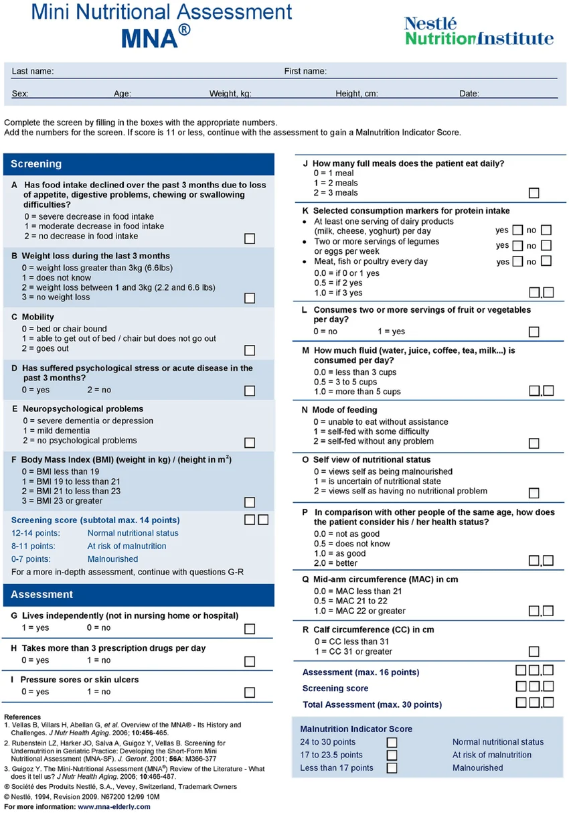

# Gizi pada Lansia: Penilaian, Kebutuhan, dan Intervensi
## 1. Mengapa gizi lansia perlu diperhatikan?

Malnutrisi pada lansia sering tidak dikenali karena penurunan berat badan dianggap bagian normal dari penuaan. Padahal, penurunan berat badan yang tidak disengaja perlu dicari penyebabnya.

Data gabungan skrining MNA yang dirangkum Kaiser dan kolega (2010) memperkirakan sekitar **23% lansia mengalami malnutrisi** dan **46% berisiko**. Perkiraan malnutrisi berbeda menurut tempat perawatan: sekitar 6% di komunitas, 14% di panti, 39% di rumah sakit, dan 51% di fasilitas rehabilitasi.

Malnutrisi berkaitan dengan infeksi, luka tekan, jatuh, rawat inap yang lebih lama, rawat ulang, dan kematian. Dehidrasi juga dapat memicu delirium, konstipasi, infeksi saluran kemih, cedera ginjal akut, jatuh, dan kematian.

## 2. Mengapa lansia rentan mengalami malnutrisi?

Faktor risiko biasanya saling berinteraksi:

- **Fisik dan fisiologis:** nafsu makan menurun, gigi tidak lengkap atau gigi palsu tidak pas, gangguan mengunyah atau menelan, penyakit akut maupun kronis, kelemahan fisik, dan gangguan kognitif.
- **Saluran cerna:** perubahan pengecapan, gastritis atrofi antrum, produksi asam dan sekresi lambung yang berkurang, pertumbuhan bakteri berlebih di saluran cerna atas, penyerapan vitamin B12 yang menurun, motilitas usus yang melambat, serta kemungkinan defisiensi ringan enzim pencernaan. Obat dan komorbiditas dapat memperberat perubahan ini.
- **Psikologis:** depresi, kehilangan pasangan, kesepian, atau kehilangan minat makan.
- **Sosial ekonomi:** kemiskinan, tinggal sendiri, kesulitan berbelanja atau memasak, dan terbatasnya dukungan sosial.
- **Obat:** polifarmasi, efek samping, perubahan rasa, mulut kering, mual, atau konstipasi dapat menurunkan asupan.

Penuaan juga mengubah komposisi tubuh: massa otot dan massa bebas lemak cenderung turun, sedangkan massa lemak dapat meningkat. Pengeluaran energi menurun akibat ukuran tubuh, komposisi tubuh, laju metabolisme basal, dan aktivitas fisik yang lebih rendah. Karena itu, kebutuhan kalori bisa turun, tetapi kepadatan zat gizi makanan tetap harus tinggi.

## 3. Skrining dan diagnosis malnutrisi

### Metode-metode penilaian gizi pada lansia

- **Mini Nutritional Assesment (MNA):** penilaian status gizi secara menyeluruh.
- **MNA-Short Form (MNA-SF):** skrining awal yang lebih singkat dan praktis.
- **Subjective Global Assesment (SGA):** menilai perubahan berat badan dan asupan, gejala, fungsi, serta pemeriksaan fisik.
- **Patient Derived-SGA (PD-SGA):** pengembangan SGA yang banyak digunakan pada pasien kanker.
- **•Global Leadership Initiative on Malnutrition (GLIM):** kriteria untuk menegakkan diagnosis malnutrisi setelah risiko teridentifikasi; bukan alat skrining.

MNA-SF dipilih karena dirancang khusus untuk lansia dan lebih cepat serta praktis daripada MNA lengkap, sehingga cocok sebagai **skrining awal**. Jika hasilnya menunjukkan risiko, lanjutkan dengan penilaian lebih lengkap dan gunakan kriteria GLIM untuk diagnosis.

### Langkah pertama: skrining dengan MNA-SF

MNA-SF memiliki enam butir dengan skor maksimum 14:

1. Penurunan asupan makanan selama tiga bulan terakhir.
2. Penurunan berat badan selama tiga bulan terakhir.
3. Mobilitas.
4. Stres psikologis atau penyakit akut.
5. Masalah neuropsikologis.
6. Indeks massa tubuh (IMT); lingkar betis dapat dipakai bila IMT tidak tersedia pada versi formulir terkait.

#Ingat Interpretasi skor:

- **12–14:** status gizi normal.
- **8–11:** berisiko malnutrisi.
- **0–7:** malnutrisi.

Skor rendah menunjukkan perlunya penilaian lebih lanjut; skor skrining saja tidak menggantikan diagnosis klinis.

### Langkah kedua: diagnosis dengan kriteria GLIM

Diagnosis GLIM memerlukan **minimal satu kriteria fenotipik dan satu kriteria etiologis**.

#### Kriteria fenotipik (perubahan yang terlihat atau terukur):

| Kriteria fenotipik                        | Batas                                                                                                                                                                                                                         |
| ----------------------------------------- | ----------------------------------------------------------------------------------------------------------------------------------------------------------------------------------------------------------------------------- |
| **Penurunan berat badan tidak disengaja** | Lebih dari **5%** dalam **enam bulan** terakhir, atau lebih dari **10%** bila berlangsung **lebih dari enam bulan**.                                                                                                          |
| **IMT rendah**                            | Salah satu batas yang digunakan pada lansia adalah **<22 kg/m² untuk usia ≥70 tahun**; **batas Asia** yang digunakan pada sejumlah kriteria adalah **<20 kg/m²**. Gunakan kriteria yang sesuai populasi dan pedoman setempat. |
| **Massa otot berkurang**                  | Massa otot lebih rendah dari nilai rujukan yang sesuai populasi dan metode pengukuran.                                                                                                                                        |

#### Kriteria etiologis (penyebab atau mekanisme):

- **Asupan makanan berkurang** atau gangguan asimilasi/penyerapan.
- **Inflamasi** atau beban penyakit.

Sesudah diagnosis, **tentukan tingkat keparahan** berdasarkan kriteria fenotipik dan susun rencana intervensi.

### Contoh formulir MNA

## 4. Kebutuhan energi, protein, cairan, dan zat gizi

### Energi

Nilai panduan ESPEN untuk lansia adalah sekitar **30 kkal/kg berat badan/hari**, kemudian disesuaikan dengan status gizi, aktivitas, penyakit, dan toleransi. Pada lansia dengan kebutuhan energi lebih rendah, pilih makanan padat zat gizi agar kebutuhan vitamin dan mineral tetap terpenuhi.

Sebagai gambaran historis, tabel yang mengutip *Manual of Dietetic Practice* edisi 2001 mencantumkan kisaran energi harian berikut. Nilai ini bukan pengganti perhitungan individual:

| Usia | Laki-laki | Perempuan |
|---|---:|---:|
| 51–59 tahun | 2.550 kkal | 1.900 kkal |
| 60–64 tahun | 2.380 kkal | 1.900 kkal |
| 65–74 tahun | 2.330 kkal | 1.900 kkal |
| ≥75 tahun | 2.100 kkal | 1.810 kkal |

### Protein

Target umum ESPEN adalah **sekurang-kurangnya 1 g/kg/hari**. Kisaran **1,0–1,2 g/kg/hari** sering digunakan untuk lansia sehat, sementara kebutuhan pada penyakit akut atau kronis dapat meningkat menjadi sekitar **1,2–1,5 g/kg/hari**, bila kondisi klinis memungkinkan. Sesuaikan dengan fungsi ginjal, penyakit, status gizi, dan tujuan terapi.

Pilih sumber protein bermutu tinggi dan kaya asam amino esensial, seperti telur, susu dan produk susu, ikan, daging tanpa lemak, serta kacang-kacangan. Distribusikan asupan sepanjang hari dan kombinasikan dengan latihan kekuatan untuk mendukung massa dan fungsi otot.

### Cairan dan dehidrasi

Lansia rentan dehidrasi karena rasa haus melemah, kemampuan ginjal memekatkan urine menurun, total air tubuh lebih rendah, penggunaan diuretik, atau ketergantungan pada orang lain untuk minum. Mulut kering, turgor kulit, dan tekanan darah rendah tidak cukup andal sebagai penanda tunggal pada lansia.

Tes yang lebih baik untuk menilai dehidrasi pada lansia adalah **nilai osmolalitas serum** dengan nilai **>300 mOsm/kg** mendukung dugaan dehidrasi. Rumus perkiraan yang tercantum adalah:

`Osmolalitas serum = 1,86 × (Na + K) + 1,15 × glukosa + 14`

Gunakan satuan dan metode laboratorium yang sesuai sebelum menafsirkan hasil.

Target minuman pada pedoman ESPEN yang dirangkum di sini adalah **≥1,6 L/hari untuk perempuan** dan **≥2,0 L/hari untuk laki-laki**, kecuali ada kondisi klinis yang memerlukan penyesuaian. Ringkasan lain menyebut kisaran umum 1,5–2,0 L/hari. Kebutuhan individual berubah pada gagal jantung, penyakit ginjal, gangguan elektrolit, demam, diare, atau pembatasan cairan. Tawarkan minuman berulang kali, termasuk setiap kali bertemu pasien. Bila asupan oral gagal, pertimbangkan cairan subkutan atau intravena sesuai indikasi klinis.

### Vitamin, mineral, serat, dan lemak

- **Vitamin D dan kalsium:** penting untuk kesehatan tulang dan pencegahan fraktur. Kisaran vitamin D yang digunakan dalam berbagai rekomendasi berkisar 400–1.000 IU/hari; kebutuhan kalsium sekitar 1.000–1.200 mg/hari. Dosis perlu mengikuti pedoman lokal, pola makan, pemeriksaan klinis, dan ada tidaknya defisiensi.
- **Vitamin B12:** penyerapan dapat menurun seiring berkurangnya keasaman lambung. Pertimbangkan makanan fortifikasi atau suplementasi bila asupan tidak cukup atau terdapat defisiensi. Risiko dapat meningkat pada pemakaian metformin atau penghambat pompa proton (PPI) jangka panjang.
- **Folat dan zat besi:** perhatikan kecukupan terutama bila ada anemia, asupan rendah, malabsorpsi, atau penggunaan obat yang relevan.
- **Antioksidan:** utamakan buah dan sayur berwarna sebagai sumber vitamin C, vitamin E, dan karotenoid.
- **Serat:** sekitar 21–30 g/hari pada tabel ringkas dan 25–30 g/hari pada bagan serat. Tingkatkan bertahap melalui serealia utuh, buah, sayur, dan kacang-kacangan; kecukupan cairan membantu toleransi serat. Yogurt sebagai sumber probiotik dan makanan tinggi serat sebagai prebiotik dapat mendukung kesehatan usus, walau toleransi tiap orang berbeda.
- **Lemak:** pilih lemak tak jenuh tunggal dan omega-3, misalnya dari ikan, kacang, biji-bijian, dan minyak zaitun. Batasi lemak jenuh dan lemak trans.

## 5. Prinsip dukungan nutrisi

Mulai dengan pendekatan yang disesuaikan pada penyebab dan kemampuan makan pasien:

1. Kenali risiko sedini mungkin dan cari penyebab penurunan asupan atau berat badan.
2. Berikan konseling dan dukungan gizi secara individual.
3. Perkaya makanan dengan energi dan protein bila asupan tidak mencukupi.
4. Tambahkan kudapan atau makanan kecil yang mudah dipegang (*finger food*), terutama bila porsi besar sulit dihabiskan.
5. Bila ada masalah mengunyah atau menelan, sesuaikan tekstur dan kekentalan; pertimbangkan evaluasi tenaga profesional menelan.
6. Pertimbangkan suplemen nutrisi oral (ONS) bila makanan biasa belum memenuhi kebutuhan.
7. Bila diperlukan nutrisi enteral, pilih formula berserat bila sesuai kondisi klinis.
8. Tinjau ulang pembatasan diet. Diet rendah garam, rendah kolesterol, atau diet diabetes yang terlalu ketat dapat merugikan lansia, terutama usia >75 tahun atau yang rapuh. Individualisasikan pembatasan berdasarkan manfaat klinis nyata.

Pada disfagia, sesuaikan tekstur makanan dan cairan, serta rujuk untuk penilaian menelan. Pada demensia, bantuan saat makan dan *finger food* dapat membantu. Pada demensia berat, keputusan nutrisi enteral perlu mempertimbangkan tujuan perawatan dan bukti klinis. Pada diabetes lansia rapuh, hindari pembatasan atau diet penurunan berat badan yang tidak perlu. Pada penyakit ginjal, sesuaikan protein dengan kondisi individu dan hindari restriksi berlebihan pada pasien yang rapuh atau malnutrisi. Setelah fraktur panggul atau pada luka tekan, kebutuhan energi dan protein dapat meningkat; mobilisasi dini dan dukungan nutrisi perlu berjalan bersama.

## 6. Deplesi otot, sarkopenia, dan frailty

### Frailty

Frailty adalah keadaan kerentanan akibat penurunan cadangan fisiologis. Fenotipe Fried mencakup lima ciri:

1. Penurunan berat badan yang tidak disengaja.
2. Kelelahan.
3. Aktivitas fisik rendah.
4. Kecepatan berjalan lambat.
5. Kekuatan genggam lemah.

Penyebab frailty bersifat multifaktorial; malnutrisi merupakan salah satu faktor penting. Frailty meningkatkan risiko jatuh, delirium, rawat inap, dan kematian.

### Clinical Frailty Scale (CFS)

Bagan CFS yang dipindai menunjukkan skala 1–9:

| Skor | Gambaran umum |
|---:|---|
| 1 | Sangat bugar: aktif, energik, rutin berolahraga. |
| 2 | Bugar: tidak memiliki gejala penyakit aktif, tetapi kebugaran lebih rendah daripada skor 1. |
| 3 | Penyakit terkelola baik; umumnya tidak aktif di luar aktivitas rutin. |
| 4 | Rentan: mandiri, tetapi gejala memperlambat aktivitas atau mudah lelah. |
| 5 | Frailty ringan: perlu bantuan untuk kegiatan instrumental sehari-hari, seperti belanja, transportasi, pekerjaan rumah berat, atau menyiapkan makanan. |
| 6 | Frailty sedang: perlu bantuan untuk semua kegiatan di luar rumah dan sebagian aktivitas di dalam rumah. |
| 7 | Frailty berat: sepenuhnya bergantung untuk perawatan pribadi, tetapi kondisi relatif stabil. |
| 8 | Frailty sangat berat: sepenuhnya bergantung dan mendekati akhir hayat; pemulihan dari penyakit ringan pun sulit. |
| 9 | Sakit terminal: harapan hidup <6 bulan, tanpa harus mengalami frailty berat sebelumnya. |

Pada demensia, skor frailty perlu mempertimbangkan fungsi dan kebutuhan bantuan, bukan hanya daya ingat. Skala ini membantu menggambarkan tingkat kerapuhan dan tidak menggantikan penilaian klinis menyeluruh.

### Diagnosis sarkopenia

Sarkopenia adalah kehilangan massa dan kekuatan otot. Alur EWGSOP2 adalah **Find → Assess → Confirm → Severity**: temukan kasus (misalnya SARC-F), nilai kekuatan, konfirmasi massa otot, lalu tentukan keparahan berdasarkan performa fisik.

| Ukuran | EWGSOP2 | AWGS 2019 (Asia) |
|---|---|---|
| Kekuatan genggam rendah | Laki-laki <27 kg; perempuan <16 kg | Laki-laki <28 kg; perempuan <18 kg |
| Tes berdiri dari kursi | 5 kali >15 detik | 5 kali ≥12 detik |
| Kecepatan berjalan | ≤0,8 m/detik menunjukkan performa rendah/keparahan | <1,0 m/detik |
| Massa otot rendah, ASM/tinggi² | Laki-laki <7,0; perempuan <5,5 kg/m² | DXA: laki-laki <7,0; perempuan <5,4 kg/m² |
| Massa otot rendah dengan BIA | — | Laki-laki <7,0; perempuan <5,7 kg/m² |

AWGS juga mencantumkan SPPB ≤9 sebagai performa fisik rendah. Gunakan ambang yang sesuai populasi; cut-off Asia lebih relevan untuk pasien Indonesia. Kekuatan genggam rendah menunjukkan **probable sarcopenia**, sedangkan konfirmasi memerlukan bukti massa otot rendah.

> **Cara mengingat EWGSOP2:** **F-A-C-S** = *Find, Assess strength, Confirm muscle quantity, Severity*. Pada pasien Asia, ingat **AWGS** memiliki ambang genggam sedikit lebih tinggi dan ambang kecepatan berjalan 1,0 m/detik.

## 7. Latihan dan pola makan untuk penuaan sehat

Latihan dan asupan protein saling melengkapi untuk menjaga fungsi otot dan mengurangi risiko frailty.

- **Latihan resistensi:** pilihan utama untuk membangun kekuatan dan massa otot. Contoh: beban atau pita resistensi, 2–3 kali per minggu, 30–60 menit per sesi sesuai kemampuan.
- **Latihan aerobik:** berjalan, berenang, atau bersepeda; sekitar 3–5 kali per minggu, 30–60 menit per sesi sesuai kemampuan.
- **Latihan keseimbangan dan koordinasi:** tai chi, yoga, atau latihan keseimbangan; sekitar 2–3 kali per minggu, 15–30 menit per sesi.
- **Protein dan mobilisasi:** kombinasikan asupan protein memadai dengan latihan resistensi atau mobilisasi terprogram. Evaluasi keamanan latihan, risiko jatuh, komorbiditas, dan kemampuan pasien.

Pola makan seimbang berisi buah, sayur, serealia utuh, sumber protein rendah lemak, dan lemak sehat. Pola Mediterania, DASH, dan pola Okinawa dapat menjadi contoh pola makan kaya pangan utuh; penerapannya perlu disesuaikan dengan budaya, ketersediaan pangan, dan kondisi pasien.

## 8. Obat yang dapat memengaruhi status gizi

| Kelompok obat | Dampak yang perlu diwaspadai |
|---|---|
| PPI dan metformin | Penyerapan vitamin B12 dapat menurun. |
| Diuretik | Dehidrasi, hiponatremia, atau hipokalemia. |
| Antikolinergik dan sejumlah obat lain | Mulut kering, perubahan rasa, anoreksia, atau konstipasi. |
| SSRI | Hiponatremia. |
| Kortikosteroid | Kehilangan otot dan tulang serta hiperglikemia. |
| Antiepilepsi penginduksi enzim | Defisiensi vitamin D. |

Pada pasien lansia dengan malnutrisi, tinjau seluruh obat bersama tim klinis dan pertimbangkan deprescribing bila aman serta sesuai indikasi.

## 9. Bukti intervensi gizi

- **EFFORT (uji acak terkontrol, 2.088 pasien rawat inap berisiko):** dukungan nutrisi yang diindividualisasi menurunkan luaran buruk gabungan, termasuk mortalitas 30 hari.
- **NOURISH:** ONS yang diperkaya HMB pada lansia rawat inap malnutrisi menunjukkan mortalitas 90 hari lebih rendah; luaran gabungan primer kematian/rawat ulang tidak signifikan.
- **Protein ditambah latihan resistensi:** pendekatan dengan dukungan bukti terbaik untuk meningkatkan fungsi otot.
- **Vitamin D:** koreksi bila defisiensi; manfaat suplementasi rutin pada orang yang sudah cukup vitamin D belum terbukti dengan kuat.

Saat membaca uji klinis, periksa populasi yang diteliti, luaran primer, besar efek, interval kepercayaan, dan risiko bias. Hasil pada pasien rawat inap tidak otomatis berlaku untuk semua lansia di komunitas.

## 10. Kasus latihan: Ibu S., 78 tahun

Ibu S. tinggal sendiri, mengalami jatuh, berat turun dari 50 menjadi 44 kg dalam enam bulan, tinggi 150 cm, makan hanya 1–2 porsi kecil per hari, merasa makanan tidak terasa, dan gigi palsunya tidak pas. Kekuatan genggam 12 kg dan kecepatan berjalan 0,6 m/detik. Obat yang digunakan: omeprazole, metformin, dan furosemide.

### Interpretasi

- Penurunan berat badan = (50 − 44) / 50 × 100% = **12% dalam enam bulan**.
- IMT = 44 / (1,50²) = **19,6 kg/m²**.
- GLIM: penurunan berat badan >5% dan IMT rendah merupakan kriteria fenotipik; asupan berkurang merupakan kriteria etiologis. Temuan mendukung malnutrisi berat sesuai penilaian kasus.
- Genggam 12 kg berada di bawah ambang EWGSOP2 untuk perempuan (<16 kg), dan kecepatan berjalan 0,6 m/detik rendah. Ini mendukung dugaan sarkopenia; massa otot perlu dikonfirmasi dengan DXA atau BIA.
- Risiko penyebab: gangguan gigi/rasa, tinggal sendiri, asupan rendah, obat yang berpotensi memengaruhi B12, serta diuretik yang meningkatkan risiko dehidrasi.

### Rencana awal yang dapat dipertimbangkan

- Energi: 30 kkal/kg × 44 kg = **sekitar 1.320 kkal/hari** sebagai nilai panduan awal.
- Protein: gunakan sekurang-kurangnya 1,2 g/kg bila kondisi klinis sesuai = **sekitar 53 g/hari**; individualisasikan terhadap kondisi ginjal dan penyakit lain.
- Cairan: target awal sesuai ringkasan pedoman untuk perempuan **≥1,6 L/hari**, kecuali ada pembatasan klinis.
- Evaluasi gigi palsu dan kesehatan mulut, suasana hati, dukungan sosial, status hidrasi, fungsi ginjal, elektrolit, vitamin B12, pola makan, serta kemampuan menelan.
- Perkaya makanan, atur kudapan dan makanan kecil padat energi-protein, dan pertimbangkan ONS bila asupan tetap kurang.
- Rencanakan latihan resistensi atau mobilisasi yang aman, lalu pantau berat badan, asupan, kekuatan genggam, dan fungsi secara berkala.

## 11. Rangkuman

1. Penurunan berat badan yang tidak disengaja pada lansia selalu perlu dievaluasi.
2. Lakukan skrining dengan MNA-SF; skor 12–14 normal, 8–11 berisiko, dan 0–7 malnutrisi.
3. Diagnosis GLIM memerlukan sekurang-kurangnya satu kriteria fenotipik dan satu etiologis.
4. Nilai panduan energi adalah sekitar 30 kkal/kg/hari; protein minimal 1 g/kg/hari dan dapat lebih tinggi saat sakit bila sesuai kondisi klinis.
5. Target minuman pedoman: ≥1,6 L/hari untuk perempuan dan ≥2,0 L/hari untuk laki-laki, dengan penyesuaian kondisi medis.
6. Turgor kulit dan mulut kering kurang andal untuk mendiagnosis dehidrasi; osmolalitas serum >300 mOsm/kg mendukung diagnosis.
7. Skrining frailty dan sarkopenia perlu menilai kekuatan, massa otot, performa, serta kemampuan aktivitas sehari-hari.
8. Intervensi dimulai dari makanan yang diperkaya, kudapan, bantuan makan, dan penyesuaian tekstur; ONS dipertimbangkan bila asupan oral tetap tidak cukup.
9. Hindari pembatasan diet yang tidak memberikan manfaat klinis yang jelas.
10. Kombinasikan protein memadai dengan latihan resistensi, tinjau obat, dan libatkan tim multidisiplin.

### Mnemonik cepat

- **GLIM:** 1 fenotipik + 1 etiologis.
- **MNA-SF:** enam area skrining, total 14 poin; **12 normal, 8–11 risiko, 0–7 malnutrisi**.
- **Fried:** berat turun, lelah, aktivitas rendah, jalan lambat, genggam lemah.
- **Sarkopenia EWGSOP2:** cari kasus → ukur kekuatan → konfirmasi massa → nilai keparahan.
- **Prioritas gizi lansia:** cukup energi, protein, cairan; makanan mudah dimakan; gerak dan latihan; evaluasi obat dan penyebab sosial.

## Referensi pilihan

- Volkert D, et al. ESPEN practical guideline: Clinical nutrition and hydration in geriatrics. *Clinical Nutrition*. 2022;41:958–989. [Teks pedoman](https://www.clinicalnutritionjournal.com/article/S0261-5614(22)00034-6/fulltext)
- Cederholm T, et al. GLIM criteria for the diagnosis of malnutrition: A consensus report. *Clinical Nutrition*. 2019;38:1–9. [Konsensus GLIM](https://pmc.ncbi.nlm.nih.gov/articles/PMC6438340/)
- Cruz-Jentoft AJ, et al. Sarcopenia: revised European consensus on definition and diagnosis (EWGSOP2). *Age and Ageing*. 2019;48:16–31. [Konsensus EWGSOP2](https://pmc.ncbi.nlm.nih.gov/articles/PMC6322506/)
- Chen LK, et al. Asian Working Group for Sarcopenia: 2019 consensus update. *Journal of the American Medical Directors Association*. 2020;21:300–307.
- Kaiser MJ, et al. Frequency of malnutrition in older adults: A multinational perspective using the MNA. *Journal of the American Geriatrics Society*. 2010;58:1734–1738.
- Schuetz P, et al. Individualised nutritional support in medical inpatients at nutritional risk (EFFORT). *The Lancet*. 2019;393:2312–2321.
- Deutz NEP, et al. Protein supplementation enriched with HMB in malnourished older adults (NOURISH). *Clinical Nutrition*. 2016;35:18–26.
