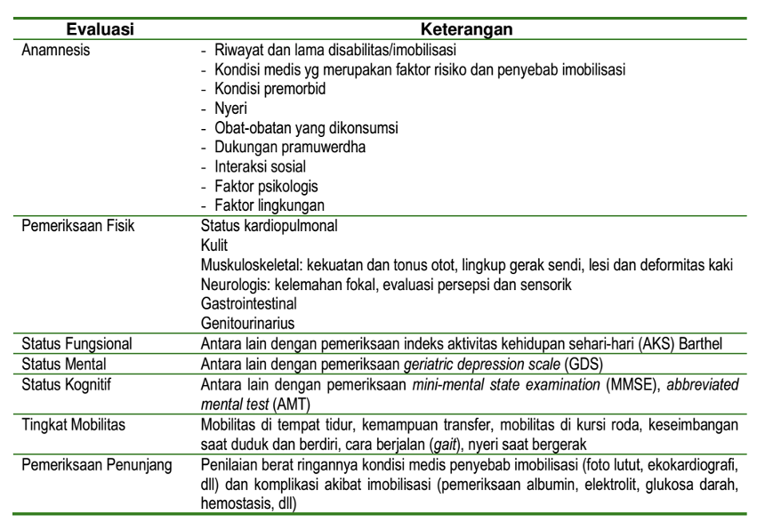

# 1. Pengertian Imobilisasi

**Imobilisasi** adalah hilangnya kemampuan melakukan gerakan tubuh atau berpindah posisi akibat perubahan fungsi fisiologis tubuh. Keadaan ini dapat berupa ketidakmampuan berpindah tempat atau tirah baring selama lebih dari tiga hari. Kurangnya aktivitas dalam waktu lama menyebabkan penurunan kebugaran dan kemunduran fungsi tubuh (*deconditioning*).

## Penyebab umum imobilisasi pada usia lanjut

- **Gangguan muskuloskeletal:** artritis, osteoporosis, fraktur (terutama panggul dan femur), masalah kaki seperti bunion atau kalus, serta lain-lain seperti penyakit Paget.
- **Gangguan neurologis:** stroke, penyakit Parkinson, disfungsi serebelar, dan neuropati.
- **Penyakit kardiovaskular:** gagal jantung kongestif (berat), penyakit jantung koroner dengan nyeri dada berulang, atau penyakit vaskular perifer dengan nyeri saat berjalan (klaudikasio) yang sering.
- **Penyakit paru berat**, misalnya penyakit paru obstruktif kronis.
- **Faktor sensorik** seperti gangguan penglihatan, rasa takut jatuh, nyeri akut atau kronis.
- **Lingkungan dan perawatan:** pembatasan gerak yang tidak perlu di rumah sakit atau panti, serta alat bantu mobilitas yang tidak memadai.
- **Faktor lain:** dekondisi (setelah tirah baring lama pada sakit akut), malnutrisi, penyakit sistemik berat (misalnya metastasis luas pada keganasan), depresi, efek samping obat (misalnya kekakuan akibat obat antipsikotik), dan perjalanan panjang yang membatasi gerak.

# 2. Dampak Imobilisasi pada Tubuh

| Organ/Sistem                           | Perubahan yang Terjadi Akibat Imobilisasi                                                                                                                                                                                                                                                                                          |
| -------------------------------------- | ---------------------------------------------------------------------------------------------------------------------------------------------------------------------------------------------------------------------------------------------------------------------------------------------------------------------------------- |
| Muskuloskeletal                        | Osteoporosis, penurunan massa tulang, hilangnya kekuatan otot, penurunan area potong lintang otot, kontraktur, degenerasi rawan sendi, ankilosis, peningkatan tekanan intraartikular, berkurangnya volume sendi                                                                                                                    |
| Kardiopulmonal dan pembuluh darah      | Peningkatan denyut nadi istirahat, penurunan perfusi miokard, intoleran terhadap ortostatik, penurunan ambilan oksigen maksimal (VO₂ maks), _deconditioning_ jantung, penurunan volume plasma, perubahan uji fungsi paru, atelektasis paru, pneumonia, peningkatan stasis vena, peningkatan agregasi trombosit, dan hiperkoagulasi |
| Integumen                              | Peningkatan risiko ulkus dekubitus dan maserasi kulit                                                                                                                                                                                                                                                                              |
| Metabolik dan endokrin                 | Keseimbangan nitrogen negatif, hiperkalsiuria, natriuresis dan deplesi natrium, resistensi insulin (intoleransi glukosa), hiperlipidemia, serta penurunan absorpsi dan metabolisme vitamin/mineral                                                                                                                                 |
| Neurologi dan psikiatri                | Depresi dan psikosis, atrofi korteks motorik dan sensorik, gangguan keseimbangan, penurunan fungsi kognitif, neuropati kompresi, dan rekrutmen neuromuskular yang tidak efisien                                                                                                                                                    |
| Traktus gastrointestinal dan urinarius | Inkontinensia urin dan alvi, infeksi saluran kemih, pembentukan batu kalsium, pengosongan kandung kemih yang tidak sempurna dan distensi kandung kemih, impaksi feses dan konstipasi, penurunan motilitas usus, refluks esofagus, aspirasi saluran napas, dan peningkatan risiko perdarahan gastrointestinal                       |

# 3. P3G dan Tatalaksana

**Pengkajian Paripurna Pasien Geriatri (P3G)** membantu menemukan penyebab, kemampuan yang masih dimiliki, dan komplikasi yang perlu dicegah.

## Tatalaksana Umum

- Kerjasama tim medis interdisiplin dengan partisipasi pasien, keluarga, dan pramuwerdha.
- **Edukasi kepada pasien dan keluarga** mengenai bahaya tirah baring lama, pentingnya latihan bertahap dan ambulasi dini, serta mencegah ketergantungan pasien dengan melakukan aktivitas kehidupan sehari-hari sendiri, semampu pasien.
- Dilakukan **Pengkajian Geriatri Paripurna (P3G)**, perumusan target fungsional, dan pembuatan rencana terapi yang mencakup pula perkiraan waktu yang diperlukan untuk mencapai target terapi.
- Temukenali dan **tatalaksana infeksi, malnutrisi, anemia, gangguan cairan dan elektrolit** yang mungkin terjadi pada kasus imobilisasi, serta penyakit/kondisi penyerta lainnya.
- **Evaluasi seluruh obat-obatan yang dikonsumsi**; obat-obatan yang dapat menyebabkan kelemahan atau kelelahan harus diturunkan dosisnya atau dihentikan bila memungkinkan.
- **Berikan nutrisi yang adekuat**, asupan cairan, dan makanan yang mengandung serat, serta suplementasi vitamin dan mineral.
- **Program latihan dan remobilisasi** dimulai ketika kestabilan kondisi medis terjadi meliputi latihan mobilitas di tempat tidur, latihan lingkup gerak sendi (pasif, aktif, dan aktif dengan bantuan), latihan penguatan otot-otot (isotonik, isometrik, isokinetik), latihan koordinasi/ keseimbangan (misalnya berjalan pada satu garis lurus), transfer dengan bantuan, dan ambulasi terbatas.
- Bila diperlukan, sediakan dan ajarkan cara penggunaan alat-alat bantu berdiri dan ambulasi.
- **Manajemen miksi dan defekasi**, termasuk penggunaan komod atau toilet.

## Tatalaksana Khusus

- Tatalaksana faktor risiko imobilisasi.
- Tatalaksana komplikasi akibat imobilisasi.
- Pada keadaan-keadaan khusus, konsultasikan kondisi medik kepada dokter spesialis yang kompeten.
- Lakukan remobilisasi segera dan bertahap pada pasien pasien yang mengalami sakit atau dirawat di rumah sakit dan panti werdha untuk mencegah imobilisasi lebih lanjut.
- Upayakan dukungan lingkungan dan ketersediaan alat bantu untuk mobilitas yang adekuat bagi usia lanjut yang mengalami disabilitas permanen.

# 4. Tatalaksana Komplikasi Imobilisasi

## a. Tromboemboli vena

Tromboemboli vena mencakup **deep vein thrombosis (DVT)** dan **pulmonary embolism (PE)**. Risikonya meningkat pada usia 60 tahun ke atas. Imobilisasi memudahkan darah mengalir lambat dan membeku.

### Trias Virchow

Patogenesis timbulnya tromboemboli vena melibatkan 3 faktor yang disebut **Trias Virchow**. #Ingat 

> [!NOTE] Trias Virchow = kerusakan dinding pembuluh + stasis aliran darah + hiperkoagulasi

Hiperkoagulasi berarti darah lebih mudah membeku. Kurang gerak terutama memperburuk stasis vena.

### Gejala klinis klasik DVT

- Bengkak.
- Nyeri.
- Perubahan warna kulit pada ekstremitas yang terkena.

### Pemeriksaan fisik

Vena yang mengalami trombosis:
- Edema unilateral.
- Perabaan yang hangat.
- **Tanda Homans** (nyeri pada dorsofleksi pasif kaki).
- Dilatasi vena superfisial, bisa karena cedera muskuloskeletal, selulitis, atau insufisiensi vena.

### Petunjuk Prediksi Klinis dari Wells untuk Diagnosis DVT dan PE
#### a. Trombosis Vena Dalam (DVT)

| Gambaran Klinis                                                             | Nilai |
| --------------------------------------------------------------------------- | ----: |
| Kanker aktif (dlm terapi atau paliatif)                                     |     1 |
| Paralisis, paresis, atau imobilisasi ekstremitas bawah                      |     1 |
| Tirah baring lebih dari 3 hari karena pembedahan (dlm 4 bulan)              |     1 |
| Nyeri tekan terlokalisasi sepanjang distribusi vena dalam                   |     1 |
| Pembengkakan seluruh tungkai                                                |     1 |
| Bengkak pada betis unilateral lebih dari 3 cm (di bawah tuberositas tibial) |     1 |
| Edema _pitting_ unilateral                                                  |     1 |
| Kolateral vena superfisial                                                  |     1 |
| Ada diagnosis alternatif lain selain DVT dgn kemungkinan sama atau lebih    |    -2 |
| **Jumlahkan total nilai dan interpretasikan sesuai kriteria di bawah.**     |       |

*Interpretasi risiko berdasarkan nilai (kemungkinan DVT):* #Ingat 
- **≥3**: risiko tinggi (75%)
- **1-2**: risiko sedang (17%)
- **<1**: risiko rendah (3%)

#### b. Emboli Paru (PE)

| Gambaran Klinis                                                         | Nilai |
| ----------------------------------------------------------------------- | ----: |
| Gejala klinis DVT                                                       |     3 |
| Diagnosis selain PE kurang mungkin                                      |     3 |
| Frekuensi denyut jantung lebih dari 100 kali per menit                  |   1,5 |
| Imobilisasi dan pembedahan (dlm 4 minggu sebelumnya)                    |   1,5 |
| DVT atau PE sebelumnya                                                  |   1,5 |
| Hemoptisis                                                              |     1 |
| Keganasan                                                               |     1 |
| **Jumlahkan total nilai dan interpretasikan sesuai kriteria di bawah.** |       |

_Interpretasi risiko berdasarkan nilai (kemungkinan PE):_
- **>6**: risiko tinggi (78,4%)
- **2-6**: risiko sedang (27,8%)
- **<2**: risiko rendah (3,4%)

### Pencegahan
#### Metode Mekanik

1. **Graduated compression stocking (GCS)** → stoking elastis yang dililitkan pada ekstremitas dengan gradasi ketat menuju ringan, dari distal ke proksimal.
2. **Intermitten pneumatic compression (IPC)**
3. **Venous foot pump (VFP)**

Metode mekanik tidak seefektif penggunaan obat-obat antikoagulan dan dapat menimbulkan bias saat dilakukan pemeriksaan penapisan tromboemboli vena, berupa angka positif-palsu sebesar 10–30%.

The American College of Chest Physicians (ACCP) merekomendasikan penggunaan profilaksis mekanik ini untuk kelompok dengan risiko perdarahan tinggi atau dikombinasikan dengan obat antikoagulan untuk meningkatkan efektivitasnya.

#### Metode Farmakologi

- **Aspirin atau antiplatelet lain**  
    Tidak dianjurkan sebagai pencegahan tunggal.
- **Antikoagulan**
    - **Unfractionated Heparin**  
        Dosis 5000 unit s.c setiap 8 jam atau 12 jam.
    - **Low molecular weight heparin**  
        Enoxaparin 40 mg s.c, sekali sehari.
    - **Fondaparinux**
    - **Warfarin atau coumarin jenis lain**

Beberapa upaya lain untuk mencegah kejadian tromboemboli vena meliputi:

- Latihan tungkai dan gerak sendi aktif maupun pasif sesuai toleransi pasien.
- **Elevasi kaki setinggi 15-20°** dengan lutut sedikit fleksi dan posisi kepala tempat tidur rendah atau mendatar.
- Hindari duduk di kursi pada masa awal pasca operasi.
- Gunakan stoking elastik anti-flebitis pada pasien dengan varises atau memiliki riwayat flebitis.
- Jalan kaki dalam waktu singkat secara teratur pasca operasi.

### Dosis untuk Terapi Antikoagulan

- **UFH**
    - _Loading dose_ diberikan sebesar **80 unit/kgBB bolus**, kemudian dilanjutkan dengan dosis **18 unit/kgBB per jam** melalui infus kontinu.
    - Pemantauan dilakukan dengan _activated partial thromboplastin time_ (APTT), yang diharapkan mencapai 1,5 sampai 2,5 kali kontrol.
    - Insidensi perdarahan mayor pada dosis terapeutik lebih tinggi dibandingkan profilaksis, tetapi efeknya dapat diharapkan segera berhenti 2 jam setelah infus dihentikan.
- **LMWH**
    - Pemberian LMWH sama efektifnya dengan pemberian UFH.
    - **Enoxaparin** diberikan dengan dosis **1 mg/kgBB dua kali sehari** atau **1,5 mg/kgBB sekali sehari** secara subkutan.
    - **Dalteparin** diberikan dengan dosis **200 IU/kgBB per hari**, sebagai dosis tunggal atau dua kali sehari.
    - **Tinzaparin** diberikan dengan dosis **175 anti-Xa/kgBB per hari** untuk pengobatan DVT.
    - Untuk terapi PE, hanya enoxaparin dan tinzaparin yang telah terbukti efektif dan diterima oleh FDA.
- **Fondaparinux**
    - Untuk terapi PE maupun DVT, fondaparinux diberikan secara subkutan sekali sehari:
        - **5 mg** untuk **BB <50 kg**;
        - **7,5 mg** untuk **BB 50-100 kg**;
        - **10 mg** untuk **BB >100 kg**.

### Trombolitik

Umumnya diberikan pada pasien PE masif atau dengan keadaan hemodinamik tidak stabil.

- **Alteplase** dengan dosis **100 mg IV** selama 2 jam.
- **Streptokinase** diberikan dengan _loading dose_ **250.000 IU**, dilanjutkan dengan **100.000 IU per jam** selama 24 jam.
- Pemberian trombolitik langsung pada trombus melalui kateter tidak terbukti lebih superior dibandingkan pemberian secara perifer.
- Efek samping perdarahan pada pemakaian trombolitik lebih besar dibandingkan dengan UFH, LMWH, maupun fondaparinux.

### Fisioterapi

**Setelah 48 jam pasca terapi antikoagulan**, latihan lingkup gerak sendi pasif sampai aktif dengan bantuan dan pemberian stoking elastis dapat diberikan.

## b. Ulkus dekubitus (luka tekan)

Ulkus dekubitus adalah kerusakan kulit dan jaringan di bawahnya akibat tekanan berkepanjangan, terutama di atas tonjolan tulang.

**Empat faktor utama**:
- Tekanan
- Daya regang
- Friksi/gesekan
- Kelembaban

Faktor risiko lain meliputi kulit kering, suhu tubuh meningkat, tekanan darah rendah, usia lanjut, inkontinensia, malnutrisi, diabetes, insufisiensi vaskular, obesitas, hipoalbuminemia, demensia berat, perubahan kesadaran, dan kurang cairan.

Komplikasinya dapat berupa nyeri, infeksi lokal, selulitis, osteomielitis (infeksi tulang), sepsis, dan kematian.

### Stadium ulkus dekubitus berdasarkan Modifikasi Klasifikasi Shea

| Stadium     | Manifestasi Klinis                                                                                                                               |
| ----------- | ------------------------------------------------------------------------------------------------------------------------------------------------ |
| Stadium I   | Eritema _nonblanchable_ pada kulit yang masih utuh atau perubahan warna kulit yang hangat, edema, dan berindurasi pada pasien dengan kulit gelap |
| Stadium II  | Sudah terjadi kehilangan lapisan kulit epidermis dan/atau dermis                                                                                 |
| Stadium III | Ulkus sudah berkembang ke jaringan lunak dan ke lapisan fasia dalam                                                                              |
| Stadium IV  | Jaringan otot dan tulang sudah terlibat                                                                                                          |

💡**Tips hafalan**: ingat urutan **Merah → Kulit → Dalam → Otot/tulang** #Ingat

- **Stadium I – Merah:** kulit masih utuh, tetapi tampak kemerahan atau berubah warna.
- **Stadium II – Kulit:** lapisan kulit mulai hilang.
- **Stadium III – Dalam:** luka menembus jaringan lunak hingga fasia dalam.
- **Stadium IV – Otot/tulang:** jaringan otot dan tulang ikut terlibat.

Bayangkan luka yang makin dalam di setiap tahap: **warna kulit → kulit terbuka → jaringan dalam → otot dan tulang**.

### Tipe ulkus dekubitus

| Tipe             | Manifestasi Klinis                                                                                 | Perkiraan Lama Perawatan |
| ---------------- | -------------------------------------------------------------------------------------------------- | -----------------------: |
| Normal           | Suhu area luka berbeda sekitar 2,5°C atau lebih dibanding kulit sekitarnya                         |                 6 minggu |
| Arteriosklerotik | Selain faktor tekanan, terdapat gangguan aliran darah akibat arteriosklerosis; perbedaan suhu <1°C |                16 minggu |
| Terminal         | Terjadi pada pasien yang mendekati akhir hayat                                                     |       Tidak dapat sembuh |

### Skala Norton untuk mengukur risiko ulkus dekubitus

Skala Norton menilai lima aspek. Tiap aspek diberi skor 1-4; skor total lebih rendah berarti kondisi lebih buruk dan risiko luka tekan lebih besar.

| Aspek | 4 | 3 | 2 | 1 |
|---|---|---|---|---|
| Kondisi fisik umum | Baik | Cukup/lumayan | Buruk | Sangat buruk |
| Kesadaran | Kompos mentis | Apatis | Bingung | Stupor |
| Aktivitas | Berjalan | Berjalan dengan bantuan | Hanya dapat duduk | Hanya berbaring |
| Mobilitas | Bergerak bebas | Sedikit terbatas | Sangat terbatas | Tidak dapat bergerak |
| Inkontinensia | Tidak ada | Kadang-kadang | Sering inkontinensia urine | Inkontinensia urine dan tinja |

Setiap pasien yang mengalami imobilisasi harus dilakukan penilaian risiko untuk terjadinya ulkus dekubitus dengan menggunakan skala Norton. 

#### Interpretasi:

Skor **<14** = **risiko tinggi** untuk terjadinya ulkus dekubitus. 
Skor **<12** = **peningkatan risiko 50 kali lebih besar** untuk mendapatkan ulkus dekubitus.
Skor **12-13** = **risiko sedang**.
Skor **>14** = **risiko sangat kecil**.

### Rekomendasi perawatan kulit dan terapi awal untuk pencegahan ulkus dekubitus

1. Amati kulit setiap hari secara sistematis.
2. Bersihkan kulit dengan bahan pembersih yang lembut secara rutin, hindari pemakaian air panas dan minimalkan regangan dan gesekan pada kulit.
3. Kurangi kekeringan kulit karena kelembaban yang rendah dan paparan terhadap dingin, dan gunakan pelembab untuk kulit kering.
4. Kurangi paparan kulit terhadap kelembaban karena inkontinensia, keringat, atau drainase luka. Jika inkontinensia tidak dapat dikendalikan, setelah pengkajian dan terapi yang sesuai, gunakan bahan absorptif atau alas (underpad). Bahan topikal yang bekerja menghalangi kelembaban juga dapat digunakan.
5. Kurangi cedera kulit karena gesekan dan regangan dengan cara mengubah posisi, berpindah, dan berbalik; pelumas seperti minyak sayur atau krim; dan pelapis protektif, pembalut, atau alas di atas tulang yang menonjol.
6. Pastikan asupan gizi yang adekuat dan koreksi defisiensi nutrisi yang konsisten dengan seluruh target terapi.
7. Upayakan rehabilitasi yang sesuai dengan target terapi.
8. Catat seluruh intervensi dan hasil yang didapat.

### Pencegahan efek akibat tekanan, gesekan, dan regangan

- **Mengubah posisi sesering mungkin merupakan metode utama pencegahan ulkus dekubitus**.
- Ubah posisi dengan **punggung pasien miring 30°** dari permukaan tempat tidur bergantian ke kiri atau kanan dan telentang setiap 2-3 jam pada pasien dengan risiko tinggi dan 2-4 kali per hari pada pasien dengan risiko lebih rendah.
- Hindari posisi miring dengan punggung berada 90° terhadap permukaan karena akan memberikan tekanan berlebihan pada trokanter mayor dan maleolus lateral.
- Gunakan bantal di antara tungkai, di bawah punggung, dan penyangga lengan untuk mempertahankan posisi optimal, mencegah kontak antara tonjolan tulang yang satu dengan yang lainnya, antar ekstremitas maupun dengan alas tidur, dapat mengangkat tumit dari alas tempat tidur, dan menopang pasien pada posisi miring lateral 30°.
- Bagi pasien yang harus memposisikan kepala tegak (posisi duduk) di tempat tidur atau pasien dengan kemampuan terbatas duduk di kursi roda, ubah posisinya setiap 1 jam atau pasien diminta untuk mengubah tumpuan berat badannya setiap 15 menit.
- Untuk mencegah gaya regangan, jangan mendudukkan pasien pada sudut 30°, pasien sebaiknya berbaring atau duduk tegak, karena posisi duduk dengan sudut 30° tersebut menyebabkan lekukan (angulasi) pada pembuluh darah di daerah gluteal dan sakrum sehingga aliran darah dapat terhambat.
- Untuk mencegah maserasi kulit, jaga agar kulit tetap kering (memakai alas berdaya serap tinggi untuk pasien dengan inkontinensia) tapi licin (lubricated) dengan mengoleskan emolien tipis-tipis setelah mandi atau inkontinens.
- Gunakan alat pengurang tekanan, gesekan, atau regangan (kasur air atau kasur udara/kasur anti-dekubitus), pada pasien yang dengan teknik perubahan posisi saja tidak cukup atau tidak memungkinkan.
- Hindari penggunaan alat bantu berbentuk seperti donat untuk kursi dan kursi roda.

### Edukasi dan pendekatan multidisplin

Edukasi terhadap tenaga kesehatan di seluruh tingkat pelayanan kesehatan serta pasien, keluarga, dan pramuwerdha (caregivers) mengenai faktor risiko dan perawatan pada pasien dengan faktor risiko dapat mengurangi insidensi ulkus dekubitus, demikian pula
bila pendekatan tim multidisiplin diterapkan.

### Terapi

Sesuai dengan panduan yang dikeluarkan oleh AHCPR, penatalaksanaan terhadap ulkus dekubitus harus meliputi:

- Pendekatan sistemik.
- Penggunaan kasur atau matras khusus.
- Perawatan luka lokal.
- Pembedahan.
- Terapi-terapi eksperimental.

#### Pendekatan sistemik

- **Status hidrasi.**
- **Asupan nutrisi adekuat.**
	- Setidaknya 30-35 kalori/kgBB/hari.
	- Protein 1,25-1,5 g/kgBB/hari.
- **Antibiotika sistemik.**
	- Ampisilin sulbactam, imipenem, meropenem, tikarsilin klavulanat, piperacillin tazobactam, kombinasi klindamisin dengan siprofloksasin atau dengan aminoglikosida sambil menunggu hasil kultur.

#### Perawatan Lokal

- **Ulkus dekubitus stadium I dan II umumnya tidak memerlukan pemberian terapi topikal**, cukup menjaga kelembaban dan kebersihan ulkus, dan **diharapkan akan membaik dengan sendirinya**.
- Pada luka yang bersih namun tidak menyembuh atau tetap mengeluarkan eksudat setelah 2-4 minggu dengan perawatan yang optimal, dapat dicoba pemberian antibiotika topikal seperti silver sulfadiazin selama 2 minggu.
- Hindari penggunaan povidon-iodin, iodofor, natrium hipoklorit, hidrogen peroksid, serta asam asetat.
- Lakukan debridemen luka secara adekuat bila terdapat jaringan nekrotik, meliputi debridemen dengan pisau atau gunting, atau pendekatan mekanik berupa pembalutan, hidroterapi, irigasi, dekstranomer, terapi enzimatik, atau teknik autolitik.
- Setelah ulkus bersih dan granulasi atau epitelisasi telah mulai, pertahankan kelembaban daerah ulkus dan sekitarnya tanpa menghambat penyembuhan jaringan dengan menggunakan dressing seperti transparent film, hydrocolloid dressing, atau cukup kasa yang dibasahi dengan normal salin.
- Tatalaksana nyeri pada luka, terutama nyeri yang timbul saat dilakukan debridemen.
- Lakukan pijat manual sirkular pada tepi luka dekubitus, phonophoresis dengan transducer ultrasound dan ZnO2 serta transcutaneous electrical nerve stimulation (TENS) berfrekuensi rendah pada tepi luka untuk memperbaiki vaskularisasi daerah luka, granulasi, dan epitelisasi jaringan.

## c. Hipotensi Ortostatik

Salah satu akibat komplikasi imobilisasi pada sistem kardiovaskular adalah hipotensi ortostatik yang ditegakkan bila dijumpai **penurunan tekanan darah sistolik ≥20 mmHg atau diastolik ≥10 mmHg** yang diukur segera **dalam waktu 2-3 menit dari posisi berbaring ke posisi tegak** dan dapat disertai **keluhan dizziness** atau **sinkop** (hipotensi ortostatik simtomatik).

### Pencegahan

Hipotensi ortostatik dapat dicegah dengan **mobilisasi bertahap secepatnya**, diutamakan agar secepatnya dapat duduk di tempat tidur dengan kaki menggantung ke bawah sambil digerak-gerakan.

### Terapi

**Evaluasi obat-obatan yang dikonsumsi dan status hidrasi pasien** karena penyebab hipotensi ortostatik antara lain adalah penggunaan obat-obatan anti-hipertensi, diuretika, antiparkinson, antipsikotik, antidepresi, dan vasodilator tertentu, serta defisit cairan tubuh atau berkurangnya volume darah.

## d. Kontraktur

Kontraktur/deformitas terjadi akibat **pemendekan serabut otot karena imobilisasi pada posisi non-fungsional**, contohnya berbaring lama pada posisi tungkai menekuk, membuka keluar, atau drop foot (pergelangan kaki dalam posisi plantar fleksi).

### Pencegahan

Untuk mencegah kontraktur/deformitas, dapat dilakukan *body positioning/stretching*:

- Mobilisasi bertahap secepatnya.
- *Proper positioning*, dengan memosisikan pasien sedemikian rupa agar dapat berbaring dengan posisi sendi-sendi penopang tubuh pada keadaan serupa dengan saat berdiri tegak, yaitu kepala, punggung, serta tungkai dalam keadaan lurus, sedangkan sendi pergelangan kaki dalam posisi seperti saat berdiri tegak dimana tungkai dan kaki membentuk sudut 90 derajat.
- *Static splinting* (pemberian foot board, ankle foot orthosis) agar sendi pergelangan dipertahankan pada posisi fungsional.
- Apabila pasien mampu menggerakkan tungkai secara mandiri saat sedang berbaring, maka dapat dilakukan gerakan-gerakan sederhana sesuai dengan kemampuan pasien; dimulai dengan gerakan dorso fleksi-plantar fleksi pergelangan kaki yang dilanjutkan dengan menekuk lutut secara bergantian dengan menggeser tungkai pada tempat tidur, dari posisi lurus sampai menekuk secara berulang-ulang, minimal 3 kali sehari, 10 gerakan untuk setiap tungkai atau sesuai kemampuan pasien.

### Terapi

Apabila sudah terjadi kontraktur atau terdapat keterbatasan gerak sendi, dilakukan **latihan gerak sendi ekstremitas aktif dan pasif** disertai ***slow stretching*** minimal 1-2 kali sehari untuk menjaga seluruh rentang gerak sendi. Untuk mempermudah *stretching* dapat diberikan *ultrasound diatermi* pada otot yang hendak dilatih.

## e. Osteoporosis akibat imobilisasi

Tulang terus mengalami pembongkaran (resorpsi) dan pembentukan. **Osteoporosis berkembang ketika proses tersebut tidak seimbang**. **Imobilisasi meningkatkan resorpsi sehingga massa tulang hilang**, sementara perbandingan matriks organik dan anorganik tulang tidak berubah.

Pada awal imobilisasi, kalsium serum dapat meningkat, yang ditandai dengan peningkatan kalsium, fosfor, dan hidroksiprolin dalam urine. Kalsium total tubuh akan menurun sekitar 4% setelah tujuh minggu imobilisasi.

Imobilisasi juga dapat menghambat sekresi hormon paratiroid (PTH) dan pembentukan vitamin D aktif, sehingga kadar vitamin D turun tanpa kenaikan PTH serum.

## f. Pneumonia dan infeksi saluran kemih (ISK)

### Paru

- Tirah baring membuat sputum (dahak) lebih mudah tertahan (retensi) dan meningkatkan risiko aspirasi.
- Saat berbaring, kerja diafragma dan otot interkostal dapat kurang efektif; gerak dinding dada terbatas sehingga dahak lebih sulit dikeluarkan.
- Pada usia lanjut, elastisitas paru berkurang dan saluran napas kecil lebih mudah menutup. Akibatnya, risiko atelektasis dan pneumonia meningkat.

### Saluran kemih

- Imobilisasi dapat mengubah aliran urine dan menyebabkan kandung kemih tidak kosong sempurna. Hal ini meningkatkan risiko retensi urine dan ISK. 
- Kadar kalsium urine yang tinggi dapat mendukung pembentukan batu, yang bisa menyumbat aliran. 
- Inkontinensia pada orang lanjut usia dapat terjadi karena tidak mampu mencapai toilet, pengosongan kandung kemih tidak tuntas, gangguan mental, atau sensasi berkemih yang menurun.

## g. Gangguan nutrisi dan albumin rendah

Imobilisasi dapat mengubah metabolisme zat gizi, terutama protein. Peningkatan kortisol plasma mendorong pemecahan protein dan keseimbangan nitrogen menjadi negatif. Keadaan ini dapat mulai tampak setelah tujuh hari, disertai peningkatan nitrogen urine, protein darah rendah, edema, dan penurunan berat badan. Kehilangan nitrogen lebih besar dapat terjadi bila imobilisasi disertai malnutrisi, trauma, patah tulang panggul, atau infeksi.

Perubahan hormon antidiuretik (ADH), peningkatan pengeluaran urine, serta pemecahan otot dapat memperburuk kehilangan berat badan. Kekurangan natrium kronis juga dapat menyebabkan natrium darah dan urine rendah.

## h. Konstipasi dan skibala

Imobilisasi memperlambat perjalanan tinja melalui usus besar. Semakin lama tinja tertahan, semakin banyak air diserap kembali sehingga tinja mengeras. Tinja keras yang menumpuk disebut **skibala** atau impaksi feses. Faktor lain termasuk obat yang memperlambat gerak usus, dehidrasi, serta kurang minum dan serat.

# Rangkuman akhir ✨

- Imobilisasi berarti kemampuan bergerak atau berpindah menurun; tirah baring lebih dari tiga hari termasuk gambarannya.
- Penyebab dapat berasal dari penyakit, nyeri, kelemahan, obat, rasa takut jatuh, atau lingkungan yang membatasi gerak.
- Dampaknya luas: otot dan tulang melemah, sirkulasi melambat, kulit rusak, paru dan saluran kemih lebih rentan infeksi, serta pencernaan dan status gizi terganggu.
- Kunci penanganan adalah mencari penyebab, mengkaji fungsi secara menyeluruh, memenuhi kebutuhan dasar, dan memulai mobilisasi bertahap saat kondisi stabil.
- Cegah komplikasi dengan gerak yang sesuai, reposisi, perawatan kulit, asupan gizi/cairan memadai, dan pemantauan klinis.
- Ingat **Trias Virchow** untuk trombosis: kerusakan pembuluh, stasis, hiperkoagulasi. Ingat **T-D-G-L** untuk luka tekan: tekanan, daya regang, gesekan, lembap.
