# 1. Penglihatan Normal dan Kelainan Refraksi

## Emetropia = Normal

Emetropia adalah keadaan ketika sinar sejajar dari benda yang sangat jauh **difokuskan tepat pada retina** saat mata tidak berakomodasi. Untuk melihat benda dekat, mata berakomodasi agar bayangan tetap jatuh pada retina.

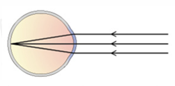

## Ametropia = Kelainan

Ametropia adalah keadaan ketika **fokus cahaya tidak jatuh tepat pada retina** saat akomodasi beristirahat. Bentuk utamanya adalah **hipermetropia, miopia, dan astigmatisme**. Presbiopia berbeda: kondisi ini terjadi ketika kemampuan akomodasi untuk melihat dekat menurun, dan merupakan kondisi fisiologis yang terjadi seiring penuaan.

| Keadaan                     | Letak fokus / masalah utama                  | Koreksi optik umum                      |
| --------------------------- | -------------------------------------------- | --------------------------------------- |
| Emetropia                   | Fokus tepat di retina saat melihat jauh      | Tidak perlu koreksi refraksi untuk jauh |
| Hipermetropia (Rabun Dekat) | Fokus di belakang retina                     | Lensa cembung atau plus (+)             |
| Miopia (Rabun Jauh)         | Fokus di depan retina                        | Lensa cekung atau minus (−)             |
| Astigmatisme (Silinder)     | Daya bias berbeda pada meridian yang berbeda | Lensa silinder sesuai sumbu             |

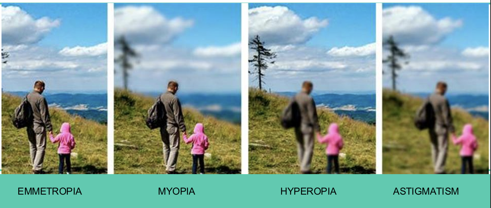

# 2. Hipermetropia (Hiperopia)

Hipermetropia adalah **kelainan refraksi ketika sinar sejajar yang masuk ke mata akan difokuskan di belakang retina** saat akomodasi tidak bekerja. Akomodasi dapat membantu menggeser fokus ke depan, sehingga sebagian orang tetap melihat jelas, tetapi usaha akomodasi yang terus-menerus dapat menimbulkan keluhan.

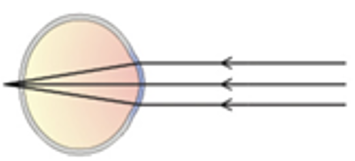

## Jenis-jenis hipermetropia

- **Hipermetropia aksial:** daya bias mata normal, tetapi **bola mata lebih pendek** dari biasanya. Ini merupakan bentuk yang paling umum.
- **Hipermetropia refraktif:** panjang bola mata normal, tetapi **daya bias mata kurang kuat**.
- **Afakia**: **tidak adanya lensa** kristalin. Kondisi ini menyebabkan hipermetropia tinggi dan dapat terjadi, misalnya, setelah lensa diangkat dalam operasi katarak.

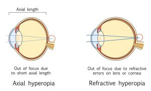

## Komponen hipermetropia

Hipermetropia terdiri atas tiga komponen:

- **Hipermetropia absolut (A):** tidak dapat diatasi dengan akomodasi. Penglihatan tetap kabur dan perlu dikoreksi dengan lensa plus.
- **Hipermetropia manifes (M):** dapat diatasi dengan akomodasi atau lensa plus. Akomodasi biasanya cukup untuk mempertahankan penglihatan jelas, sehingga lensa plus belum tentu diperlukan.
- **Hipermetropia laten (L):** tertutupi oleh akomodasi dan baru terukur saat akomodasi dilumpuhkan dengan obat sikloplegik.

#Ingat Rumus untuk menghitung hipermetropia laten:

$L = CR − (A + M)$

Nilai **CR (cycloplegic refraction)** didapat dari **pemeriksaan refraksi setelah akomodasi dilumpuhkan sementara dengan obat sikloplegik**. Jadi, CR bukan dihitung dari nilai A dan M saja; nilainya harus diukur lewat pemeriksaan mata.

> [!NOTE] **Contoh**:
> Seorang pasien menjalani pemeriksaan refraksi dengan obat sikloplegik, dan hasilnya menunjukkan hipermetropia **+5 D** (Jadi nilai CR=5). Pemeriksaan juga menunjukkan hipermetropia absolut **+2 D** dan hipermetropia manifes **+1 D**. Maka, hipermetropia latennya adalah:
> 
> **L = CR − (A + M) = +5 − (+2 + +1) = +2 D**
> 
> Artinya, sebelum pemeriksaan sikloplegik, akomodasi pasien menutupi sebagian hipermetropianya. Karena itu, meresepkan lensa **+5 D** tanpa mempertimbangkan efek akomodasi dapat memberi koreksi plus yang berlebihan setelah efek obat hilang, sehingga penglihatan menjadi kabur. Jadi **koreksi yang sesuai adalah +3 D**: hipermetropia absolut **+2 D** ditambah manifes **+1 D** (tapi tidak selalu harus ditambah manifes). Sedangkan sisa **+2 D** adalah komponen laten yang selama ini ditutupi akomodasi, jadi tidak perlu ditambahkan ke resep.

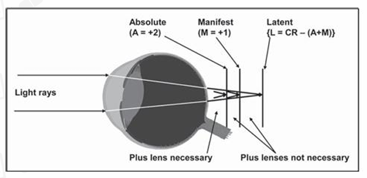

## Gejala dan tanda

Keluhan dapat tidak ada (asimtomatik), terutama jika akomodasi masih mampu mengimbangi kelainan. Keluhan yang mungkin muncul meliputi:

### Gejala

- **Gejala astenopia**: mata lelah, sakit kepala di dahi atau pelipis bagian depan, mata berair, dan sedikit sensitif terhadap cahaya. Keluhan ini berkaitan dengan aktivitas melihat dekat.
- Penglihatan kabur disertai gejala astenopia; penglihatan dekat biasanya lebih terganggu daripada penglihatan jauh.
- Pada hipermetropia tinggi, akomodasi tidak cukup untuk mengatasi kelainan sehingga penglihatan dekat dan jauh sama-sama sangat kabur.

### Tanda

- Bola mata dapat tampak kecil secara keseluruhan.
- Kornea mungkin sedikit lebih kecil.
- Bilik mata depan dangkal.
- Pemeriksaan fundus dapat menunjukkan diskus optik kecil, tampak lebih vaskular, dan berbatas kurang tegas. Tampilannya dapat menyerupai papilitis (_pseudopapilitis_). Retina dapat tampak berkilau akibat pantulan cahaya yang lebih terang (_shot-silk appearance_).
- Pemeriksaan ultrasonografi A-scan dapat menunjukkan panjang aksial bola mata yang pendek.

## Penanganan hipermetropia

**Terapi optik** menggunakan lensa konveks (plus), berupa kacamata atau lensa kontak. Prinsip pemberian kacamata meliputi:

1. Menentukan derajat hipermetropia total melalui pemeriksaan refraksi dengan sikloplegia penuh.
2. Mengoreksi astigmatisme yang menyertai secara penuh.
3. Menambah koreksi hipermetropia manifes secara bertahap, dengan evaluasi setiap enam bulan.
4. Memberikan koreksi penuh jika terdapat juling konvergen akomodatif.
5. Memberikan koreksi penuh disertai terapi oklusi jika terdapat ambliopia.

**Terapi bedah** meliputi termoplasti laser holmium, PRK hipermetropia dengan laser eksimer, LASIK hipermetropia, dan keratoplasti konduktif (CK).

## Komplikasi yang berkaitan dengan hipermetropia

- Bintitan berulang, blefaritis, atau kalazion; koreksi dapat membantu mengurangi mata lelah.
- Juling konvergen akomodatif, yang biasanya muncul sekitar usia 2–3 tahun akibat penggunaan akomodasi berlebihan.
- Ambliopia, yang dapat bersifat anisometropik pada hipermetropia satu mata, strabismik pada anak dengan juling akomodatif, atau ametropik pada hipermetropia tinggi di kedua mata yang tidak dikoreksi.
- Kecenderungan mengalami glaukoma sudut tertutup primer.

# 3. Afakia

Afakia adalah keadaan tanpa lensa kristalin. Akibatnya, daya bias mata sangat berkurang dan timbul hipermetropia tinggi.

## Penyebab

- Tidak terbentuknya lensa sejak lahir (jarang).
- Lensa diangkat melalui operasi (penyebab yang paling umum).
- Lensa terserap setelah trauma, terutama pada anak (jarang).
- Lensa keluar dari mata akibat trauma (jarang).
- Lensa bergeser ke belakang ke dalam badan kaca (corpus vitreous); kondisi ini disebut afakia optik.

## Gejala afakia

- Penglihatan jauh dan dekat terganggu karena hipermetropia tinggi dan hilangnya akomodasi. 
- Dapat pula terjadi eritropsia atau sianopsia, yaitu melihat rona kemerahan atau kebiruan. Hal ini terjadi karena lebih banyak sinar ultraviolet dan inframerah masuk ke mata saat lensa kristalin tidak ada.

## Tanda afakia

1. Terdapat bekas luka pada limbus (limbal scar) pada afakia akibat pembedahan.
2. Bilik mata depan lebih dalam daripada normal.
3. Iridodonesis, yaitu iris tampak bergetar, dapat terlihat.
4. Pupil tampak hitam pekat.
5. Uji bayangan Purkinje hanya menunjukkan dua bayangan, padahal normalnya terlihat empat.
6. Pemeriksaan fundus menunjukkan diskus optik kecil dengan gambaran hipermetropik.
7. Retinoskopi menunjukkan hipermetropia tinggi.

## Penanganan afakia

Prinsip koreksi optik adalah menggunakan lensa cembung dengan kekuatan yang sesuai agar bayangan terbentuk tepat pada retina. Pilihannya meliputi:

1. Kacamata.
2. Lensa kontak.
3. Implantasi lensa intraokular.
4. Bedah refraktif kornea.

# 4. Miopia (Rabun Jauh)

Miopia adalah kelainan refraksi ketika **sinar sejajar dari benda jauh difokuskan di depan retina** saat akomodasi beristirahat. Benda dekat dapat terlihat lebih jelas karena sinarnya menyebar sebelum masuk ke mata. Titik jauh pada mata miopia berada pada jarak tertentu di depan mata.

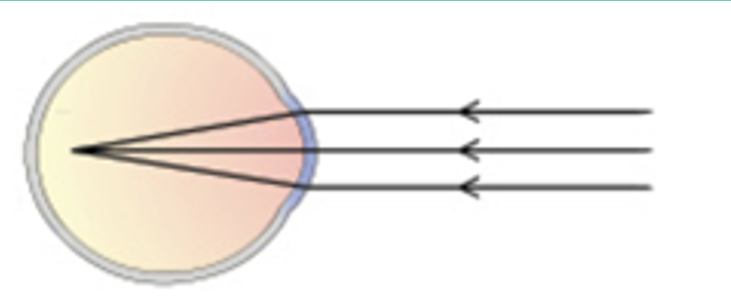

## Jenis dan penyebab

- **Miopia aksial:** bola mata terlalu panjang, sementara daya biasnya normal. Ini bentuk yang paling umum.
- **Miopia kurvatur:** kelengkungan kornea, lensa, atau keduanya terlalu besar.
- **Miopia posisi:** lensa kristalin terletak lebih ke depan.
- **Miopia indeks:** indeks bias lensa meningkat, misalnya pada sklerosis nuklear.
- **Miopia akibat akomodasi berlebihan:** dapat terjadi pada spasme akomodasi.
- Katarak nuklear juga dapat mengubah fokus dan menyebabkan keluhan penglihatan ganda.

Miopia sederhana biasanya mulai pada usia 5–10 tahun dan dapat bertambah hingga sekitar usia 18–20 tahun. Perkembangannya diperkirakan sekitar −0,5 ± 0,30 dioptri per tahun dan biasanya tidak melebihi 6–8 D.

## Gejala dan tanda

Keluhan utama adalah penglihatan jauh kabur. Keluhan astenopia (mata lelah) dapat menyertai, terutama pada miopia ringan. Pasien kadang menyipitkan mata agar objek jauh terlihat lebih jelas. Tanda yang dapat ditemukan meliputi bola mata tampak menonjol, bilik mata depan agak dalam, pupil agak besar dan lambat bereaksi, serta perubahan pada fundus pada miopia tertentu.

## Miopia patologis

Miopia patologis adalah **miopia progresif yang terutama dipengaruhi oleh faktor genetik**, meskipun proses pertumbuhan umum juga berperan dalam derajat yang lebih kecil. Pengaruh faktor-faktor tersebut dapat mendorong **pertumbuhan retina yang berlebihan**. Pertumbuhan ini meregangkan sklera, sehingga **panjang aksial bola mata bertambah**. Pemanjangan bola mata kemudian diikuti degenerasi koroid, retina, dan badan kaca.

Komplikasi yang dapat terjadi meliputi ablasio retina, katarak komplikata, perdarahan badan kaca, perdarahan koroid, dan strabismus divergen. 

## Koreksi dan penanganan miopia

**Koreksi optik** menggunakan lensa cekung atau konkaf (minus), berupa kacamata atau lensa kontak. Lensa minus membantu memfokuskan cahaya tepat pada retina.

**Penanganan lain** meliputi:

- **Bedah refraktif.**
- **Langkah umum:** pola makan seimbang yang kaya vitamin dan protein serta penanganan dini penyakit penyerta pernah dianjurkan untuk membantu memperlambat progresi miopia, tetapi manfaatnya belum terbukti.
- **Low Vision Aids (LVA):** dapat digunakan pada miopia progresif dengan perubahan degeneratif lanjut jika penglihatan normal tidak dapat tercapai hanya dengan kacamata atau lensa kontak.
- **Konseling genetik (profilaksis):** menyarankan agar dua orang dengan miopia progresif tidak menikah dan tidak memiliki anak jika tetap menikah.

## Komplikasi

1. Ablasio retina.
2. Katarak komplikata.
3. Perdarahan viterous.
4. Perdarahan koroid.
5. Strabismus fiksus konvergen.

# 5. Astigmatisme

Astigmatisme adalah kelainan refraksi ketika **daya bias berbeda pada meridian yang berlainan**. Akibatnya, **cahaya tidak membentuk satu titik fokus tunggal**.

**Meridian** adalah garis imajiner yang melintasi permukaan kornea dan membelah pusat pupil dengan sudut tertentu untuk menunjukkan arah kelengkungan mata. Meridian tidak hanya ada dua; arahnya dapat beragam, seperti garis-garis yang melewati pusat lingkaran, mirip meridian pada bumi. Namun, pada astigmatisme reguler, biasanya ada **dua meridian utama** yang saling tegak lurus: satu paling curam dan satu paling datar. Karena keduanya memiliki perbedaan daya bias paling besar, keduanya digunakan untuk menjelaskan jenis astigmatisme, misalnya vertikal-horizontal atau oblik.

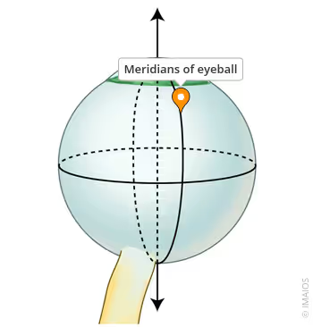

Meridian yang lebih curam memiliki kelengkungan dan daya bias lebih besar daripada meridian yang lebih datar. Berdasarkan arah meridian yang lebih curam, astigmatisme reguler dapat disebut:

- **With-the-rule:** meridian **vertikal lebih curam** daripada meridian horizontal.
- **Against-the-rule:** meridian **horizontal lebih curam** daripada meridian vertikal.
- **Oblik:** meridian utama berada pada arah **miring**.

Pada astigmatisme ireguler, kelengkungan dan daya bias berubah tidak teratur, sehingga pola dua meridian utama yang saling tegak lurus tidak dapat menggambarkannya dengan baik.

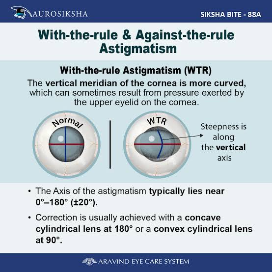

## Jenis-jenis astigmatisme

Astigmatisme dikelompokkan berdasarkan **keteraturan dan arah meridian** serta **letak fokus terhadap retina**.

### 1. Berdasarkan keteraturan dan arah meridian

- **Astigmatisme reguler:** dua meridian utama memiliki daya bias berbeda, tetapi arahnya teratur dan saling tegak lurus. Jenisnya meliputi:
    - **Horizontal-vertikal:** meridian utama berada pada arah horizontal dan vertikal. Dapat berupa _with the rule_ atau _against the rule_.
    - **Oblik:** meridian utama berada pada arah miring.
    - **Bioblik:** kedua meridian utama berada pada arah miring.
- **Astigmatisme ireguler:** kelengkungan atau daya bias berubah tidak teratur, sehingga meridian utama tidak membentuk pola yang teratur. Kondisi ini dapat terjadi, misalnya, akibat jaringan parut kornea luas atau keratokonus.

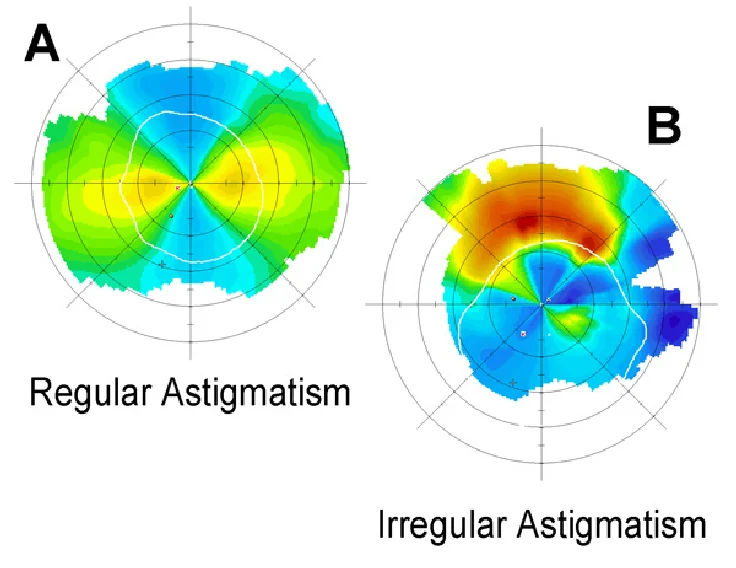

### 2. Berdasarkan letak fokus kedua meridian terhadap retina

- **Simple astigmatism**: **satu fokus jatuh tepat pada retina, sedangkan fokus lainnya tidak**, misal fokus satunya malah jatuh di depan retina (*simple myopic astigmatism*) atau di belakang retina (*simple hypermetropic astigmatism*).
- **Compound astigmatism**: **kedua fokus tidak tepat di retina tapi letaknya sama**, misal keduanya berada di depan retina (*compound myopic astigmatism*) atau keduanya berada di belakang retina (*compound hypermetropic astigmatism*).
- **Mixed astigmatism**: **kedua fokus tidak tepat di retina tapi letaknya berbeda**, satu fokus di depan retina dan fokus lainnya di belakang retina.

Kedua pengelompokan ini dapat digunakan bersamaan. Contohnya, **astigmatisme reguler oblik majemuk (compound) miop** berarti meridian-meridiannya teratur dan miring, sementara kedua fokusnya berada di depan retina.

## Gejala astigmatisme

1. Penglihatan terganggu.
2. Benda tampak kabur.
3. Keluhan astenopia, seperti rasa pegal pada mata, sakit kepala, mata cepat lelah, dan terkadang mual atau mengantuk.

## Tanda astigmatisme

1. Pemeriksaan retinoskopi atau autorefraktometri menunjukkan daya bias yang berbeda pada dua meridian.
2. Pada astigmatisme derajat tinggi, pemeriksaan oftalmoskopi dapat menunjukkan diskus optik berbentuk oval atau tampak miring.
3. Pasien dapat memiringkan kepala. Pada sebagian kasus, kebiasaan ini dapat berkembang menjadi tortikolis saat pasien berusaha mendekatkan sumbu penglihatannya ke arah horizontal atau vertikal.
4. Pasien dapat menyipitkan atau menutup sebagian kelopak mata.

## Penanganan

**1. Koreksi optik**

- Kacamata dengan lensa silinder.
- Lensa kontak:
    - Lensa kontak kaku untuk astigmatisme sekitar 2–3 D.
    - Lensa kontak lunak torik untuk astigmatisme lebih dari 1 D.

**2. Koreksi bedah**

Bedah refraktif dapat dipertimbangkan untuk mengoreksi astigmatisme.

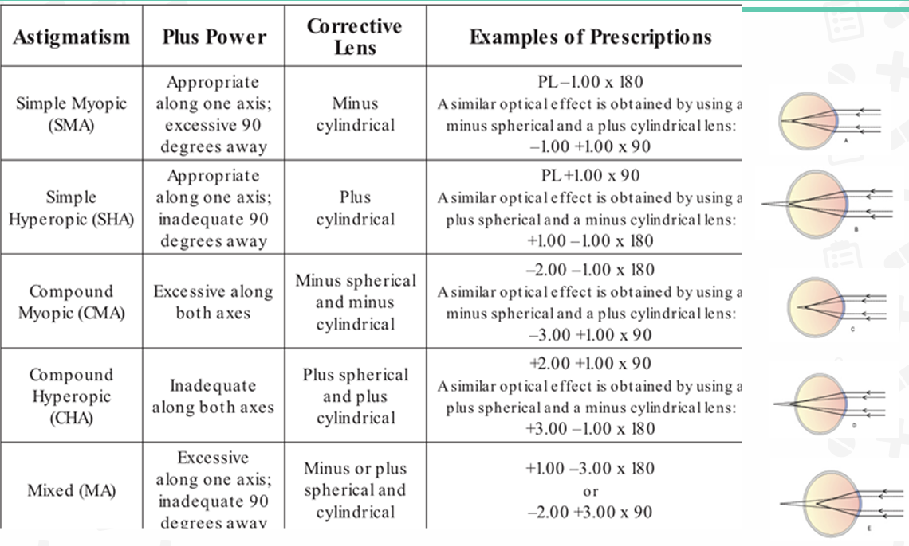
## Astigmatisme ireguler

Astigmatisme ireguler adalah keadaan ketika **daya bias berubah secara tidak teratur pada berbagai meridian**. Berbeda dari astigmatisme reguler yang memiliki pola kelengkungan teratur, permukaan pada astigmatisme ireguler tidak membentuk pola yang konsisten.

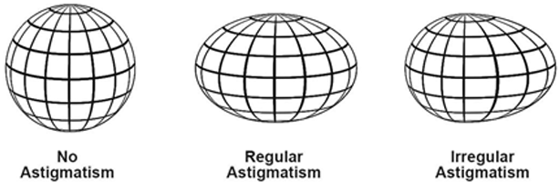

**Penyebabnya meliputi:**

1. **Astigmatisme ireguler kurvatur**, akibat jaringan parut kornea yang luas atau keratokonus.
2. **Astigmatisme ireguler indeks**, yang dapat terjadi selama perkembangan katarak.

**Gejalanya** meliputi penglihatan kabur, benda tampak terdistorsi, dan polipia, yaitu satu benda terlihat sebagai beberapa bayangan.

**Penanganan:**

- Lensa kontak keras.
- Keratektomi fototerapeutik (PTK).
- Keratoplasti penetrasi, yaitu operasi penggantian seluruh ketebalan kornea.

# 6. Anisometropia dan Aniseikonia

**Isometropia** berarti kedua mata memiliki kekuatan refraksi yang sama. **Anisometropia** adalah keadaan ketika kekuatan refraksi kedua mata berbeda.

## Anisometropia

Penyebabnya dapat berupa:

- **Bawaan atau terjadi selama perkembangan:** pertumbuhan kedua bola mata berbeda.
- **Didapat:** misalnya, lensa alami hanya tidak ada pada satu mata (afakia unilateral), atau lensa intraokular yang ditanam memiliki kekuatan yang tidak sesuai.

Koreksi dapat menggunakan kacamata dengan **lensa aniseikonik** atau lensa kontak. Pilihan lain meliputi implantasi lensa intraokular, bedah refraktif kornea, dan pengangkatan lensa alami yang masih jernih pada miopia unilateral yang sangat tinggi (operasi Fukala).

## Aniseikonia

Aniseikonia terjadi ketika **ukuran atau bentuk bayangan yang diterima kedua retina berbeda secara tidak normal**. Jadi, anisometropia adalah perbedaan refraksi antara kedua mata, sedangkan aniseikonia adalah perbedaan ukuran atau bentuk bayangan yang diterima otak.

Jenis aniseikonia berdasarkan penyebabnya:

1. **Optik:** berasal dari perbedaan sistem optik mata.
2. **Retinal:** berasal dari perbedaan atau gangguan pada retina.
3. **Kortikal:** berkaitan dengan pemrosesan bayangan di korteks otak.

Penanganannya disesuaikan dengan penyebab. Aniseikonia optik dapat dikoreksi dengan kacamata aniseikonik, lensa kontak, atau lensa intraokular. Pada aniseikonia retinal, penyebabnya ditangani. Aniseikonia kortikal sulit ditangani.

# 7. Akomodasi

Akomodasi adalah kemampuan mata mengubah daya bias lensa agar objek pada jarak berbeda tetap terfokus pada retina. Saat melihat dekat, otot siliar berkontraksi, tegangan zonula berkurang, dan lensa menjadi lebih cembung. Daya bias lensa pun meningkat. Semakin dekat objek, semakin besar akomodasi yang diperlukan.

## Titik dan ukuran akomodasi

- **Titik dekat (near point / punctum proximum):** titik terdekat tempat objek kecil masih terlihat jelas. Dilambangkan **P**.
- **Titik jauh (far point / punctum remotum):** titik terjauh yang terlihat jelas saat mata tidak berakomodasi. Dilambangkan **R**.
- **Rentang (range) akomodasi:** jarak antara titik dekat dan titik jauh.
- **Amplitudo akomodasi (A):** selisih kebutuhan daya dioptri untuk memfokuskan titik dekat dan titik jauh, dirumuskan **A = P − R**.

Pada mata emetrop (normal), titik jauh berada di tak terhingga. Pada hipermetropia, titik jauh bersifat maya dan berada di belakang mata. Pada miopia, titik jauh nyata dan berada di depan mata. Titik dekat berubah dengan usia; contohnya sekitar 7 cm pada usia 10 tahun, 25 cm pada usia 40 tahun, dan 33 cm pada usia 45 tahun.

## Mekanisme akomodasi

Saat melihat dekat, lensa berubah bentuk agar daya biasnya meningkat dan bayangan tetap fokus pada retina. Ada dua teori yang menjelaskan mekanisme perubahan ini:

### 1. Teori Helmholtz

Menurut Helmholtz, saat mata berakomodasi:

1. Otot siliaris berkontraksi.
2. Cincin siliaris mengecil.
3. Tegangan pada serabut zonula Zinn berkurang.
4. Kapsul lensa yang elastis membuat lensa menjadi lebih cembung.
5. Diameter lensa mengecil dan daya biasnya meningkat.

Dengan demikian, mata dapat memfokuskan objek dekat.

### 2. Teori Tscherning

Teori ini menjelaskan bahwa nukleus lensa relatif kaku dan tidak banyak berubah bentuk. Saat akomodasi, tegangan zonula di sekitar ekuator lensa justru meningkat sehingga menghasilkan tarikan. Tarikan ini mengubah bentuk lensa dan menekan korteks yang lebih lunak ke arah nukleus yang relatif kaku. Akibatnya, permukaan depan korteks menonjol dan lensa menjadi lebih cembung. Jadi, **nukleusnya relatif tidak berubah bentuk**; ia bertindak seperti inti yang lebih kaku, sementara korteks di sekitarnya berubah bentuk.

**Perbedaan utamanya:** teori Helmholtz menjelaskan lensa mencembung karena tegangan zonula berkurang dan kapsul lensa yang elastis membentuk ulang lensa. Teori Tscherning menjelaskan perubahan bentuk karena tegangan zonula justru meningkat, menekan nukleus, dan mendorong korteks lensa menonjol.

### 3. Teori Schachar

Saat mata melihat dekat, **otot siliaris berkontraksi**. Menurut teori Schachar, kontraksi ini mengubah tarikan zonula secara berbeda di sekitar lensa:

1. **Tegangan zonula di ekuator lensa meningkat.** Ekuator adalah bagian tepi lensa pada lingkar terlebarnya.
2. **Tegangan zonula bagian depan dan belakang berkurang.**
3. Tarikan pada ekuator meregangkan tepi lensa ke arah luar. Akibatnya, bagian tengah lensa menjadi lebih cembung, ketebalan tengah lensa bertambah, dan bagian tepinya lebih datar.
4. Lensa menjadi lebih kuat membiaskan cahaya, sehingga mata dapat memfokuskan objek dekat.

Jadi, menurut Schachar, **tegangan zonula tidak semuanya meningkat**: tegangan di ekuator meningkat, sedangkan di bagian depan dan belakang menurun. Ini adalah teori alternatif; teori Helmholtz, yang menyatakan tegangan zonula secara umum berkurang saat akomodasi, lebih luas diterima.

# 8. Presbiopia

Presbiopia bukan kelainan refraksi, melainkan **penurunan fisiologis kemampuan akomodasi yang berlangsung bertahap**.

## Etiologi

Menurunnya kekuatan akomodatif dapat terjadi melalui dua cara:

1. Perubahan pada lensa sehubungan dengan usia: 
    - **Menurunnya elastisitas kapsul lensa**.
    - Meningkatnya ukuran dan pengerasan **(sklerosis) yang progresif dari substansi lensa** sehingga lensa menjadi kurang lentur.
2. **Menurunnya kekuatan muskulus siliar** sehubungan dengan usia.

## Presbiopia premature/precox

Presbiopia dapat muncul lebih awal pada:

- Hipermetropia yang belum dikoreksi.
- Sklerosis dini lensa kristalin.
- Kelemahan sistemik yang mengakibatkan kelemahan pre-senile pada muskulus siliar.
- Glaukoma kronik.

## Gejala

- Sulit membaca tulisan kecil atau melihat objek dekat.
- Buku atau telepon dijauhkan agar tulisan lebih jelas.
- Gejala astenopia: mata cepat lelah, berair, terasa perih, atau sakit kepala setelah membaca dan melakukan pekerjaan dekat.
- Menyipitkan mata saat melihat dekat.

Jarak baca umum sekitar 25–30 cm. Setelah usia sekitar 40 tahun, titik dekat dapat bergeser lebih jauh daripada jarak kerja yang nyaman sehingga membaca menjadi sulit.

## Koreksi kacamata

Koreksi optik menggunakan lensa cembung (plus) untuk melihat dekat. Kekuatan tambahan (adisi) sebagai perkiraan kasar adalah:

| Usia | Perkiraan adisi dekat |
|---:|---:|
| 40 tahun | +1,00 D |
| 45 tahun | +1,50 D |
| 50 tahun | +2,00 D |
| 55 tahun | +2,50 D |
| 60 tahun | +3,00 D |

### Prinsip dasar koreksi presbiopia

1. Selalu temukan kelainan refraksi jauh dan koreksi terlebih dahulu.
2. Carilah koreksi presbiopia yang dibutuhkan pada setiap mata secara terpisah lalu tambahkan pada koreksi jauh.
3. Near point ditentukan dengan mempertimbangkan pekerjaan dan kebutuhan pasien. 
4. Lensa konveks (cembung) terkecil yang dapat memberikan gambaran jelas near point harus diresepkan karena menghindarkan over koreksi yang akan mengakibatkan gejala astenopia.

## Jenis kacamata dan lensa kontak

- **Monofokal baca:** memberi bidang pandang dekat yang luas; penglihatan jauh akan kabur saat kacamata baca dipakai. Berguna bagi orang yang tidak membutuhkan koreksi jauh atau kesulitan memakai lensa multifokal.
- **Bifokal:** memiliki bagian terpisah untuk melihat jauh dan dekat.
- **Trifokal:** mengoreksi penglihatan jauh, menengah, dan dekat.

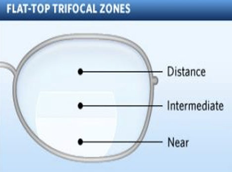

- **Progresif / multifokal / varifokal / PAL (Progressive Addition Lenses):** kekuatan lensa berubah bertahap untuk berbagai jarak.

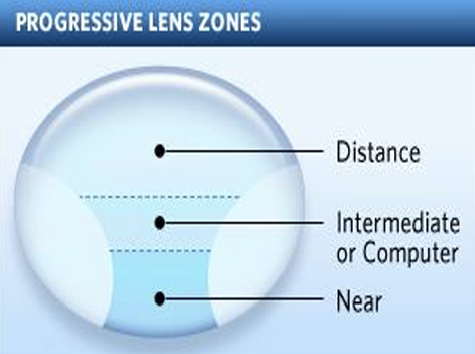

- **Lensa kontak monovision:** satu mata dikoreksi untuk jauh (biasanya mata dominan) dan mata lainnya untuk dekat. Kekurangannya, cara ini dapat mengurangi kontras dan persepsi kedalaman (stereopsis), serta menimbulkan rasa tidak nyaman dalam memperkirakan ruang (disorientasi spasial).
- **Lensa kontak bifokal:** memiliki segmen jauh dan dekat pada posisi berbeda; pengguna mengandalkan gerakan mata untuk melihat melalui segmen yang sesuai.
- **Lensa kontak multifokal:** zona jauh dan dekat tersedia bersamaan pada pupil. Bayangan dapat saling bertumpuk (tersuperimposisi) dan kontras berkurang, meski objek dapat terlihat tajam. Desainnya dapat berupa asferik atau konsentris.

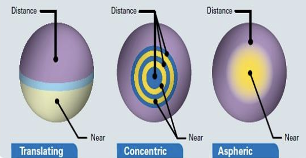

# 9. Tindakan Bedah untuk Presbiopia

Pilihan tindakan meliputi beberapa pendekatan bedah yang masih dalam penelitian atau pengembangan, antara lain:

- LASIK monovision.
- Keratoplasti konduktif monovision.
- Prosedur ekspansi sklera.
- LASIK-PARM.
- Metode Rozakis.
- Implantasi lensa intraokular bifokal/multifokal/akomodatif.
- Monovision dengan lensa intraokular.
- Sklerotomi siliar anterior.

Pendekatan lain yang pernah diteliti atau dikembangkan meliputi:

- Ablasi kornea intrastromal.
- Keratoplasti konduktif dengan energi radiofrekuensi.
- Implantasi inlay kornea, serta lensa intraokular monovision, multifokal, atau akomodatif. 

Monovision mengoreksi satu mata untuk dekat dan satu mata untuk jauh. Inlay intrakornea dapat bersifat reversibel, tetapi dapat menimbulkan penipisan atau kerusakan stroma, kekeruhan kornea, dan pergeseran posisi. Efektivitas ekspansi sklera belum terbukti.

# Tips Menghafal 🧠

- **Miopia:** fokus di muka retina → minus.
- **Hipermetropia:** fokus di belakang retina → plus.
- **Astigmatisme:** daya bias berbeda menurut meridian → silinder.
- **Presbiopia:** akomodasi dekat menurun seiring usia → tambahan plus untuk dekat.
- **Akomodasi dekat:** otot siliar berkontraksi → zonula mengendur → lensa mencembung.

# Rangkuman

- **Emetropia** adalah keadaan ketika cahaya dari objek jauh fokus tepat pada retina tanpa akomodasi, dengan kata lain, mata normal. **Ametropia** terjadi ketika fokus tidak jatuh tepat pada retina. Kelainan utamanya adalah hipermetropia, miopia, dan astigmatisme; **presbiopia** adalah penurunan akomodasi dekat akibat usia.

- **Hipermetropia** membuat fokus jatuh di belakang retina. Penyebabnya dapat berupa bola mata terlalu pendek (aksial), daya bias kurang kuat (refraktif), atau tidak adanya lensa (afakia). Komponennya ialah absolut, manifes, dan laten; **L = CR − (A + M)**. Koreksi optiknya menggunakan lensa plus. Keluhan dapat berupa mata lelah, sakit kepala, dan penglihatan dekat kabur; hipermetropia tinggi dapat mengaburkan penglihatan jauh maupun dekat.
    
- **Afakia** adalah keadaan tanpa lensa kristalin dan menyebabkan hipermetropia tinggi serta hilangnya akomodasi. Koreksinya dapat menggunakan kacamata, lensa kontak, implantasi lensa intraokular, atau bedah refraktif kornea.
    
- **Miopia** membuat fokus jatuh di depan retina. Jenisnya meliputi aksial, kurvatur, posisi, indeks, dan akibat akomodasi berlebihan. Gejala utamanya penglihatan jauh kabur; koreksi optiknya memakai lensa minus.
    
- **Miopia patologis** bersifat progresif dan terutama dipengaruhi faktor genetik. Pertumbuhan retina yang berlebihan meregangkan sklera dan memperpanjang bola mata, lalu dapat diikuti degenerasi koroid, retina, dan badan kaca. Komplikasinya termasuk ablasio retina, katarak, dan perdarahan. Alat bantu penglihatan rendah dapat dipakai bila kacamata atau lensa kontak tidak cukup membantu.
    
- **Astigmatisme** terjadi ketika daya bias berbeda menurut meridian, sehingga cahaya tidak fokus pada satu titik. Jenisnya dapat dibedakan berdasarkan pola meridian (reguler atau ireguler) dan posisi fokus (simpleks, majemuk, atau campuran). Koreksi umumnya menggunakan lensa silinder; astigmatisme ireguler dapat ditangani dengan lensa kontak keras atau tindakan kornea.
    
- **Anisometropia** adalah perbedaan refraksi antara kedua mata. **Aniseikonia** adalah perbedaan ukuran atau bentuk bayangan yang diterima kedua retina. Penanganan disesuaikan dengan penyebab dan dapat meliputi kacamata, lensa kontak, atau lensa intraokular.
    
- **Akomodasi** mengubah bentuk lensa agar objek dekat tetap fokus di retina. Titik dekat adalah _punctum proximum_, titik jauh adalah _punctum remotum_, dan amplitudo akomodasi dirumuskan **A = P − R**. Teori Helmholtz menjelaskan akomodasi melalui berkurangnya tegangan zonula; teori Tscherning dan Schachar mengusulkan perubahan tegangan zonula yang berbeda.
    
- **Presbiopia** adalah penurunan kemampuan akomodasi dekat seiring usia, terkait lensa yang makin kaku dan kemungkinan penurunan kekuatan otot siliar. Gejalanya meliputi sulit membaca tulisan kecil, menjauhkan bacaan, dan mata lelah. Koreksi menggunakan adisi lensa plus, dengan kekuatan disesuaikan pada pemeriksaan serta kebutuhan melihat dekat.
    
- Koreksi presbiopia dapat berupa kacamata monofokal, bifokal, trifokal, progresif, atau lensa kontak multifokal/monovision. Berbagai tindakan bedah juga pernah dikembangkan, tetapi pilihan dan efektivitasnya bergantung pada prosedur serta kondisi pasien.