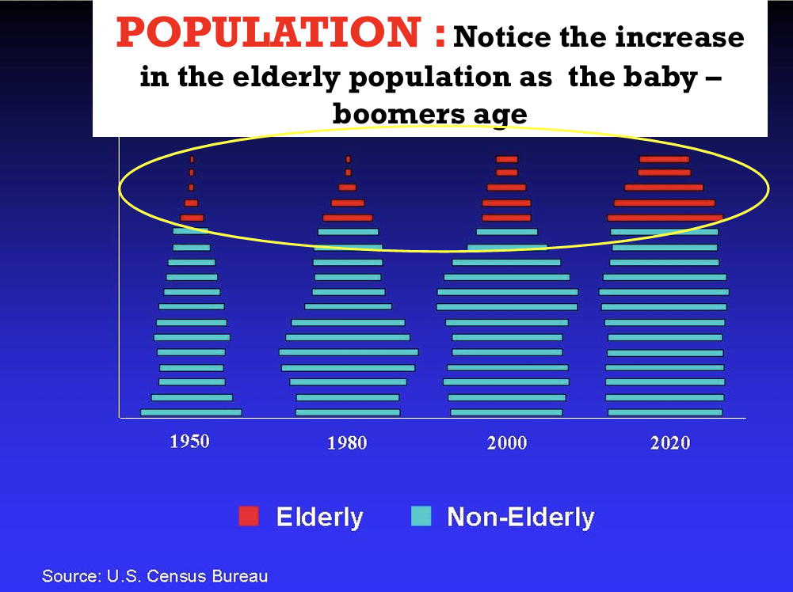
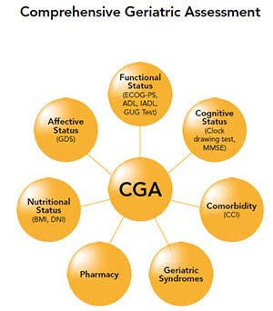
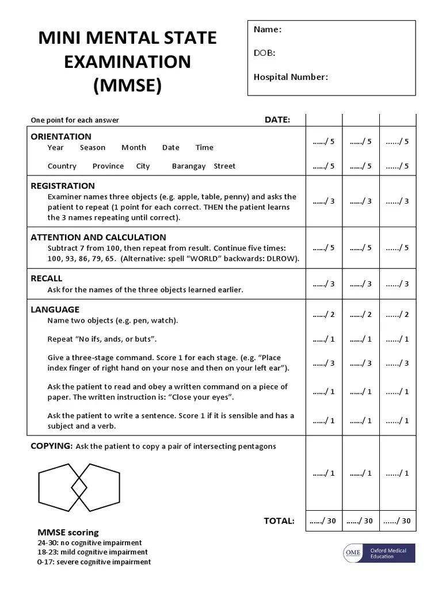
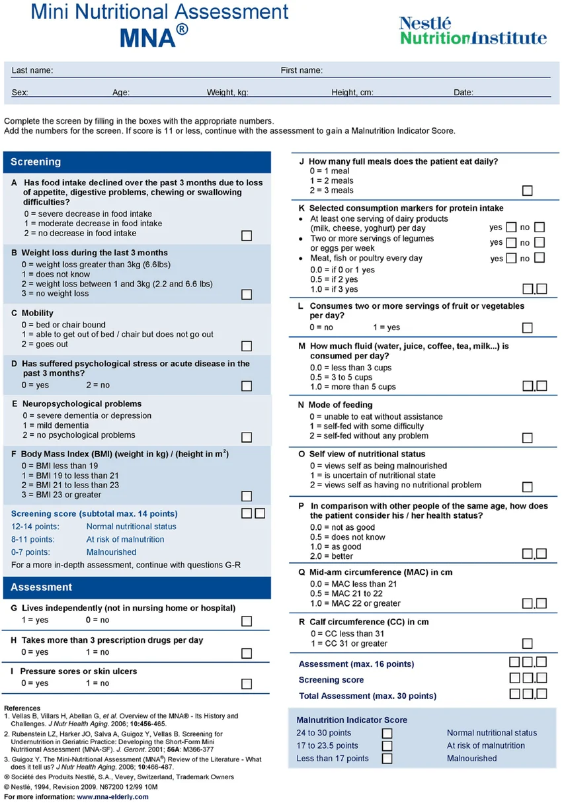

Pengkajian Paripurna Pasien Geriatri (P3G) dikenal pula sebagai *Comprehensive Geriatric Assessment* (CGA).

# 1. Mengapa Pengkajian Geriatri Diperlukan?

Usia harapan hidup sering dipakai sebagai salah satu tolok ukur kemajuan suatu bangsa. Seiring meningkatnya jumlah penduduk lanjut usia, kebutuhan layanan kesehatan yang sesuai juga meningkat. Masalah pada lansia dapat muncul pada ranah **fisik-biologis, psikologis, dan sosial** sekaligus.

Data historis memperkirakan proporsi lansia Indonesia sebesar 7,28% pada tahun 2000 dan 11,34% pada tahun 2020 (BPS, 1992). Jumlah penduduk berusia 60 tahun ke atas tercatat 4,5 juta pada 1961; 5,3 juta pada 1971; 8,0 juta pada 1980; 11,6 juta pada 1990; 16,2 juta pada 2000; 17,2 juta pada 2010; dan 29,0 juta pada 2020. Persentasenya: 4,3% (1971), 5,5% (1980), 6,3% (1990), 7,6% (2000), 7,4% (2010), dan 11,1% (2020). Rujukan: *BPS Profile Kesehatan Indonesia*, Departemen Kesehatan RI.

## Transisi demografik dan bertambahnya penduduk lansia

Transisi demografik adalah perubahan pola kependudukan yang terjadi seiring menurunnya angka kematian dan tingkat fertilitas. Perbaikan kondisi sosial-ekonomi, layanan kesehatan, perumahan, sanitasi, higiene, dan nutrisi membantu lebih banyak orang bertahan hidup hingga usia lanjut. Akibatnya, jumlah dan proporsi penduduk lansia meningkat.

Grafik di atas membandingkan struktur umur penduduk pada 1950, 1980, 2000, dan 2020. Setiap batang menggambarkan kelompok umur: bagian merah menunjukkan penduduk lansia (_elderly_), sedangkan bagian biru kehijauan menunjukkan penduduk non-lansia (_non-elderly_). Dari 1950 ke 2020, bagian merah tampak makin besar. Artinya, kelompok lansia mengambil porsi yang semakin besar dalam populasi seiring bertambahnya usia generasi _baby boomers_.

**Intinya:** angka kematian dan fertilitas yang menurun, disertai kondisi hidup yang membaik, membuat lebih banyak orang mencapai usia lanjut. Karena itu, kebutuhan layanan kesehatan dan sosial bagi lansia juga meningkat.

## Penuaan

Menjadi tua merupakan proses alami yang tidak dapat dihindari. Proses ini berlangsung berkesinambungan dan disertai perubahan serta kemunduran pada tingkat sel, anatomi, fisiologi, dan biologi. Dampaknya dapat terlihat pada kemampuan fisik, kognitif, dan fungsi biologis.

## Gerontologi dan geriatri

- **Gerontologi** adalah kajian ilmiah tentang **berbagai aspek penuaan**, termasuk kesehatan, sosial, ekonomi, perilaku, dan lingkungan.
- **Geriatri** adalah cabang gerontologi dan kedokteran yang **berfokus pada kesehatan serta asuhan sosial bagi lansia**. Cakupannya meliputi pencegahan, pelayanan klinis, pengobatan, rehabilitasi, dan pemantauan berkelanjutan.

# 2. Siapa yang Termasuk Pasien Geriatri?

Menurut Permenkes No. 79 Tahun 2014, lansia adalah orang yang berusia **60 tahun ke atas**. Mereka disebut **pasien geriatri** bila memiliki ciri atau kebutuhan kesehatan khas lansia yang memang berbeda dari pasien dewasa muda.

Ciri atau kebutuhan khas lansia tersebut meliputi:

| Karakteristik                     | Penjelasan                                                                                                                                                                                                               |
| --------------------------------- | ------------------------------------------------------------------------------------------------------------------------------------------------------------------------------------------------------------------------ |
| **Multipatologi**                 | Memiliki lebih dari satu penyakit, sering kali disertai penyakit kronis degeneratif. Namun, **seseorang berusia 70 tahun ke atas juga dapat digolongkan sebagai pasien geriatri meskipun hanya memiliki satu penyakit**. |
| **Tampilan klinis tidak khas**    | Keluhan atau tanda penyakit dapat samar dan berbeda dari yang biasanya terlihat pada pasien lebih muda.                                                                                                                  |
| **Cadangan fungsi organ menurun** | Fungsi organ dapat sesuai dengan usia, tetapi cadangan fisiologisnya menipis sehingga tubuh lebih mudah mengalami gangguan saat sakit.                                                                                   |
| **Status fungsional terganggu**   | Kemampuan menjalankan kegiatan sehari-hari dapat menurun.                                                                                                                                                                |
| **Masalah nutrisi**               | Asupan makanan, berat badan, atau status gizi dapat bermasalah.                                                                                                                                                          |
| **Polifarmasi**                   | Penggunaan banyak obat membuat pengelolaan lebih rumit dan meningkatkan risiko interaksi serta efek samping.                                                                                                             |

Akibatnya, penyakit akut dapat lebih sulit dikenali, pemulihan dapat berlangsung lebih lambat, dan risiko komplikasi meningkat. Lansia juga dapat lebih mudah mengalami *failure to thrive* atau kegagalan mempertahankan kondisi dan fungsi tubuh.

## Masalah “14 I + 1 F”

**Masalah “14 I + 1 F”** adalah daftar berbagai masalah yang sering ditemukan pada pasien geriatri.

1. **Immobility** — imobilitas atau sulit bergerak.
2. **Instability** — ketidakstabilan, termasuk jatuh.
3. **Incontinence** — inkontinensia urine atau alvi.
4. **Impaction** — impaksi, misalnya konstipasi berat.
5. **Inanition** — kekurangan gizi atau gangguan status gizi.
6. **Impotence** — impotensi atau gangguan fungsi seksual.
7. **Immunodeficiency** — penurunan daya tahan tubuh.
8. **Infection** — infeksi.
9. **Isolation** — isolasi sosial, termasuk depresi.
10. **Impairment of mood and cognitive function** — gangguan suasana hati dan fungsi kognitif.
11. **Iatrogenesis** — masalah akibat tindakan atau terapi medis.
12. **Insomnia** — sulit tidur.
13. **Impairment of senses** — gangguan penglihatan, pendengaran, pengecapan, penciuman, dan indra lain.
14. **Impecunity** — keterbatasan finansial.
15. **Frailty** — kerapuhan.

🧠 **Tips menghafal:** bayangkan lansia yang **sulit bergerak dan mudah jatuh**, mengalami masalah **berkemih, BAB, makan, tidur, indra, dan suasana hati**, lalu pikirkan **obat, infeksi, kesepian, uang, dan kerapuhan**.

# 3. Apa itu CGA/P3G?

**Comprehensive Geriatric Assessment (CGA)** atau **Pengkajian Paripurna Pasien Geriatri (P3G)** adalah evaluasi **multidimensi** untuk:

- menemukan dan menjelaskan berbagai masalah pasien (*describe and explain*);
- mengenali **aset**, kemampuan, sumber daya, dan kekuatan pasien serta keluarga;
- menentukan **jenis layanan** yang dibutuhkan;
- menyusun **rencana asuhan** yang terkoordinasi; dan
- memastikan keputusan **berorientasi pada kepentingan pasien** secara utuh, bukan hanya dari sudut medis.

CGA bersifat **holistik** dan mencakup aspek **biologis, psikologis, sosial, dan spiritual**. Pendekatannya dapat mencakup perawatan kuratif, rehabilitatif, promotif, serta preventif. Status fungsional, psikologis-kognitif, nutrisi, kondisi fisik, dan aset sosial keluarga perlu dinilai bersama karena saling memengaruhi.

## Peta komponen CGA

| Ranah                 | Hal yang dinilai                                                           |
| --------------------- | -------------------------------------------------------------------------- |
| Fisik dan biologis    | Keluhan, penyakit, pemeriksaan fisik, fungsi organ, sindrom geriatri       |
| Status fungsional     | Kemandirian dalam **ADL** dan **IADL**                                     |
| Kognitif              | Orientasi, ingatan, perhatian, bahasa, dan kemampuan berpikir              |
| Psikologis/afektif    | Suasana hati, gejala depresi, kondisi emosi                                |
| Nutrisi               | Asupan, antropometri, pemeriksaan klinis, dan data biokimia                |
| Sosial dan spiritual  | Dukungan, tempat tinggal, pendamping, hubungan, sumber daya keluarga       |
| Komorbiditas dan obat | Penyakit penyerta, obat yang digunakan, serta risiko polifarmasi/interaksi |

Semua ranah perlu dilihat sebagai satu kesatuan. Misalnya, gangguan kognitif dapat menghambat makan dan minum, lalu memperburuk nutrisi dan kemampuan beraktivitas.

# 4. Anamnesis dan Pemeriksaan Awal
## Anamnesis

Anamnesis geriatri memperluas riwayat medis biasa. Komponen yang dapat digali meliputi:

- keluhan utama dan riwayat penyakit sekarang, termasuk pengaruhnya terhadap ADL;
- riwayat penyakit dahulu;
- riwayat penyakit keluarga dan, bila sesuai, genogram;
- alergi dan seluruh obat/medikasi yang digunakan;
- riwayat sosial, kondisi emosi, dan status kognitif;
- kondisi finansial, asupan nutrisi, dan keadaan rumah;
- anamnesis sistem.

Pasien geriatri mungkin mudah lupa, kesulitan mengungkapkan keluhan, merasa malu, atau mengalami hambatan medis dalam berkomunikasi. Karena itu, klinisi perlu **aktif bertanya**, memakai pertanyaan yang jelas, memberi waktu, dan bila diperlukan melibatkan keluarga atau pendamping.

Anamnesis sistem dapat meliputi sistem kardiovaskular, pernapasan, gastrointestinal, kulit dan kelamin, urogenital, hematologi, muskuloskeletal, endokrin, serta neuropsikiatri.

## Pemeriksaan Fisik

Pemeriksaan fisik mencakup:
- Kesadaran.
- Tanda vital, termasuk tekanan darah berbaring dan duduk.
- Pemeriksaan fisis sistem.
    + Semua sistem, termasuk gigi dan rongga mulut.
    + Muskuloskeletal (rentang gerak (ROM), trofi otot, deformitas).
    + Kulit (ulkus dekubitus dan hematoma).
- Kekuatan motorik.
- Koordinasi.
- Saraf kranialis I–XII
- Sensorik.
- Keseimbangan.

Pada lansia, infeksi tidak selalu disertai kenaikan suhu. Perubahan kesadaran atau penurunan fungsi bisa menjadi petunjuk penting. Penyakit yang tumpang tindih dapat terlewat, sehingga pengkajian sistematis diperlukan.

# 5. Pengkajian Risiko Geriatri

- Setelah menilai kondisi umum dan masalah kesehatan pasien, lakukan juga pengkajian risiko yang dapat mengganggu keselamatan dan pemulihannya. Dua risiko penting yang perlu diperhatikan adalah **risiko jatuh** dan **risiko luka tekan (dekubitus)**.
- Risiko jatuh berkaitan dengan keseimbangan, mobilitas, kondisi kognitif, penglihatan, obat-obatan, dan riwayat jatuh.
- Risiko luka tekan terutama berkaitan dengan imobilitas, tekanan berkepanjangan, serta kondisi kulit dan nutrisi. 
- Hasil pengkajian membantu menentukan langkah pencegahan dan perawatan yang sesuai.

## Pengkajian risiko jatuh geriatri

Faktor risiko dan bobot penilaiannya:

| Faktor risiko                                              | Skala |
| ---------------------------------------------------------- | ----: |
| Gangguan gaya berjalan (diseret, menghentak, atau berayun) |     4 |
| Pusing/pingsan saat berdiri                                |     3 |
| Kebingungan terus-menerus                                  |     3 |
| Nokturia/inkontinensia                                     |     3 |
| Kebingungan intermitten                                    |     2 |
| Kelemahan umum                                             |     2 |
| Obat berisiko tinggi*                                      |     2 |
| Riwayat jatuh dalam 12 bulan sebelumnya                    |     2 |
| Osteoporosis                                               |     1 |
| Gangguan pendengaran atau penglihatan                      |     1 |
| Usia 70 tahun ke atas                                      |     1 |

\*Contoh obat berisiko tinggi: diuretik, narkotik, sedatif, antipsikotik, laksatif, vasodilator, antiaritmia, antihipertensi, obat hipoglikemik, antidepresan, neuroleptik, dan NSAID.
Setelah itu, kaji **status fungsional**, yaitu kemampuan pasien melakukan aktivitas sehari-hari secara mandiri.

## Pengkajian risiko luka tekan (dekubitus)

Luka tekan adalah kerusakan kulit dan jaringan di bawahnya akibat tekanan berkepanjangan. Kondisi ini sering terjadi pada bagian tubuh yang menonjol dan terus menekan alas, seperti tumit, pergelangan kaki, pinggul, tulang ekor, siku, dan bahu.

Risiko luka tekan meningkat pada lansia yang sulit bergerak atau harus berbaring lama. Faktor lain yang perlu diperhatikan meliputi kelembapan kulit akibat keringat atau inkontinensia, asupan nutrisi dan cairan yang kurang, gangguan sensasi, serta kondisi kesehatan yang menghambat aliran darah dan penyembuhan.

### Pengkajian risiko dekubitus dengan Skala Norton

**Skala Norton** membantu menilai risiko pasien mengalami luka tekan (dekubitus) berdasarkan lima aspek: kondisi fisik, status mental, aktivitas, mobilitas, dan inkontinensia. Nilai setiap aspek **4 sampai 1**, lalu jumlahkan skornya. Total berkisar **5–20**; semakin rendah skor, semakin tinggi risikonya.

|Aspek yang dinilai|**4**|**3**|**2**|**1**|
|---|---|---|---|---|
|Kondisi fisik|Baik|Sedang|Buruk|Sangat buruk|
|Status mental|Sadar|Apatis|Bingung|Stupor|
|Aktivitas|Berjalan sendiri|Berjalan dengan bantuan|Menggunakan kursi roda|Terbaring di tempat tidur|
|Mobilitas|Bebas bergerak|Agak terbatas|Sangat terbatas|Tidak mampu bergerak|
|Inkontinensia|Kontinen|Kadang-kadang inkontinensia urine|Selalu inkontinensia urine|Inkontinensia urine dan alvi|

### Inti pencegahan

Bantu pasien mengubah posisi secara teratur sesuai kondisi dan rencana perawatan, jaga kulit tetap bersih dan kering, kurangi tekanan pada area yang rentan, serta dukung pemenuhan nutrisi dan cairan. Bila ditemukan kemerahan yang menetap atau kerusakan kulit, sampaikan kepada tenaga kesehatan agar dinilai dan ditangani lebih lanjut.

🧠 **Tips mengingat faktor risiko:** cek **“gerak, kulit, basah, makan-minum, rasa”** — mobilitas, kondisi kulit, kelembapan, nutrisi/hidrasi, dan sensasi.

# 6. Pengkajian Status Fungsional (Kemampuan Sehari-hari)

- Menilai kemampuan seseorang untuk melakukan aktivitas hidup dasar sehari-hari.
- Merupakan gambaran umum derajat kesehatan seseorang berusia lanjut.
- Dapat dijadikan patokan keberhasilan pengobatan, termasuk evaluasi.
- Dapat dinilai dengan alat bantu **Barthel ADL (Activities of Daily Living) Index** dan **IADL**.

## Barthel ADL Index

**Indeks ADL Barthel** adalah alat untuk menilai tingkat kemandirian seseorang dalam melakukan **10 aktivitas dasar sehari-hari**: berpindah, berjalan atau bergerak, menggunakan toilet, membersihkan diri, mengontrol BAB dan BAK, mandi, berpakaian, makan, serta naik-turun tangga.

Setiap aktivitas diberi skor berdasarkan seberapa mandiri orang tersebut atau seberapa banyak bantuan yang diperlukan. Skor total memberi gambaran tingkat ketergantungan dan dapat digunakan untuk memantau perubahan kemampuan dari waktu ke waktu.

| Aktivitas | Rincian kemampuan dan skor |
|---|---|
| Berpindah dari tidur ke duduk | Mandiri 3; dibantu satu orang 2; dibantu dua orang 1; tidak mampu 0 |
| Mobilisasi/berjalan | Mandiri 3; dibantu satu orang atau alat bantu jalan 2; menggunakan kursi roda 1; tidak mampu 0 |
| Menggunakan toilet | Mandiri 2; perlu bantuan sebagian 1; bergantung pada orang lain 0 |
| Membersihkan diri (wajah, rambut, gigi) | Mandiri 1; perlu bantuan 0 |
| Mengontrol BAB | Kontinen 2; kadang inkontinen 1; inkontinen 0 |
| Mengontrol BAK | Mandiri/kontinen 2; kadang inkontinen 1; inkontinen atau memakai kateter 0 |
| Mandi | Mandiri 1; bergantung pada orang lain 0 |
| Berpakaian | Mandiri 2; sebagian dibantu 1; bergantung pada orang lain 0 |
| Makan | Mandiri 2; perlu bantuan memotong makanan 1; bergantung pada orang lain 0 |
| Naik-turun tangga | Mandiri 2; perlu bantuan 1; tidak mampu 0 |

### Keterangan skor Barthel ADL Index:

- **20** = mandiri
- **19–12** = ketergantungan ringan
- **11–9** = ketergantungan sedang
- **8–5** = ketergantungan berat
- **4–0** = ketergantungan total

Intinya makin kecil skor, makin besar ketergantungan.

#Ingat 🧠 **Tips menghafal skor Barthel Index:** ingat urutannya sebagai **20 – 19 – 11 – 8 – 4**. Angka-angka itu menandai batas kategori.

## Lawton IADL Scale

**IADL (Instrumental Activities of Daily Living)** adalah jenis aktivitas yang dinilai, sedangkan **Skala Lawton** adalah salah satu alat untuk menilai kemampuan seseorang melakukan aktivitas IADL tersebut. Contoh aktivitas yang dinilai pada Lawton IADL Scale:

- menggunakan telepon;
- menggunakan moda transportasi;
- berbelanja;
- menyiapkan makanan;
- mengurus rumah;
- bertanggung jawab atas obat sendiri;
- mencuci pakaian; dan
- mengelola keuangan.

Skala Lawton memiliki tiga kategori: **kategori 1 = mandiri, 2 = perlu bantuan, 3 = bergantung**.

# 7. Pengkajian Status Kognitif

Seiring pertambahan usia, fungsi memori dapat menurun. Perubahan ini berkaitan dengan **berkurangnya neurotransmiter pada celah sinaps** dan **berkurangnya jumlah sel di hipokampus**. Kesulitan kognitif juga dapat membuat pasien sulit menyampaikan keluhan dengan tepat.

Instrumen yang dapat digunakan adalah **AMT (Abbreviated Mental Test)** dan **MMSE (Mini-Mental State Examination)**.

## AMT (Abbreviated Mental Test)

Sepuluh butir AMT:

1. Usia.
2. Waktu/jam saat ini.
3. Alamat tempat tinggal.
4. Tahun saat ini.
5. Saat ini sedang berada di mana.
6. Mengenali orang lain (misalnya dokter atau perawat).
7. Tahun kemerdekaan Republik Indonesia.
8. Nama presiden Republik Indonesia saat ini.
9. Tahun kelahiran pasien atau anak terakhir.
10. Menghitung mundur dari 20 sampai 1.

### Interpretasi AMT: 

**0–3** = gangguan kognitif berat;
**4–7** = gangguan kognitif sedang;
**8–10** = normal.

## MMSE (Mini-Mental State Examination)

Komponen instrumen MMSE meliputi:

- Orientasi
- Registrasi
- Atensi
- Kalkulasi
- Mengingat kembali (recall)
- Bahasa
- Fungsi eksekutif
- Kemampuan visuospasial

# 8. Pengkajian Status Afektif

Perasaan sedih pada lansia sering tidak diungkapkan secara verbal. Perhatikan mimik wajah, sikap dalam berbicara, murung, mata berkaca-kaca atau menangis, ungkapan ketidakpuasan, maupun sikap merajuk atau "ngambek". **Geriatric Depression Scale (GDS)** dapat digunakan sebagai alat skrining.

## Geriatric Depression Scale (GDS)

GDS-15 terdiri atas pertanyaan berikut: (Jawaban: YA/TIDAK)

1. Apakah Anda sebenarnya puas dengan kehidupan Anda?
2. Apakah Anda telah meninggalkan banyak kegiatan, minat, atau kesenangan?
3. Apakah Anda merasa kehidupan Anda kosong?
4. Apakah Anda sering merasa bosan?
5. Apakah Anda mempunyai semangat yang baik setiap saat?
6. Apakah Anda takut sesuatu yang buruk akan terjadi pada Anda?
7. Apakah Anda merasa bahagia untuk sebagian besar hidup Anda?
8. Apakah Anda sering merasa tidak berdaya?
9. Apakah Anda lebih senang tinggal di rumah daripada pergi ke luar dan melakukan hal baru?
10. Apakah Anda merasa mempunyai lebih banyak masalah dengan daya ingat dibandingkan kebanyakan orang?
11. Apakah Anda pikir hidup Anda sekarang menyenangkan?
12. Apakah Anda merasa tidak berharga seperti yang Anda rasakan saat ini?
13. Apakah Anda merasa penuh semangat?
14. Apakah Anda merasa keadaan Anda tidak ada harapan?
15. Apakah Anda pikir orang lain lebih baik keadaannya daripada Anda?

Untuk menghitung skor, beri 1 poin pada jawaban **Tidak** untuk nomor 1, 5, 7, 11, dan 13; beri 1 poin pada jawaban **Ya** untuk nomor lainnya. 

Skor **5–9** menunjukkan kemungkinan besar depresi dan **10 atau lebih** menunjukkan depresi. GDS ini merupakan alat skrining, bukan diagnosis.

# 9. Pengkajian Status Nutrisi

Pengkajian nutrisi mencakup:

- anamnesis riwayat asupan makanan dan cairan;
- pengukuran antropometri: **tinggi badan, berat badan, dan indeks massa tubuh (IMT)**;
- **lingkar lengan atas (LLA) dan lingkar betis**;
- penilaian klinis, termasuk **Mini Nutritional Assessment (MNA)**; dan
- data biokimia, misalnya **hemoglobin (Hb), albumin, dan kolesterol**.

Jika tinggi badan sulit diukur langsung, tinggi badan dapat diperkirakan dari tinggi lutut (TL):

- **Laki-laki:** TB (cm) = 59,01 + (2,08 × TL)
- **Perempuan:** TB (cm) = 75,00 + (1,91 × TL) − (0,17 × usia)

## Mini Nutritional Assesment (MNA)

MNA mencakup bagian skrining dan penilaian lanjutan. Butir skrining antara lain penurunan asupan, penurunan berat badan, mobilitas, stres/penyakit akut, masalah neuropsikologis, dan IMT atau ukuran lingkar betis. Bagian lanjutan menilai kemandirian, jumlah obat, luka tekan, frekuensi makan, asupan protein, konsumsi buah/sayur dan cairan, cara makan, persepsi terhadap status gizi dan kesehatan, serta ukuran antropometri. Gunakan formulir MNA resmi untuk butir dan skoring lengkap.

# 10. Pengkajian Kondisi Sosial dan Dukungan

Kondisi sosial berkaitan erat dengan penyebab masalah kesehatan serta keberhasilan rencana perawatan. Tanyakan:

- bagaimana rencana pengobatan dapat dijalankan di rumah sakit dan setelah pulang;
- siapa yang akan merawat atau mendampingi pasien di rumah;
- bagaimana kondisi finansial pasien;
- siapa yang biasanya menemani pasien; dan
- bagaimana hubungan pasien dengan orang-orang terdekat.

Pengkajian perlu mengenali aset dan dukungan keluarga, bukan hanya kekurangan pasien. Kondisi rumah, kemampuan pendamping, dan sumber daya yang tersedia dapat menentukan apakah rencana perawatan dapat dijalankan.

# 11. Merumuskan Masalah dan Menyusun Layanan

Rumusan masalah CGA dapat dikelompokkan menjadi **fisik-biologis, fungsional, psikologis, kognitif, dan psikososial**. Dalam tata kelola pasien geriatri, aspek yang perlu diperhatikan meliputi:

- **Infusion:** cairan dan status hidrasi.
- **Nutrition:** makanan dan zat gizi.
- **Medications:** obat-obatan.
- **Activity:** aktivitas.
- **Psychosocial care:** dukungan psikososial.

Pendekatan geriatri idealnya bersifat interdisiplin, dengan intensitas perawatan yang lebih tinggi sesuai kebutuhan. Rehabilitasi medik dan psikiatri terlibat dan merawat langsung tanpa konsul, didukung ruang perawatan khusus yang terpadu (terpisah dari ruang rawat umum), komunikasi intens antaranggota tim, kewaspadaan lebih tinggi terhadap iatrogenesis, tim keperawatan gerontik, serta tindak lanjut berkesinambungan.

## Hasil yang diharapkan (manfaat P3G)

Hasil layanan geriatri yang diharapkan berupa:
- Lama rawat lebih singkat.
- Status fungsional (skor ADL) meningkat.
- Sintasan lebih baik.
- Rawat ulang lebih jarang.
- Kepuasan pasien dan keluarga meningkat.
- Tidak timbul dekubitus pada pasien yang dirawat lebih dari dua minggu.
- Berkurangnya polifarmasi dan efek interaksi obat.
- Tidak terjadi efek *deconditioning*.
- Depresi dideteksi dan ditangani lebih cepat.
- Biaya perawatan berkurang.

# 12. Kerja Antar-Disiplin

Ada lima pola hubungan tim antar-disiplin dalam pelayanan geriatri:

| Pola              | Ciri utama                                                                                                                                                                                   | Contoh/gambaran                                                                                          |
| ----------------- | -------------------------------------------------------------------------------------------------------------------------------------------------------------------------------------------- | -------------------------------------------------------------------------------------------------------- |
| **Unidisiplin**   | Satu disiplin bekerja sendiri dan tidak memahami atau melibatkan disiplin lain.                                                                                                              | Bagian penyakit dalam tidak berkonsultasi dengan psikiatri.                                              |
| **Paradisiplin**  | Disiplin lain mulai berperan, tetapi keterlibatannya sebatas menyampaikan informasi.                                                                                                         | Pasien berpindah dari satu poliklinik spesialis ke spesialis lain tanpa koordinasi memadai.              |
| **Multidisiplin** | Beberapa bagian terlibat dan merencanakan pengelolaan bersama, tetapi tiap bagian bekerja dalam batas ilmunya sendiri; konsep dan pelaksanaan masih terpisah.                                | Tim membuat rencana bersama, lalu menjalankan bagian masing-masing.                                      |
| **Interdisiplin** | Anggota tim memahami keterkaitan dan tumpang tindih kompetensi. Peran unik tiap disiplin dihargai, komunikasi berlangsung, dan pembagian tanggung jawab dapat menyesuaikan kebutuhan pasien. | Penyakit dalam, rehabilitasi medik, dan psikiatri bekerja bersama dengan fokus pada pasien.              |
| **Pandisiplin**   | Seorang klinisi merasa mampu menangani seluruh bidang sendiri dan tidak memerlukan bantuan disiplin lain.                                                                                    | Seorang internis mempelajari rehabilitasi dan psikiatri lalu mencoba menangani semua aspek seorang diri. |

Dalam kerja interdisiplin, anggota tim memahami peran bidang lain, merencanakan asuhan bersama, membangun kerja sama sehari-hari, serta bersedia berbagi pengetahuan dan tanggung jawab. Peran dapat bergeser sesuai perkembangan keadaan pasien.

⚠️ **Tips membedakan:** *multi* = banyak disiplin ikut, tetapi tugasnya masih terpisah; *inter* = disiplin saling mengintegrasikan peran; *pan* = satu orang merasa bisa mengerjakan semuanya sendiri.

# 13. Tim Terpadu Geriatri dan Fasilitas Geriatri

Anggota tim meliputi internis geriatri, dokter rehabilitasi medik geriatri, psikiater/psikogeriatri, perawat, ahli gizi, dokter gigi, serta konsultan terkait seperti neurologi, bedah ortopedi, dan bedah urologi.

Fasilitas geriatri meliputi poliklinik geriatri, ruang rawat akut geriatri, ruang rehabilitasi geriatri, *day hospital*, *nursing home*, dan layanan *home care*.

# Rangkuman Akhir ✨

- Penuaan dapat menurunkan cadangan fungsi organ dan memengaruhi kondisi fisik, kognitif, psikologis, serta sosial.
- Pasien geriatri sering memiliki lebih dari satu masalah, gejala yang tidak khas, gangguan fungsi atau nutrisi, dan risiko terkait banyak obat.
- **CGA/P3G** adalah pengkajian multidimensi yang mengenali masalah sekaligus kemampuan pasien, lalu menyusun asuhan terkoordinasi sesuai kepentingan pasien.
- Pengkajian mencakup anamnesis dan pemeriksaan fisik, ADL/IADL, risiko jatuh, afektif, kognitif, nutrisi, serta dukungan sosial.
- Hasil penilaian berbagai ranah saling berkaitan; perubahan kecil pada satu aspek dapat berdampak pada aspek lainnya.
- Perawatan geriatri memerlukan kerja **interdisiplin** dan tindak lanjut berkelanjutan.

## Rangkuman Instrumen Pengkajian Geriatri

| Instrumen/pengkajian                      | Kepanjangan                                            | Digunakan untuk mengkaji                       | Aspek yang dinilai                                                                                                                         | Interpretasi                                                                                                                                                                             |
| ----------------------------------------- | ------------------------------------------------------ | ---------------------------------------------- | ------------------------------------------------------------------------------------------------------------------------------------------ | ---------------------------------------------------------------------------------------------------------------------------------------------------------------------------------------- |
| **Barthel Index (ADL)**                   | _Barthel Index of Activities of Daily Living_          | Status fungsional dasar                        | Kemandirian dalam 10 aktivitas, seperti makan, mandi, berpakaian, berpindah, berjalan, dan menggunakan toilet                              | **20:** mandiri; **12–19:** ketergantungan ringan; **9–11:** sedang; **5–8:** berat; **0–4:** total.                                                                                     |
| **Lawton IADL Scale**                     | _Lawton Instrumental Activities of Daily Living Scale_ | Status fungsional instrumental                 | Aktivitas kompleks untuk hidup mandiri, seperti menggunakan telepon, berbelanja, menyiapkan makanan, mengurus obat, dan mengelola keuangan | Kategori **1 = mandiri, 2 = perlu bantuan, 3 = bergantung** per aktivitas.                                                                                                               |
| **Skala Norton**                          | _Norton Pressure Sore Risk Assessment Scale_           | Risiko luka tekan/dekubitus                    | Kondisi fisik, status mental, aktivitas, mobilitas, dan inkontinensia                                                                      | Total **5–20**; semakin rendah skor, semakin tinggi risiko. Beberapa acuan memakai **skor <14** sebagai risiko tinggi, tetapi batas dapat berbeda menurut versi dan kebijakan fasilitas. |
| **GDS-15**                                | _Geriatric Depression Scale–15 items_                  | Status psikologis/afektif dan skrining depresi | Suasana hati melalui 15 pertanyaan tentang kepuasan hidup, semangat, rasa tidak berdaya, dan hal terkait                                   | Skor **5–9** menunjukkan kemungkinan depresi; **≥10** menunjukkan depresi menurut acuan di catatan. Skrining bukan diagnosis.                                                            |
| **AMT**                                   | _Abbreviated Mental Test_                              | Status kognitif                                | Orientasi dan ingatan melalui 10 pertanyaan, misalnya usia, waktu, tempat, dan menghitung mundur                                           | **8–10:** normal; **4–7:** gangguan kognitif sedang; **0–3:** gangguan kognitif berat.                                                                                                   |
| **MMSE**                                  | _Mini-Mental State Examination_                        | Status kognitif                                | Orientasi, registrasi, atensi, kalkulasi, _recall_, bahasa, fungsi eksekutif, dan visuospasial                                             | Rentang skor dan batas interpretasi tidak tersedia dalam catatan.                                                                                                                        |
| **MNA**                                   | _Mini Nutritional Assessment_                          | Status nutrisi                                 | Asupan, perubahan berat badan, mobilitas, kondisi kesehatan, aspek neuropsikologis, dan ukuran tubuh                                       | Digunakan untuk skrining dan pengkajian status nutrisi. Interpretasi skor mengikuti formulir MNA yang digunakan.                                                                         |
| **Antropometri dan pemeriksaan biokimia** | —                                                      | Status nutrisi                                 | Tinggi dan berat badan, IMT, lingkar lengan atas/betis, serta pemeriksaan seperti Hb, albumin, dan kolesterol                              | Tidak ada satu skor gabungan; nilai dinilai menurut parameter dan konteks klinis.                                                                                                        |
| **Anamnesis dan pemeriksaan fisik**       | —                                                      | Pengkajian medis/fisik menyeluruh              | Riwayat penyakit dan obat, tanda vital, kesadaran, fungsi organ, kulit, kekuatan, koordinasi, sensorik, dan keseimbangan                   | Tidak menghasilkan skor tunggal; temuan membantu mengenali masalah dan menentukan pengkajian lanjutan.                                                                                   |

🧠 **Kalimat kunci:** *Kenali masalahnya, ukur fungsinya, cek pikirannya dan gizinya, libatkan keluarganya, lalu susun perawatan bersama.*
