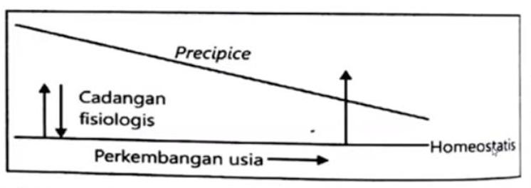
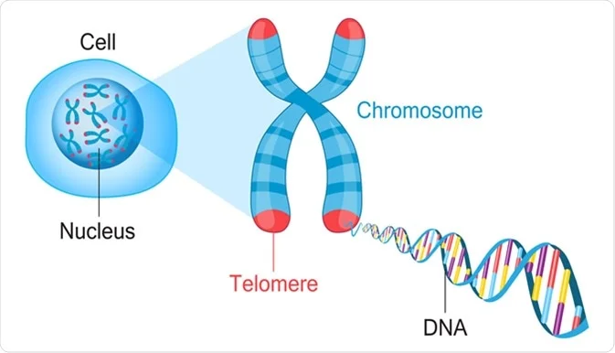

# 1. Pengertian Proses Menua 🧓🏽🌿

Menua adalah proses alami yang tidak dapat dihindari. Proses ini berlangsung terus-menerus dan menyebabkan perubahan anatomis, fisiologis, serta biologis. Seiring waktu, kemampuan tubuh untuk mempertahankan fungsi dan memperbaiki kerusakan berkurang. Dampaknya dapat terlihat pada fungsi fisik, kognitif, dan biologis.

Secara umum, **penuaan adalah proses ketika kemampuan jaringan untuk memperbaiki atau mengganti dirinya sendiri dan mempertahankan struktur serta fungsi normal perlahan menurun**. Akibatnya, **tubuh lebih sulit bertahan terhadap cedera dan infeksi, serta memperbaiki kerusakan**.

Penuaan juga dapat dipahami sebagai perubahan dari kondisi dewasa sehat menuju kondisi yang lebih rentan (*frail*). Cadangan berbagai sistem fisiologis berkurang sehingga kerentanan terhadap penyakit dan kematian meningkat.

## Istilah Penting

- **Aging (pertambahan usia):** efek waktu yang berjalan terus-menerus (*continuum*), biasanya bertahap dan spontan. Proses ini mencakup perkembangan (*development*) dan berlanjut menjadi senesens.
- **Senesens (proses menjadi tua):** penurunan kemampuan sel untuk membelah dan berkembang, yang diikuti penurunan efisiensi fungsi seiring waktu.
- **Homeostenosis:** berkurangnya cadangan homeostasis tubuh selama penuaan pada berbagai sistem organ.

> 🧠 **Tips hafalan:** *Aging* = waktu bertambah; *senesens* = fungsi sel menurun; *homeostenosis* = cadangan tubuh menyempit.

# 2. Usia dan Longevity
## Usia

1. **Usia kronologis** dihitung berdasarkan **jumlah tahun sejak lahir**. 
2. **Usia fisiologis** menggambarkan keadaan fungsi tubuh dan **kapasitas fungsional** seseorang. 

Keduanya tidak selalu sama: orang dengan usia kronologis yang sama dapat memiliki kapasitas fisiologis yang berbeda, dipengaruhi faktor genetik dan lingkungan.

## Longevity (Lama Hidup Individu)

- **Usia harapan hidup (*mean longevity*):** perkiraan lama hidup berdasarkan kondisi populasi. Dihitung berdasarkan penjumlahan umur semua anggota populasi saat meninggal dibagi jumlah anggota populasi tersebut.
- **Usia maksimum (*maximum longevity*):** usia individu yang hidup paling lama dalam suatu populasi. Potensi usia maksimum manusia diperkirakan sekitar 110–120 tahun.

# 3. Cadangan Fisiologis dan Homeostenosis
## Konsep Homeostenosis oleh Walter Canon

Seiring bertambahnya usia, **cadangan fisiologis berbagai organ berkurang**. Tubuh masih dapat mempertahankan keseimbangan pada keadaan sehari-hari, tetapi **kemampuan menghadapi stres—misalnya infeksi, dehidrasi, atau cedera—menjadi lebih terbatas**. Karena itu, **orang lanjut usia lebih mudah jatuh sakit dan pemulihannya dapat lebih lambat**.

# 4. Teori-teori Proses Menua
## a. Teori Jam Genetik

Teori ini menyatakan bahwa penuaan terjadi akibat adanya program jam genetik di dalam nuklei (inti sel). Jam ini akan berputar dalam jangka waktu tertentu dan **jika jam ini sudah habis putarannya maka akan menyebabkan berhentinya proses mitosis**.

Radiasi dan zat kimia dapat mempercepat kerusakan yang berupa mutasi progresif pada DNA sel somatik, yang kemudian menurunkan kemampuan fungsional sel tersebut dan berakibat memperpendek umur seseorang.

## b. Teori Kesalahan Beruntun (*Error Catastrophe*)

**Kesalahan dalam proses pembentukan protein**, baik saat transkripsi (DNA menjadi RNA) maupun translasi (RNA menjadi protein) dapat **terakumulasi sepanjang hidup**. Akumulasi kesalahan dapat menghasilkan protein atau enzim yang tidak berfungsi dengan baik → **mutasi somatik**.

## c. Teori Kerusakan Sistem Imun

**Mutasi berulang** pada materi genetik atau protein pascatranslasi dapat **menurunkan kemampuan sistem imun untuk mengenalinya sebagai bagian dari tubuh itu sendiri** sehingga kemungkinan terbentuknya respons **autoimun** meningkat, sementara pertahanan terhadap gangguan eksternal melemah.

## d. Teori Perbaikan DNA

Kemampuan memperbaiki kerusakan DNA berbeda antarspesies. Penelitian pada fibroblas yang terpapar sinar ultraviolet menunjukkan hubungan antara laju perbaikan DNA dan potensi umur maksimum (*maximum lifespan potential*). Dalam teori ini, **spesies dengan potensi umur maksimum lebih tinggi cenderung memiliki laju perbaikan DNA yang lebih tinggi**.

## e. Teori Pemendekan Telomer

Telomer adalah wilayah urutan DNA berulang (TTAGGG) di ujung kromosom yang berfungsi **melindungi materi genetik** agar tidak rusak, kusut, atau menyatu dengan kromosom lain. **Telomer cenderung memendek setiap kali sel membelah sehingga pemendekan telomer berkaitan dengan penuaan sel**. Sebagai contoh, sel janin memiliki telomer lebih panjang daripada sel somatik dewasa. Beberapa sel kanker menjadi pengecualian karena dapat mempertahankan telomernya.

## f. Teori Radikal Bebas

Radikal bebas adalah **molekul sangat reaktif yang dapat merusak DNA, protein, dan asam lemak tak jenuh pada membran sel**, sehingga dianggap sebagai kausa utama terjadinya kerusakan fungsi sel. Contoh radikal bebas meliputi anion superoksida, radikal hidroksil, hidrogen peroksida, dan radikal purin. 

Pada teori radikal bebas, metabolisme oksidatif menghasilkan produk utama dan produk sampingan berupa radikal bebas. Bila radikal bebas tersebut bereaksi dengan DNA, protein, dan asam lemak tak jenuh dalam sel, mereka akan berubah menjadi molekul disfungsional yang menyebabkan disfungsi sel sehingga disebut kerusakan oksidatif. Kerusakan oksidatif yang menumpuk karena usia dapat mempercepat penuaan dan memperpendek umur.

Tubuh memiliki sistem pertahanan terhadap radikal bebas berupa antioksidan:

- **Superoksida dismutase:** memerlukan seng (Zn), tembaga (Cu), atau mangan (Mn).
- **Katalase:** memerlukan besi (Fe).
- **Glutation peroksidase:** memerlukan selenium (Se).
- **Antioksidan nonenzimatik:** vitamin C (asam askorbat), provitamin A (beta-karoten), dan vitamin E (tokoferol).

## g. Teori Glikosilasi atau Glikasi

Glikasi adalah pertautan glukosa dengan protein tanpa bantuan enzim. Proses ini menghasilkan *advanced glycation end products* (AGEs) yang dapat menumpuk di jaringan. Akumulasi AGEs meningkatkan kekakuan jaringan, termasuk kolagen, dan mengurangi elastisitas pembuluh darah. Pembatasan kalori pernah dikaitkan dengan peningkatan harapan hidup dalam kajian teori ini.

# 5. Perubahan Tubuh Akibat Penuaan dan Implikasi Klinisnya
## a. Gastrointestinal

**Perubahan:** 
- Kesehatan gigi dapat memburuk; jumlah kuncup pengecap (*taste buds*), kekuatan mengunyah, produksi air liur, dan enzim ptialin menurun. 
- Refleks muntah melemah. 
- Sekresi asam lambung, faktor intrinsik, ketebalan mukosa lambung, gerak pengosongan lambung, serta kemampuan usus menyerap zat gizi dapat berubah.
- Hati dapat mengalami penurunan ukuran, aliran darah, kapasitas penyimpanan, dan aktivitas enzim.

**Implikasi:**
- Pengecapan dan nafsu makan menurun, mengunyah atau menelan dapat lebih sulit, pencernaan pati dan toleransi lemak berubah. 
- Keluhan dapat berupa karies, gangguan pencernaan, gas, konstipasi, penurunan berat badan, atau kelelahan.
- **Berkurangnya faktor intrinsik dapat meningkatkan risiko anemia pernisiosa**. Perubahan metabolisme hati juga dapat memengaruhi pemrosesan obat.

## b. Muskuloskeletal

**Perubahan:**
- Massa dan kekuatan otot menurun (**sarkopenia**).
- Tulang mengalami demineralisasi, permukaan tulang rawan sendi memburuk, dan diskus antar-ruas tulang belakang menipis.
- Kelenturan jaringan berkurang.
- Postur kifosis dapat muncul sehingga tinggi badan dapat berkurang; diperkirakan kehilangan sekitar 2 inci antara usia 20 dan 70 tahun.

**Implikasi:** nyeri, rentang gerak dan fleksibilitas berkurang, mobilitas serta kemandirian dalam aktivitas sehari-hari menurun. Perubahan gaya berjalan meningkatkan risiko jatuh dan patah tulang, termasuk akibat osteoporosis.

> 🧠 **Tips hafalan:** otot melemah + tulang rapuh + sendi kaku → gerak berkurang → risiko jatuh dan fraktur meningkat.

## c. Genitourinaria

**Perubahan:**
- Jumlah nefron, aliran darah ginjal, laju filtrasi glomerulus (GFR), dan kemampuan tubulus mengatur zat terlarut menurun.
- Kapasitas kandung kemih dapat berkurang (sekitar 500 mL menjadi 250 mL), begitu pula elastisitas dan tonusnya.
- Tonus otot uretra menurun.
- **Pembesaran prostat jinak umum terjadi pada laki-laki**.

**Implikasi:** klirens kreatinin dan kemampuan memekatkan urine menurun. Retensi urine, inkontinensia, frekuensi berkemih, dan nokturia dapat meningkat. Perubahan fungsi ginjal memengaruhi pembuangan obat dan dapat meningkatkan risiko jatuh, terutama bila berkemih malam hari.

## d. Kardiovaskular

**Perubahan:**
- Kolagen dan lemak pada otot jantung bertambah, katup menebal dan kaku, aliran darah koroner serta respons jantung terhadap rangsangan beta-adrenergik menurun. Sel pacu jantung di nodus sinoatrial berkurang.
- Ukuran jantung keseluruhan umumnya tidak banyak berubah, meskipun dapat terjadi hipertrofi miokard.
- Frekuensi jantung saat istirahat umumnya relatif tetap, tetapi frekuensi maksimum, pengisian ventrikel kiri, dan curah jantung maksimal menurun. Tekanan sistolik cenderung meningkat, sedangkan tekanan diastolik dapat relatif tetap.
- Autoregulasi aliran darah otak dapat terganggu.
- Dinding arteri menebal dan elastin terfragmentasi sehingga resistensi vaskular perifer meningkat.

**Implikasi:** kemampuan meningkatkan curah jantung saat stres berkurang. Perubahan irama, hipotensi ortostatik, dan respons tekanan darah dapat berkontribusi pada pusing atau jatuh.

## e. Sistem Pernapasan

**Perubahan:**
- Elastisitas paru, jumlah alveolus, kekuatan otot pernapasan, efektivitas silia dan refleks batuk menurun. Volume residu meningkat, sedangkan FEV₁, FVC, kapasitas vital, difusi gas, dan respons ventilasi terhadap karbon dioksida dapat menurun. 
- Dinding dada menjadi lebih kaku dan diameter dada depan-belakang dapat meningkat.

**Implikasi:** pertukaran gas dan toleransi olahraga berkurang, sementara risiko infeksi saluran napas meningkat. Rumus perkiraan tekanan oksigen arteri (PaO₂) adalah **100 − (0,32 × usia)**.

## f. Sistem Saraf dan Fungsi Kognitif

**Perubahan:**
- Massa otak dan aliran darah otak dapat sedikit berkurang.
- **Efisiensi transmisi saraf dan kecepatan pemrosesan informasi dapat menurun**. Informasi baru lebih sulit dikumpulkan dan diambil kembali, sedangkan kejadian masa lalu sering lebih mudah diingat daripada kejadian baru.
- Neurotransmiter tertentu, termasuk dopamin, serta cadangan kolinergik dapat menurun.
- Pola tidur berubah. Sensasi getar dan suhu, propriosepsi, refleks tendon, serta kecepatan gerak sukarela dapat berkurang.

**Implikasi:**
- Respons terhadap rangsangan melambat.
- Keseimbangan dan gaya berjalan berubah dan risiko jatuh meningkat.
- Pengaturan suhu tubuh lebih rentan sehingga hipotermia maupun hipertermia lebih mudah terjadi.
- Informasi baru dapat dipelajari dan diingat dengan lebih lambat; ingatan lama sering lebih baik daripada ingatan atas kejadian yang baru berlangsung. Penuaan normal tidak sama dengan demensia.

## g. Indra Penglihatan

**Perubahan:**
- Lensa menguning, mengeruh, dan menjadi kaku.
- Ukuran pupil, kemampuan akomodasi, lapang pandang, jumlah sel kerucut retina, serta produksi air mata menurun.
- Adaptasi dalam gelap dan penyerapan cairan intraokular menjadi kurang efisien.

**Implikasi:** **presbiopia** (sulit fokus pada benda dekat), persepsi kedalaman dan pembedaan warna menurun, kebutuhan pencahayaan meningkat, serta silau lebih mengganggu. Mata dapat terasa kering dan risiko jatuh meningkat.

## h. Indra Pendengaran dan Keseimbangan

**Perubahan:**
- Jumlah sel saraf pendengaran dan elastisitas membran timpani menurun.
- Tulang pendengaran dapat mengalami atrofi atau kekakuan.
- Produksi dan komposisi serumen berubah.
- Jumlah sel rambut pada organ Corti berkurang dan ambang respons vestibular meningkat.

**Implikasi:** 
- **Presbikusis** biasanya lebih dahulu mengganggu pendengaran nada berfrekuensi tinggi. 
- Memahami percakapan, membedakan arah sumber bunyi, dan memilah suara dari kebisingan menjadi lebih sulit.
- Serumen dapat menyumbat telinga.
- Gangguan pendengaran dan keseimbangan dapat mendorong isolasi sosial serta meningkatkan risiko jatuh.

## i. Integumentum

**Perubahan:**
- Epidermis menipis dan atrofi; kekuatan, elastisitas, aliran darah, lemak bawah kulit, serta fungsi kelenjar keringat dan minyak menurun. Kulit menjadi lebih rapuh. 
- Rambut kulit kepala, kemaluan, dan ketiak menipis atau memutih; rambut hidung dan telinga dapat menebal.
- Kuku tumbuh lebih lambat dan dapat menebal.

**Implikasi:**
- Kulit kering, bersisik, dan berkerut; turgor serta kemampuan mengatur suhu menurun. 
- Penyembuhan luka melambat, sedangkan risiko infeksi, trauma, lesi ganas, dan luka tekan meningkat.
- Bercak penuaan dapat muncul.
- Kuku lebih rapuh atau berubah warna sehingga mudah terbelah dan terinfeksi.
- Penyerapan obat melalui kulit dapat melambat.

## j. Sistem Endokrin dan Metabolisme

**Perubahan:** 
- Toleransi glukosa dapat terganggu dan kadar glukosa puasa maupun setelah makan cenderung meningkat.
- Hormon tertentu dapat menurun, termasuk DHEA, testosteron bebas, T3, IGF-1, dan produksi vitamin D kulit. 
- PTH dan homosistein dapat meningkat.
- Pada perempuan, kegagalan ovarium disertai penurunan hormon ovarium.

Laju metabolisme basal dan sintesis protein otot menurun. Perubahan hormon dan aktivitas aromatase pada jaringan lemak juga dapat mengubah distribusi serta pemecahan lemak.

## k. Darah dan Sumsum Tulang

**Cadangan sumsum tulang berkurang** sehingga respons pembentukan sel darah dapat lebih terbatas ketika kebutuhan meningkat. Respons retikulosit terhadap eritropoietin dapat melemah.

## l. Pengaturan Suhu dan Rasa Haus

Produksi keringat serta kemampuan pembuluh darah kulit untuk menyempit dan melebar menurun. Suhu inti yang diperlukan untuk memulai keringat dapat meningkat. Rasa haus juga berkurang dan pengaturannya dapat terganggu.

**Implikasi:** risiko dehidrasi dan gangguan pengaturan suhu meningkat. Asupan cairan perlu diperhatikan, terutama saat sakit atau cuaca panas, dengan tetap mempertimbangkan kondisi medis masing-masing.

## m. Sistem Imun

Imunitas yang dimediasi sel dapat berkurang, produksi antibodi dapat memiliki afinitas lebih rendah, dan autoantibodi dapat meningkat. Akibatnya, pertahanan terhadap infeksi dapat melemah.

# 6. Menua Sehat 🌱

Menua sehat berarti **bertambah usia dengan mempertahankan kesehatan, kemampuan fungsional, dan kemandirian sebaik mungkin**. Proses ini dipengaruhi oleh:

**Faktor dari dalam tubuh (endogen):**
- Sel
- Jaringan
- Organ

**Faktor dari luar (eksogen):**
- Lingkungan
- Gaya hidup

# 7. Rangkuman

- Menua adalah proses alami dan berkesinambungan yang mengubah struktur dan fungsi tubuh.
- Cadangan fisiologis menyempit (*homeostenosis*), sehingga kemampuan menghadapi stres menurun dan kerentanan terhadap penyakit meningkat.
- Penuaan dijelaskan oleh berbagai teori, termasuk jam genetik, kesalahan beruntun (mutasi somatik), perubahan imun, perbaikan DNA, pemendekan telomer, radikal bebas, dan glikasi (akibat metabolisme).
- Perubahan dapat mengenai hampir semua sistem: otot dan tulang, jantung dan paru, ginjal, pencernaan, saraf, indra, kulit, hormon, serta sistem imun.
- Dampak klinis yang penting mencakup penurunan mobilitas, risiko jatuh, perubahan metabolisme obat, gangguan pengaturan suhu dan cairan, serta melambatnya pemrosesan informasi.
- Menua sehat dipengaruhi faktor biologis, lingkungan, dan gaya hidup. Penuaan sendiri bukan penyakit, tetapi dapat berjalan bersamaan dengan penyakit kronis degeneratif.

> 💡 **Kalimat kunci:** usia bertambah → cadangan tubuh berkurang → respons terhadap stres melemah → risiko gangguan fungsi meningkat.