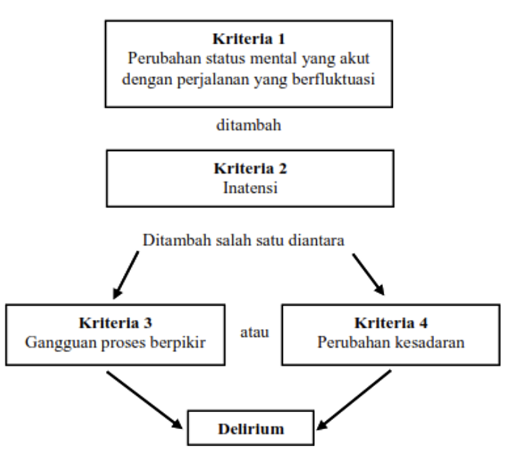

# Sindrom Delirium Akut pada Pasien Geriatri
## 1. Gambaran umum pasien geriatri

- Pasien lanjut usia sering memiliki **cadangan fisiologis yang lebih rendah, beberapa penyakit sekaligus, gangguan fungsi, masalah nutrisi, serta penggunaan banyak obat (polifarmasi)**. 
- Akibatnya, **penyakit akut dapat muncul dengan gejala yang tidak khas**. Infeksi, gangguan metabolik, atau efek obat, misalnya, dapat terlihat sebagai perubahan perilaku atau kesadaran, bukan keluhan yang jelas pada satu organ.
- Kondisi tersebut membuat **perubahan akut pada kemampuan berpikir dan beraktivitas** perlu dinilai dengan serius. Salah satu penyebab pentingnya adalah **delirium**.

### Sindrom Geriatri

- Sindrom geriatri adalah **kumpulan kondisi yang sering dialami pasien lanjut usia** dan merupakan masalah utama sehingga harus dirawat.
- Kondisi ini biasanya memiliki beberapa penyebab sekaligus, saling memengaruhi, dan dapat mengganggu kemandirian serta fungsi sehari-hari.

#### _Geriatric giants_

_Geriatric giants_ adalah **kelompok masalah utama yang sering dijumpai** pada pasien lanjut usia:

- **Instabilitas dan jatuh:** gangguan keseimbangan atau mobilitas yang meningkatkan risiko jatuh.
- **Imobilisasi:** keterbatasan bergerak yang dapat memperburuk kekuatan otot dan kemandirian.
- **Inkontinensia:** kesulitan mengendalikan buang air kecil atau buang air besar.
- **Gangguan intelektual:** perubahan kognitif, termasuk demensia dan delirium.
- **Infeksi:** dapat muncul dengan gejala yang tidak khas.
- **Gangguan penglihatan dan pendengaran:** menghambat komunikasi, orientasi, dan aktivitas.
- **Dekubitus:** kerusakan kulit akibat tekanan berkepanjangan, terutama pada pasien yang kurang bergerak.
- **Depresi:** gangguan suasana hati yang dapat memengaruhi fungsi dan kualitas hidup.

#### Kumpulan masalah yang dikenal sebagai **“14 I + F + S”**

Beberapa masalah geriatri dapat diingat melalui daftar berikut:

1. _Impairment of visual_ — gangguan penglihatan.
2. _Impairment of hearing_ — gangguan pendengaran.
3. _Intellectual impairment_ — gangguan kognitif.
4. _Incontinence_ — inkontinensia.
5. _Instability and falls_ — ketidakstabilan dan jatuh.
6. _Immobility_ — keterbatasan bergerak.
7. _Infection_ — infeksi.
8. _Inanition_ — kekurangan asupan atau malnutrisi.
9. _Insomnia_ — gangguan tidur.
10. _Iatrogenesis_ — masalah akibat tindakan atau pengobatan.
11. _Immunodeficiency_ — penurunan fungsi kekebalan.
12. _Impaction_ — sumbatan, misalnya impaksi tinja.
13. _Isolation_ — isolasi sosial.
14. _Impotence_ — gangguan fungsi seksual.
15. *Frailty* — kerentanan.
16. *Sarcopenia* — kehilangan massa otot.

>**Note**: _Geriatric giants_ adalah istilah umum untuk masalah besar yang sering mengganggu kesehatan dan kemandirian lansia, sedangkan **14 I + F + S** adalah daftar pengingat yang lebih rinci—14 masalah berawalan _I_, ditambah _frailty_ dan _sarcopenia_. Keduanya mencakup beberapa masalah yang sama, tetapi daftarnya tidak persis sama.

#### Mengapa penting pada delirium?

Masalah geriatri sering saling berkaitan. Gangguan pendengaran, gangguan kognitif sebelumnya, malnutrisi, infeksi, imobilisasi, dan penggunaan banyak obat dapat meningkatkan kerentanan terhadap delirium. Karena itu, penilaian pasien lanjut usia perlu memperhatikan fungsi, mobilitas, nutrisi, sensorik, obat, dukungan sosial, dan penyakit akut secara bersamaan.

## 2. Pengertian delirium

Delirium adalah **gangguan akut pada perhatian dan kesadaran yang disertai perubahan kognitif**. Perubahan biasanya **timbul dalam hitungan jam sampai beberapa hari**, **berfluktuasi** sepanjang hari, dan menunjukkan penurunan dari keadaan dasar pasien.

Gejala dapat mencakup:

- **Sulit memusatkan, mempertahankan, atau mengalihkan perhatian.**
- **Disorientasi terhadap waktu, tempat, atau orang.**
- **Gangguan ingatan, bahasa, atau alur berpikir.**
- **Salah menafsirkan keadaan sekitar, halusinasi, atau waham.**
- **Perubahan pola tidur-bangun.**
- **Aktivitas psikomotor yang meningkat, menurun, atau berganti-ganti.**

Delirium umumnya berhubungan dengan kondisi medis akut, obat atau zat, penghentian zat tertentu, paparan toksin, atau beberapa penyebab sekaligus. Delirium merupakan keadaan yang memerlukan penilaian medis segera, terutama jika perubahan muncul mendadak.

### Dampak

Delirium dapat terjadi di ruang gawat darurat, bangsal, maupun unit perawatan intensif. Kondisi ini berkaitan dengan komplikasi selama perawatan dan dapat diikuti gejala kognitif yang menetap atau penurunan fungsi. Karena gejalanya dapat berfluktuasi dan pasien mungkin tampak tenang, delirium mudah terlewat bila perubahan dari keadaan dasar tidak ditanyakan kepada keluarga atau pendamping.

### Istilah lain

- *Acute confusional state*
- *Acute mental status change*
- *Altered mental status*
- *Reversible dementia*
- *Toxic/metabolic encephalopathy*
- *Organic brain syndrome*
- *Dysergasticreation*

## 3. Tiga tipe delirium

| Tipe             | Gambaran yang sering terlihat                                                                                                |
| ---------------- | ---------------------------------------------------------------------------------------------------------------------------- |
| Hiperaktif (30%) | Gelisah, banyak bergerak, waspada berlebihan, sulit diarahkan, atau mengalami halusinasi dan waham.                          |
| Hipoaktif (25%)  | Tampak tenang, menarik diri, mengantuk atau letargis, bergerak sedikit, dan merespons lambat. Tipe ini mudah tidak dikenali. |
| Campuran (45%)   | Gejala hiperaktif dan hipoaktif muncul bergantian.                                                                           |

## 4. Faktor risiko dan faktor pencetus

Delirium sering timbul dari gabungan kerentanan pasien dan pencetus akut. Semakin tinggi kerentanan, semakin ringan pencetus yang mungkin memicu delirium.

### Faktor predisposisi: kerentanan yang telah ada

- Usia lanjut.
- Demensia atau gangguan kognitif sebelumnya.
- Penyakit berat dan komorbiditas multipel.
- Depresi.
- Gangguan penglihatan atau pendengaran.
- Gangguan fungsi atau imobilitas.
- Riwayat stroke atau serangan iskemik transien.
- Riwayat delirium.
- Riwayat penggunaan alkohol bermasalah.

### Faktor pencetus: gangguan yang muncul atau bertambah akut

- Infeksi.
- Dehidrasi atau status nutrisi buruk.
- Gangguan metabolik, termasuk perubahan elektrolit, glukosa, atau keseimbangan asam-basa.
- Obat-obatan, terutama polifarmasi, obat psikoaktif, sedatif, dan hipnotik; interaksi obat juga perlu ditinjau.
- Kateter kandung kemih menetap dan restrain fisik.
- Komplikasi tindakan atau perawatan medis.
- Operasi besar, trauma, atau rawat inap mendadak.
- Koma atau penyakit akut lain.

## 5. Patofisiologi secara ringkas

- **Delirium melibatkan gangguan fungsi jaringan otak dan komunikasi antarsel saraf.**
- Gangguan tersebut dapat berkaitan dengan:
    - ketidakseimbangan neurotransmiter, termasuk **penurunan aktivitas asetilkolin**;
    - **gangguan metabolisme otak akibat hipoksia** atau **hipoglikemia**;
    - peradangan dan **peningkatan sitokin saat sakit akut**; serta
    - **efek obat** tertentu pada komunikasi antarsel saraf.
- Patofisiologi delirium kompleks dan tidak disebabkan oleh satu mekanisme saja.
- Gangguan metabolisme otak, peradangan, dan efek obat dapat mengganggu sinyal neurotransmiter serta sistem _second messenger_.
- Akibatnya, fungsi otak dan aktivitas psikomotor berubah sehingga muncul gejala delirium.

## 6. Penegakan diagnosis

Diagnosis delirium dapat menggunakan dua pedoman, yaitu **ICD-10** dan **DSM-5**. Keduanya menilai perubahan kognitif dan gejala delirium, tetapi memiliki kriteria yang berbeda.

- **ICD-10** *(The World Health Organization’s International Classification of Diseases 10th Revision)* mencakup gangguan ingatan, disorientasi, serta perubahan tidur, psikomotor, dan emosi. 
- **DSM-5**  *(Diagnostic and statistical manual of mental disorders-V)* menekankan gangguan perhatian dan kesadaran yang muncul akut dan berfluktuasi, disertai perubahan kognitif atau persepsi serta bukti penyebab fisiologis. 

Beberapa penelitian yang mengevaluasi kesesuaian antara kriteria DSM-V dan ICD-10 menunjukkan bahwa **DSM-V lebih sensitif dibandingkan ICD-10 untuk diagnosis delirium**.

Diagnosis dimulai dengan memastikan adanya perubahan akut dari keadaan dasar, mengenali ciri delirium, lalu mencari penyebab yang mendasarinya. Informasi keluarga, pendamping, atau petugas yang mengenal pasien sering sangat membantu.

### Kriteria DSM-5

Diagnosis delirium didukung oleh seluruh pokok berikut:

-  **(a)** Gangguan kesadaran (berupa penurunan kejernihan kesadaran terhadap lingkungan) dengan **penurunan kemampuan fokus, mempertahankan atau mengubah perhatian**.
- **(b)** Gangguan berkembang dalam periode **singkat** (biasanya beberapa jam hingga hari) dan cenderung **berfluktuasi** dalam perjalanannya.
- **(c)** **Perubahan kognitif** (seperti defisit memori, disorientasi, gangguan bahasa) atau perkembangan gangguan persepsi yang tidak dapat dimasukkan ke dalam kondisi demensia.
- **(d)** Gangguan pada kriteria (a) dan (c) **tidak disebabkan oleh gangguan neurokognitif lain** yang telah ada, terbentuk ataupun sedang berkembang dan tidak timbul pada kondisi penurunan tingkat kesadaran berat, seperti koma.
- **(e)** Temuan bukti dari riwayat, pemeriksaan fisik, atau laboratorium yang mengindikasikan gangguan terjadi akibat konsekuensi fisiologik langsung suatu kondisi medik umum, intoksikasi atau penghentian substansi (seperti penyalahgunaan obat atau pengobatan), pemaparan terhadap toksin, atau karena etiologi multipel.

### Skrining dengan CAM

*Confusion Assessment Method* (CAM) merupakan alat skrining dan diagnosis yang umumnya digunakan oleh profesional kesehatan yang non-mental health. Empat ciri yang dinilai adalah:

1. **Onset akut dan perjalanan berfluktuasi.**
2. **Inatensi**, yaitu kesulitan memusatkan perhatian.
3. **Pikiran tidak terorganisasi.**
4. **Perubahan tingkat kesadaran.**

> [!NOTE] Syarat diagnosis delirium dengan CAM:
> Pasien harus memenuhi **nilai 1 dan 2 ditambah nilai 3 atau 4** untuk bisa didiagnosis delirium.

Untuk lebih detailnya:
#### Confusion Assessment Method (CAM)

**1. Awitan Akut dan Berfluktuasi**  
- Apakah ada bukti status mental pasien berubah mendadak (akut) dari kondisi awalnya?  
- Apakah perilaku tersebut (abnormal) berfluktuasi pada hari itu, dengan kata lain hilang timbul atau keparahannya meningkat-menurun?

**2. Perhatian Tidak Terfokus**  
- Apakah pasien sulit memusatkan perhatian, misalnya mudah sekali teralih atau sulit mengikuti pembicaraan?

**3. Pikiran Tidak Tertata**  
- Apakah pemikiran pasien tidak tertata atau tidak koheren, misalnya percakapan melantur atau tidak relevan, aliran gagasan tidak jernih atau tidak logis, berganti-ganti topik secara tidak terduga?

**4. Perubahan Tingkat Kesadaran**  
- Secara keseluruhan, bagaimana Anda menilai tingkat kesadaran pasien ini? Waspada (normal), _vigilant_ (waspada berlebihan), letargik, stupor, atau koma?

**Pasien harus memenuhi nilai 1 dan 2 ditambah nilai 3 atau 4 untuk diagnosis delirium**

### Pemeriksaan awal

Penilaian dilakukan secara terarah berdasarkan kondisi pasien. Komponen penting meliputi:

| Area | Hal yang dinilai |
|---|---|
| Riwayat | Fungsi kognitif dasar; perubahan mental dalam beberapa hari atau minggu terakhir; perubahan penyakit; obat resep, obat bebas, herbal, dan interaksinya; penggunaan alkohol atau sedatif; nyeri dan ketidaknyamanan seperti retensi urine, konstipasi, atau haus. |
| Tanda vital | Suhu, saturasi oksigen, glukosa darah, dan tanda vital lain sesuai kebutuhan, termasuk perubahan saat berdiri bila relevan. |
| Pemeriksaan fisik dan neurologis | Tanda infeksi yang samar, dehidrasi, nyeri akut, gangguan sensorik, perubahan neurologis fokal, dan tanda iritasi meningeal. |
| Laboratorium terarah | Darah lengkap, urinalisis, elektrolit, kalsium, glukosa, fungsi ginjal, hati, atau tiroid sesuai petunjuk klinis; kultur bila dicurigai infeksi; pemeriksaan gas darah atau kadar obat bila diperlukan. |
| Pemeriksaan lain | EKG dan foto toraks sesuai indikasi. Pencitraan otak dipertimbangkan pada keadaan tertentu, seperti perubahan neurologis fokal, dugaan ensefalitis, riwayat atau tanda trauma kepala. EEG dapat membantu bila dicurigai kejang tersembunyi atau perlu membedakan gangguan psikiatri tertentu. Pungsi lumbal dipertimbangkan bila terdapat kecurigaan meningitis atau ensefalitis. |

Pemeriksaan tidak harus dilakukan semuanya pada setiap pasien. Pemilihannya mengikuti temuan riwayat, pemeriksaan fisik, dan dugaan penyebab.

## 7. Diagnosis banding delirium: demensia dan depresi

| Aspek | Delirium | Demensia | Depresi |
|---|---|---|---|
| Awitan | Akut, jam sampai hari | Biasanya perlahan | Bervariasi |
| Perjalanan | Berfluktuasi | Umumnya progresif | Dapat berubah menurut waktu atau keadaan |
| Perhatian dan kesadaran | Perhatian terganggu; kesadaran dapat berkabut | Sering relatif terjaga pada tahap awal | Biasanya kesadaran terjaga; konsentrasi dapat menurun |
| Memori dan pikir | Perubahan kognitif akut; pikiran dapat tidak terorganisasi | Gangguan kognitif menetap, sering dimulai dengan memori | Keluhan konsentrasi, motivasi, dan suasana hati menonjol |
| Persepsi | Salah tafsir, halusinasi, atau waham dapat terjadi | Biasanya tidak menonjol pada banyak tipe; dapat terjadi pada tipe tertentu | Dapat muncul gejala psikotik pada sebagian kasus |

Delirium dapat terjadi pada orang yang juga mengalami demensia. Riwayat fungsi dasar sangat penting agar perubahan akut tidak keliru dianggap sebagai demensia saja.

**Tips mengingat:** delirium biasanya **mendadak dan berubah-ubah**; demensia umumnya **perlahan dan menetap/progresif**. Awitan akut dengan fluktuasi harus mendorong pencarian penyebab medis.

## 8. Penatalaksanaan

Penatalaksanaan memiliki tiga sasaran yang berjalan bersamaan:

1. Menegakkan dan memantau diagnosis delirium.
2. Mencari serta menangani penyebab yang mendasari.
3. Menilai dan mengatasi kondisi yang mengancam jiwa.

### Langkah klinis

- Identifikasi faktor predisposisi dan pencetus.
- Lakukan anamnesis, pemeriksaan fisik, pemeriksaan neurologis, dan penilaian status mental secara menyeluruh.
- Pilih pemeriksaan penunjang berdasarkan temuan klinis.
- Tinjau kembali seluruh obat, termasuk obat bebas dan herbal; evaluasi kebutuhan, efek samping, dan interaksi bersama tenaga kesehatan.
- Atasi penyebab yang dapat dikoreksi, seperti hipoksia, infeksi, gangguan glukosa atau elektrolit, dehidrasi, nyeri, retensi urine, atau konstipasi.

### Dukungan nonfarmakologis

**Keselamatan dan kondisi fisiologis**

- Ciptakan lingkungan yang aman dan cegah cedera pada pasien maupun orang di sekitarnya.
- Pertahankan oksigenasi, hidrasi, nutrisi, dan keseimbangan elektrolit sesuai kebutuhan klinis.
- Bantu pasien mempertahankan pola tidur-bangun yang teratur.
- Usahakan mobilisasi dini dan kurangi imobilisasi yang tidak perlu.
- Hindari restrain bila memungkinkan; utamakan pendekatan yang lebih aman dan suportif.

**Komunikasi dan orientasi**

- Gunakan kalimat singkat dan jelas; sampaikan satu instruksi atau pertanyaan pada satu waktu.
- Kenalkan diri dan ingatkan pasien dengan tenang tentang waktu, tempat, dan situasi.
- Sediakan jam, kalender, pencahayaan yang sesuai, dan penanda lokasi yang mudah dilihat.
- Libatkan keluarga atau orang yang dikenal pasien dan gunakan benda familiar bila membantu.
- Hindari perpindahan ruang yang terlalu sering. Bila perpindahan tidak dapat dihindari, bantu orientasi kembali.
- Koreksi hambatan penglihatan atau pendengaran dengan alat bantu yang biasa digunakan.
- Penuhi kebutuhan dasar seperti makan, minum, istirahat, toileting, dan pengendalian nyeri.
- Jaga tingkat stimulasi tetap sesuai: kurangi kebisingan dan rangsangan berlebihan, tetapi jangan membuat lingkungan terlalu gelap atau mengisolasi pasien.

### Obat untuk gejala berat

- **Penanganan penyebab dan langkah nonfarmakologis merupakan prioritas**.
- Antipsikotik tidak mengobati penyebab delirium dan **tidak diberikan rutin** kepada semua pasien. 
- Penelitian telah mengevaluasi berbagai antipsikotik dalam pengelolaan delirium. Namun, hanya ada sedikit uji coba terkontrol plasebo yang mengevaluasi kemanjuran antipsikotik pada pasien delirium.
- Antipsikotik telah dilaporkan mengurangi agitasi, kecemasan, gejala psikotik terkait, memiliki efek sedatif dan juga terbukti memperbaiki gejala kognitif delirium.
- Dosis rata-rata yang diperlukan untuk mengendalikan gejala delirium secara signifikan lebih kecil dibandingkan dosis yang biasanya digunakan dalam pengelolaan gangguan kejiwaan lainnya.

#### Dosis anti-psikotik

1. **Hanya diberikan pada delirium tipe hiperaktif**
	Dimulai dengan obat antipsikotik dosis rendah per oral, yaitu:
	- **Haloperidol 0,5 mg tiap 4-6 jam**, dapat ditingkatkan sampai maksimal 10 mg/hari. Pada lansia dosis **maksimal 3 mg/hari**.
	- Risperidon **2 x 0,5 mg**, dosis maksimal dewasa 4 mg, lansia **1 mg**.
2. **Pada agitasi berat atau kondisi yang tidak memungkinkan pemberian per oral:**
    - **Injeksi Haloperidol 2,5 mg IM**, dapat diulang setelah 30 menit.
    - Dosis maksimal lansia **5 mg/hari**.

## 9. Prognosis dan tindak lanjut

- Pasien sindrom delirium memiliki risiko kematian lebih tinggi jika komorbiditasnya tinggi.
- Hampir setengah pasien delirium keluar dari kondisi perawatan akut rumah sakit dengan gejala persisten.
- 20-40% di antaranya masih mengalami delirium hingga 12 bulan.

## 10. Pencegahan

Pencegahan berfokus pada faktor risiko yang dapat diubah:

| Faktor risiko | Upaya pencegahan |
|---|---|
| Gangguan kognitif | Komunikasi berorientasi, pengawasan, dan lingkungan yang konsisten. |
| Imobilisasi | Mobilisasi dini atau latihan di sisi tempat tidur; minimalkan kateter dan pembatasan gerak yang tidak perlu. |
| Obat psikoaktif | Tinjau kebutuhan obat dan kurangi penggunaan yang tidak perlu bersama tenaga kesehatan. |
| Kurang tidur | Kurangi kebisingan malam dan atur tindakan rutin agar tidak sering mengganggu tidur. |
| Gangguan penglihatan | Pastikan alat bantu tersedia dan pencahayaan memadai. |
| Gangguan pendengaran | Pastikan alat bantu dengar berfungsi dan gunakan cara komunikasi yang sesuai. |
| Dehidrasi atau nutrisi buruk | Kenali lebih awal dan bantu pemenuhan cairan serta nutrisi sesuai kondisi medis. |
| Penyakit akut dan nyeri | Kenali perubahan klinis, evaluasi nyeri, dan tangani penyebabnya sedini mungkin. |

## 11. Penerapan pada kasus

Seorang perempuan berusia 75 tahun mengalami gelisah dan bicara meracau selama tiga hari, tidak mengenali orang, serta salah mengenali waktu. Gejala akut ini mengarah pada kemungkinan delirium dan perlu dinilai segera. Batuk dengan lendir yang sulit dikeluarkan, sesak sesekali, dan penurunan nafsu makan merupakan petunjuk yang perlu diperiksa untuk mencari pencetus medis, termasuk masalah pernapasan, infeksi, hipoksia, atau dehidrasi. Riwayat diabetes, hipertensi, stroke, gangguan berjalan, nyeri lutut, dan inkontinensia juga relevan untuk penilaian menyeluruh.

Pendekatan kasus:

1. Bandingkan keadaan sekarang dengan fungsi kognitif dan aktivitas pasien sebelum sakit, menggunakan keterangan keluarga.
2. Nilai perhatian, kesadaran, fluktuasi gejala, tanda vital, oksigenasi, glukosa, hidrasi, dan pemeriksaan neurologis.
3. Tinjau obat yang digunakan dan perubahan obat baru-baru ini.
4. Cari serta tangani penyebab yang mungkin melalui pemeriksaan yang sesuai, termasuk kemungkinan gangguan pernapasan, infeksi, dan gangguan metabolik.
5. Jaga keselamatan, bantu orientasi, penuhi kebutuhan dasar, dan libatkan keluarga.

## Rangkuman

- Delirium adalah perubahan akut dan berfluktuasi pada perhatian serta kesadaran, disertai perubahan kognitif.
- Delirium dapat hiperaktif, hipoaktif, atau campuran; tipe hipoaktif mudah terlewat.
- Risiko muncul dari gabungan kerentanan dasar dan pencetus akut.
- Diagnosis memerlukan perbandingan dengan keadaan dasar, pemeriksaan klinis, dan pencarian penyebab.
- CAM mendukung skrining: onset akut/fluktuasi dan inatensi, ditambah pikiran tidak terorganisasi atau perubahan kesadaran.
- Penanganan berfokus pada penyebab, keselamatan, orientasi, tidur, hidrasi, nutrisi, mobilisasi, dan peninjauan obat.
- Antipsikotik hanya dipertimbangkan tenaga klinis untuk keadaan tertentu; obat bukan terapi rutin untuk semua delirium.
- Pencegahan meliputi mobilisasi, tidur yang cukup, koreksi gangguan sensorik, pemenuhan cairan/nutrisi, serta pengurangan obat dan prosedur yang tidak perlu.

### Kunci hafalan singkat

**“Akut - Fluktuatif - Inatensi - Cari pencetus.”**

Gunakan urutan ini saat mengingat ciri utama delirium dan langkah awal penilaian: kenali perubahan akut, amati fluktuasinya, periksa perhatian, lalu cari penyebab yang dapat ditangani.