# 1. Gambaran Umum

**Age-related macular degeneration (AMD)** atau degenerasi makula terkait usia adalah degenerasi retina yang didapat dan **dapat menyebabkan gangguan penglihatan sentral** yang bermakna. AMD mencakup bentuk **nonneovaskular** dan **neovaskular**.

Makula adalah bagian retina yang berperan besar dalam penglihatan sentral dan detail. Karena itu, AMD terutama mengganggu aktivitas seperti membaca dan mengenali wajah.

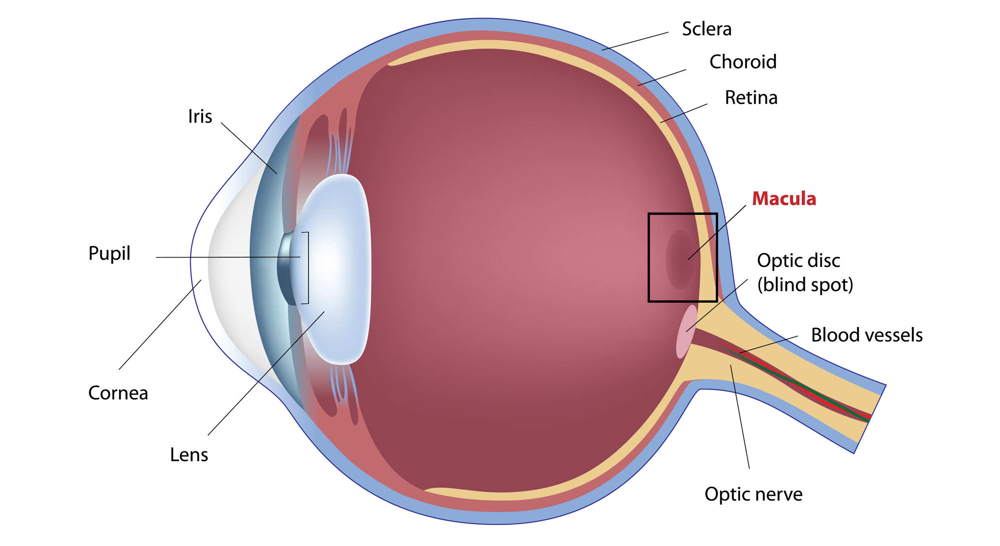

# 2. Epidemiologi

- WHO: AMD merupakan **penyebab terbesar ke-3 kebutaan** pada orang berusia >50 tahun di negara maju, setelah katarak dan glaukoma.
- Insidensi, prevalensi, dan progresi AMD meningkat seiring bertambahnya usia.
- Sekitar 80% pasien AMD memiliki bentuk kering (*dry form*).
- AMD diperkirakan akan memengaruhi 3,7 juta orang pada 2030.

# 3. Faktor Risiko dan Gejala

## Faktor Risiko

**Non-modifiable:** usia, jenis kelamin perempuan, **riwayat keluarga AMD**, hipermetropia, iris berwarna terang, dan ras.

**Modifiable:** merokok. Faktor lain yang terkait meliputi hipertensi, hiperkolesterolemia, penyakit kardiovaskular, rasio lingkar pinggang terhadap pinggul yang tinggi pada laki-laki, serta kadar protein C-reaktif yang meningkat.

## Gejala

AMD dapat **asimtomatik pada tahap awal**. Keluhan yang mungkin timbul meliputi:

- penglihatan kabur;
- **makropsia**, yaitu objek tampak lebih besar;
- **skotoma sentral**, yaitu titik atau area kosong di pusat penglihatan;
- penurunan sensitivitas kontras; dan
- penurunan kemampuan membedakan warna.

🧠 **Kiat hafalan:** pikirkan “pusat penglihatan berubah”—kabur, ukuran tampak berubah, atau ada titik kosong di tengah.

# 4. Retina dan Perubahan Terkait Usia

## Peran Epitel Pigmen Retina

**Retinal pigment epithelium (RPE)** atau epitel pigmen retina membantu:

- meregenerasi pigmen visual;
- mengangkut nutrisi dan ion ke fotoreseptor serta membuang sisanya;
- menyerap cahaya berlebih;
- menjaga ruang subretina;
- memfagositosis segmen luar sel batang dan kerucut;
- membentuk sawar darah-retina bagian luar; dan
- memperbaiki jaringan, termasuk melalui pembentukan jaringan parut.

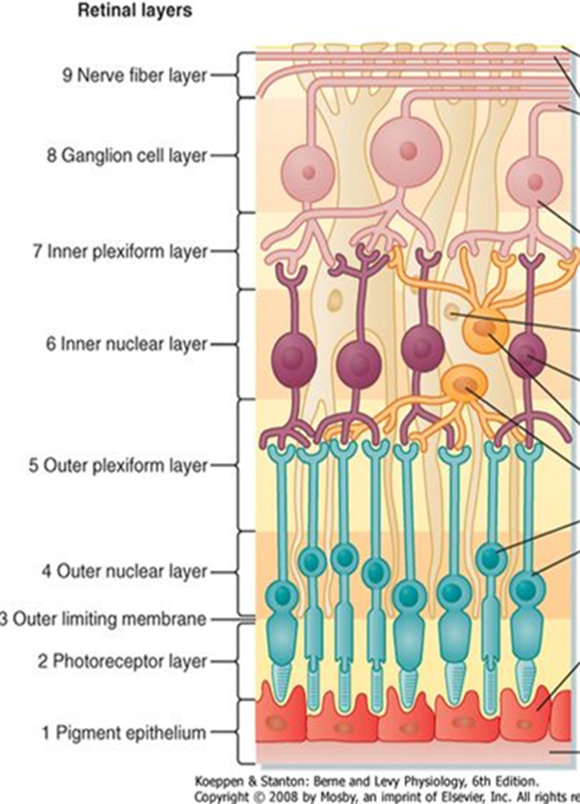

## Penuaan Normal pada Retina

Perubahan ini dapat terjadi seiring usia dan tidak otomatis berarti AMD.

- **Fotoreseptor berkurang:** jumlah dan sebarannya menurun, terutama pada sel batang. Dampaknya, retina bisa kurang peka menangkap cahaya dan detail.
- **Granula melanin berkurang:** melanin menyerap cahaya berlebih dan membantu melindungi jaringan retina. Jika berkurang, perlindungan tersebut mungkin ikut menurun.
- **Lipofuscin dan badan residu menumpuk:** lipofuscin adalah pigmen berisi sisa sel yang sulit dicerna; badan residu adalah sisa dari proses penguraian. Penumpukannya dapat membebani dan mengganggu kerja RPE.
- **Deposit laminar basal menebal:** bahan ini menumpuk di bawah sel RPE. Jika menebal, pertukaran zat dan dukungan RPE terhadap fotoreseptor dapat terganggu.
- **Deposit linear basal menumpuk:** bahan kaya **lipid** dan sisa sel **tertahan di membran Bruch**. Penumpukan dapat membentuk atau memperbesar **drusen**, yaitu **gundukan deposit di bawah RPE**. **Drusen besar atau lunak lebih berkaitan dengan AMD**.
- **Koriokapilaris mengalami involusi:** jejaring pembuluh darah halus di bawah retina menyusut atau fungsinya menurun. Akibatnya, pasokan oksigen dan nutrisi serta pembuangan sisa metabolisme dapat terganggu.

🧠 **Gambaran besarnya:** RPE adalah “petugas perawatan” fotoreseptor. Melanin membantu meredam cahaya, lipofuscin adalah sisa yang sulit dibuang, deposit dapat menumpuk di bawah RPE, dan koriokapilaris memasok kebutuhan retina dari bawah. Ketika beberapa fungsi ini melemah bersama, lingkungan fotoreseptor menjadi kurang terjaga.

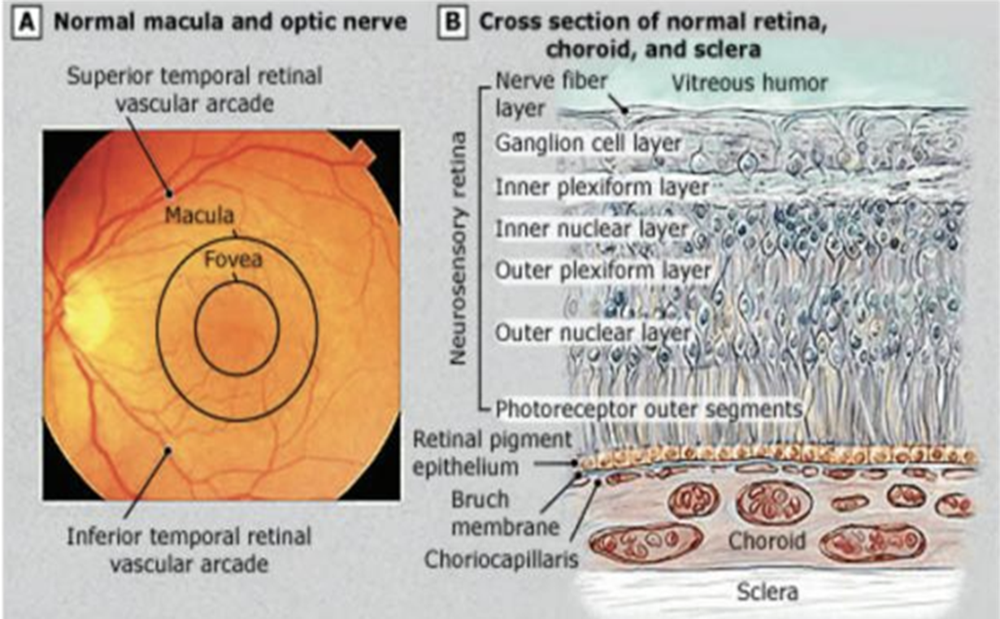

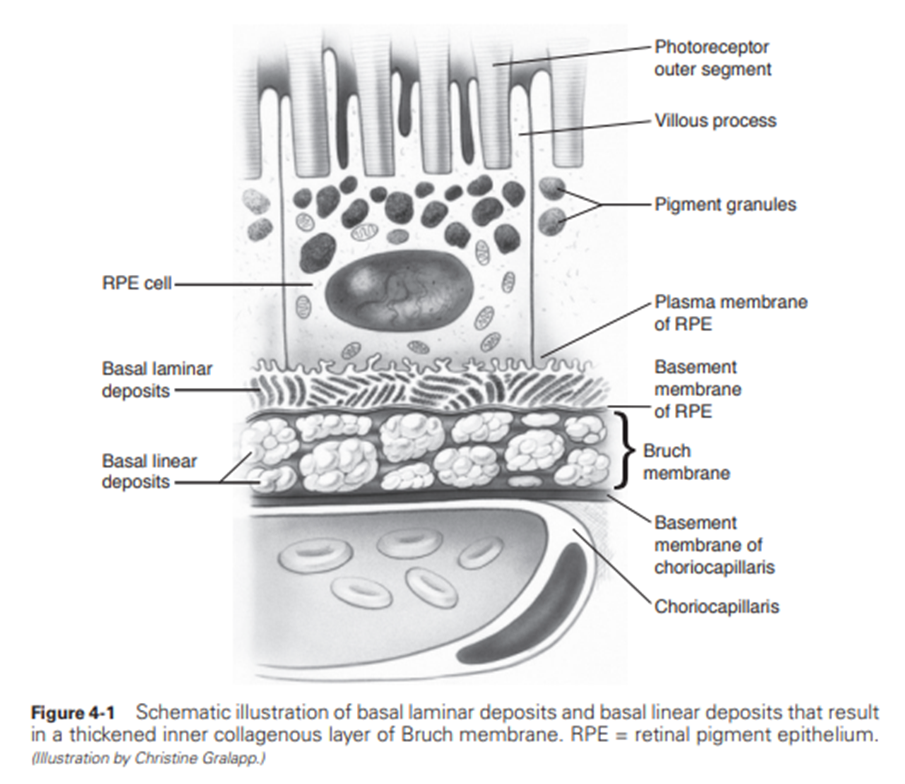

# 5. Drusen dan Dua Bentuk Lanjut AMD: Dry & Wet AMD

## Drusen

Drusen adalah deposit yang terbentuk di sekitar membran Bruch dan RPE.

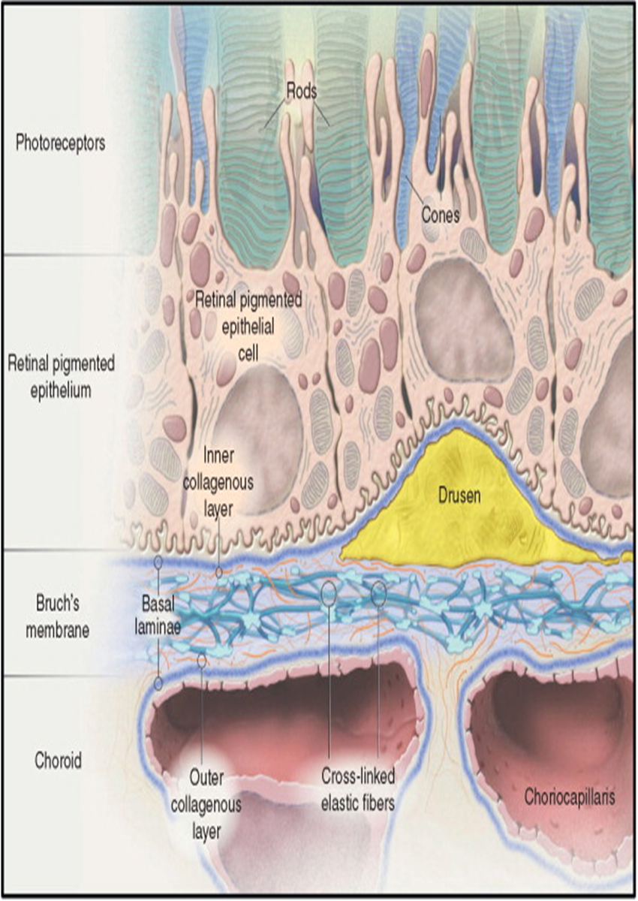

| Ciri | Drusen keras | Drusen lunak |
|---|---|---|
| Batas | Tajam dan jelas | Kurang tegas |
| Ukuran/bentuk | Kecil dan terlokalisasi | Lebih besar, sering menyatu |
| Gambaran tambahan | Deposit bahan hialin di dalam atau sekitar membran Bruch | Dapat disertai deposit linear basal dan elevasi fokal RPE |

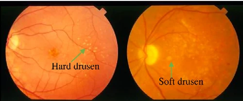

## AMD Kering (Nonneovaskular)

Drusen merupakan lesi utama pada AMD nonneovaskular/awal. Kelainan RPE lain, seperti hiperpigmentasi dan atrofi, juga dapat ditemukan. Bentuk lanjutnya dapat berupa **atrofi geografik (GA)**.

## AMD Basah (Neovaskular)

Perubahan membran Bruch (karena akumulasi drusen) dapat menciptakan lingkungan yang mendukung pembentukan pembuluh darah baru. Pembuluh abnormal dapat tumbuh dan disertai fibroblas, lalu bocor atau berdarah. Bentuk ini juga disebut AMD eksudatif atau AMD neovaskular.

| AMD kering | AMD basah |
|---|---|
| Drusen, perubahan pigmen, dan degenerasi RPE/fotoreseptor | Pembuluh darah baru abnormal yang bocor, cairan, eksudat, atau perdarahan |

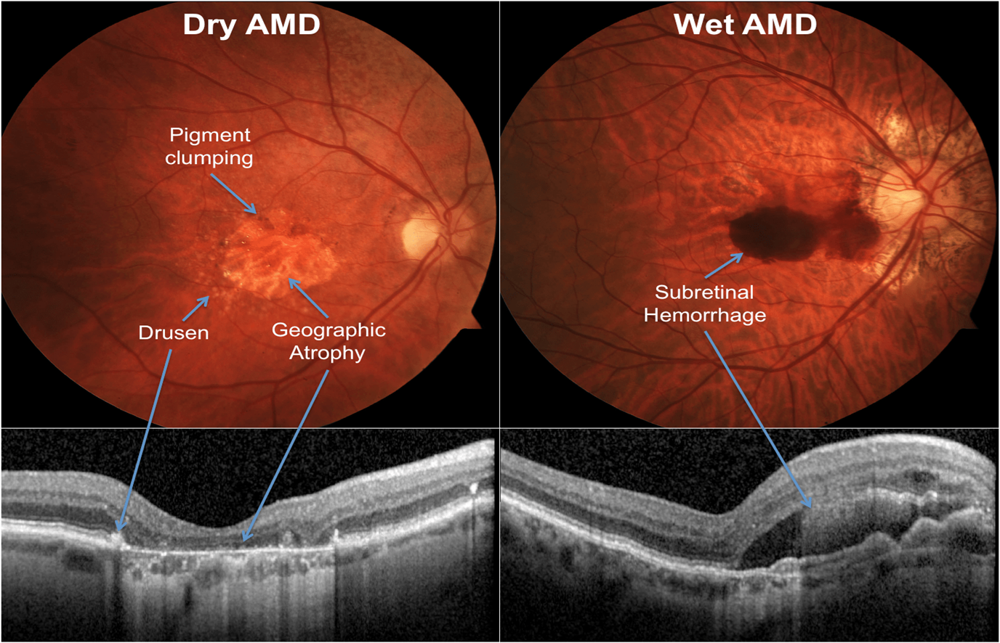

## Atrofi Geografik (*Geographic Atrophy / GA*)

Atrofi geografik adalah **kondisi dimana RPE tidak ada, yang dapat disebabkan oleh regresi dari drusen yang soft dan confluens**. Pada daerah atrofi geografik, pembuluh darah koroid lebih tampak dan lapisan luar retina tampak lebih tipis. 

Apabila daerah atrofi tidak luas dan menyatu, daerah atrofi tampak seperti bercak-bercak depigmentasi yang disebut sebagai **atrofi nongeografik**.

GA ditandai **area pigmentasi retina yang tidak merata atau hilang**, dengan diameter lebih dari 175 µm. Area atrofi sering tidak mengenai fovea sampai tahap lanjut. Kejadiannya meningkat seiring usia.

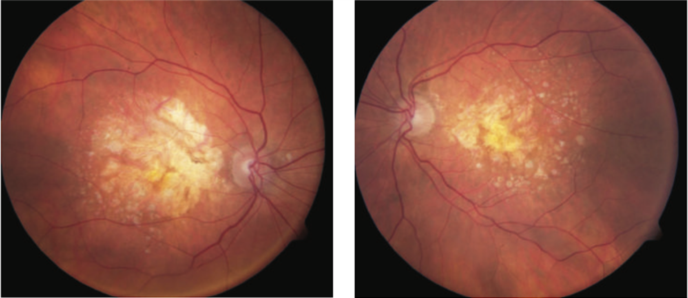

Pada pencitraan autofluoresensi:

- RPE yang mengalami atrofi tampak **hipoautofluoresen** (abu-abu gelap atau hitam);
- RPE yang sakit dapat tampak **hiperautofluoresen** (lebih terang daripada latar); dan
- RPE sehat tampak abu-abu.

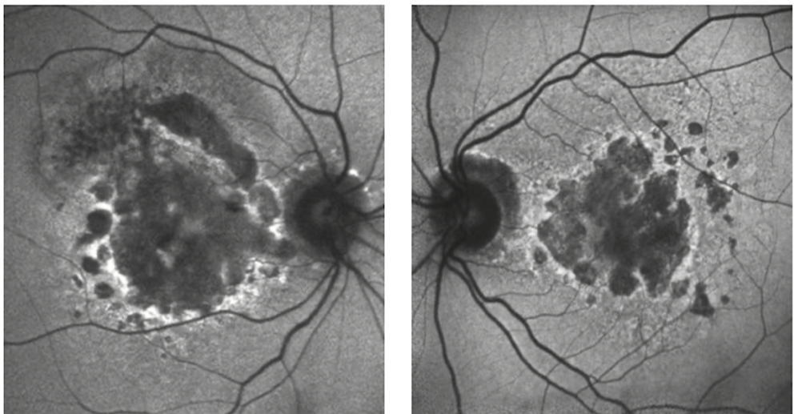

12–20% pasien GA mengalami kehilangan penglihatan berat, dan 10% pasien AMD dengan tajam penglihatan 20/200.

# 6. Klasifikasi AREDS

Klasifikasi **Age-Related Eye Disease Study (AREDS)** mengelompokkan AMD berdasarkan drusen, perubahan pigmen, atrofi geografik, dan tanda neovaskularisasi.

| Kategori | Klasifikasi            | Temuan utama                                                                                                                                                                         |
| -------- | ---------------------- | ------------------------------------------------------------------------------------------------------------------------------------------------------------------------------------ |
| **1**    | Tidak ada AMD          | **Tidak ada atau <5 drusen kecil** berdiameter <63 µm                                                                                                                                |
| **2**    | AMD dini               | **Banyak drusen kecil atau beberapa drusen sedang** (63–124 µm), dan/atau perubahan pigmen makula/RPE                                                                                |
| **3**    | AMD intermediat/sedang | **Drusen sedang yang luas, setidaknya satu drusen besar** (≥125 µm), atau GA yang belum mengenai pusat fovea                                                                         |
| **4**    | AMD lanjut             | **GA yang mengenai pusat fovea** atau bukti **neovaskularisasi koroid**, termasuk perdarahan subretina, ablasio serosa retina/RPE, eksudat lipid, atau jaringan parut fibro-vaskular |

📌 **Ingat urutannya:** kategori 1–4 bergerak dari tidak ada AMD menuju AMD lanjut; ukuran dan jumlah drusen bertambah, lalu muncul atrofi sentral atau neovaskularisasi.

# 7. AMD Neovaskular

Neovaskularisasi makula (**MNV**/*Macular Neovascularization*) merupakan ciri penentu AMD neovaskular. Perubahan degeneratif membran Bruch—misalnya penumpukan drusen dan penebalan progresif—serta kemungkinan perubahan koriokapilaris dapat mendorong pertumbuhan pembuluh abnormal. Pembuluh dapat berasal dari koriokapilaris atau retina neurosensorik.

## Gejala dan Tanda Klinis

Gejala yang mungkin muncul:

- penurunan penglihatan yang mendadak;
- **metamorfopsia**, yaitu garis lurus tampak bengkok; dan/atau
- skotoma parasentral.

**Grid Amsler** dapat digunakan pasien untuk memantau perubahan penglihatan sentral dan membantu mendeteksi perubahan eksudatif.

**Tanda klinis** dapat meliputi cairan subretina atau intraretina, edema makula kistoid, eksudat atau darah, cincin pigmen atau membran abu-abu kehijauan, elevasi RPE tidak teratur/ablasio epitel pigmen (PED), robekan RPE, serta pola kipas laut pada pembuluh subretina.

## Klasifikasi MNV secara Anatomi

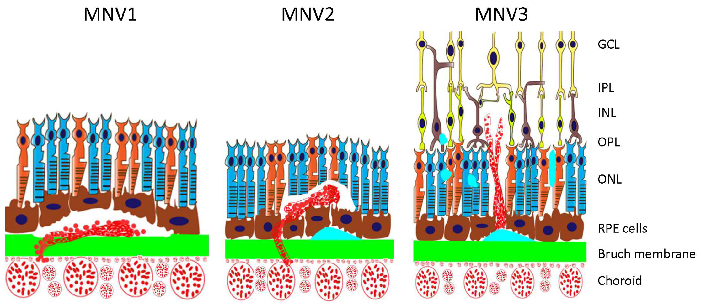

| Jenis                   | Lokasi/perjalanan pembuluh                                                                   |
| ----------------------- | -------------------------------------------------------------------------------------------- |
| Tipe 1 (**CNV Okult**)  | Pembuluh **dari koriokapiler menembus defek membran Bruch** dan **tumbuh di ruang sub-RPE**  |
| Tipe 2 (**CNV Klasik**) | CNV berada **di antara RPE dan retina** neurosensorik                                        |
| Tipe 3                  | Pembuluh berkembang dari pleksus **kapiler dalam retina** dan **tumbuh ke bawah menuju RPE** |

Note: **CNV** adalah istilah lama yang berarti neovaskularisasi koroid (*Choroidal Neovascularization*). Istilah yang lebih baru dan lebih luas, MNV, digunakan untuk neovaskularisasi makula.

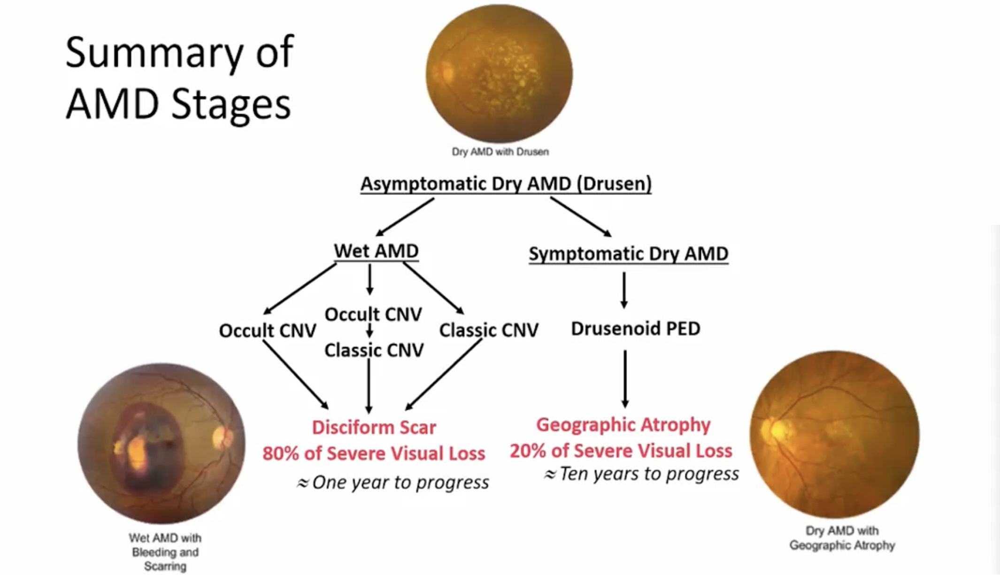

# 8. Pemeriksaan dan Diagnosis

- **Funduskopi/fotografi fundus:** menilai makula, drusen, perdarahan, dan perubahan pigmen.
- **Angiografi fluorescein (FA):** menilai pola aliran dan kebocoran fluorescein.
- **Optical coherence tomography (OCT):** menilai struktur retina dan keberadaan cairan atau perubahan lapisan.
- Pencitraan autofluoresensi dapat membantu memetakan area RPE yang sehat, sakit, atau atrofi.

## Gambaran drusen pada FA

- Drusen kecil dan keras dapat tampak hiperfluoresen lebih awal akibat *window defect*.
- Drusen lunak yang lebih besar dan menyatu dapat mengalami pewarnaan lambat dan homogen pada fase lanjut akibat penumpukan zat fluorescein.

Pengukuran luas dan volume drusen pada foto fundus/OCT dapat dibandingkan dengan median: tidak terukur, di bawah median, atau sama dengan/di atas median.

## Pola CNV pada angiografi fluorescein

- **CNV klasik:** lesi terang berbentuk jala, berbatas tegas, tampak pada fase awal, lalu kebocorannya meningkat pada fase lanjut.
- **CNV okult:** hiperfluoresensi lebih menyebar dan dapat berupa:
  1. PED fibro-vaskular atau PED serosa tervaskularisasi, dengan elevasi RPE tidak teratur dan kebocoran berbercak yang progresif; atau
  2. pewarnaan cepat yang homogen seperti kaca buram pada PED serosa, dengan takik/*hot spot* akibat komponen vaskular.
- **Kebocoran lanjut dari sumber yang belum diketahui:** fluoresensi pada tingkat RPE sulit dibatasi pada fase awal, tetapi lebih terlihat pada fase lanjut.

# 9. Diagnosis Banding

## Distrofi Pola RPE

Dapat terlihat sebagai hiperpigmentasi makula berbentuk kupu-kupu. Pada SD-OCT, lesi sentral dapat tampak hiperreflektif dan berbentuk kubah.

## Korioretinopati Serosa Sentral

Merupakan diagnosis banding yang perlu dipertimbangkan saat menilai perubahan makula, terutama bersama temuan klinis dan OCT, karena ditemukan cairan subretinal pada kedua kondisi tersebut; namun, mata dengan CSC biasanya tidak berhubungan dengan perdarahan subretinal kecuali CNV sekunder telah berkembang. 

Selain itu, lapisan koroid, yang mudah divisualisasikan menggunakan EDI-OCT, sering kali lebih tebal pada mata penderita CSC dibandingkan dengan lapisan koroid tipis pada penderita AMD.

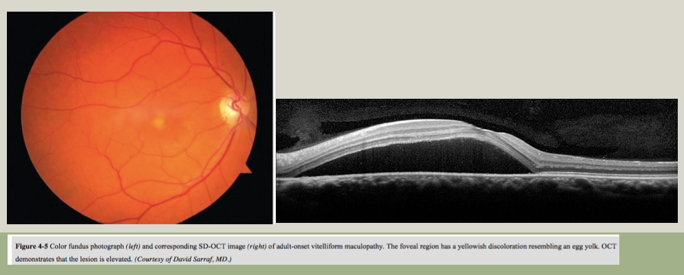

## Sindrom histoplasmosis okular

Gambaran meliputi jaringan parut korioretina kecil, atrofi, berbentuk “punched-out” di midperifer atau kutub posterior, serta jalur atrofi perifer linear, dengan atau tanpa CNV di makula.

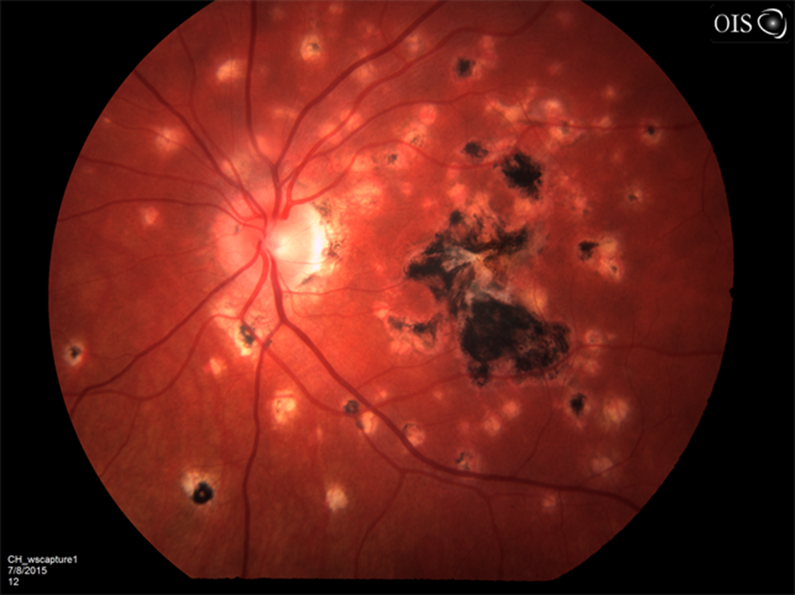

# 10. Tata Laksana

## AMD Nonneovaskular

**Perubahan gaya hidup** yang meliputi berhenti merokok, mengurangi obesitas, dan mengendalikan tekanan darah. Edukasi dan tindak lanjut mencakup:

- mengenali gejala AMD lanjut dan segera menghubungi dokter mata bila gejala tersebut muncul; serta
- pemantauan mandiri dengan **grid Amsler** untuk melihat perubahan baru pada penglihatan sentral.

Contoh Amsler Grid:
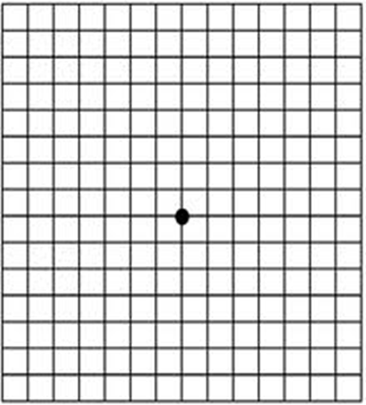

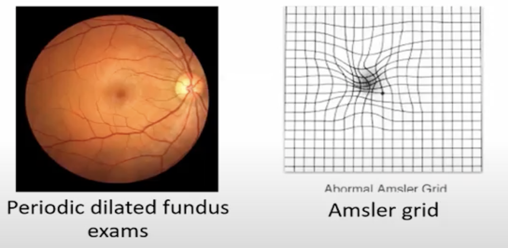

### Suplemen Mikronutrien menurut Rekomendasi AREDS2

| Nutrien    | Dosis Harian |
| ---------- | -----------: |
| Vitamin C  |       500 mg |
| Vitamin E  |       400 IU |
| Lutein     |        10 mg |
| Zeaksantin |         2 mg |
| Zinc       |        80 mg |

## AMD Neovaskular
### Fotokoagulasi laser termal: 

Kini digunakan pada keadaan yang sangat jarang karena hasilnya kurang baik dan angka kekambuhan tinggi. Laser makula dapat membantu mengurangi drusen, tetapi tidak terbukti mengubah perjalanan alami kehilangan penglihatan atau perkembangan CNV.

### Terapi fotodinamik (PDT/“laser dingin”):

- Diperkenalkan pada tahun 2000 sebagai fototerapi yang tidak terlalu merusak untuk mengobati MNV. 
- Melibatkan pemberian terapi fotosensitisasi verteporfin secara intravena diikuti dengan penerapan cahaya dengan panjang gelombang tertentu. Cahaya memicu reaksi fotokimia lokal di area target, mengakibatkan trombosis MNV. 
- Meskipun PDT memperlambat perkembangan, namun tidak mencegah kehilangan penglihatan yang besar pada sebagian besar mata dengan MNV dan telah terbukti meningkatkan regulasi VEGF di area pengobatan. Penggunaan PDT untuk menangani AMD eksudatif sekarang jarang kecuali pada mata dengan PCV (Polypoidal Choroidal Vasculopathy).

### Terapi antiangiogenik/anti-VEGF:

Hingga saat ini, empat obat anti-VEGF yang diberikan melalui injeksi intravitreal telah disetujui oleh FDA AS untuk pengobatan AMD eksudatif:

- Pegaptanib
- Ranibizumab
- Aflibercept
- Bevacizumab
- Brolucizumab

Strategi jadwal injeksi bisa dipililh antara:
- Dosis tetap.
- Sesuai kebutuhan (*pro re nata*, PRN).
- *Treat-and-extend* (beri terapi lalu perpanjang interval secara bertahap sesuai respons).

### Pilihan lain:

- Tindakan bedah untuk perdarahan submakula.
- Rehabilitasi penglihatan rendah.

# 11. Rangkuman Akhir

- AMD adalah degenerasi retina terkait usia yang terutama mengganggu penglihatan sentral.
- Drusen dan perubahan RPE menjadi petunjuk penting AMD. Bentuk kering dapat berkembang menjadi atrofi geografik; bentuk basah melibatkan pembuluh abnormal yang bocor atau berdarah.
- AMD lanjut diklasifikasikan menurut atrofi yang mengenai pusat fovea atau bukti neovaskularisasi.
- Penurunan penglihatan mendadak, garis tampak bengkok, atau titik kosong sentral perlu dinilai segera oleh dokter mata.
- Funduskopi, FA, OCT, dan autofluoresensi membantu menilai struktur serta aktivitas penyakit.
- Berhenti merokok, pengendalian faktor kesehatan, edukasi gejala, dan pemantauan dapat menjadi bagian pengelolaan. Terapi AMD basah umumnya berpusat pada injeksi anti-VEGF.

🧠 **Kiat hafalan besar:** **“Penumpukan drusen → dua jalur”**: jalur **kering** menuju atrofi RPE/GA; jalur **basah** menuju pembuluh baru, kebocoran, dan perdarahan. Untuk diagnosis, ingat **Fundus–FA–OCT**: lihat permukaan, aliran/kebocoran, lalu potongan lapisan retina.
