# Definisi dan Dampak

**Katarak** adalah kekeruhan lensa mata. **Katarak senilis** adalah katarak yang berkaitan dengan proses penuaan. Katarak umumnya berkembang perlahan dan dapat mengganggu penglihatan secara bermakna.

Katarak membuat penglihatan tampak berkabut atau buram. Kondisi ini terjadi ketika lensa menjadi keruh, antara lain karena **perubahan kadar cairan lensa (hidrasi) atau perubahan struktur protein lensa (denaturasi)**. Cahaya yang seharusnya difokuskan dengan jelas menjadi tersebar atau terhalang oleh lensa keruh.

Katarak merupakan penyebab gangguan penglihatan yang *reversible*. Pada kondisi tertentu, kebutaan akibat katarak dapat dicegah atau dipulihkan setelah penanganan. Namun, hasil penglihatan dapat tetap buruk bila sudah ada komplikasi, misalnya glaukoma atau penyakit sistemik yang memengaruhi mata.

Katarak senilis berkaitan dengan pertambahan usia. Seiring meningkatnya harapan hidup, jumlah orang yang berisiko juga bertambah. Dampaknya dapat mencakup:

- **Kesehatan:** kebutuhan skrining, pemeriksaan, operasi, dan tindak lanjut.
- **Ekonomi:** biaya pelayanan kesehatan serta berkurangnya penghasilan atau produktivitas.
- **Sosial:** penurunan kualitas hidup dan kemandirian, serta bertambahnya beban keluarga.

# Epidemiologi

Katarak merupakan penyebab **33%** kebutaan di dunia, menjadikannya penyumbang terbesar kedua setelah kelainan refraksi (**42%**). Penyebab lainnya meliputi penyebab yang tidak diketahui (18%), glaukoma (2%), degenerasi makula terkait usia/ARMD (1%), retinopati diabetik (1%), kebutaan pada anak (1%), trakoma (1%), dan kekeruhan kornea (1%).

Di Indonesia, prevalensi katarak rata rata sebesar 2.6% (data RAAB 2015) dengan 1.5% di antaranya masuk dalam kategori buta. Jumlah penduduk 250 juta dan jumlah penderita katarak = 2.6% x 250 juta, sehingga terdapat **6.500.000 orang penderita katarak di Indonesia**.

# Anatomi Mata 👁️

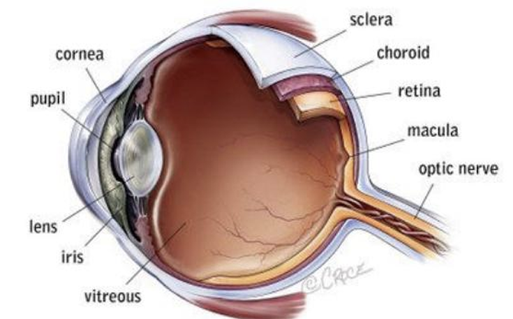

- **Sklera:** lapisan putih pelindung bola mata.
- **Kornea:** lapisan bening di bagian depan mata.
- **Iris dan pupil:** iris mengatur besar-kecil pupil; pupil menjadi jalur masuk cahaya.
- **Lensa:** memfokuskan cahaya ke retina.
- **Koroid:** lapisan pembuluh darah di antara sklera dan retina.
- **Retina:** jaringan peka cahaya di bagian belakang mata.
- **Makula:** bagian retina untuk penglihatan pusat yang rinci.
- **Saraf optik:** membawa sinyal penglihatan dari retina ke otak.
- **Badan kaca (vitreous):** gel yang mengisi bagian dalam bola mata.

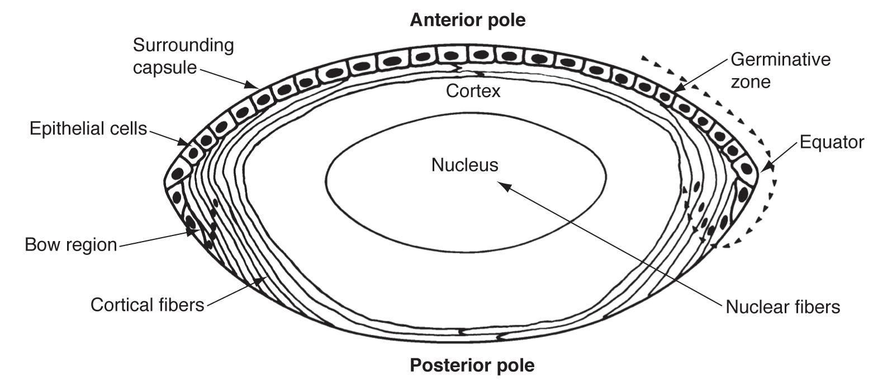

Lensa tersusun atas **kapsul**, **epitel**, dan **serabut lensa**. Lensa jernih memusatkan cahaya dengan tajam ke retina; lensa keruh menyebarkan atau menghalangi cahaya.

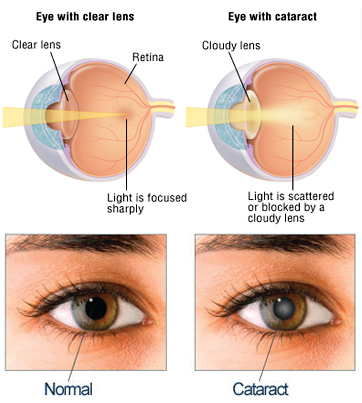

# Etiologi

Katarak dapat berhubungan dengan:

- Usia lanjut dan proses penuaan.
- Kelainan kongenital atau faktor keturunan.
- Katarak juvenil (muncul pada usia muda).
- Trauma mata.
- Penyakit metabolik, misalnya diabetes.
- Efek obat tertentu, misalnya [kortikosteroid dan benzodiazepin]{**Kortikosteroid** memicu kekeruhan lensa mata dengan **mengaktifkan reseptor glukokortikoid pada sel epitel lensa**, yang mengganggu proliferasi, diferensiasi, serta keseimbangan metabolisme sel lensa mata. Kondisi ini mendorong reaksi kimia antara steroid dan asam amino lensa sehingga memicu agregasi protein abnormal dan membuat lensa kehilangan kejernihannya, terutama pada bagian subkapsular posterior. Sebaliknya, **benzodiazepin** **tidak terbukti secara langsung menyebabkan katarak senilis** karena cara kerjanya berfokus pada peningkatan aktivitas GABA di sistem saraf pusat, bukan merusak struktur protein lensa. Katarak senilis sendiri dipicu oleh proses degenerasi alami akibat penuaan serta faktor risiko seperti paparan sinar UV atau diabetes, sedangkan efek samping benzodiazepin pada mata umumnya hanya sebatas pandangan kabur sementara, mata kering, atau risiko glaukoma sudut tertutup akut pada individu yang rentan.}.
- Paparan sinar matahari.
- Penyakit mata lain, seperti peradangan atau infeksi, yang dapat menimbulkan **katarak komplikata**.

# Gejala dan Tanda Klinis

## Keluhan yang Dirasakan (Subjektif)

Gejala biasanya berkembang perlahan:

| Gejala                                                                                         | Mekanisme singkat                                                                                                                                 |
| ---------------------------------------------------------------------------------------------- | ------------------------------------------------------------------------------------------------------------------------------------------------- |
| Ketajaman penglihatan menurun                                                                  | Lensa yang keruh menghamburkan atau menghalangi cahaya, sehingga bayangan yang terbentuk di retina menjadi kurang jelas.                          |
| Penglihatan berkabut atau berasap                                                              | Kekeruhan lensa menyebarkan cahaya dan mengurangi kejernihan bayangan.                                                                            |
| Silau                                                                                          | Cahaya tersebar tidak merata saat melewati lensa keruh, sehingga timbul hamburan cahaya yang mengganggu penglihatan.                              |
| Lingkaran pelangi atau halo di sekitar lampu                                                   | Cahaya dari lampu dibiaskan dan dihamburkan secara tidak merata oleh lensa keruh, sehingga tampak lingkaran di sekeliling sumber cahaya.          |
| Penglihatan ganda pada satu mata (_diplopia monokular_)                                        | Kekeruhan lensa memecah atau membiaskan cahaya secara tidak merata. Satu objek dapat membentuk lebih dari satu bayangan pada mata yang sama.      |
| Penglihatan lebih buruk saat melihat cahaya terang pada katarak subkapsular posterior          | Kekeruhan berada dekat pusat jalur cahaya yang masuk melalui pupil. Cahaya terang memperkuat hamburan dan mengganggu pembentukan bayangan.        |
| Lebih nyaman melihat pada malam hari pada tahap awal atau imatur katarak subkapsular posterior | Dalam cahaya redup, pupil melebar sehingga cahaya dapat masuk melalui bagian lensa yang relatif lebih jernih di sekitarnya.                       |
| Penglihatan dekat terasa lebih jelas pada katarak nuklear imatur (_second sight_)              | Perubahan indeks refraksi lensa menggeser fokus ke arah miopia (*myopic shift*), sehingga fokus untuk melihat dekat sementara menjadi lebih baik. |

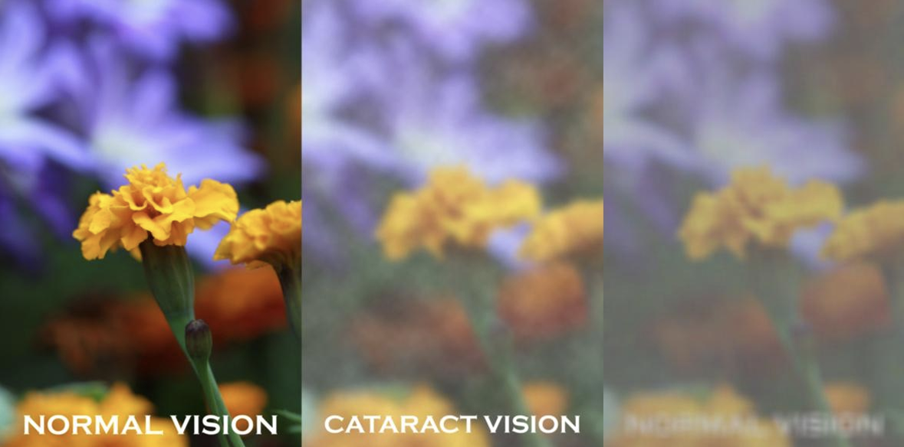

## Temuan Pemeriksaan (Objektif)

- Tajam penglihatan menurun dan tidak terkoreksi maksimal dengan kacamata. Rentang penurunan visus sekitar <6/9 hingga 1/~.

	**Note**: Rentang visus <6/9 hingga 1/~ menggambarkan tingkat keparahan buramnya mata dari kategori ringan hingga sangat berat yang mendekati kebutaan. Pada batas ringan dengan visus <6/9 berarti **seseorang baru dapat melihat objek atau huruf pada jarak 6 meter padahal mata normal sudah mampu membacanya dari jarak 9 meter**. Sementara itu, pada batas terberat (1/~ atau _light perception_), **penurunan penglihatan sudah sangat parah** hingga mata tidak lagi mampu mengenali bentuk benda, hitungan jari, maupun lambaian tangan, dan hanya bisa membedakan ada atau tidaknya cahaya seperti sorotan senter.

- Tampak kekeruhan pada lensa.
- **Pada katarak imatur** dapat ditemukan *Iris shadow*, yaitu bayangan iris yang terlihat pada lensa saat pemeriksaan dengan pencahayaan tertentu.
- **Pada katarak matur**, pupil akan menjadi benar-benar **putih**.

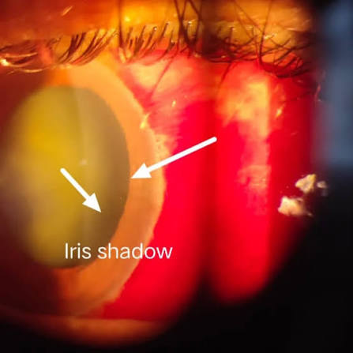

Gambar katarak matur/matang:

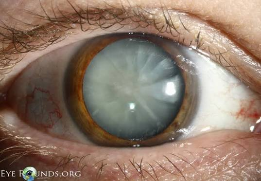

> **Tips mengingat:** keluhan khas mudah dirangkum sebagai **kabur, silau, halo, dan ganda**. Tanda yang dicari adalah **lensa keruh**, lalu nilai tajam penglihatan dan kemungkinan penyakit penyerta.

# Staging Katarak

Tahap klinis katarak dibagi menjadi:

1. **Insipien:** tahap awal.
2. **Imatur:** lensa mulai keruh, tetapi belum seluruhnya.
3. **Matur:** kekeruhan lensa sudah menyeluruh.
4. **Hipermatur:** katarak lanjut dengan perubahan lebih jauh pada lensa.

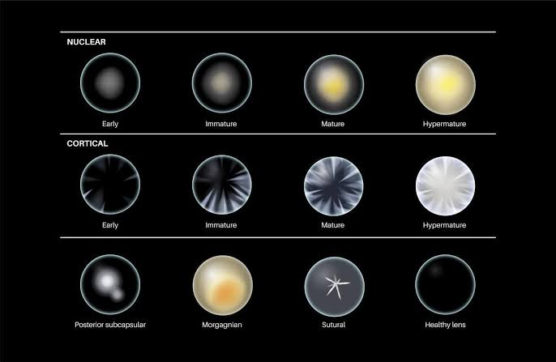

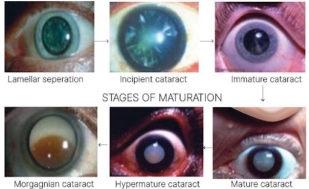

# Jenis Katarak Berdasarkan Morfologi

Katarak dapat dibedakan menurut lokasi atau pola kekeruhannya:

1. **Nuklear:** mengenai inti lensa.
2. **Kortikal:** mengenai korteks lensa.
3. **Subkapsular posterior (PSC):** berada di bagian belakang lensa, dekat kapsul posterior.
4. **Kombinasi:** melibatkan lebih dari satu pola.

## Katarak Nuklear (Bentuk Paling Umum)

- Berkembang lambat, biasanya bilateral, dan dapat memiliki derajat berbeda pada kedua mata.
- Visus jauh umumnya lebih terganggu daripada visus dekat.
- Pada tahap awal dapat terjadi pergeseran refraksi (*myopic shift*) ke arah miopia (*lenticular myopia*).
- Pergeseran miopia sementara dapat membuat pasien mampu membaca dekat tanpa kacamata; ini dikenal sebagai *second sight*.
- Perubahan indeks refraksi pada korteks dan pengerasan inti lensa dapat menyebabkan diplopia monokular.
- Pada tahap lanjut, fungsi retina terhadap cahaya terang (*photopic retinal function*) dapat menurun.

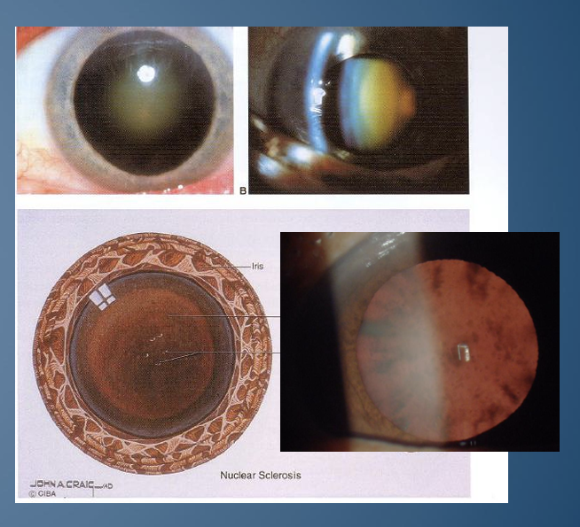

## Katarak Kortikal

- Biasanya bilateral, tetapi sering tidak simetris.
- Gangguan visus bergantung pada lokasi kekeruhan.
- Silau (*glare*) merupakan keluhan yang sering muncul.
- Pemeriksaan biomikroskopik dengan lampu celah (*slit lamp*) dapat memperlihatkan vakuola dan *water cleft* (celah berisi cairan).
- Kekeruhan dapat berbentuk baji atau jari-jari (*wedge-shaped opacities / cortical spokes*), juga disebut **kekeruhan kuneiform**.
- Bila lensa membengkak (**katarak intumesen**), celah cairan dan vakuola dapat tampak; keadaan ini dapat memerlukan penanganan segera sesuai penilaian dokter mata.

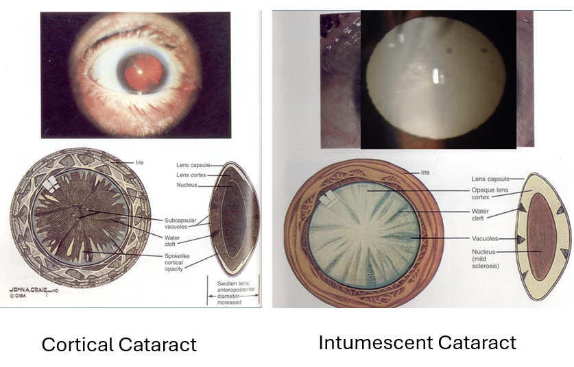

## Katarak Subkapsular Posterior

- Dapat ditemukan pada usia yang lebih muda dibanding jenis lain.
- Terletak di bagian aksial lapisan korteks posterior.
- Silau pada pencahayaan terang dan penglihatan buruk dapat terjadi karena kekeruhan berada dekat jalur masuk cahaya melalui pupil.
- Dapat menyebabkan diplopia monokular.
- Faktor yang berkaitan antara lain trauma tumpul, penggunaan steroid sistemik atau topikal, peradangan, dan radiasi.
- Perubahan jaringan dapat melibatkan migrasi sel epitel lensa.

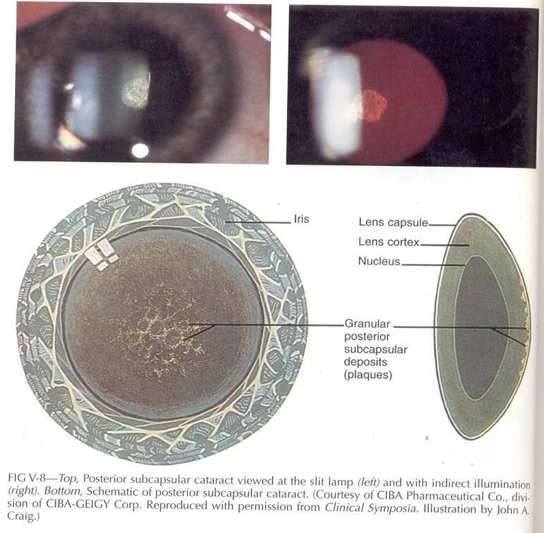

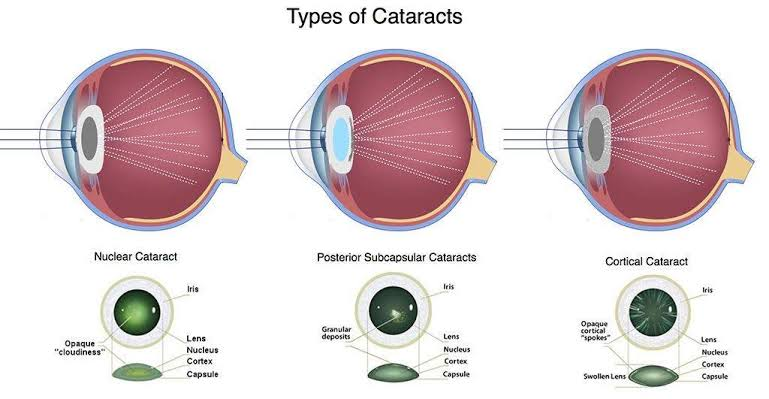

# Pemeriksaan dan Penegakan Diagnosis

Penilaian dapat meliputi:

- **Pemeriksaan visus:** untuk mengetahui derajat gangguan penglihatan.
- **Pemeriksaan segmen anterior:** menilai lensa serta faktor predisposisi dan komorbiditas.
  - Faktor predisposisi yang perlu ditanyakan antara lain penggunaan steroid jangka panjang, miopia tinggi, dan riwayat penyakit mata.
  - Komorbiditas yang perlu dinilai antara lain bilik mata sempit dan pupil kecil.
- **Tekanan intraokular (TIO):** mengukur tekanan di dalam mata.
- **Segmen posterior:** dinilai dengan pemeriksaan fundus. Bila fundus tidak dapat terlihat karena kekeruhan, dokter mata dapat mempertimbangkan USG B-scan.
- **Kondisi sistemik:** dinilai untuk mengenali penyakit yang dapat memengaruhi penanganan.

Kriteria untuk **menegakkan diagnosis katarak senilis** meliputi:
- Usia >50 tahun.
- Penurunan penglihatan perlahan.
- Kekeruhan lensa.

Penyakit lain pada mata maupun di luar mata juga perlu diperiksa sebagai kondisi penyerta atau diagnosis banding.

# Penatalaksanaan

## Operasi

**Pembedahan merupakan terapi paling efektif** untuk mengatasi katarak. Tekniknya meliputi:

- **ECCE** (*extracapsular cataract extraction/surgery*): ekstraksi katarak ekstrakapsular.
- **SICS/MSICS** (*small incision cataract surgery* / *manual small incision cataract surgery*): operasi katarak manual melalui sayatan kecil.
- **Fakoemulsifikasi:** lensa dihancurkan menggunakan energi ultrasonik lalu dikeluarkan.
- Teknik berbantuan laser atau pencitraan (*image-assisted/image-guided*).
- Setelah lensa keruh dikeluarkan, lensa buatan atau **IOL** (*intraocular lens*) dapat dipasang.

Keputusan operasi mempertimbangkan kondisi klinis dan seberapa berat gangguan penglihatan. **Operasi kedua mata biasanya tidak dilakukan sekaligus karena komplikasi dapat mengancam penglihatan kedua mata**.

Pilihan teknik perlu disesuaikan dengan keadaan klinis dan dibicarakan bersama pasien. >90% pasien tanpa penyakit penyerta dapat mencapai tajam penglihatan ≥6/12 setelah operasi.

## Terapi Nonbedah

Pilihan berikut dapat membantu pada keadaan tertentu, tetapi tidak menghilangkan kekeruhan lensa:

- **Kacamata:** bantuan sementara; lebih bermanfaat pada katarak nuklear.
- **Midriatikum:** obat pelebar pupil untuk memperluas jalur masuk cahaya pada kondisi tertentu.
- **Rehabilitasi penglihatan rendah (*low vision*).**
- Terapi *stem cell* masih dalam tahap penelitian dan pengembangan, sehingga belum menjadi pengobatan standar yang terbukti aman dan efektif secara luas untuk menyembuhkan katarak.

## Rehabilitasi Pasien Katarak

- **Koreksi refraksi** setelah operasi bila diperlukan.
- **IOL** dipasang untuk memungkinkan rehabilitasi maksimal. Biometri yang tepat penting untuk memperkirakan kekuatan lensa.
- IOL konvensional umumnya tetap memerlukan kacamata untuk presbiopia. IOL multifokal dapat mengurangi ketergantungan pada kacamata, tetapi hasil bergantung pada kondisi pasien.

# Follow Up Pascaoperasi

### Hari ke-1, ke-3, dan ke-7

Periksa kemungkinan komplikasi:

- Edema kornea.
- Peningkatan TIO.
- Posisi atau dislokasi IOL.
- Tanda infeksi dan peradangan.
- Tajam penglihatan, bila sudah dapat diperiksa.
- TIO wajib diperiksa.

### Dua minggu hingga satu bulan

- Nilai visus.
- Periksa tanda infeksi.
- Tentukan kebutuhan koreksi kacamata.
- Pertimbangkan waktu operasi mata kedua bila diperlukan.

### Lebih dari satu bulan

- Pemeriksaan refraksi berkala **setiap tiga bulan**.
- Penyesuaian kacamata.
- Pemantauan komplikasi lambat pascaoperasi.
- Dukungan keluarga dan lingkungan membantu proses rehabilitasi.

# Prognosis

- Jika tidak ada komplikasi atau penyakit penyerta yang membatasi penglihatan, prognosis operasi katarak umumnya sangat baik. 
- Operasi katarak memiliki tingkat kepuasan konsumen diatas 96% dan rehabilitasi penglihatan yang baik.

# Rangkuman Akhir ✨

- Katarak adalah kekeruhan lensa yang membuat penglihatan kabur; jenis senilis berkaitan dengan penuaan.
- Keluhan yang sering muncul: penglihatan perlahan memburuk, berkabut, silau, halo, dan kadang penglihatan ganda.
- Jenis morfologi utama: nuklear, kortikal, subkapsular posterior, dan kombinasi.
- Tahap klinis berurutan: **insipien → imatur → matur → hipermatur**.
- Diagnosis didukung oleh pemeriksaan visus, lensa dan segmen anterior, TIO, segmen posterior, serta kondisi sistemik.
- Operasi adalah terapi paling efektif. Teknik dan waktu tindakan ditentukan berdasarkan kondisi pasien serta gangguan penglihatannya.
- Tindak lanjut diperlukan untuk mendeteksi infeksi, peradangan, perubahan TIO, masalah IOL, dan kebutuhan kacamata.
- **Jembatan ingatan:** *Kabur-Silau-Halo-Ganda* untuk keluhan; *I-I-M-H* untuk tahap katarak. 👓
