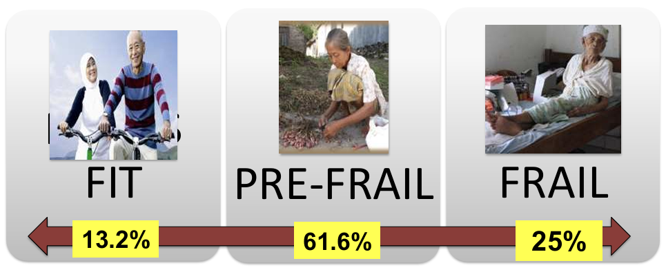
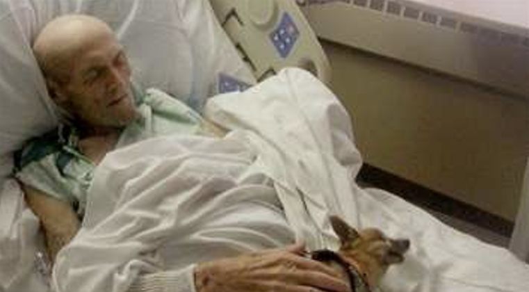
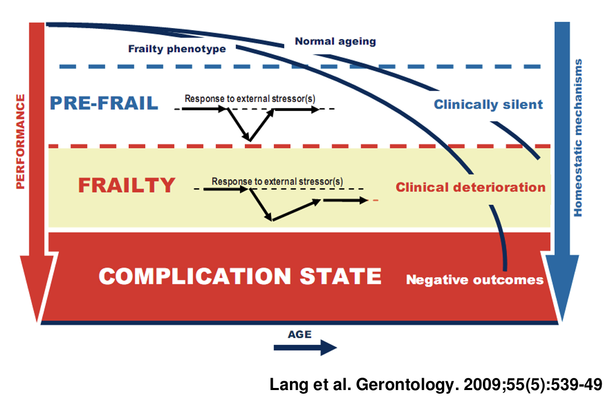
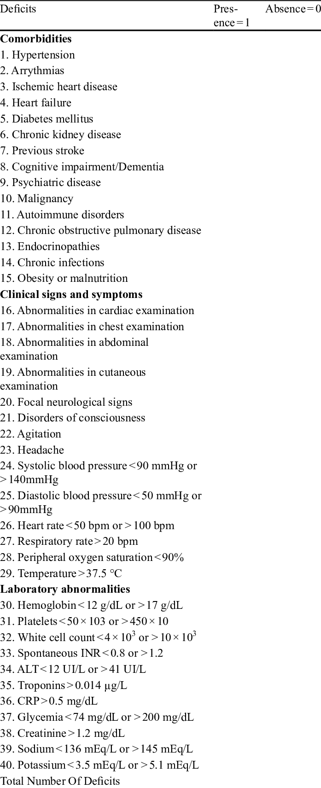

# Pendahuluan

Indonesia berada pada posisi nomor 8 di dunia dan nomor 4 di kawasan Asia untuk populasi lansia. Salah satu permasalahan pada populasi yang menua adalah **kerapuhan** (*frailty*), yang termasuk dalam *geriatric giant*.

## Spektrum frailty di Indonesia

| Status | Proporsi |
|---|---:|
| Robust/fit | 13,2% |
| Pre-frail | 61,6% |
| Frail | 25% |



Data berasal dari studi Indonesia Frailty, Aging, and Quality of Life (INA-FRAGILE), 2013.

# Definisi Frailty

Menurut konsensus *Association of Gerontology and Geriatrics*, frailty adalah **kondisi berkurangnya kekuatan dan menurunnya fungsi fisiologis** yang meningkatkan risiko ketergantungan, kerentanan, dan kematian.



# Tahapan Frailty

Seiring bertambahnya usia, performa tubuh menurun. Penuaan normal dan fenotipe frailty dapat menyebabkan penurunan performa, tetapi frailty membuat tubuh lebih rentan terhadap stresor dari luar.

- **Pre-frail:** respons terhadap stresor masih dapat kembali pulih. Perubahan klinis dapat belum tampak jelas (_clinically silent_).
- **Frailty:** respons terhadap stresor dapat diikuti penurunan kondisi klinis (_clinical deterioration_).
- **Keadaan komplikasi:** penurunan performa dapat berlanjut menjadi komplikasi dan luaran negatif.

Mekanisme homeostasis bekerja sepanjang proses tersebut, tetapi kemampuan mempertahankan keseimbangan menurun seiring usia. 

🧠 **Ingat alurnya:** pre-frail → frailty → komplikasi dan luaran negatif.



# Patomekanisme Frailty

Penuaan berkaitan dengan **inflamasi** dan **stres oksidatif**. Keduanya berhubungan dua arah dan dapat memengaruhi beberapa sistem tubuh:

- **Sistem kardiovaskular** — penyakit kardiovaskular (CVD)
- **Sistem pernapasan** — penyakit paru
- **Sistem endokrin** — penyakit metabolik
- **Otot rangka** — sarkopenia

Gangguan pada berbagai sistem tersebut dapat menyebabkan **disfungsi multisistem** yang berhubungan dengan frailty.

```
Penuaan ↔ inflamasi ↔ stres oksidatif
                  ↓
Gangguan sistem kardiovaskular, pernapasan,
endokrin, dan otot rangka
                  ↓
         Disfungsi multisistem
                  ↕
               Frailty
```

# Vicious Cycle Frailty

**Vicious cycle frailty** artinya _lingkaran setan kerapuhan_: satu perubahan memicu perubahan lain, lalu perubahan berikutnya memperburuk kondisi awal sehingga frailty makin berat.

Contohnya, nafsu makan menurun membuat asupan energi dan protein berkurang. Berat badan dan massa otot lalu turun (_sarkopenia_). Otot yang melemah membuat seseorang lebih lambat berjalan dan kurang aktif. Karena aktivitas berkurang, tubuh makin kehilangan kekuatan dan mengeluarkan lebih sedikit energi. Akhirnya, kelemahan dan kesulitan bergerak bertambah, sehingga seseorang makin rentan mengalami disabilitas dan ketergantungan.

```
Nafsu makan dan asupan menurun
               ↓
Berat badan dan massa otot turun
               ↓
Kekuatan dan kecepatan berjalan turun
               ↓
Aktivitas fisik berkurang
               ↓
Otot makin melemah dan frailty memburuk
               ↺
```

Disebut “siklus” karena proses ini bisa berulang dan saling memperkuat. Karena itu, memutus lingkarannya dengan dukungan nutrisi dan latihan yang sesuai dapat membantu mempertahankan kekuatan serta fungsi.

# Model Presentasi Frailty (Kriteria Diagnosis Frailty)

Frailty dinilai dengan dua model utama:

| Model | Instrumen |
|---|---|
| Fenotipe frailty | Cardiovascular Health Study (CHS), Study of Osteoporotic and Fracture (SOF), FRAIL |
| Akumulasi defisit | Frailty Index 40 item (FI-40 item), Clinical Frailty Scale (CFS) |

## Model Fenotipe/fisik 

Model fenotipe/fisik menilai frailty berdasarkan ciri-ciri fisik. Instrumen yang digunakan antara lain **Cardiovascular Health Study (CHS)**, **Study of Osteoporotic and Fracture (SOF)**, dan **FRAIL**.

### Cardiovascular Health Study (CHS)

| Fenotipe                       | Deskripsi                                                                                                                |
| ------------------------------ | ------------------------------------------------------------------------------------------------------------------------ |
| Penurunan berat badan          | Laporan individu mengenai penurunan berat badan **>4,5 kg** atau **≥5%** per tahun.                                      |
| Kelelahan                      | Laporan individu mengenai kelelahan minimal 3-4 hari per minggu atau dirasakan setiap waktu.                             |
| Aktivitas fisik rendah         | Konsumsi energi **<383 kkal** per minggu pada laki-laki atau **<270 kkal** per minggu pada perempuan.                    |
| Kecepatan berjalan rendah      | Diukur dengan uji berjalan 15 kaki (4,75 meter). Kriteria waktu: laki-laki **6,92 detik** dan perempuan **<5,36 detik**. |
| Kekuatan genggam tangan rendah | Diukur dengan dinamometer tangan. Kriteria untuk populasi Asia: laki-laki **22,4 kg** dan perempuan **<14,3 kg**.        |

#Ingat **Interpretasi:**

- Terdapat ≥3 kriteria: frail.
- Terdapat 1-2 kriteria: pre-frail.

🧠 **Tips hafalan:** urutkan lima fenotipe CHS sebagai **berat badan, lelah, aktivitas, berjalan, genggam**.

### Study of Osteoporotic and Fracture (SOF)

| Fenotipe                     | Deskripsi                                                                                                                                                    |
| ---------------------------- | ------------------------------------------------------------------------------------------------------------------------------------------------------------ |
| Penurunan berat badan        | Penurunan berat badan **≥5%** dalam dua tahun.                                                                                                               |
| Kemampuan bangkit dari kursi | Tidak mampu bangkit dari kursi sebanyak **lima kali** tanpa menggunakan bantuan tangan.                                                                      |
| Kelelahan                    | **Penurunan semangat**, ditandai dengan jawaban “tidak” pada pertanyaan “Apakah Anda merasa bersemangat setiap saat?” pada Geriatric Depression Scale (GDS). |

#Ingat **Interpretasi:**

- 2-3 kriteria: frail.
- 1 kriteria: pre-frail.
- 0 kriteria: fit/robust.

🧠 **Tips hafalan SOF:** **berat badan turun, sulit bangkit, semangat menurun**.

### Skor FRAIL

FRAIL adalah kuesioner lima kriteria untuk menilai kondisi frailty. Setiap jawaban positif mendapat skor **1**.

|Kriteria|Pengukuran dan cut-off|
|---|---|
|**Fatigue / kelelahan**|“Dalam 4 minggu terakhir, berapa banyak waktu/seberapa sering Anda merasakan kelelahan?” Dinilai positif jika jawabannya **“setiap waktu”** atau **“sebagian besar waktu.”**|
|**Resistance / daya tahan atau kelemahan**|“Apakah Anda mengalami kesulitan untuk naik tangga sebanyak 10 undakan secara mandiri, tanpa beristirahat, dan tanpa menggunakan alat bantu?”|
|**Ambulation / kemampuan berjalan**|“Apakah Anda mengalami kesulitan untuk berjalan beberapa ratus meter sendiri dan tanpa alat bantu?”|
|**Illness / penyakit**|Dinilai positif jika terdapat **5 atau lebih** penyakit dari 11 penyakit berikut: hipertensi, diabetes, kanker kulit minor, penyakit paru kronis, serangan jantung, penyakit jantung kongestif, angina, asma, artritis, strok, dan penyakit ginjal.|
|**Loss of weight / penurunan berat badan**|Dinilai positif jika berat badan turun **5% atau lebih** dalam 12 bulan terakhir.|

#Ingat **Interpretasi skor total:**

- **0:** fit/robust
- **1-2:** pre-frail
- **3-5:** frail

## Model Akumulasi Defisit

Model akumulasi defisit menilai frailty berdasarkan masalah kesehatan dan keterbatasan yang dialami seseorang. Dua instrumen yang digunakan adalah **Clinical Frailty Scale (CFS)** dan **Frailty Index 40 item (FI-40)**.

### Clinical Frailty Scale (CFS)

|Skor|Kategori|Gambaran|
|--:|---|---|
|**1**|Sangat bugar (_Very Fit_)|Robust, aktif, energik, dan termotivasi. Berolahraga secara teratur dan termasuk kelompok paling bugar untuk usianya.|
|**2**|Bugar (_Well_)|Tidak memiliki gejala penyakit aktif, tetapi kurang bugar dibandingkan kategori 1. Sering berolahraga atau sangat aktif sesekali.|
|**3**|Mengelola penyakit dengan baik (_Managing Well_)|Masalah medis terkendali, tetapi tidak aktif secara teratur selain berjalan rutin.|
|**4**|Rentan (_Vulnerable_)|Tidak bergantung pada orang lain untuk kegiatan sehari-hari, tetapi gejala sering membatasi aktivitas. Keluhan umum: merasa aktivitas melambat dan/atau mudah lelah pada siang hari.|
|**5**|Frail ringan (_Mildly Frail_)|Membutuhkan bantuan untuk kegiatan instrumental sehari-hari seperti berbelanja, menyiapkan makanan, pekerjaan rumah, dan mengatur keuangan. Biasanya, frailty semakin membatasi aktivitas di luar rumah, persiapan makanan, dan pekerjaan rumah.|
|**6**|Frail sedang (_Moderately Frail_)|Membutuhkan bantuan untuk semua kegiatan di luar rumah dan pekerjaan rumah. Di dalam rumah, sering mengalami kesulitan menaiki tangga, membutuhkan bantuan saat mandi, dan mungkin memerlukan bantuan minimal untuk berpakaian.|
|**7**|Frail berat (_Severely Frail_)|Sepenuhnya bergantung pada orang lain untuk perawatan pribadi, baik karena kondisi fisik maupun kognitif. Meski demikian, kondisinya tampak stabil dan tidak berisiko tinggi meninggal dalam sekitar 6 bulan.|
|**8**|Frail sangat berat (_Very Severely Frail_)|Sepenuhnya bergantung pada orang lain dan mendekati akhir hayat. Biasanya, kondisi ini membuat seseorang sulit pulih, bahkan dari penyakit ringan.|
|**9**|Terminal (_Terminally Ill_)|Mendekati akhir hayat. Kategori ini berlaku bagi orang dengan harapan hidup kurang dari 6 bulan yang belum tampak frail.|

### Penilaian frailty pada demensia

Derajat frailty sejalan dengan derajat demensia. Pada demensia ringan, seseorang dapat melupakan detail kejadian baru, tetapi masih mengingat kejadian itu sendiri, mengulangi cerita atau pertanyaan, dan membutuhkan petunjuk.

Pada demensia sedang, daya ingat baru sangat terganggu meskipun seseorang tampak mampu mengingat masa lalu. Perawatan pribadi masih dapat dilakukan tanpa bantuan.

Pada demensia berat, seseorang tidak dapat melakukan perawatan pribadi tanpa bantuan.

### Frailty Index 40 item (FI-40)

**Sistem skor FI-40 (Frailty Index 40 item)** adalah metode penilaian sindrom kerapuhan (_frailty_) pada lansia berdasarkan pendekatan akumulasi defisit kesehatan (dikembangkan oleh Rockwood dkk.). Skor ini menghitung proporsi gangguan atau defisit yang dimiliki seseorang dari 40 variabel kesehatan dan fungsi sehari-hari:



#### Cara Perhitungan Skor

- **Rumus:** $\text{FI-40} = \frac{\text{Jumlah skor defisit yang ada}}{\text{Jumlah item valid yang dinilai}}$ (total maksimal 40 item, atau jumlah item non-kosong yang terisi).
- **Skoring tiap item:** Umumnya diberi nilai **0** (tidak ada gangguan/defisit), **0,5** (ada kesulitan sebagian/bantuan ringan), atau **1** (terdapat defisit/tidak mampu mandiri).
- **Domain yang dinilai:** Meliputi aktivitas hidup sehari-hari (ADL/IADL), penyakit kronis, sindrom geriatri (seperti inkontinensia, jatuh, gangguan penglihatan/pendengaran), gejala klinis, status kognitif, dan persepsi kesehatan.

#### Interpretasi Skor:

- **≤0,08:** **Robust / Fit** (tidak rapuh)
- **>0,08 hingga <0,25:** **Pre-frail** (pra-rapuh)
- **≥0,25:** **Frail** (rapuh)

# Tatalaksana

Penatalaksanaan meliputi asupan protein yang cukup dan suplementasi gizi, latihan resistensi serta program pencegahan jatuh, penanganan penyakit dasar, dan kehati-hatian terhadap polifarmasi. Pendekatan dilakukan secara interdisipliner.

## Asupan Protein dan Nutrisi

Pilihan suplementasi meliputi whey protein, HMB, kreatin monohidrat, dan vitamin D3 (kolekalsiferol).

Rekomendasi asupan protein harian untuk lansia dari kelompok studi PROT-AGE:

| Kondisi | Asupan protein |
|---|---:|
| Lansia sehat | 1,0-1,2 g/kg berat badan/hari |
| Lansia aktif atau berolahraga | ≥1,2 g/kg berat badan/hari |
| Lansia dengan penyakit akut atau kronis | 1,2-1,5 g/kg berat badan/hari mungkin diperlukan |

Rekomendasi ini tidak berlaku bagi orang dengan penyakit ginjal berat.

## Vitamin D

Orang dewasa berusia <70 tahun direkomendasikan mengonsumsi 600 IU vitamin D setiap hari. Lansia berusia >70 tahun disarankan mengonsumsi 800 IU setiap hari.

## Latihan Resistensi

- Tirah baring menyebabkan hilangnya massa dan kekuatan otot dengan cepat.
- **Latihan resistensi memperbaiki kekuatan dan menurunkan frailty pada lansia yang sangat tua.**
- Efek latihan tersebut bertahan setidaknya satu tahun.
- **Latihan resistensi meningkatkan serat otot tipe II dan rekrutmen sel satelit otot pada lansia.**
- Rekomendasi: latihan resistensi dan aerobik **minimal 20-30 menit, tiga kali per minggu**, untuk memperlambat kehilangan serta meningkatkan massa dan kekuatan otot.

Nutrisi dan latihan dapat membantu membalikkan frailty. Potensi perbaikan berbagai ciri merupakan salah satu karakteristik yang membedakan sindrom frailty dari dampak penuaan.

# Rangkuman 🧠

- **Frailty** adalah berkurangnya kekuatan dan fungsi fisiologis yang meningkatkan risiko ketergantungan, kerentanan, dan kematian.
- Penilaian frailty dapat menggunakan model **fenotipe/fisik** (CHS, SOF, FRAIL) atau **akumulasi defisit** (CFS, FI-40).
- **CHS** menilai 5 kriteria: penurunan berat badan, kelelahan, aktivitas fisik rendah, kecepatan berjalan rendah, dan kekuatan genggam rendah. Interpretasi:
	- **3-5 = frail**
	- **1-2 = pre-frail**
	- **0 = fit/robust**
- **FRAIL** terdiri atas _Fatigue, Resistance, Ambulation, Illness,_ dan _Loss of weight_. Interpretasi:
	- **3-5 = frail**
	- **1-2 = pre-frail**
	- **0 = fit/robust**
- **SOF** menilai 3 kriteria: berat badan turun ≥5% dalam 2 tahun, tidak mampu berdiri dari kursi 5 kali tanpa bantuan tangan, dan merasa tidak bersemangat. Interpretasi:
	- **2-3 = frail**
	- **1 = pre-frail**
	- **0 = fit/robust**
- **CFS** menilai tingkat kebugaran dan ketergantungan dengan skala **1-9**:
	- **1 = sangat bugar**
	- **2 = bugar**
	- **3 = mengelola penyakit dengan baik**
	- **4 = rentan**
	- **5 = frail ringan**
	- **6 = frail sedang**
	- **7 = frail berat**
	- **8 = frail sangat berat**
	- **9 = sakit terminal**. Pada demensia, penilaian frailty mengikuti tingkat keparahan demensia.
- **FI-40** menilai 40 defisit. Interpretasi:
	- **≤0,08 = fit/robust**
	- **>0,08 hingga <0,25 = pre-frail**
	- **≥0,25 = frail**
- Penatalaksanaan mencakup asupan protein dan nutrisi yang cukup, **latihan resistensi dan aerobik**, pencegahan jatuh, penanganan penyakit dasar, serta kehati-hatian terhadap polifarmasi.
- Belum ada terapi farmakologis yang optimal untuk mencegah atau memperbaiki frailty. Kombinasi latihan fisik dan terapi nutrisi merupakan pilihan utama.
- Rekomendasi asupan protein:
	- Lansia sehat **1,0-1,2 g/kg/hari**
	- Lansia aktif **≥1,2 g/kg/hari**
	- Lansia dengan penyakit akut atau kronis **1,2-1,5 g/kg/hari**.
- Angka latihan: **20-30 menit, 3 kali per minggu**.
- Angka vitamin D: usia **<70 tahun = 600 IU/hari**; usia **>70 tahun = 800 IU/hari**.
