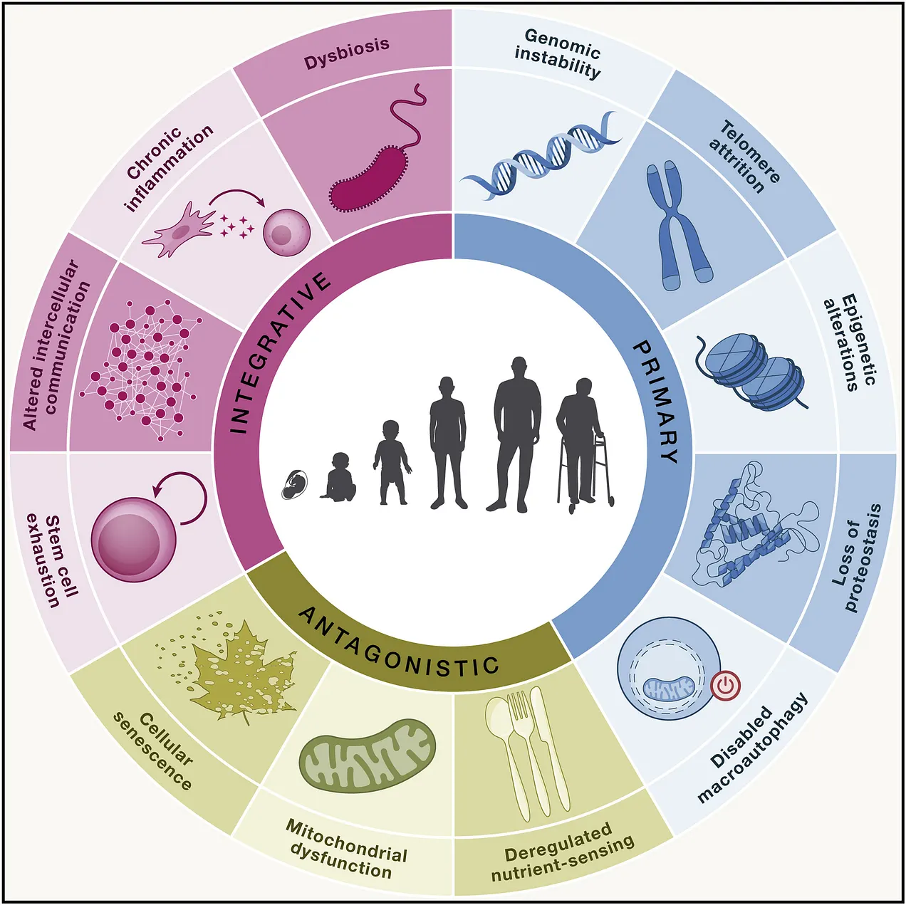

# Gambaran Umum

Penuaan adalah proses bertahap yang memengaruhi struktur dan fungsi tubuh. Perubahannya terjadi pada tingkat molekul, organel, sel, jaringan, organ, hingga sistem tubuh. Kecepatan dan pola penuaan berbeda pada setiap orang; usia kalender saja tidak menggambarkan seluruh kondisi biologis seseorang.

**Gerontologi** mempelajari penuaan secara interdisipliner, termasuk aspek biologis, psikologis, dan sosial. **Biogerontologi** berfokus pada dasar biologis penuaan. Perubahan fisik normal dapat memengaruhi kapasitas sel dan organ, tetapi tidak selalu berarti seseorang pasti mengalami penyakit atau gangguan berat.

## Tiga sisi penuaan

- **Biologis:** perubahan struktur serta fungsi sel, jaringan, dan organ.
- **Psikologis:** perubahan kognisi dan perilaku, seperti kecepatan berpikir, waktu respons, memori, kemampuan belajar, emosi, sikap, dan motivasi.
- **Sosial:** perubahan hubungan dan peran dalam kehidupan, misalnya memasuki masa pensiun, menjadi kakek/nenek, atau kehilangan pasangan. Perubahan hidup ini dapat memengaruhi stres, suasana hati, kebiasaan makan, dan kesehatan.

# Perubahan Fungsi Tubuh Seiring Usia

- **Pendengaran:** kemampuan mendengar nada berfrekuensi tinggi dapat mulai berkurang sejak usia dewasa muda; frekuensi rendah cenderung terdampak lebih lanjut. Pada rentang 30–80 tahun, penurunan pendengaran pada laki-laki berlangsung lebih dari dua kali lebih cepat dibanding perempuan.
- **Mata:** kesulitan memfokuskan benda dekat dapat muncul sejak usia 40-an. Setelah sekitar usia 50 tahun, sensitivitas terhadap silau meningkat, sedangkan kemampuan melihat dalam cahaya redup dan mendeteksi objek bergerak menurun. Ketajaman melihat detail halus dapat berkurang pada usia lanjut.
- **Otak dan saraf:** memori dan waktu reaksi dapat melambat pada sebagian orang lanjut usia. Kecepatan hantaran saraf rata-rata diperkirakan tersisa sekitar 96% pada usia 60 dan 88% pada usia 80 dibandingkan usia 30.
- **Pembuluh darah dan jantung:** dinding arteri menebal dan menjadi lebih kaku. Tekanan darah sistolik rata-rata meningkat seiring usia. Indeks jantung diperkirakan tersisa 82% pada usia 60 dan 70% pada usia 80 dibanding usia 30. Denyut jantung maksimal saat olahraga menurun; curah jantung dapat berkurang sekitar 30–35% pada usia 80.
- **Tulang:** kehilangan mineral tulang dapat melampaui pembentukan tulang mulai sekitar usia 35 tahun. Penurunan dapat berlangsung lebih cepat pada perempuan setelah menopause.
- **Otot:** massa dan kekuatan otot menurun. Konsumsi oksigen saat berolahraga turun sekitar 5–10% per dekade; kekuatan genggam dapat turun bermakna pada usia lanjut. Kehilangan massa otot puncak sekitar 24% antara usia 40 dan 70 tahun.
- **Paru:** kapasitas napas maksimal diperkirakan berkurang sekitar 40% antara usia 20 dan 80. Kapasitas vital dan kekuatan otot pernapasan menurun.
- **Ginjal:** laju filtrasi glomerulus diperkirakan tersisa sekitar 96% pada usia 60 dan 61% pada usia 80 dibanding usia 30. Aliran plasma ginjal dan kapasitas metabolisme basal juga menurun.
- **Hati dan pankreas:** berat hati dan aliran darah ke hati menurun. Metabolisme glukosa dapat menjadi kurang efisien secara bertahap.

> [!NOTE] **Tips menghafal** 🧠
> Perubahan fungsi organ: **mata dan telinga** adalah _indra_ yang makin kurang peka; **jantung dan pembuluh darah** adalah _pompa dan pipa_ yang makin kaku; **otot dan tulang** adalah _alat gerak_ yang makin lemah dan rapuh; **paru-paru** mengurus _udara_ dengan kapasitas yang menurun; sedangkan **ginjal, hati, dan pankreas** menjadi _penyaring dan pengolah_ yang bekerja lebih lambat.

# Gambaran Umum Proses Penuaan Normal

Penuaan dipengaruhi oleh faktor dari dalam tubuh dan faktor dari luar.

- **Faktor intrinsik:** genetik. Pengaruh genetik relatif tetap dan dapat berdampak positif maupun negatif.
- **Faktor ekstrinsik dari gaya hidup:** pola makan, stres, dan olahraga.
- **Faktor ekstrinsik dari lingkungan:** suhu, obat-obatan, trauma, toksin, dan radiasi.

Seiring penuaan, fungsi tubuh dapat menurun, keseimbangan internal (_homeostasis_) lebih sulit dipertahankan, dan kemampuan beradaptasi terhadap rangsangan dari dalam maupun luar tubuh berkurang. Akibatnya, tubuh menjadi lebih rentan terhadap penyakit dan kematian.

# Hallmarks of Aging (Tanda-tanda Penuaan)
### 1. Tanda primer

Perubahan yang memulai atau menimbulkan kerusakan sel:

- **Ketidakstabilan genom:** meningkatnya kerusakan atau kesalahan pada DNA.
- **Pemendekan telomer:** pelindung di ujung kromosom memendek setiap kali sel membelah.
- **Perubahan epigenetik:** perubahan pengaturan aktivitas gen tanpa mengubah urutan DNA.
- **Hilangnya proteostasis:** kemampuan menjaga kualitas dan keseimbangan protein menurun.
- **Gangguan makroautofagi:** proses daur ulang komponen sel yang rusak tidak berjalan optimal.

### 2. Tanda antagonistik

Respons tubuh terhadap kerusakan yang awalnya dapat membantu, tetapi menjadi merugikan jika berlebihan atau berlangsung lama:

- **Pengindraan nutrisi yang tidak teratur:** pengaturan respons sel terhadap ketersediaan nutrisi berubah.
- **Disfungsi mitokondria:** produksi energi dan fungsi mitokondria terganggu.
- **Penuaan seluler (cellular senescence):** sel berhenti membelah, tetapi tetap bertahan dan dapat mengeluarkan sinyal yang memicu peradangan.

### 3. Tanda integratif

Dampak luas yang muncul pada jaringan dan tubuh:

- **Kelelahan sel punca:** kemampuan memperbarui dan memperbaiki jaringan menurun.
- **Perubahan komunikasi antarsel:** sinyal antar sel menjadi tidak seimbang.
- **Peradangan kronis:** peradangan ringan berlangsung terus-menerus.
- **Disbiosis:** keseimbangan mikroorganisme, misalnya di usus, berubah.

🧠 **Tips menghafal:** urutkan dari **kerusakan → respons → dampak tubuh**.  
**Primer** memulai kerusakan; **antagonistik** adalah respons sel yang dapat menjadi masalah; **integratif** adalah efeknya yang meluas ke jaringan dan tubuh.

# Mekanisme Biologis Penuaan

Penuaan melibatkan beberapa proses yang saling memengaruhi:

1. **Pemendekan telomer.** Telomer adalah urutan DNA berulang (**TTAGGG**) pada ujung kromosom yang membantu melindungi materi genetik. Telomer memendek setiap kali sel membelah. Telomerase dapat mempertahankan telomer pada jenis sel tertentu (misalnya sel kanker). Bila perlindungan telomer berkurang, kromosom lebih rentan mengalami kerusakan.
2. **Kerusakan genom dan perubahan epigenetik.** Kerusakan DNA dan perubahan pengaturan ekspresi gen dapat mengganggu fungsi sel.
3. **Stres oksidatif dan disfungsi mitokondria.** Mitokondria menghasilkan energi. Kerusakan mitokondria dapat mengganggu respirasi sel, keseimbangan ion, dan pengaturan kalsium, lalu mendorong penuaan sel atau kematian sel.
4. **Perubahan pengindraan nutrisi dan proteostasis.** Pengaturan respons terhadap nutrisi dan pemeliharaan kualitas protein dapat menurun.
5. **Autofagi yang terganggu.** Autofagi mendaur ulang komponen sel yang rusak. Penurunan proses ini membuat bahan yang tidak berfungsi menumpuk.
6. **Penuaan sel, kelelahan sel punca, dan inflamasi kronis.** Sel yang menua dapat mengeluarkan molekul proinflamasi. Peradangan menetap, berkurangnya kemampuan regenerasi, dan komunikasi antarsel yang berubah dapat memperburuk fungsi jaringan.

Proses tersebut berkontribusi pada berkurangnya kemampuan menjaga keseimbangan internal (homeostasis), memperbaiki kerusakan, dan beradaptasi terhadap stres. Dampaknya dapat berlanjut dari tingkat sel ke jaringan, organ, dan sistem tubuh.

🧠 **Tips menghafal urutan besarnya:** **DNA → energi → bersih-bersih → regenerasi → komunikasi**. Artinya: telomer/genom, mitokondria, autofagi, sel punca, lalu komunikasi dan inflamasi jaringan.

# Perubahan pada Sistem Saraf dan Otak

Proses penuaan otak tidak hanya dipengaruhi oleh zat kimia saraf, melainkan melibatkan **perubahan menyeluruh pada komunikasi antar-saraf, sel pendukung, pelindung serabut saraf, hingga keseimbangan hormon** yang menentukan kecepatan berpikir dan daya ingat seseorang.

## Faktor Neurotrofik

Faktor-faktor neurotrofik (_neurotrophic factors_) adalah protein alami yang berperan sebagai "nutrisi" untuk menjaga pertumbuhan, koneksi, dan ketahanan sel saraf**, yang produksi maupun efektivitasnya cenderung menurun saat menua.

 - **BDNF (_Brain-Derived Neurotrophic Factor_).** Faktor neurotrofik paling melimpah di otak yang berperan krusial dalam plastisitas sinaptik, pembentukan memori jangka panjang, dan pertumbuhan sel saraf baru di hipokampus. Penurunan kadar BDNF saat menua memicu penyusutan volume pusat memori, melemahnya kemampuan belajar, serta meningkatkan kerentanan terhadap depresi dan demensia.
 - **NGF (_Nerve Growth Factor_).** Berfungsi memelihara kelangsungan hidup neuron penghasil asetilkolin di otak depan basal. Gangguan sinyal NGF seiring bertambahnya usia menyebabkan sel-sel saraf ini menyusut, yang berkaitan langsung dengan penurunan daya ingat dan perkembangan penyakit Alzheimer.
 - **NT (_Neurotrophins_, seperti NT-3 dan NT-4/5).** Mendukung pertumbuhan cabang akson dan dendrit serta memperkuat komunikasi antar-sel saraf. Berkurangnya _neurotrophin_ pada lansia membuat otak lebih lambat beradaptasi dalam membentuk sirkuit saraf baru maupun pulih dari kerusakan ringan.
- **FGF (_Fibroblast Growth Factor_, terutama FGF-2).** Merangsang pembentukan sel saraf baru (neurogenesis) dan menjaga kesehatan jaringan pembuluh darah otak. Penurunan FGF seiring usia memperlambat regenerasi sel otak dan mengurangi dukungan suplai nutrisi bagi jaringan saraf yang menua.
- **GDNF (_Glial Cell Line-Derived Neurotrophic Factor_).** Bertindak sebagai pelindung utama bagi neuron penghasil dopamin di area pengatur gerak otak. Melemahnya dukungan GDNF saat menua membuat neuron dopamin lebih rentan rusak, yang berhubungan erat dengan melambatnya gerakan motorik dan risiko penyakit Parkinson.
- **CNTF (_Ciliary Neurotrophic Factor_).** Menjaga daya tahan neuron motorik serta membantu sel pendukung saraf (sel glia) merespons cedera atau stres jaringan. Penurunan aktivitas CNTF pada usia lanjut turut memengaruhi melemahnya kendali saraf ke otot dan berkurangnya perlindungan sel saraf terhadap peradangan.

Secara keseluruhan, **BDNF dan NGF** paling menentukan ketahanan fungsi memori dan kognitif saat menua, sementara **GDNF dan CNTF** lebih banyak menjaga fungsi gerak motorik dan daya tahan sel saraf.

## Neurotransmitter

- **Dopamin.** Berperan sebagai pengatur gerak, motivasi, dan fokus. Saat menua, berkurangnya sinyal dan reseptor dopamin membuat gerakan melambat, konsentrasi mudah terpecah, serta menurunkan dorongan semangat.
- **Asetilkolin.** Merupakan kunci utama dalam pembentukan memori dan proses belajar. Melemahnya jalur asetilkolin di pusat memori otak menyebabkan lansia lebih mudah lupa terhadap hal-hal baru dan kesulitan mengolah informasi kompleks.
- **Glutamat.** Bertindak sebagai neurotransmitter pemicu utama yang menjaga koneksi antar-sel saraf tetap aktif. Perubahan keseimbangan glutamat seiring usia memengaruhi plastisitas otak, sehingga kemampuan beradaptasi dan mempelajari keterampilan baru menjadi lebih lambat.

## Sel Glia dan Mielin

- **Sel glia dan peradangan.** Sel glia (seperti mikroglia dan astrosit) bertugas membersihkan sisa metabolisme serta melindungi sel saraf. Pada usia lanjut, sel ini cenderung lebih sensitif dan memicu peradangan ringan kronis (_inflammaging_) yang dapat mengganggu kesehatan lingkungan otak.
- **Mielin.** Merupakan selubung lemak yang membungkus serabut saraf agar sinyal listrik mengalir cepat. Seiring bertambahnya usia, lapisan mielin mulai menipis dan sulit diperbaiki, sehingga kecepatan pemrosesan informasi dan refleks otak ikut melambat.

## Hormon Steroid

Hormon seperti estrogen, progesteron, dan kortisol turut mengatur perlindungan sel saraf serta respons stres. Penurunan hormon reproduksi setelah menopause maupun fluktuasi hormon stres kortisol dapat memengaruhi kestabilan emosi, kualitas tidur, dan ketajaman kognitif.

Secara ringkas, **penurunan efisiensi sinyal saraf (neurotransmitter dan mielin)** membuat otak bekerja lebih lambat, sementara **perubahan sel glia dan hormon** memengaruhi ketahanan otak terhadap stres dan peradangan saat menua.

🧠 **Tips menghafal:** bayangkan neuron sebagai jaringan komunikasi: **BDNF merawat kabel**, **dopamin dan asetilkolin mengatur pesan**, **sel glia menjaga lingkungan**, **mielin mempercepat hantaran**, dan **hormon menyetel kondisi jaringan**.

# Perubahan Saluran Cerna dan Pengaturan Asupan

- **Penurunan fungsi indra (_Senses_).** Kemampuan mengecap (↓ _taste_) dan mencium (↓ _smell_) melemah seiring usia. Makanan terasa kurang menarik sehingga lansia cenderung membatasi variasi makanannya (↓ _Dietary Variety_).
- **Pengosongan lambung melambat (_Delayed Gastric Emptying_).** Peningkatan hormon kenyang kolesistokinin (↑ CCK) dan menurunnya kerja saraf otonom membuat pergerakan lambung melambat. Akibatnya, makanan bertahan lebih lama di lambung dan perut terasa penuh lebih cepat.
- **Perubahan zat di sirkulasi darah (_Circulation_).** Kadar glukosa, asam lemak bebas (_FFA_), insulin, dan glukagon dalam darah cenderung lebih tinggi setelah makan, yang secara alami mengirimkan sinyal kenyang ke seluruh tubuh.
- **Gangguan sinyal pemicu lapar di otak (_Opioids & NPY_).** Seluruh perubahan dari indra, lambung, dan aliran darah tersebut menghambat kerja _opioid_ serta _neuropeptide Y_ (NPY)—dua senyawa otak yang seharusnya merangsang selera makan.

Secara keseluruhan, kombinasi faktor-faktor ini membuat otak **menekan rasa lapar (↓ _Hunger_) dan mempercepat munculnya rasa kenyang (↑ _Satiation_)**, sehingga asupan energi lansia sering kali berkurang secara alami.

# Perubahan Kardiovaskular

**Pada pembuluh darah besar, diameter, ketebalan dinding, dan kekakuan dapat meningkat**. Lapisan dalam pembuluh mengalami perubahan pada sel otot polos dan matriks. Kolagen serta ikatan silang kolagen meningkat, sedangkan elastin dapat mengalami fragmentasi atau kalsifikasi. Fungsi endotel dan kemampuan pembuluh untuk melebar atau menyempit dapat menurun.

Perubahan ini meningkatkan kekakuan arteri dan mengubah aliran darah. Gelombang tekanan yang dipantulkan dapat kembali lebih cepat ke jantung pada arteri yang kaku. Tekanan sistolik cenderung meningkat seiring usia, meski hasil aktual dipengaruhi pula oleh kesehatan dan faktor hidup.

# Perubahan Paru

Perubahan paru terkait usia meliputi:

- Reaktivitas saluran napas meningkat.
- Dinding dada menjadi lebih kaku dan kurang lentur.
- Kapasitas difusi oksigen menurun.
- Volume residu dan kapasitas residu fungsional meningkat.
- Kapasitas vital, aliran ekspirasi maksimal, serta kekuatan dan daya tahan otot napas menurun.
- Jaringan paru kehilangan sebagian daya recoil (kemampuan kembali menguncup setelah mengembang).
- Kapasitas total paru relatif stabil.
- Dorongan atau respons pernapasan dapat berkurang.
- Ketidakcocokan ventilasi-perfusi dapat menurunkan oksigenasi.

**Singkatan:** FRC = kapasitas residu fungsional; RV = volume residu; VC = kapasitas vital; TLC = kapasitas total paru; FEV₁ = volume ekspirasi paksa dalam satu detik; FVC = kapasitas vital paksa; FEF = aliran ekspirasi paksa; V/Q = ventilasi/perfusi.

# Perubahan Muskuloskeletal

## Otot

Massa otot puncak berkurang seiring usia dan kapasitas regenerasi serat otot menurun. Peradangan menetap dan perubahan sinyal dari otot (miokin), jaringan lemak, serta sel imun dapat mengganggu pemeliharaan otot. Dampaknya dapat berupa berkurangnya kekuatan, daya tahan, dan kemampuan melakukan aktivitas.

## Tulang

Tulang terus mengalami remodeling: osteoklas menyerap tulang lama atau rusak, lalu osteoblas membentuk tulang baru. Retakan mikro dapat memicu sinyal dari osteosit dan sel pelapis tulang, menarik sel yang membantu proses remodeling. Osteoklas membersihkan area tersebut dan osteoblas mengisi kembali dengan tulang baru. Jika keseimbangan pembentukan dan resorpsi terganggu, massa serta kualitas tulang dapat turun dan risiko patah meningkat.

🧠 **Tips menghafal remodeling tulang:** **Osteoklas mengikis, osteoblas membangun**. Akhiran “-klas” = mengikis; “-blas” = membentuk.

# Perubahan Hormon dan Reproduksi

Fungsi endokrin berubah dengan usia. Toleransi glukosa dapat menurun sehingga risiko hiperglikemia dan diabetes meningkat. Gangguan fungsi tiroid dapat berkaitan dengan keadaan hipo- atau hipertiroid. Perubahan metabolisme vitamin D dapat memengaruhi mineralisasi tulang dan risiko fraktur.

Kadar hormon seks dan sintesisnya menurun. Pada laki-laki, kadar testosteron total maupun bebas berkurang secara bertahap. Perubahan hormon berkaitan dengan perubahan komposisi tubuh, penurunan kepadatan mineral tulang, sarkopenia, frailty, perubahan kualitas hidup dan kognisi, serta risiko kardiovaskular.

Pada perempuan, usia ibu yang lebih tinggi berkaitan dengan penurunan kesuburan dan meningkatnya risiko keguguran serta kelainan kromosom pada kelahiran hidup. Terdapat kenaikan risiko sindrom Down dan kelainan kromosom seiring usia ibu.

# Perubahan Sistem Imun

Penuaan mengubah jumlah maupun fungsi beberapa jenis sel imun:

- **Neutrofil:** produksi spesies oksigen reaktif dan apoptosis berubah.
- **Sel dendritik:** kemampuan merangsang sel B, jumlah sebagian subtipe, penangkapan antigen, migrasi, dan aktivasi sel T dapat menurun.
- **Makrofag:** produksi spesies oksigen reaktif, mediator nitrogen, prostaglandin, dan sitokin berubah.
- **Sel NK dan NKT:** jumlah sel dapat berubah; aktivitas pembunuhan sel tumor dapat menurun.
- **Sel B:** produksi antibodi berafinitas tinggi dan keragaman respons antibodi dapat berkurang.
- **Sel T:** keragaman reseptor sel T dapat menurun. Pada sel T CD8+, produksi granzyme B dan IFN-γ dapat terganggu; ekspresi CD28 juga dapat berkurang.

Secara umum, respons imun yang menua dapat menjadi kurang efektif dalam mengenali dan menangani ancaman, sementara peradangan kronis dapat meningkat.

🧠 **Tips menghafal imun:** bayangkan alur **kenali → panggil → serang → ingat**. Sel dendritik membantu mengenali dan mengaktifkan; sel T dan NK menyerang; sel B membuat antibodi dan membantu kekebalan spesifik.

# Rangkuman Akhir 🌟

- Penuaan mencakup perubahan **biologis, psikologis, dan sosial**, dengan pola yang berbeda pada tiap orang.
- Perubahan melibatkan seluruh tingkat tubuh: molekul, sel, jaringan, organ, dan sistem.
- Pemendekan telomer, kerusakan genom, stres oksidatif, gangguan mitokondria dan autofagi, inflamasi kronis, serta berkurangnya regenerasi berkontribusi pada penurunan homeostasis.
- Seiring usia, fungsi indra, jantung-pembuluh darah, paru, otot, tulang, ginjal, saraf, hormon, pencernaan, dan imun dapat berubah.
- Remodeling tulang adalah keseimbangan antara resorpsi oleh osteoklas dan pembentukan oleh osteoblas.
- Perubahan fisiologis meningkatkan kerentanan, tetapi tidak otomatis berarti penyakit pasti terjadi. Kondisi tiap individu tetap bervariasi.

**Kunci hafalan super singkat:** penuaan memengaruhi **B-P-S** (badan, pikiran, sosial); mekanismenya bergerak dari **DNA–energi–daur ulang–regenerasi–komunikasi**; pada tulang, **klas mengikis, blas membangun**. ✨
